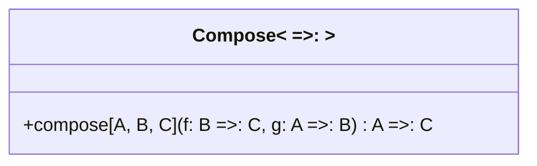

# Compose

`Compose` is a type class that provides the ability to compose functions or morphisms.
It is part of a more general abstraction known as [**Category**](category.md),
and allows combining two functions into one, where the output of the first function becomes the input of the second.

The main method of the `Compose` type class is `compose`, which performs composition of two functions.
In mathematical notation, this can be written as: \\((f \circ g)(x) = f(g(x))\\).

## Formal definition

Let \\(C\\) be a category where:

- \\(\text{Obj}(C)\\) is a set of objects (e.g., types in Scala).
- \\(\text{Mor}(C)\\) is a set of morphisms (e.g., functions between types).

The `Compose` type class is formally defined as follows:

- **Objects**: Types \\(A, B, C, \dots\\), which are objects of the category.
- **Morphisms**: Functions (or arrows) \\(f: A \to B\\), \\(g: B \to C\\), where:
    - \\(A, B, C\\) are types.
    - \\(f\\) and \\(g\\) are functions that can be composed.
- **Composition operation**: For any two morphisms \\(f: A \to B\\) and \\(g: B \to C\\)
  there exists a morphism \\(g \circ f: A \to C\\) which is the composition of \\(f\\) and \\(g\\).

The `Compose` type class provides the `compose` method which implements this composition operation:

\\(\text{compose}(g, f) = g \circ f\\)

where:

- \\(f: A \to B\\) — the first function,
- \\(g: B \to C\\) — the second function,
- \\(g \circ f: A \to C\\) — the resulting function.

### `Compose` laws

The `Compose` type class must satisfy the following law:

**Composition associativity**: \\(h \circ (g \circ f) = (h \circ g) \circ f\\)

This means the order of applying composition does not matter.

#### What is composition?

Given an arrow **f** from **a** to **b** and an arrow **g** from **b** to **c**,
their _composition_ is an arrow going directly from **a** to **c**.
In other words, if one has two arrows where the target of one matches the source of the other,
one can always compose them to obtain a third arrow.
Denoted as: \\(h = g \circ f\\)

#### What is associativity?

Suppose \\(j = i \circ f\\).
Suppose we managed to decompose i into \\(h \circ g\\).
Then \\(j = (h \circ g) \circ f\\.
It would be desirable for this decomposition to be the same as \\(j = h \circ (g \circ f)\\.
At the same time, there should be a way to state
that j was decomposed into three simpler functions \\(j = h \circ g \circ f\\)
and there is no need to track which decomposition was first.
This property is called _associativity_ of composition.

## Scala code definition

In Scala, the `Compose` type class can be defined as follows:

```dotty
trait Compose[=>:[_, _]]:
  /** Associative `=>:` binary operator. */
  def compose[A, B, C](f: B =>: C, g: A =>: B): A =>: C
```

Where:

- `=>:[_, _]` is a type representing a morphism (e.g., a function `A => B`).
- The `compose` method takes two morphisms \\(f: B \to C\\) and \\(g: A \to B\\) and returns their composition \\(f \circ g: A \to C\\.

### Relationship with other type classes

The `compose` function allows implementing [Semigroup](../monoid/semigroup.md)
and [Plus](../monad/plus.md) in terms of function combination.

```dotty
trait Compose[=>:[_, _]]:
  self =>

  /** Associative `=>:` binary operator. */
  def compose[A, B, C](f: B =>: C, g: A =>: B): A =>: C

  protected[arrow] trait ComposePlus extends Plus[[A] =>> A =>: A]:
    def plus[A](f1: A =>: A, f2: => A =>: A): A =>: A = self.compose(f1, f2)

  protected[arrow] trait ComposeSemigroup[A] extends Semigroup[A =>: A]:
    def combine(f1: A =>: A, f2: A =>: A): A =>: A = self.compose(f1, f2)

  def plus: Plus[[A] =>> A =>: A] = new ComposePlus {}

  def semigroup[A]: Semigroup[A =>: A] = new ComposeSemigroup[A] {}
```

## Exercises

### Exercise 4.1.1: Implement Compose for Function1 (regular functions)

> [Exercise repository with instructions][sample]

Implement the `Compose` instance for `Function1`, using built-in function composition.

```dotty
given Compose[Function1] with
  override def compose[A, B, C](f: B => C, g: A => B): A => C = ???
```

**Examples:**

```dotty
import Compose.given

// Basic functions
val add1: Int => Int = x => x + 1
val mul2: Int => Int = x => x * 2
val toString: Int => String = _.toString
val length: String => Int = _.length

// Composition of add1 and mul2
val composed1 = compose(mul2, add1)  // first add1, then mul2
composed1(5)  // (5 + 1) * 2 = 12

// Composition of toString and length
val composed2 = compose(length, toString)  // first toString, then length
composed2(42)  // length of string "42" = 2
```

@:note(🔍 Show solution)

The implementation is trivial: Scala already has a built-in `andThen` method for functions,
which does exactly what is needed — first applies `g`, then `f`.
Note the order: `compose(f, g)` must return `g andThen f`,
i.e., a function that first executes `g`, then `f`.
This is the standard mathematical definition of composition: (f ∘ g)(x) = f(g(x)).
Alternatively, one can use `f compose g` (though in Scala `compose` is defined with reversed argument order).

```dotty
given Compose[Function1] with
  override def compose[A, B, C](f: B => C, g: A => B): A => C = g andThen f
```

@:@

### Exercise 4.1.2: Implement Compose instance for Kleisli based on Bind

In this exercise, you will implement a `Compose` type class instance for the `Kleisli[F, A, B]` type,
using the ability to bind computations via `Bind[F]`.

```dotty
given kleisliCompose[F[_]: Bind]: Compose[[A, B] =>> Kleisli[F, A, B]] with
  override def compose[A, B, C](
      f: Kleisli[F, B, C],
      g: Kleisli[F, A, B]
  ): Kleisli[F, A, C] =
    ???
```

@:note(🔍 Show solution)

The solution uses `Bind[F]` to get access to `flatMap`.
For arrows `f` and `g`, composition creates a new arrow
that first applies `g` to input value `a`, getting `F[B]`.
Then via `flatMap` it extracts `B` and applies `f.run(b)`, returning `F[C]`.
This is standard monadic composition, ensuring sequential execution of effects.

```dotty
given kleisliCompose[F[_]: Bind]: Compose[[A, B] =>> Kleisli[F, A, B]] with
  override def compose[A, B, C](
      f: Kleisli[F, B, C],
      g: Kleisli[F, A, B]
  ): Kleisli[F, A, C] =
    Kleisli[F, A, C](a => g.run(a).flatMap(b => f.run(b)))
```

@:@

### Exercise 4.1.3: Implement Compose instance for Cokleisli based on CoBind

In this exercise, you will implement a `Compose` type class instance for the `Cokleisli[F, A, B]` type,
using the ability to extend context via `CoBind[F]`.

```dotty
given cokleisliCompose[F[_]: CoBind]: Compose[[A, B] =>> Cokleisli[F, A, B]] with
  override def compose[A, B, C](
      f: Cokleisli[F, B, C],
      g: Cokleisli[F, A, B]
  ): Cokleisli[F, A, C] =
    ???
```

@:note(🔍 Show solution)

The solution uses `CoBind[F]` to get access to `cobind` (also known as `coflatMap`).
For arrows `f` and `g`, composition creates a new arrow
that first applies `cobind` with `g.run` to the input context `F[A]`, extending it to `F[B]`.
Then it applies `f.run` to the obtained `F[B]` to get result `C`.
This is comonadic composition, where each subsequent computation has access to the entire previous context.

```dotty
given cokleisliCompose[F[_]: CoBind]: Compose[[A, B] =>> Cokleisli[F, A, B]] with
  override def compose[A, B, C](
      f: Cokleisli[F, B, C],
      g: Cokleisli[F, A, B]
  ): Cokleisli[F, A, C] =
    Cokleisli[F, A, C](fa => f.run(fa.cobind(g.run)))
```

@:@

## Diagram



## Library Implementations

### Cats Implementation

```dotty
import cats.*, cats.data.*, cats.syntax.all.*

lazy val f = (_:Int) + 1
lazy val g = (_:Int) * 100

(f >>> g)(2)
// res0: Int = 300

(f <<< g)(2)
// res1: Int = 201
```

### ScalaZ Implementation

```dotty
import scalaz.*
import Scalaz.*

val f1 = (_:Int) + 1
val f2 = (_:Int) * 100

(f1 >>> f2)(2)   // 300
(f1 <<< f2)(2)   // 201
```

---

**References:**

- [Exercise repository link][sample]
- [Cats](https://typelevel.org/cats/typeclasses/arrow.html)
- [Herding Cats](http://eed3si9n.com/herding-cats/Arrow.html)
- [Learning Scalaz](http://eed3si9n.com/learning-scalaz/Arrow.html)
- [Scalaz API](https://javadoc.io/doc/org.scalaz/scalaz-core_3/7.3.6/scalaz/Compose.html)

[sample]: https://gitverse.ru/scalabook/typeclasses
