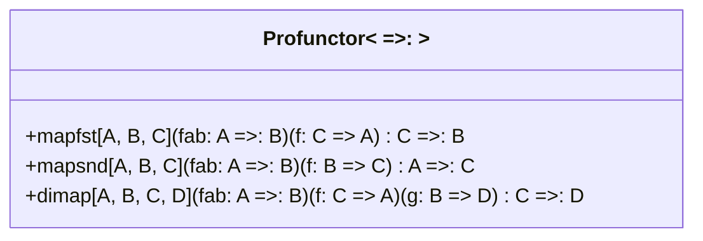

# Profunctor

`Profunctor` is a type class in functional programming
that generalizes the notion of a **[bifunctor](../bifunctor/bifunctor.md)** (a functor of two arguments) to the case
where the first argument is **contravariant** and the second is **covariant**.
This means that `Profunctor` can transform input data (first argument)
and output data (second argument) independently of each other.

Main operations provided by `Profunctor`:

- **`dimap`**: Transforms input and output data using two functions.
- **`lmap`** (or **`mapfst`**): Transforms only input data.
- **`rmap`** (or **`mapsnd`**): Transforms only output data.

**Brief examples**

- **Optics (Lens)**:
    - There is a Lens that works with field `age` in structure `Person`.
    - With `Profunctor` you can transform the Lens so that it works with field `birthYear`, computing age on the fly.

## Formal definition

Let \\(P\\) be a profunctor, where:

- \\(P: C^\text{op} \times D \to \text{Set}\\) is a functor from the product of categories \\(C^\text{op}\\
  (opposite category of \\(C\\)) and \\(D\\) into the category of sets.
- \\(C^\text{op}\\) is a category where morphisms are reversed (contravariance).
- \\(D\\) is a category where morphisms are in the standard direction (covariance).

The `Profunctor` type class is formally defined as follows:

- **Objects**: Types \\(A, B, C, D, \dots\\), which are objects of categories \\(C\\) and \\(D\\.
- **Morphisms**: Functions (or arrows) \\(f: A \to B\\) and \\(g: C \to D\\), where:
    - \\(f\\) — contravariant morphism (transforms input data).
    - \\(g\\) — covariant morphism (transforms output data).
- **`dimap` operation**: For any two morphisms \\(f: A \to B\\) and \\(g: C \to D\\) there exists a morphism:
  \\(\text{dimap}(f, g): P\[B, C\] \to P\[A, D\]\\),
  which transforms profunctor \\(P\[B, C\]\\) into profunctor \\(P\[A, D\]\\).

### `Profunctor` laws

The `Profunctor` type class must satisfy the following laws:

- **Identity**:
  \\(\text{dimap}(\text{id}\_A, \text{id}\_B) = \text{id}_{P\[A, B\]}\\).
  This means that applying `dimap` to identity morphisms returns the original profunctor.
- **Composition**:
  \\(\text{dimap}(f \circ g, h \circ k) = \text{dimap}(g, h) \circ \text{dimap}(f, k)\\).
  This means that `dimap` preserves composition of morphisms.

## Scala code definition

```dotty
trait Profunctor[=>:[_, _]]:
  /** Contramap on `A`. */
  def mapfst[A, B, C](fab: A =>: B)(f: C => A): C =>: B

  /** Functor map on `B`. */
  def mapsnd[A, B, C](fab: A =>: B)(f: B => C): A =>: C

  /** Functor map on `A` and `B`. */
  def dimap[A, B, C, D](fab: A =>: B)(f: C => A)(g: B => D): C =>: D =
    mapsnd(mapfst(fab)(f))(g)
```

Where:

- `=>:[_, _]` is the type representing a profunctor (e.g., function `A => B`).
- The `dimap` method takes a profunctor \\(P\[A, B\]\\) and two functions:
  - \\(f: C \to A\\) — contravariant transformation of input data.
  - \\(g: B \to D\\) — covariant transformation of output data.
- The result is a new profunctor \\(P\[C, D\]\\).

### Relationship with other type classes

`Profunctor` allows implementing [InvariantFunctor](../monad/invariant-functor.md),
[Functor](../monad/functor.md)
and [ContravariantFunctor](../monad/contravariant-functor.md).


```dotty
trait Profunctor[=>:[_, _]]:
  ...

  protected[arrow] trait SndCovariant[C] extends Functor[[X] =>> =>:[C, X]]:
    extension [A](fa: C =>: A) override def map[B](f: A => B): C =>: B = mapsnd(fa)(f)

  def invariantFunctor: InvariantFunctor[[X] =>> X =>: X] =
    new InvariantFunctor[[X] =>> X =>: X]:
      extension [A](fa: A =>: A)
        override def imap[B](f: A => B, g: B => A): B =>: B = mapsnd(mapfst(fa)(g))(f)

  def covariantInstance[C]: Functor[[X] =>> =>:[C, X]] =
    new SndCovariant[C] {}

  def contravariantInstance[C]: ContravariantFunctor[[X] =>> =>:[X, C]] =
    new ContravariantFunctor[[X] =>> =>:[X, C]]:
      override def cmap[A, B](fa: B =>: C)(f: A => B): A =>: C = mapfst(fa)(f)
```

## Exercises

### Exercise 4.4.1: Implement Profunctor for Function1 (regular functions)

> [Exercise repository with instructions][sample]

Implement the `Profunctor` instance for `Function1`, defining:
- `mapfst` — input transformation via left composition
- `mapsnd` — output transformation via right composition

```dotty
given Profunctor[Function1] with
  override def mapfst[A, B, C](fab: A => B)(f: C => A): C => B = ???
  override def mapsnd[A, B, C](fab: A => B)(f: B => C): A => C = ???
```

**Examples:**

```dotty
import Profunctor.given

// Basic functions
val len: String => Int = _.length        // String -> Int
val inc: Int => Int = _ + 1              // Int -> Int
val toString: Int => String = _.toString // Int -> String
val parseInt: String => Int = _.toInt    // String -> Int
val mul2: Int => Int = _ * 2             // Int -> Int

// mapfst — input transformation (contravariant)
// len takes String, want to get Int => Int function
val lenOfStringFromInt = mapfst(len)(toString)
lenOfStringFromInt(42)  // len(toString(42)) = len("42") = 2

val incAfterParse = mapfst(inc)(parseInt)
incAfterParse("10")  // inc(parseInt("10")) = inc(10) = 11

// mapsnd — output transformation (covariant)
// inc returns Int, want to get String
val incAndToString = mapsnd(inc)(toString)
incAndToString(5)  // toString(inc(5)) = toString(6) = "6"

val lenAndMul2 = mapsnd(len)(mul2)
lenAndMul2("hello")  // mul2(len("hello")) = mul2(5) = 10
```

@:note(🔍 Show solution)

The `mapfst` implementation uses composition `f andThen fab`:
first `f: C => A` is applied, transforming input from `C` to `A`, then the original function `fab: A => B`.
This is a contravariant mapping because the direction of the input type's arrow is flipped.
The `mapsnd` implementation uses composition `fab andThen f`:
first the original function `fab: A => B` is applied, then `f: B => C` transforms the output.
This is a covariant mapping because the direction of the output type's arrow is preserved.
The `dimap` method combines both operations and is already implemented in the `Profunctor` trait via `mapfst` and `mapsnd`.

```dotty
given Profunctor[Function1] with
  override def mapfst[A, B, C](fab: A => B)(f: C => A): C => B = f andThen fab

  override def mapsnd[A, B, C](fab: A => B)(f: B => C): A => C = fab andThen f
```

@:@

### Exercise 4.4.2: Implement Profunctor instance for Kleisli based on Functor

In this exercise, you will implement a `Profunctor` type class instance for type `Kleisli[F, A, B]`,
using the mapping capability of `Functor[F]`.

```dotty
given kleisliProfunctor[F[_]: Functor]
    : Profunctor[[A, B] =>> Kleisli[F, A, B]]
with
  override def mapfst[A, B, C](fab: Kleisli[F, A, B])(f: C => A)
      : Kleisli[F, C, B] =
    ???

  override def mapsnd[A, B, C](fab: Kleisli[F, A, B])(f: B => C)
      : Kleisli[F, A, C] =
    ???
```

@:note(🔍 Show solution)

The solution uses `Functor[F]` to get access to `map`, which allows transforming values within context `F`.
For `mapfst`, a new arrow is created that first applies function `f: C => A` to input value `c`,
then passes the result to the original arrow `fab`.
For `mapsnd`, a new arrow is created that applies the original arrow `fab` to value `a`,
getting `F[B]`, and then uses `map` to transform the result with function `f: B => C`.

```dotty
given kleisliProfunctor[F[_]: Functor]
    : Profunctor[[A, B] =>> Kleisli[F, A, B]]
with
  override def mapfst[A, B, C](fab: Kleisli[F, A, B])(f: C => A)
      : Kleisli[F, C, B] =
    Kleisli[F, C, B](c => fab.run(f(c)))

  override def mapsnd[A, B, C](fab: Kleisli[F, A, B])(f: B => C)
      : Kleisli[F, A, C] =
    Kleisli[F, A, C](a => fab.run(a).map(f))
```

@:@

### Exercise 4.4.3: Implement Profunctor instance for Cokleisli based on Functor

In this exercise, you will implement a `Profunctor` type class instance for type `Cokleisli[F, A, B]`,
using the mapping capability of `Functor[F]`.

```dotty
given cokleisliProfunctor[F[_]: Functor]
    : Profunctor[[A, B] =>> Cokleisli[F, A, B]] with
  override def mapfst[A, B, C](fab: Cokleisli[F, A, B])(f: C => A)
      : Cokleisli[F, C, B] =
    ???

  override def mapsnd[A, B, C](fab: Cokleisli[F, A, B])(f: B => C)
      : Cokleisli[F, A, C] =
    ???
```

@:note(🔍 Show solution)

The solution uses `Functor[F]` to get access to `map`, which allows transforming values within context `F`.
For `mapfst`, a new arrow is created that first applies `map(f)` to input context `F[C]`, transforming it into `F[A]`,
then passes the result to the original arrow `fab`.
For `mapsnd`, a new arrow is created that applies original arrow `fab` to context `F[A]`,
getting `B`, and then applies function `f: B => C` to the result.

```dotty
given cokleisliProfunctor[F[_]: Functor]
    : Profunctor[[A, B] =>> Cokleisli[F, A, B]] with
  override def mapfst[A, B, C](fab: Cokleisli[F, A, B])(f: C => A)
      : Cokleisli[F, C, B] =
    Cokleisli[F, C, B](fc => fab.run(fc.map(f)))

  override def mapsnd[A, B, C](fab: Cokleisli[F, A, B])(f: B => C)
      : Cokleisli[F, A, C] =
    Cokleisli[F, A, C](fa => f(fab.run(fa)))
```

@:@

## Diagram



## Library Implementations

### ScalaZ Implementation

```dotty
import scalaz.*
import Scalaz.*

// ... All parent operations
```

---

**References:**

- [Exercise repository link][sample]
- [Cats](https://typelevel.org/cats/typeclasses/arrow.html)
- [Learning Scalaz](http://eed3si9n.com/learning-scalaz/Arrow.html)
- [Scalaz API](https://javadoc.io/doc/org.scalaz/scalaz-core_3/7.3.6/scalaz/Profunctor.html)
- The Dao of Functional Programming - Bartosz Milewski:
    - [The Dao of Functional Programming, Chapter 6.2](https://henrychern.wordpress.com/2022/09/23/milewski-%d0%b4%d0%b0%d0%be-%d1%84%d1%83%d0%bd%d0%ba%d1%86%d0%b8%d0%be%d0%bd%d0%b0%d0%bb%d1%8c%d0%bd%d0%be%d0%b3%d0%be-%d0%bf%d1%80%d0%be%d0%b3%d1%80%d0%b0%d0%bc%d0%bc%d0%b8%d1%80%d0%be%d0%b2%d0%b0/)
    - [The Dao of Functional Programming, Chapter 6.2](https://github.com/BartoszMilewski/Publications/blob/master/TheDaoOfFP/DaoFP.pdf)

[sample]: https://gitverse.ru/scalabook/typeclasses
