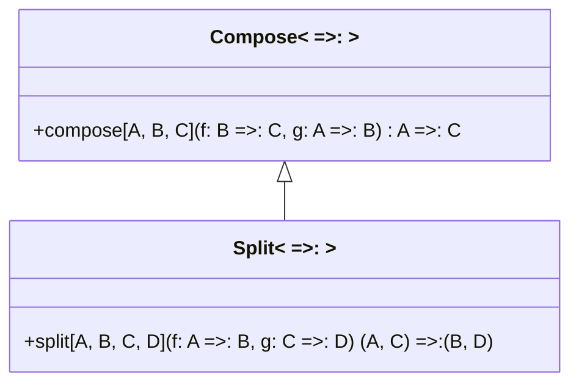

# Split

`Split` is a type class in Scala that provides the ability for
**parallel [composition](compose.md)** of two morphisms (functions or computations).
It allows combining two morphisms so that they work independently on different parts of input data.
This is especially useful when you need to process pairs of values or perform parallel computations.

The main operation provided by `Split` is `***` (or `split`), which takes two morphisms:

- \\(f: A \to B\\)
- \\(g: C \to D\\)

and returns a new morphism:

- \\(f \, \*\*\* \, g: (A, C) \to (B, D)\\)

This means input data \\((A, C)\\) is split into two parts,
each of which is processed independently, and the results are combined into a pair \\((B, D)\\.

**Brief examples**

- **Processing pairs of values**:
    - There are two functions: `f: Int => Boolean` and `g: String => Double`.
    - With `Split` you can create a function that takes a pair `(Int, String)` and returns a pair `(Boolean, Double)`.
- **Parallel data processing**:
    - There are two data streams: one contains numbers, the other strings.
    - With `Split` you can create a pipeline where numbers are filtered and strings are transformed.
- **Working with tuples**:
    - There is a tuple `(Int, String)` and two functions: `f: Int => Boolean` and `g: String => Double`.
    - With `Split` you can transform the tuple into `(Boolean, Double)`.
- **Reactive systems**:
    - There are two event streams: one contains mouse clicks, the other key presses.
    - With `Split` you can create a handler that independently processes each stream.
- **Testing**:
    - There is a request and an API response that need to be checked.
    - With `Split` you can create a test where the request is checked by one function and the response by another.

## Formal definition

Let \\(C\\) be a category where:

- \\(\text{Obj}(C)\\) is a set of objects (e.g., types in Scala).
- \\(\text{Mor}(C)\\) is a set of morphisms (e.g., functions between types).

The `Split` type class is formally defined as follows:

- **Objects**: Types \\(A, B, C, D, \dots\\), which are objects of the category.
- **Morphisms**: Functions (or arrows) \\(f: A \to B\\) and \\(g: C \to D\\), where:
    - \\(A, B, C, D\\) are types.
    - \\(f\\) and \\(g\\) are functions that can be composed in parallel.
- **`split` operation**: For any two morphisms \\(f: A \to B\\) and \\(g: C \to D\\) there exists a morphism:
  \\(f \, \*\*\* \, g: (A, C) \to (B, D)\\) which applies \\(f\\) to the first element of the pair and \\(g\\) to the second.

### `Split` laws

The `Split` type class must satisfy the following laws:

- **Associativity**:
  \\((f \, \*\*\* \, g) \, \*\*\* \, h = f \, \*\*\* \, (g \, \*\*\* \, h)\\).
  This means the order of applying parallel composition does not matter.
- **Identity morphism**:
  \\(\text{id}\_A \, \*\*\* \, \text{id}\_B = \text{id}\_{(A, B)}\\),
  where \\(\text{id}\_A\\) and \\(\text{id}\_B\\) are identity morphisms for objects \\(A\\) and \\(B\\.
- **Compatibility with composition**:
  \\((f\_1 \, \*\*\* \, g\_1) \circ (f\_2 \, \*\*\* \, g\_2) = (f\_1 \circ f\_2) \, \*\*\* \, (g\_1 \circ g\_2)\\.
  This means parallel composition is compatible with standard morphism composition.

## Scala code definition

```dotty
trait Split[=>:[_, _]] extends Compose[=>:]:
  def split[A, B, C, D](f: A =>: B, g: C =>: D): (A, C) =>: (B, D)
```

Where:

- `=>:[_, _]` is a type representing a morphism (e.g., function `A => B`).
- The `split` method takes two morphisms \\(f: A \to B\\) and \\(g: C \to D\\) and returns a new morphism \\((A, C) \to (B, D)\\.

## Exercises

### Exercise 4.3.1: Implement Split for Function1 (regular functions)

> [Exercise repository with instructions][sample]

Implement the `Split` instance for `Function1`.

```dotty
given Split[Function1] with
  override def compose[A, B, C](f: B => C, g: A => B): A => C = ???
  override def split[A, B, C, D](f: A => B, g: C => D): ((A, C)) => (B, D) = ???
```

**Examples:**

```dotty
import Split.given

// Basic functions
val inc: Int => Int = _ + 1
val toString: Int => String = _.toString

// split — parallel application
val parallel = split(inc, toString)
parallel(5, 42)  // (6, "42")
```

@:note(🔍 Show solution)

The `compose` implementation uses built-in composition `g andThen f` — first `g` is applied, then `f`.
The `split` implementation takes a pair `(a, c)` and returns `(f(a), g(c))`.
This is a simple yet powerful definition that allows composing functions in parallel,
preserving independence of transformations for different tuple components.

```dotty
given Split[Function1] with
  override def compose[A, B, C](f: B => C, g: A => B): A => C = g andThen f

  override def split[A, B, C, D](f: A => B, g: C => D): ((A, C)) => (B, D) =
    (a, c) => (f(a), g(c))
```

@:@

### Exercise 4.3.2: Implement Split instance for Kleisli based on Bind

In this exercise, you will implement a `Split` type class instance for type `Kleisli[F, A, B]`,
using the ability to bind computations via `Bind[F]`.

```dotty
given kleisliSplit[F[_]: Bind]: Split[[A, B] =>> Kleisli[F, A, B]] with
  override def compose[A, B, C](
      f: Kleisli[F, B, C],
      g: Kleisli[F, A, B]
  ): Kleisli[F, A, C] =
    ???

  override def split[A, B, C, D](
      f: Kleisli[F, A, B],
      g: Kleisli[F, C, D]
  ): Kleisli[F, (A, C), (B, D)] =
    ???
```

@:note(🔍 Show solution)

The solution uses `Bind[F]` to get access to `apply2`,
which allows parallel execution of two computations in context `F` and combining their results into a tuple.
For two arrows `f` and `g`, the `split` operation creates a new arrow that takes a pair `(a, c)`,
applies `f.run(a)` and `g.run(c)` in parallel, then uses `apply2` to combine results `(b, d)`.
The `compose` operation is implemented in the standard way via `flatMap`, as in the `Compose` instance for `Kleisli`.

```dotty
given kleisliSplit[F[_]: Bind]: Split[[A, B] =>> Kleisli[F, A, B]] with
  override def compose[A, B, C](
      f: Kleisli[F, B, C],
      g: Kleisli[F, A, B]
  ): Kleisli[F, A, C] =
    Kleisli[F, A, C](a => g.run(a).flatMap(b => f.run(b)))

  override def split[A, B, C, D](
      f: Kleisli[F, A, B],
      g: Kleisli[F, C, D]
  ): Kleisli[F, (A, C), (B, D)] =
    Kleisli[F, (A, C), (B, D)]((a, c) =>
      Bind[F].apply2(f.run(a), g.run(c))((b, d) => (b, d))
    )
```

@:@

### Exercise 4.3.3: Implement Split instance for Cokleisli based on CoBind

In this exercise, you will implement a `Split` type class instance for type `Cokleisli[F, A, B]`,
using the ability to extend context via `CoBind[F]`.

```dotty
given cokleisliSplit[F[_]: CoBind]: Split[[A, B] =>> Cokleisli[F, A, B]] with
  override def compose[A, B, C](
      f: Cokleisli[F, B, C],
      g: Cokleisli[F, A, B]
  ): Cokleisli[F, A, C] =
    ???

  override def split[A, B, C, D](
      f: Cokleisli[F, A, B],
      g: Cokleisli[F, C, D]
  ): Cokleisli[F, (A, C), (B, D)] =
    ???
```

@:note(🔍 Show solution)

The solution uses `CoBind[F]` to get access to `map`, which allows transforming values within context `F`.
For two arrows `f` and `g`, the `split` operation creates a new arrow that takes context `fac: F[(A, C)]`.
Using `CoBind[F].map`, the left part `fa: F[A]` (projection onto the first element)
and the right part `fc: F[C]` (projection onto the second element) are extracted.
Then `f.run(fa)` and `g.run(fc)` are applied to the obtained contexts, and results are combined into pair `(B, D)`.
The `compose` operation is implemented in the standard way via `cobind`, as in the `Compose` instance for `Cokleisli`.

```dotty
given cokleisliSplit[F[_]: CoBind]: Split[[A, B] =>> Cokleisli[F, A, B]] with
  override def compose[A, B, C](
      f: Cokleisli[F, B, C],
      g: Cokleisli[F, A, B]
  ): Cokleisli[F, A, C] =
    Cokleisli[F, A, C](fa => f.run(fa.cobind(g.run)))

  override def split[A, B, C, D](
      f: Cokleisli[F, A, B],
      g: Cokleisli[F, C, D]
  ): Cokleisli[F, (A, C), (B, D)] =
    Cokleisli[F, (A, C), (B, D)] { fac =>
      val fa = CoBind[F].map(fac)((a, _) => a)
      val fc = CoBind[F].map(fac)((_, c) => c)
      (f.run(fa), g.run(fc))
    }
```

@:@

## Diagram



## Library Implementations

### Cats Implementation

```dotty
import cats.*, cats.data.*, cats.syntax.all.*

lazy val f = (_:Int) + 1
lazy val g = (_:Int) * 100

(f split g)((1, 1))
// res0: (Int, Int) = (2, 100)
```

### ScalaZ Implementation

```dotty
import scalaz.*
import Scalaz.*

// ... All parent operations
```

---

**References:**

- [Exercise repository link][sample]
- [Cats](https://typelevel.org/cats/typeclasses/arrow.html)
- [Herding Cats](http://eed3si9n.com/herding-cats/Arrow.html)
- [Learning Scalaz](http://eed3si9n.com/learning-scalaz/Arrow.html)
- [Scalaz API](https://javadoc.io/doc/org.scalaz/scalaz-core_3/7.3.6/scalaz/Split.html)

[sample]: https://gitverse.ru/scalabook/typeclasses
