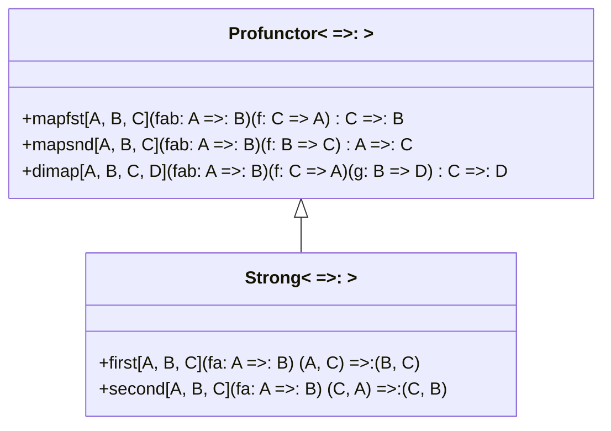

# Strong

`Strong` is a type class in functional programming
that extends the capabilities of a **[profunctor](profunctor.md)** (`Profunctor`),
adding support for working with **pair types** (tuples).
It allows "strengthening" a profunctor by providing the ability to extract
and combine elements from pair data structures.

The main operation provided by `Strong` is `first` (or `***`),
which allows a profunctor to work with the first element of a pair, leaving the second element unchanged.
Similarly, the `second` operation (or `&&&`) works with the second element of a pair.

**Brief examples**

- **Optics (Lens)**:
    - There is a Lens that works with field `age` in structure `Person`.
    - With `Strong` you can create a Lens that works with tuple `(Person, String)`, changing only field `age`.
- **Functional pipelines**:
    - There is a function `Int => Boolean` that processes data.
    - With `Strong` you can create a function that works with tuple `(Int, String)`, transforming only the first element.
- and so on.

## Formal definition

Let \\(P\\) be a [profunctor](profunctor.md), where:

- \\(P: C^\text{op} \times D \to \text{Set}\\) is a functor from the product of categories \\(C^\text{op}\\
  (opposite category of \\(C\\)) and \\(D\\) into the category of sets.
- \\(C^\text{op}\\) is a category where morphisms are reversed (contravariance).
- \\(D\\) is a category where morphisms are in the standard direction (covariance).

The `Strong` type class is formally defined as follows:

- **Objects**: Types \\(A, B, C, D, \dots\\), which are objects of categories \\(C\\) and \\(D\\.
- **Morphisms**: Functions (or arrows) \\(f: A \to B\\) and \\(g: C \to D\\), where:
    - \\(f\\) — contravariant morphism (transforms input data).
    - \\(g\\) — covariant morphism (transforms output data).
- **`first` operation**: For any morphism \\(p: P\[A, B\]\\) there exists a morphism:
  \\(\text{first}(p): P\[(A, C), (B, C)\]\\),
  which applies \\(p\\) to the first element of a pair, leaving the second element unchanged.
- **`second` operation**: For any morphism \\(p: P\[A, B\]\\) there exists a morphism:
  \\(\text{second}(p): P\[(C, A), (C, B)\]\\),
  which applies \\(p\\) to the second element of a pair, leaving the first element unchanged.

### `Strong` laws

The `Strong` type class must satisfy the following laws:

- **Naturality**:
  \\(\text{first}(p) \circ (f \times \text{id}) = (g \times \text{id}) \circ \text{first}(p)\\.
  This means the `first` operation must be natural with respect to composition.
- **Associativity**:
  \\(\text{first}(\text{first}(p)) = \text{assoc} \circ \text{first}(p) \circ \text{assoc}^{-1}\\),
  where \\(\text{assoc}\\) is the associative transformation of tuples.
- **Identity morphism**:
  \\(\text{first}(\text{id}\_P) = \text{id}\_{P\[(A, C), (A, C)\]}\\.
  This means that applying `first` to an identity morphism returns the identity morphism.

## Scala code definition

```dotty
trait Strong[=>:[_, _]] extends Profunctor[=>:]:
  def first[A, B, C](fa: A =>: B): (A, C) =>: (B, C)

  def second[A, B, C](fa: A =>: B): (C, A) =>: (C, B) =
    dimap[(A, C), (B, C), (C, A), (C, B)](first(fa))(_.swap)(_.swap)
```

Where:

- `=>:[_, _]` is the type representing a profunctor (e.g., function `A => B`).
- The `first` method takes profunctor \\(P\[A, B\]\\) and returns a new profunctor \\(P\[(A, C), (B, C)\]\\).
- The `second` method takes profunctor \\(P\[A, B\]\\) and returns a new profunctor \\(P\[(C, A), (C, B)\]\\).

## Exercises

### Exercise 4.5.1: Implement Strong for Function1 (regular functions)

> [Exercise repository with instructions][sample]

Implement the `Strong` instance for `Function1`, defining:

- `mapfst` — contravariant mapping of input (from `Profunctor`)
- `mapsnd` — covariant mapping of output (from `Profunctor`)
- `first` — apply function to the first element of a pair
- `second` — apply function to the second element of a pair

```dotty
given Strong[Function1] with
  override def mapfst[A, B, C](fab: A => B)(f: C => A): C => B = ???
  override def mapsnd[A, B, C](fab: A => B)(f: B => C): A => C = ???
  override def first[A, B, C](fa: A => B): ((A, C)) => (B, C) = ???
  override def second[A, B, C](fa: A => B): ((C, A)) => (C, B) = ???
```

**Examples:**

```dotty
import Strong.given

// Basic functions
val inc: Int => Int = _ + 1
val mul2: Int => Int = _ * 2
val toString: Int => String = _.toString
val length: String => Int = _.length

// first — apply to first element of pair
val firstInc = first(inc)
firstInc(5, "hello")   // (6, "hello")
firstInc(10, "world")  // (11, "world")

val firstToString = first(toString)
firstToString(42, true)  // ("42", true)

// second — apply to second element of pair
val secondInc = second(inc)
secondInc("hello", 5)   // ("hello", 6)
secondInc("world", 10)  // ("world", 11)

val secondLength = second(length)
secondLength(42, "hello")  // (42, 5)

// Composition of first with Profunctor operations
val transformed = mapsnd(first(inc))(toString)
transformed(5, "x")  // (toString(inc(5)), "x") = ("6", "x")

// Nested firsts
val nestedFirst = first(first(inc))
nestedFirst((5, "hello"), true)  // ((6, "hello"), true)

// Nested seconds
val nestedSecond = second(second(inc))
nestedSecond(true, ("hello", 5))  // (true, ("hello", 6))

// Combination of first and second
val firstThenSecond = second(first(inc))
firstThenSecond("hello", (5, true))  // ("hello", (6, true))
```

@:note(🔍 Show solution)

The `mapfst` implementation uses composition `f andThen fab` — transforms input first, then applies the function.
`mapsnd` uses `fab andThen f` — applies the function first, then transforms the output.
`first` takes a pair `(a, c)` and returns `(fa(a), c)` — the original function is applied to the first element, the second remains unchanged.
`second` takes a pair `(c, a)` and returns `(c, fa(a))` — the original function is applied to the second element, the first remains unchanged.

```dotty
given Strong[Function1] with
  override def mapfst[A, B, C](fab: A => B)(f: C => A): C => B = f andThen fab

  override def mapsnd[A, B, C](fab: A => B)(f: B => C): A => C = fab andThen f

  override def first[A, B, C](fa: A => B): ((A, C)) => (B, C) = (a, c) =>
    (fa(a), c)

  override def second[A, B, C](fa: A => B): ((C, A)) => (C, B) = (c, a) =>
    (c, fa(a))
```

@:@

### Exercise 4.5.2: Implement Strong instance for Kleisli based on Functor

In this exercise, you will implement a `Strong` type class instance for type `Kleisli[F, A, B]`,
using the mapping capability of `Functor[F]`.

```dotty
given kleisliStrong[F[_]: Functor]: Strong[[A, B] =>> Kleisli[F, A, B]] with
  override def mapfst[A, B, C](fab: Kleisli[F, A, B])(f: C => A)
      : Kleisli[F, C, B] =
    ???

  override def mapsnd[A, B, C](fab: Kleisli[F, A, B])(f: B => C)
      : Kleisli[F, A, C] =
    ???

  override def first[A, B, C](fa: Kleisli[F, A, B])
      : Kleisli[F, (A, C), (B, C)] =
    ???

  override def second[A, B, C](fa: Kleisli[F, A, B])
      : Kleisli[F, (C, A), (C, B)] =
    ???
```

@:note(🔍 Show solution)

The solution uses `Functor[F]` to get access to `map`, which allows transforming values within context `F`.
For `first`, a new arrow is created that takes a pair `(a, c)`, applies the original arrow `fa` to `a`,
getting `F[B]`, then uses `map` to add unchanged `c` to the result, obtaining `F[(B, C)]`.
`second` works similarly, but applies the arrow to the second element of the pair, keeping the first unchanged.
Operations `mapfst` and `mapsnd` are inherited from `Profunctor` and are implemented in the standard way for `Kleisli`.

```dotty
given kleisliStrong[F[_]: Functor]: Strong[[A, B] =>> Kleisli[F, A, B]] with
  override def mapfst[A, B, C](fab: Kleisli[F, A, B])(f: C => A)
      : Kleisli[F, C, B] =
    Kleisli[F, C, B](c => fab.run(f(c)))

  override def mapsnd[A, B, C](fab: Kleisli[F, A, B])(f: B => C)
      : Kleisli[F, A, C] =
    Kleisli[F, A, C](a => fab.run(a).map(f))

  override def first[A, B, C](fa: Kleisli[F, A, B])
      : Kleisli[F, (A, C), (B, C)] =
    Kleisli[F, (A, C), (B, C)]((a, c) =>
      fa.run(a).map(b => (b, c))
    )

  override def second[A, B, C](fa: Kleisli[F, A, B])
      : Kleisli[F, (C, A), (C, B)] =
    Kleisli[F, (C, A), (C, B)]((c, a) =>
      fa.run(a).map(b => (c, b))
    )
```

@:@

### Exercise 4.5.3: Implement Strong instance for Cokleisli based on CoMonad

In this exercise, you will implement a `Strong` type class instance for type `Cokleisli[F, A, B]`,
using the comonadic capabilities of `CoMonad[F]`.

```dotty
given cokleisliStrong[F[_]: CoMonad]: Strong[[A, B] =>> Cokleisli[F, A, B]]
with
  override def mapfst[A, B, C](fab: Cokleisli[F, A, B])(f: C => A)
      : Cokleisli[F, C, B] =
    ???

  override def mapsnd[A, B, C](fab: Cokleisli[F, A, B])(f: B => C)
      : Cokleisli[F, A, C] =
    ???

  override def first[A, B, C](fa: Cokleisli[F, A, B])
      : Cokleisli[F, (A, C), (B, C)] =
    ???

  override def second[A, B, C](fa: Cokleisli[F, A, B])
      : Cokleisli[F, (C, A), (C, B)] =
    ???
end cokleisliStrong
```

@:note(🔍 Show solution)

The solution uses `CoMonad[F]` to get access to `coPure` (also known as `extract`),
which extracts a value from context `F`.
For `first`, a new arrow is created that takes context `fac: F[(A, C)]`.
Using `map(_._1)` it extracts `F[A]`, to which the original arrow `fa` is applied, yielding `B`.
Simultaneously, via `coPure` from `fac`, value `C` is extracted. The result is pair `(B, C)`.
`second` works similarly, but extracts the second element of the pair using `map(_._2)`.
Operations `mapfst` and `mapsnd` are inherited from `Profunctor` and are implemented in the standard way for `Cokleisli`.

```dotty
given cokleisliStrong[F[_]: CoMonad]: Strong[[A, B] =>> Cokleisli[F, A, B]]
with
  override def mapfst[A, B, C](fab: Cokleisli[F, A, B])(f: C => A)
      : Cokleisli[F, C, B] =
    Cokleisli[F, C, B](fc => fab.run(fc.map(f)))

  override def mapsnd[A, B, C](fab: Cokleisli[F, A, B])(f: B => C)
      : Cokleisli[F, A, C] =
    Cokleisli[F, A, C](fa => f(fab.run(fa)))

  override def first[A, B, C](fa: Cokleisli[F, A, B])
      : Cokleisli[F, (A, C), (B, C)] =
    Cokleisli[F, (A, C), (B, C)](fac =>
      val b      = fa.run(fac.map(_._1))
      val (_, c) = CoMonad[F].coPure(fac)
      (b, c)
    )

  override def second[A, B, C](fa: Cokleisli[F, A, B])
      : Cokleisli[F, (C, A), (C, B)] =
    Cokleisli[F, (C, A), (C, B)](fca =>
      val b      = fa.run(fca.map(_._2))
      val (c, _) = CoMonad[F].coPure(fca)
      (c, b)
    )
end cokleisliStrong
```

@:@

## Diagram



## Library Implementations

### Cats Implementation

```dotty
import cats.*, cats.data.*, cats.syntax.all.*

lazy val f = (_:Int) + 1
lazy val f_first = f.first[Int]
f_first((1, 1))
// res0: (Int, Int) = (2, 1)

lazy val f_second = f.second[Int]
f_second((1, 1))
// res1: (Int, Int) = (1, 2)
```

### ScalaZ Implementation

```dotty
import scalaz.*
import Scalaz.*

val plus1 = (_: Int) + 1

plus1.first apply (7 -> "abc")    // (8,abc)
plus1.second apply ("def" -> 14)  // (def,15)
```

---

**References:**

- [Exercise repository link][sample]
- [Cats](https://typelevel.org/cats/typeclasses/arrow.html)
- [Herding Cats](http://eed3si9n.com/herding-cats/Arrow.html)
- [Learning Scalaz](http://eed3si9n.com/learning-scalaz/Arrow.html)
- [Scalaz API](https://javadoc.io/doc/org.scalaz/scalaz-core_3/7.3.6/scalaz/Strong.html)

[sample]: https://gitverse.ru/scalabook/typeclasses
