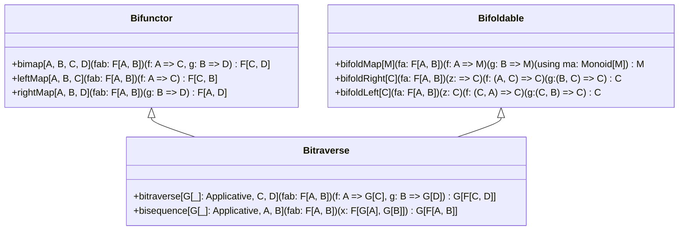

# Bifunctor Group

## Introduction

In functional programming, type classes play a key role in providing abstractions
for working with various data types. One such type class is `Bifunctor`,
which generalizes the ability to apply functions to two types contained within a single context.
In Scala, as in other functional languages, `Bifunctor` provides a powerful tool for working with types
that have two parameters, such as `Either`, `Tuple2`, or user-defined bifunctors.

The `Bifunctor` type class allows applying functions to each of the two types while preserving the container structure.
This is especially useful when it is necessary to transform both types independently of each other
without destroying the overall data structure.
In this section we will consider how `Bifunctor` is defined and used,
as well as study examples of its application for various data types.

## Usage

Bifunctors find application in various areas of functional programming,
especially where work with types having two parameters is required.
They provide a convenient way to transform both types while preserving the container structure.
Here are several examples where bifunctors can be useful:

- **Working with types that have two parameters.**
  Bifunctors naturally apply to types that contain two values or two types. For example:
    - **`Either[A, B]`**: The `Either` type represents a container that can hold either a value of type `A` or type `B`. With a bifunctor, you can transform both the left value (`A`) and the right value (`B`) without changing the `Either` structure.
    - **`Tuple2[A, B]`** (or pairs): A bifunctor allows applying functions to both elements of a tuple independently.
    - **User-defined types**: If you create your own types with two parameters (e.g., `Result[Error, Value]`), a bifunctor will help you work with them easily.
- **Error handling and alternative paths.**
  In types like `Either`, where one parameter can represent an error and the other a successful value, bifunctors allow:
    - Transforming errors (e.g., converting error type from `String` to `CustomError`).
    - Transforming successful values (e.g., transforming computation results).
  This is especially useful in chains of computations where both errors and successful results need to be handled.
- **Composing and transforming data.**
  Bifunctors can be used for composing data in the context of two types. For example:
    - In the case of `Tuple2`, you can transform both values of a tuple, preserving their relationship.
    - In the case of `Either`, you can change both the left and right parts without breaking the structure.
- **Functional libraries and frameworks.**
  Bifunctors are actively used in functional libraries such as **Cats** or **Scalaz** for providing universal abstractions. For example:
    - In the Cats library, the bifunctor is implemented for types `Either` and `Tuple2`, enabling their use in functional pipelines.
    - They can also be part of more complex abstractions such as `Bifoldable` or `Bitraverse`.
- **Parsing and validation.**
  In parsing or data validation tasks, bifunctors can be useful for working with results that can be either an error or a successful value. For example:
    - When parsing JSON, you can use a bifunctor to transform parsing errors and the data itself.
- **Functional effects.**
  In some cases, bifunctors can be used to work with effects that contain two types. For example, in functional programming libraries you can encounter types like `IO[Error, Result]`, where a bifunctor allows transforming both the error and the result.

## Diagram

**References:**

- [Exercise repository link][sample]

[sample]: https://gitverse.ru/scalabook/typeclasses
