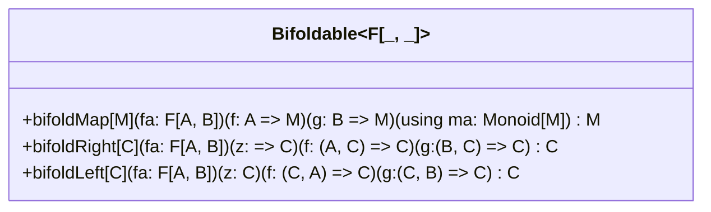

# Bifoldable

**Bifoldable** is a type class that generalizes the [folding](../monad/foldable.md) operation (fold)
for types that have two parameters. It allows "folding" (accumulating) values of both types
contained in a container into a single result value.
While [`Foldable`](../monad/foldable.md) works with types that have one parameter (e.g., `List[A]`),
`Bifoldable` extends this idea to types with two parameters (e.g., `Either[A, B]` or `Tuple2[A, B]`).

Main operations of `Bifoldable`:

- `bifoldLeft`: Folds the container starting from the left type.
- `bifoldRight`: Folds the container starting from the right type.
- `bifoldMap`: Transforms both types into a monoid and then combines them.

**Where is Bifoldable used?**

- **Types with two parameters**:
    - `Either[A, B]`: Folding the left type (error) and the right type (successful value).
    - `Tuple2[A, B]`: Folding both elements of a tuple.
    - User-defined types, e.g., `Result[Error, Value]`.
- **Error handling**:
    - Aggregating errors and successful values in `Either`.
- **Data aggregation**:
    - Summing or combining values in tuples or other two-parameter structures.
- **Functional libraries**:
    - Used in Cats and Scalaz libraries for working with types that have two parameters.
- **Parsing and validation**:
    - Aggregating errors and results in parsing or validation pipelines.

**Brief examples**

- **`Either[A, B]`**:
    - Summing all errors (left type) and successful values (right type) in a list of `Either`.
    - Converting all errors to strings and combining them into a single result.
- **`Tuple2[A, B]`**:
    - Summing both elements of a tuple, e.g., `(Int, Int)` into a single number.
    - Concatenating strings from both elements of a tuple.
- **User-defined type**:
    - For type `Result[Error, Value]` you can aggregate all errors and values into separate results.
- **JSON parsing**:
    - Aggregating all parsing errors and successfully parsed values.

## Formal definition

The `Bifoldable` type class represents a structure that:

- Works with types that have two parameters, e.g., `F[_, _]`.
- Provides operations for folding (fold) of both parameters:
    - `bifoldLeft`: Folds the container starting from the left type.
    - `bifoldRight`: Folds the container starting from the right type.
    - `bifoldMap`: Transforms both types into a monoid and then combines them.

#### Bifoldable laws

`Bifoldable` must satisfy the following laws (similar to `Foldable` laws):

- **Associativity law**:
  For `bifoldLeft` and `bifoldRight` the order of folding must respect associativity of operations.
- **Neutral element law**:
  For `bifoldMap` the result of folding with the monoid's neutral element must be the neutral element.

## Code

```dotty
trait Bifoldable[F[_, _]]:
  extension [A, B](fa: F[A, B])
    /** Accumulation of all `A` and `B`. */
    def bifoldMap[M](f: A => M)(g: B => M)(using ma: Monoid[M]): M

    /** Accumulate to `C`, starting "from the right". */
    def bifoldRight[C](z: => C)(f: (A, C) => C)(g: (B, C) => C): C =
      fa.bifoldMap[C => C](f.curried)(g.curried)(using endoMonoid[C])(z)

    /** Accumulate to `C`, starting "from the left". */
    def bifoldLeft[C](z: C)(f: (C, A) => C)(g: (C, B) => C): C =
      fa.bifoldMap[C => C](a => c => f(c, a))(b => c => g(c, b))(using dual(endoMonoid[C]))(z)
```

### Relationship with other type classes

**Bifoldable** is closely related to **Foldable**, which works with types that have one parameter.
Essentially, `Bifoldable` can be viewed as an extension of `Foldable` for types with two parameters.

#### **`leftFoldable`**

```dotty
def leftFoldable[R]: Foldable[[X] =>> F[X, R]] =
  new Foldable[[X] =>> F[X, R]]:
    extension [A](fa: F[A, R])
      override def foldMap[B](f: A => B)(using mb: Monoid[B]): B =
        fa.bifoldMap[B](f)(_ => mb.empty)
```

- **Goal**: Create a `Foldable` for the first parameter of type `F[A, R]`, where the second parameter (`R`) is fixed.
- **How it works**:
    - `leftFoldable` returns a `Foldable` for type `[X] =>> F[X, R]`, where `R` is fixed.
    - The `foldMap` method applies function `f: A => B` only to the first parameter (`A`),
      ignoring the second parameter (`R`), using the `bifoldMap` method from `Bifoldable`.
    - The second parameter is ignored, and the monoid's neutral element (`mb.empty`) is used for it.
- **Example**: If `F` is `Either[A, R]`, then `leftFoldable` allows folding only the left part (`A`), ignoring the right (`R`).

#### **`rightFoldable`**

```dotty
def rightFoldable[L]: Foldable[[X] =>> F[L, X]] =
  new Foldable[[X] =>> F[L, X]]:
    extension [A](fa: F[L, A])
      override def foldMap[B](f: A => B)(using mb: Monoid[B]): B =
        fa.bifoldMap[B](_ => mb.empty)(f)
```

- **Goal**: Create a `Foldable` for the second parameter of type `F[L, A]`, where the first parameter (`L`) is fixed.
- **How it works**:
    - `rightFoldable` returns a `Foldable` for type `[X] =>> F[L, X]`, where `L` is fixed.
    - The `foldMap` method applies function `f: A => B` only to the second parameter (`A`),
      ignoring the first parameter (`L`), using the `bifoldMap` method from `Bifoldable`.
    - The first parameter is ignored, and the monoid's neutral element (`mb.empty`) is used for it.
- **Example**: If `F` is `Either[L, A]`, then `rightFoldable` allows folding only the right part (`A`), ignoring the left (`L`).

#### **`uFoldable`**

```dotty
def uFoldable: Foldable[[X] =>> F[X, X]] =
  new Foldable[[X] =>> F[X, X]]:
    extension [A](fa: F[A, A])
      override def foldMap[B](f: A => B)(using mb: Monoid[B]): B =
        fa.bifoldMap[B](f)(f)
```

- **Goal**: Create a unified `Foldable` for type `F[X, X]`, where both parameters have the same type.
- **How it works**:
    - `uFoldable` returns a `Foldable` for type `[X] =>> F[X, X]`.
    - The `foldMap` method applies function `f: A => B` to both parameters simultaneously, using the `bifoldMap` method from `Bifoldable`.
- **Example**: If `F` is `Tuple2[A, A]`, then `uFoldable` allows folding both elements of the tuple simultaneously.

## Exercises

### Exercise 3.2.1: Implement Bifoldable for Either.

> [Exercise repository with instructions][sample]

Implement the `Bifoldable` instance for `Either`.

```dotty
given eitherBifoldable: Bifoldable[Either] with
  extension [A, B](fab: Either[A, B])
    def bifoldMap[M](f: A => M)(g: B => M)(using ma: Monoid[M]): M = ???
```

**Examples:**

```dotty
import Bifoldable.given
import Monoid.given

val right: Either[String, Int] = Right(42)
val left: Either[String, Int] = Left("error")

// Folding with transformation to Int (addition monoid)
right.bifoldMap(_.length)(identity)  // 42
left.bifoldMap(_.length)(identity)   // 5 — length of string "error"
```

@:note(🔍 Show solution)

The `bifoldMap` implementation for `Either` is simple: use pattern matching to determine the variant.
If `fab` is `Right(value)`, apply function `g` to `value` and return the result.
If `fab` is `Left(value)`, apply function `f` to `value` and return the result.
The parameter `ma: Monoid[M]` is required to match the `Bifoldable` signature,
although it is not used for `Either` (since we have only one value).
This is fine because Bifoldable laws require a monoid for container types
that can hold multiple values.

```dotty
given eitherBifoldable: Bifoldable[Either] with
  extension [A, B](fab: Either[A, B])
    def bifoldMap[M](f: A => M)(g: B => M)(using ma: Monoid[M]): M =
      fab match
        case Right(value) => g(value)
        case Left(value)  => f(value)
```

@:@

## Diagram



## Library Implementations

### Cats Implementation

Suppose there are several input paths and system queries
that ultimately result in either an `Either[Exception, *]` result
or a `Validated[Exception, *]` result.
It is required to track the number of errors and preserve the contents of valid requests.

First, add implicit variables:

```dotty
import cats.*
import cats.data.*
import cats.syntax.all.*
```

Then define an aggregation class capable of storing this information:

```dotty
case class Report(entries: Chain[String], errors: Int):
  def withEntries(entry: String): Report =
    this.copy(entries = entries :+ entry)

  def withError: Report =
    this.copy(errors = errors + 1)
```

`Bifoldable` is useful for obtaining an aggregate value from data types `F[_,_]`:

```dotty
def update[F[_, _]: Bifoldable](current: Report)(result: F[Exception, String])
    : Report =
  result.bifoldLeft(current)(
    (acc, _) => acc.withError,
    (acc, user) => acc.withEntries(user)
  )
```

Here is system input:

```dotty
val validated =
  List(
    Validated.valid[Exception, String]("valid request 1"),
    Validated.valid[Exception, String]("valid request 2"),
    Validated.invalid[
      Exception,
      String
    ](new RuntimeException("Not a valid request"))
  )

val attempted =
  List(
    Either.right[Exception, String]("valid request 1"),
    Either.right[Exception, String]("valid request 2"),
    Either.left[Exception, String](new RuntimeException("Not a valid request"))
  )
```

And fold each value into the accumulator:

```dotty
val empty = Report(Chain.empty, 0)

validated
  .foldl(empty)((acc, validation) => update(acc)(validation))
// Report(Chain(valid request 1, valid request 2),1)

attempted
  .foldl(empty)((acc, attempt) => update(acc)(attempt))
// Report(Chain(valid request 1, valid request 2),1)
```

---

**References:**

- [Exercise repository link][sample]
- [Cats](https://typelevel.org/cats/typeclasses/bifoldable.html)
- [Scalaz API](https://javadoc.io/doc/org.scalaz/scalaz-core_3/7.3.6/scalaz/Bifoldable.html)

[sample]: https://gitverse.ru/scalabook/typeclasses
