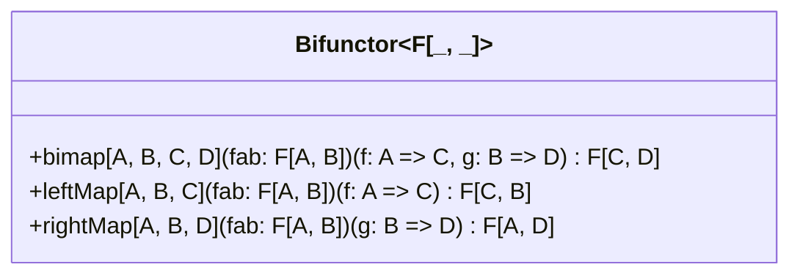

# Bifunctor

**Bifunctor** is a type class that generalizes the [ability to apply functions](../monad/functor.md)
to two types contained within a single context.
It allows transforming both types independently while preserving the container structure.
In Scala, a bifunctor is defined for types with two parameters, such as `Either[A, B]`, `Tuple2[A, B]`, or user-defined types.

The main operation of a bifunctor is `bimap`, which takes two functions:
one for transforming the first type, another for the second.
For example, for `Either[A, B]` you can transform both the left part (`A`) and the right part (`B`).

**Where is Bifunctor used?**

- **Types with two parameters**:
    - `Either[A, B]`: Error handling (left type) and successful values (right type).
    - `Tuple2[A, B]`: Transforming both elements of a tuple.
    - User-defined types, e.g., `Result[Error, Value]`.
- **Error handling**:
    - Transforming error type and successful result in `Either`.
- **Functional libraries**:
    - Used in Cats and Scalaz libraries for working with types that have two parameters.
- **Parsing and validation**:
    - Transforming errors and data in parsing results.
- **Data composition**:
    - Working with pairs of values or complex structures where both types need to be transformed.

**Brief examples**

- **`Either[A, B]`**:
    - Transforming an error of type `String` into `CustomError`.
    - Transforming a successful result of type `Int` into `String`.
- **`Tuple2[A, B]`**:
    - Transforming both elements of a tuple: `(Int, String)` into `(String, Boolean)`.
- **User-defined type**:
    - For type `Result[Error, Value]` you can transform both error and value, e.g., from `Result[String, Int]` to `Result[CustomError, String]`.
- **JSON parsing**:
    - Transforming parsing error and result into another format.

## Formal definition

The `Bifunctor` type class represents a structure that:

- Works with types that have two parameters, e.g., `F[_, _]`.
- Provides the `bimap` operation, which takes:
    - A function to transform the first type: `A => C`.
    - A function to transform the second type: `B => D`.
    - Returns a new container with transformed types: `F[C, D]`.

### Bifunctor laws:

A bifunctor must satisfy the following laws (similar to functor laws):

- **Identity law**: `bimap(fab)(identity, identity) == fab`.
  Applying `identity` functions to both types does not change the container.
- **Composition law**:
  `bimap(bimap(fab)(f1, g1))(f2, g2) == bimap(fab)(f2.compose(f1), g2.compose(g1))`.
  Sequential application of `bimap` is equivalent to a single application with composed functions.

## Code

```dotty
trait Bifunctor[F[_, _]]:
  extension [A, B](fab: F[A, B])
    /** `map` over both type parameters. */
    def bimap[C, D](f: A => C, g: B => D): F[C, D]

    def leftMap[C](f: A => C): F[C, B] =
      fab.bimap(f, identity)

    def rightMap[D](g: B => D): F[A, D] =
      fab.bimap(identity, g)

  def umap[A, B](faa: F[A, A])(f: A => B): F[B, B] =
    bimap(faa)(f, f) 
```

### Relationship with other type classes

A bifunctor (`Bifunctor`) is closely related to a [functor](../monad/functor.md) (`Functor`),
since it extends the idea of a functor to types with two parameters.
While a functor works with types that have one parameter (e.g., `F[A]`),
a bifunctor works with types that have two parameters (e.g., `F[A, B]`).

Suppose we have type `Either[A, B]` and a bifunctor for it:

- `leftFunctor` allows working with the left part (`A`), e.g., transforming `Either[String, Int]` into `Either[Int, Int]`.
- `rightFunctor` allows working with the right part (`B`), e.g., transforming `Either[String, Int]` into `Either[String, String]`.
- `uFunctor` allows working with both parts simultaneously if they have the same type,
  e.g., transforming `Either[Int, Int]` into `Either[String, String]`.

#### **`leftFunctor`**

```dotty
def leftFunctor[R]: Functor[[X] =>> F[X, R]] = new:
  extension [A](fax: F[A, R])
    override def map[B](f: A => B): F[B, R] =
      leftMap(fax)(f)
```

- **Goal**: Create a functor for the first parameter of type `F[A, R]`, where the second parameter (`R`) is fixed.
- **How it works**:
  - `leftFunctor` returns a functor for type `[X] =>> F[X, R]`, where `R` is fixed.
  - The `map` method applies function `f: A => B` only to the first parameter (`A`), using the bifunctor's `leftMap` method.
- **Example**: If `F` is `Either[A, R]`, then `leftFunctor` allows applying a function to the left part (`A`), leaving the right part (`R`) unchanged.

#### **`rightFunctor`**

```dotty
def rightFunctor[L]: Functor[[X] =>> F[L, X]] = new:
  extension [A](fax: F[L, A])
    override def map[B](f: A => B): F[L, B] =
      rightMap(fax)(f)
```

- **Goal**: Create a functor for the second parameter of type `F[L, A]`, where the first parameter (`L`) is fixed.
- **How it works**:
  - `rightFunctor` returns a functor for type `[X] =>> F[L, X]`, where `L` is fixed.
  - The `map` method applies function `f: A => B` only to the second parameter (`A`), using the bifunctor's `rightMap` method.
- **Example**: If `F` is `Either[L, A]`, then `rightFunctor` allows applying a function to the right part (`A`), leaving the left part (`L`) unchanged.

#### **`uFunctor`**

```dotty
def uFunctor: Functor[[X] =>> F[X, X]] = new:
  extension [A](fax: F[A, A])
    override def map[B](f: A => B): F[B, B] =
      umap(fax)(f)
```

- **Goal**: Create a functor for type `F[X, X]`, where both parameters have the same type.
- **How it works**:
  - `uFunctor` returns a functor for type `[X] =>> F[X, X]`.
  - The `map` method applies function `f: A => B` to both parameters simultaneously, using the bifunctor's `umap` method.
- **Example**: If `F` is `Tuple2[A, A]`, then `uFunctor` allows transforming both tuple elements simultaneously.

## Exercises

### Exercise 3.1.1: Implement bifunctor for Either.

> [Exercise repository with instructions][sample]

Implement the `Bifunctor` instance for `Either`:

```dotty
given Bifunctor[Either] with
  extension [A, B](fab: Either[A, B])
    override def bimap[C, D](f: A => C, g: B => D): Either[C, D] =
      ???
```

**Examples:**

```dotty
import Bifunctor.given

val right: Either[String, Int] = Right(42)
val left: Either[String, Int] = Left("error")

// Transform both branches
right.bimap(_.length, _ * 2)  // Right(84)
left.bimap(_.length, _ * 2)   // Left(5) — length of string "error"
```

@:note(🔍 Show solution)

The implementation uses pattern matching to determine the `Either` variant.
If `fab` is `Right(value)`, we apply function `g` to `value` and return `Right(g(value))`.
If `fab` is `Left(value)`, we apply function `f` to `value` and return `Left(f(value))`.
This allows transforming both types independently while preserving the `Either` structure.

```dotty
given Bifunctor[Either] with
  extension [A, B](fab: Either[A, B])
    override def bimap[C, D](f: A => C, g: B => D): Either[C, D] =
      fab match
        case Right(value) => Right(g(value))
        case Left(value)  => Left(f(value))
```

@:@

### Exercise 3.1.2: Implement bifunctor for Writer.

`Writer[W, A]` is a type representing a computation that accumulates a log of type `W` and returns a value of type `A`.

Structure: `Writer[W, A]` is a lazy computation `() => (W, A)` that returns a pair (log, value) when called.

Implement the `Bifunctor` instance for `Writer`.

```dotty
case class Writer[W, A](run: () => (W, A))

given Bifunctor[Writer] with
  extension [A, B](fab: Writer[A, B])
    override def bimap[C, D](f: A => C, g: B => D): Writer[C, D] =
      ???
```

**Examples:**

```dotty
import Bifunctor.given
import Monoid.given

val writer = Writer(() => ("log", 42))

// Transform both parameters
writer.bimap(_.length, _ * 2).run()  // (3, 84)
```

@:note(🔍 Show solution)

The implementation first executes the lazy computation `fab.run()`, obtaining pair `(a, b)`.
Then it applies function `f` to log `a` and function `g` to value `b`, obtaining `(f(a), g(b))`.
The result is wrapped in a new `Writer` that preserves laziness of computations —
the new computation will be executed only upon calling `run()`.
Importantly, the order of transformation does not affect semantics, since `Writer` has no dependencies between log and value.

```dotty
given Bifunctor[Writer] with
  extension [A, B](fab: Writer[A, B])
    override def bimap[C, D](f: A => C, g: B => D): Writer[C, D] =
      Writer { () =>
        val (a, b) = fab.run()
        (f(a), g(b))
      }
```

@:@

## Diagram



## Library Implementations

### Cats Implementation

```dotty
import cats.*
import cats.syntax.all.*
import java.time.*

case class DomainError(message: String)

def dateTimeFromUser: Either[Throwable, ZonedDateTime] =
  Right(ZonedDateTime.now()) // Example definition
dateTimeFromUser.bimap(
  error => DomainError(error.getMessage),
  dateTime => dateTime.toEpochSecond
)
// res0: Either[DomainError, Long] = Right(value = 1782369583L)

def calculateContributionPerMonth(balance: Int, lifetime: Int) = balance /
  lifetime

val result: List[Int] =
  records.map(record =>
    record.bimap(
      cents => cents / 100,
      years => 12 * years
    )
  ).map(calculateContributionPerMonth.tupled)
// result: List[Int] = List(125, 160, 412, 0, 12)
```

### ScalaZ Implementation

```dotty
import scalaz.*
import Scalaz.*

Bifunctor[Tuple2].bimap(("asdf", 1))(_.toUpperCase, _ + 1)                               
// ("ASDF",2)
("asdf", 1).bimap(_.length, _ + 1)                                                       
// (4,2)

// For sum types, which function is applied depends on which value is present:
Bifunctor[Either].bimap(Left("asdf") : Either[String,Int])(_.toUpperCase, _ + 1)         
// Left("ASDF")
Bifunctor[Either].bimap(Right(1): Either[String,Int])(_.toUpperCase, _ + 1)              
// Right(2)

//
// leftMap / rightMap
//

// There are functions for mapping only the "right" or "left" value:
Bifunctor[Tuple2].leftMap(("asdf", 1))(_.substring(1))                                   
// ("sdf" -> 1)
Bifunctor[Tuple2].rightMap(("asdf", 1))(_ + 3)                                           
// ("asdf" -> 4)

// They come with such syntax as well
1.success[String].rightMap(_ + 10)                                                      
// Success(11)
("a", 1).rightMap(_ + 10)                                                                
// ("a" -> 11)

// and even more fancy
1.success[String] :-> (_ + 1)                                                            
// Success(2)

// On the left side the type inference may be poor, so we're forced to explicitly specify types in the function we leftMap.
val strlen: String => Int = _.length
(strlen <-: ("asdf", 1))                                                                 
// (4 -> 1)
(((_:String).length) <-: ("asdf", 1))                                                    
// (4 -> 1)

strlen <-: ("asdf", 1) :-> (_ + 1)                                                       
// (4 -> 2)

//
// Functor extraction
//

// We can extract either the left or right base functors.
val leftF = Bifunctor[\/].leftFunctor[String]
leftF.map("asdf".right[Int])(_ + 1)                                                      
// "asdf".right[Int]
leftF.map(1.left)(_ + 1)                                                                 
// 2.left[String]

val rightF = Bifunctor[\/].rightFunctor[String]
rightF.map("asdf".left[Int])(_ + 1)                                                      
// "asdf".left[Int]
rightF.map(1.right)(_ + 1)                                                               
// 2.right[String]

//
// Ufunctor
//

// If we have F[A,A] (instead of F[A,B] with different A and B) we can extract the "unified functor", which is a functor,
Bifunctor[Tuple2].uFunctor.map((2,3))(_ * 3)                                             
// (6 -> 9)

// or skip the step of extracting the unified functor via umap method.
Bifunctor[Tuple2].umap((2,3))(_ * 3)                                                     
// (6 -> 9)
```

---

**References:**

- [Exercise repository link][sample]
- Category Theory for Programmers - Bartosz Milewski:
    - [Category Theory for Programmers](https://henrychern.wordpress.com/2022/09/15/%d1%82%d0%b5%d0%be%d1%80%d0%b8%d1%8f-%d0%ba%d0%b0%d1%82%d0%b5%d0%b3%d0%be%d1%80%d0%b8%d0%b9-%d0%b4%d0%bb%d1%8f-%d0%bf%d1%80%d0%be%d0%b3%d1%80%d0%b0%d0%bc%d0%bc%d0%b8%d1%81%d1%82%d0%be%d0%b2/)
    - [Category Theory for Programmers, Functoriality](https://bartoszmilewski.com/2015/02/03/functoriality/)
- [Cats](https://typelevel.org/cats/typeclasses/bifunctor.html)
- [Herding Cats](http://eed3si9n.com/herding-cats/datatype-generic-programming.html)
- [Scalaz API](https://javadoc.io/doc/org.scalaz/scalaz-core_3/7.3.6/scalaz/Bifunctor.html)
- The Dao of Functional Programming - Bartosz Milewski:
    - [The Dao of Functional Programming, Chapter 6.1](https://henrychern.wordpress.com/2022/09/23/milewski-%d0%b4%d0%b0%d0%be-%d1%84%d1%83%d0%bd%d0%ba%d1%86%d0%b8%d0%be%d0%bd%d0%b0%d0%bb%d1%8c%d0%bd%d0%be%d0%b3%d0%be-%d0%bf%d1%80%d0%be%d0%b3%d1%80%d0%b0%d0%bc%d0%bc%d0%b8%d1%80%d0%be%d0%b2%d0%b0/)
    - [The Dao of Functional Programming, Chapter 6.1](https://github.com/BartoszMilewski/Publications/blob/master/TheDaoOfFP/DaoFP.pdf)

[sample]: https://gitverse.ru/scalabook/typeclasses
