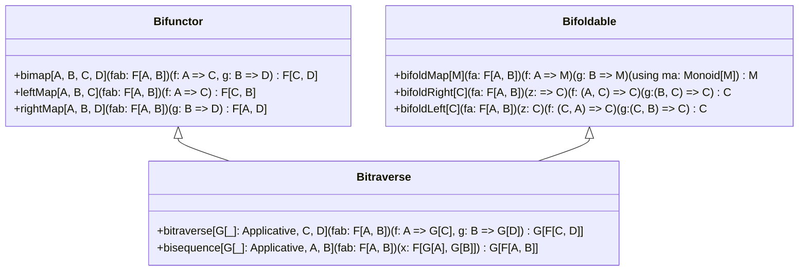

# Bitraverse

**Bitraverse** is a type class that generalizes the concept of **[Traverse](../monad/traverse.md)** to types with two parameters.
It allows you to "traverse" both types in a container simultaneously,
applying effects (e.g., computations in the context of `Option`, `Future`, `IO`, etc.).
While `Traverse` works with types having a single parameter (e.g., `List[A]`),
`Bitraverse` extends this idea to types with two parameters (e.g., `Either[A, B]` or `Tuple2[A, B]`).

The main operation of `Bitraverse` is `bitraverse`, which allows applying effects to both types in a container and combining the results.
`Bitraverse` extends [`Bifoldable`](bifoldable.md) and [`Bifunctor`](bifunctor.md).

**Where is Bitraverse used?**

- **Types with two parameters**:
    - `Either[A, B]`: Applying effects to the left type (error) and the right type (success value).
    - `Tuple2[A, B]`: Applying effects to both elements of a tuple.
    - Custom types, such as `Result[Error, Value]`.
- **Error handling**:
    - Applying effects to errors and success values in `Either`.
- **Parsing and validation**:
    - Applying effects to errors and results in parsing or validation processes.
- **Functional libraries**:
    - Used in Cats and Scalaz libraries for working with types that have two parameters.
- **Composing effects**:
    - Applying effects to both types in a container and combining results.

**Brief examples**

- **`Either[A, B]`**:
    - Applying an `Option` effect to the left part (error) and the right part (success value).
    - Applying an asynchronous `Future` effect to both parts.
- **`Tuple2[A, B]`**:
    - Applying an `IO` effect to both elements of a tuple.
    - Applying an `Option` effect to both elements and combining results.
- **Custom type**:
    - For a type `Result[Error, Value]`, you can apply effects to errors and values,
      for example, converting errors to log messages and values to computation results.
- **JSON parsing**:
    - Applying effects to parsing errors and successfully parsed values.

## Formal definition

The `Bitraverse` type class represents a structure that:

- Works with types that have two parameters, e.g., `F[_, _]`.
- Provides a `bitraverse` operation that:
    - Takes an effect (an applicative functor) `G[_]`.
    - Applies two functions: one to the first type (`A => G[C]`) and another to the second type (`B => G[D]`).
    - Returns a result in the context of the effect: `G[F[C, D]]`.

#### Bitraverse laws:

`Bitraverse` must satisfy the following laws (similar to `Traverse` laws):

- **Identity law**:
    - Applying `bitraverse` with `pure` functions (from the applicative functor) should return the original container wrapped in the effect.
      ```dotty
      bitraverse(fab)(a => Applicative[G].pure(a), b => Applicative[G].pure(b)) == Applicative[G].pure(fab)
      ```
- **Composition law**:
    - Sequentially applying `bitraverse` with two effects should be equivalent to a single application with composed effects.
    ```dotty
    fab.bitraverse(f1, g1).flatMap(inner => inner.bitraverse(f2, g2)) ==
    fab.bitraverse(a => f1(a).flatMap(f2), b => g1(b).flatMap(g2))
    ```

## Code

```dotty
trait Bitraverse[F[_, _]] extends Bifunctor[F] with Bifoldable[F]:
  extension [A, B](fab: F[A, B])
    def bitraverse[G[_]: Applicative, C, D](f: A => G[C], g: B => G[D]): G[F[C, D]]

    override def bimap[C, D](f: A => C, g: B => D): F[C, D] =
      bitraverse[Id, C, D](a => Id(f(a)), b => Id(g(b))).value

    override def bifoldMap[M](f: A => M)(g: B => M)(using ma: Monoid[M]): M =
      def toState[X](f: X => M): X => State[M, X] = x => State[M, X](s => (ma.combine(s, f(x)), x))
      val state = bitraverse[[X] =>> State[M, X], A, B](toState[A](f), toState[B](g))
      state.run(ma.empty)._1

  def bisequence[G[_]: Applicative, A, B](x: F[G[A], G[B]]): G[F[A, B]] = x.bitraverse(fa => fa, fb => fb)
```

### Connection with other type classes

**Bitraverse** is a type class that generalizes the concept of **Traverse** for types with two parameters.
It allows simultaneously traversing both types in a container,
applying effects (e.g., computations in the context of `Option`, `Future`, `IO`, etc.).
While `Traverse` works with types having a single parameter (e.g., `List[A]`),
`Bitraverse` extends this idea to types with two parameters (e.g., `Either[A, B]` or `Tuple2[A, B]`).

#### **`leftTraverse`**

```dotty
def leftTraverse[R]: Traverse[[X] =>> F[X, R]] =
  new Traverse[[X] =>> F[X, R]]:
    extension [A](fab: F[A, R])
      override def traverse[G[_]: Applicative as g, B](f: A => G[B]): G[F[B, R]] =
        fab.bitraverse(f, g.unit)
```

- **Purpose**: Create a `Traverse` for the first parameter of type `F[A, R]`, where the second parameter (`R`) is fixed.
- **How it works**:
    - `leftTraverse` returns a `Traverse` for the type `[X] =>> F[X, R]`, where `R` is fixed.
    - The `traverse` method applies the function `f: A => G[B]` only to the first parameter (`A`), using the `bitraverse` method from `Bitraverse`.
    - The second parameter (`R`) remains unchanged, and the neutral element of the applicative functor (`unit`) is used for it.
- **Example**: If `F` is `Either[A, R]`, then `leftTraverse` allows applying an effect only to the left part (`A`), leaving the right part (`R`) unchanged.

#### **`rightTraverse`**

```dotty
def rightTraverse[L]: Traverse[[X] =>> F[L, X]] =
  new Traverse[[X] =>> F[L, X]]:
    extension [A](fab: F[L, A])
      override def traverse[G[_]: Applicative as g, B](f: A => G[B]): G[F[L, B]] =
        fab.bitraverse(g.unit, f)
```

- **Purpose**: Create a `Traverse` for the second parameter of type `F[L, A]`, where the first parameter (`L`) is fixed.
- **How it works**:
    - `rightTraverse` returns a `Traverse` for the type `[X] =>> F[L, X]`, where `L` is fixed.
    - The `traverse` method applies the function `f: A => G[B]` only to the second parameter (`A`), using the `bitraverse` method from `Bitraverse`.
    - The first parameter (`L`) remains unchanged, and the neutral element of the applicative functor (`unit`) is used for it.
- **Example**: If `F` is `Either[L, A]`, then `rightTraverse` allows applying an effect only to the right part (`A`), leaving the left part (`L`) unchanged.

#### **`uTraverse`**

```dotty
def uTraverse: Traverse[[X] =>> F[X, X]] =
  new Traverse[[X] =>> F[X, X]]:
    extension [A](fab: F[A, A])
      override def traverse[G[_]: Applicative, B](f: A => G[B]): G[F[B, B]] =
        fab.bitraverse(f, f)
```

- **Purpose**: Create a unified `Traverse` for type `F[X, X]`, where both parameters have the same type.
- **How it works**:
    - `uTraverse` returns a `Traverse` for the type `[X] =>> F[X, X]`.
    - The `traverse` method applies the function `f: A => G[B]` to both parameters simultaneously, using the `bitraverse` method from `Bitraverse`.
- **Example**: If `F` is `Tuple2[A, A]`, then `uTraverse` allows applying an effect to both elements of the tuple simultaneously.

## Exercises

### Exercise 3.3.1: Implement Bitraverse for Either.

> [Repository with exercises and instructions][sample]

Implement an `Bitraverse` instance for `Either`.

```dotty
given Bitraverse[Either] with
  extension [A, B](fab: Either[A, B])
    override def bitraverse[G[_]: Applicative, C, D](
        f: A => G[C],
        g: B => G[D]
    ): G[Either[C, D]] = ???
```

**Examples:**

```dotty
import Bitraverse.given
import Applicative.given

val right: Either[String, Int] = Right(42)
val left: Either[String, Int] = Left("error")

// bitraverse with Option as the effect
right.bitraverse(s => Some(s.length), i => Some(i * 2))
// Some(Right(84))

left.bitraverse(s => Some(s.length), i => Some(i * 2))
// Some(Left(5)) — length of "error" string

// bitraverse with List as the effect (Cartesian product)
right.bitraverse(s => List(s), i => List(i, i * 2))
// List(Right(42), Right(84))

left.bitraverse(s => List(s, s + s), i => List(i))
// List(Left("error"), Left("errorerror"))
```

@:note(🔍 Show solution)

The `bitraverse` implementation for `Either` uses pattern matching to determine the variant.
If `fab` is `Right(value)`, we apply function `g` to `value`, obtaining `G[D]`.
Then, using `map` (available from `Applicative[G]`), we transform the result into `Right(d)`, getting `G[Either[C, D]]`.
If `fab` is `Left(value)`, we similarly apply `f(value)`, obtaining `G[C]`, and wrap the result in `Left(c)`.
Importantly, the effect `G` is preserved, and the `Either` structure (left or right variant) remains unchanged.

```dotty
given Bitraverse[Either] with
  extension [A, B](fab: Either[A, B])
    override def bitraverse[G[_]: Applicative, C, D](
        f: A => G[C],
        g: B => G[D]
    ): G[Either[C, D]] =
      fab match
        case Right(value) => g(value).map(d => Right(d))
        case Left(value)  => f(value).map(c => Left(c))
```

@:@

## Diagram



---

**References:**

- [Repository with exercises][sample]
- [Scalaz API](https://javadoc.io/doc/org.scalaz/scalaz-core_3/7.3.6/scalaz/Bitraverse.html)

[sample]: https://gitverse.ru/scalabook/typeclasses
