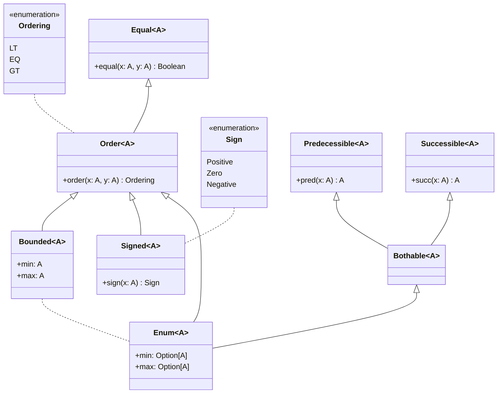

# Equal Group

## Introduction

In functional programming, type classes play an important role in providing abstractions for working with various data types.
One such abstraction is the **group of "Equal" type classes**,
used to describe types whose instances can be compared with each other.
In Scala, this group includes type classes such as `Equal`, `Order`, and others,
which provide mechanisms for checking equality and ordering of values.

Type classes in the "Equal" group allow:

- Checking equality of two values (`Equal`).
- Determining the order of values (`Order`).
- Comparing values for greater/less (`Order`).
- Determining the minimum and maximum values (`Bounded`).
- Determining the predecessor and successor values (`Bothable`).

## Usage

The `Equal` group in Scala is used in various contexts where object comparison is needed.
Here are several main areas of application:

### **Object comparison**

The `Equal` group provides methods for checking equality between instances.
This is especially useful when it's necessary to determine whether two objects are equivalent,
for example, when implementing `equals` and `hashCode` methods.

### **Collections**

When working with collections such as lists, sets, and maps, it's important to be able to compare elements. For example, when adding elements to a set or checking for the presence of an element in a collection, the `equals` method is used. The `Equal` group ensures correct element comparison in collections.

### **Filtering and searching**

When performing filtering and searching operations in collections, such as `filter`, `find`, and `exists`,
it's necessary to compare elements against given conditions.
Using `Equal` makes it easy to implement such operations, providing a unified interface for comparison.

### **Sorting**

When sorting collections, for example, using the `sortBy` method, it's important to be able to compare elements.
The `Equal` group can be used in combination with other type classes,
such as `Ordering`, to determine the order of elements.

### **Testing**

In testing, it's important to verify that objects behave as expected.
Using `Equal` makes it easy to compare expected and actual results,
which simplifies writing tests and improves their reliability.

### **Generic algorithms**

The `Equal` group allows creating generic algorithms that can work with various data types.
This is especially useful in functional programming,
where data is often processed abstractly without being tied to specific types.

### **Libraries and frameworks**

Many Scala libraries and frameworks, such as Cats and Scalaz,
use the `Equal` group to implement functional concepts such as monads and applicative functors.
This allows developers to use powerful abstractions while retaining the ability to compare objects.

## Diagram

---

**References:**

- [Repository with exercises][sample]
- [Learning Scalaz](http://eed3si9n.com/learning-scalaz/Equal.html)

[sample]: https://gitverse.ru/scalabook/typeclasses
