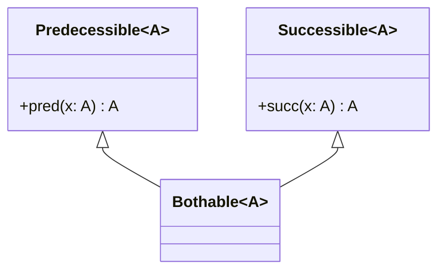

# Predecessible and Successible

## `Predecessible`

**`Predecessible`** is a type class that abstracts types
that support the operation of obtaining a **preceding element** (predecessor).
This is useful for types that have a linear order or sequence,
where each element (except the first) has a defined predecessor.

### Formal definition:

The `Predecessible` type class for type `A` defines a `prev` operation,
which returns the predecessor element for a given value.
If an element has no predecessor (e.g., the minimum element in a sequence),
the operation returns `None`.

- **`prev`** — a function that takes a value of type `A` and returns its predecessor of type `Option[A]`.

### Where is it used?

- **Working with sequences**:
  For types representing sequences (e.g., numbers, characters, enumerations),
  `Predecessible` allows easy traversal of elements in reverse order.
- **Graph and tree algorithms**:
  In algorithms that require reverse traversal (e.g., finding the previous node in a tree or graph).
- **Range generation**:
  When working with value ranges (e.g., numbers, dates),
  `Predecessible` can be used to generate sequences in reverse order.
- **Custom data types**:
  For custom data types that have a notion of predecessor
  (e.g., days of the week, months, enumeration elements).

## `Successible`

**`Successible`** is a type class that abstracts types
that support the operation of obtaining a **successor element** (successor).
This is useful for types that have a linear order or sequence,
where each element (except the last) has a defined successor.

### Formal definition:

The `Successible` type class for type `A` defines a `next` operation,
which returns the successor element for a given value.
If an element has no successor (e.g., the maximum element in a sequence),
the operation returns `None`.

- **`next`** — a function that takes a value of type `A` and returns its successor of type `Option[A]`.

### Where is it used?

Analogous to the `Predecessible` type class.

## `Bothable`

`Bothable` is a type class extending `Predecessible` and `Successible`,
where each element has both a predecessor and a successor.

## Code definition in Scala

```dotty
trait Predecessible[A]:
  def prev(a: A): Option[A]

trait Successible[A]:
  def next(a: A): Option[A]

trait Bothable[A] extends Predecessible[A], Successible[A]
```

### Numbers

```dotty
given Bothable[Int] with
  override def prev(a: Int): Option[Int] =
    if a == Int.MinValue then None
    else Some(a - 1)

  override def next(a: Int): Option[Int] =
    if a == Int.MaxValue then None
    else Some(a + 1)
```

## Diagram



---

**References:**

- [Repository with exercises][sample]
- [Algebird, Predecessible](https://twitter.github.io/algebird/typeclasses/predecessible.html)
- [Algebird, Successible](https://twitter.github.io/algebird/typeclasses/successible.html)

[sample]: https://gitverse.ru/scalabook/typeclasses
