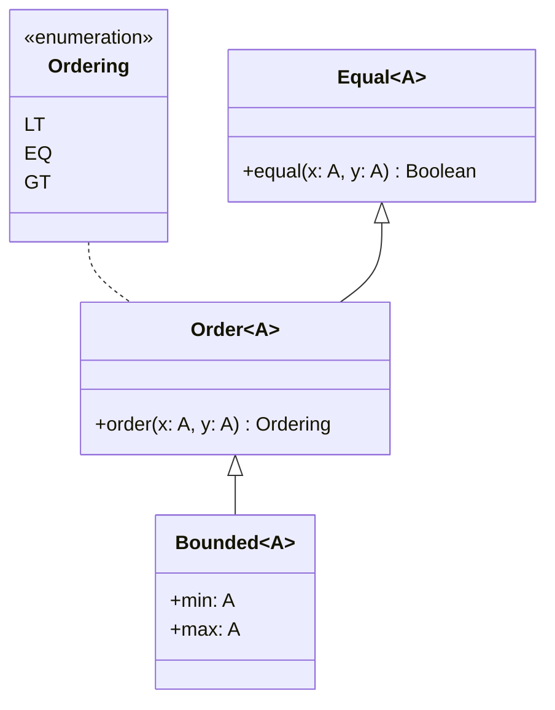

# Bounded

`Bounded` is a type class that defines the minimum and maximum values for a specific type.
It provides methods for obtaining these bounds, enabling work with types that have a limited range of values.

`Bounded` is used in various scenarios where knowing the bounds of a type's values is important. Here are some examples:

- **Working with numbers**: `Bounded` can be used to define the minimum and maximum values
  of numeric types such as `Int`, `Long`, and others.
- **Characters**: For the `Char` type, you can define the minimum and maximum values,
  such as the minimum and maximum characters in the Unicode table.
- **Custom types**: If you have a custom data type,
  you can implement a `Bounded` instance for it to define its bounds.
- **Algorithms**: In algorithms that work with limited value ranges,
  `Bounded` can be used for boundary checking.

## Formal definition

`Bounded` is a type class extending [`Order`](order.md)
that defines the minimum and maximum values for a specific type.
`Bounded` provides methods for obtaining these bounds (`min` and `max`),
enabling work with types that have a limited range of values.

### Laws

For a correct implementation of `Bounded`, the following laws must hold:

- **Minimum value**: For any value `x` of type `A`, `x` must be greater than or equal to `min` (`x >= min`).
- **Maximum value**: For any value `x` of type `A`, `x` must be less than or equal to `max` (`x <= max`).

## Code definition in Scala

```dotty
trait Equal[F]:
  def equal(a1: F, a2: F): Boolean

enum Ordering:
  case LT
  case EQ
  case GT

trait Order[F] extends Equal[F]:
  def order(x: F, y: F): Ordering

trait Bounded[F] extends Order[F]:
  def min: F
  def max: F
```

1. **Type parameter `F`**: `Bounded` is parameterized by type `F` for which bounds are defined.
2. **`min` method**: Returns the minimum value of type `F`.
3. **`max` method**: Returns the maximum value of type `F`.

## Diagram



---

**References:**

- [Repository with exercises][sample]
- [Learning Scalaz](http://eed3si9n.com/learning-scalaz/Bounded.html)

[sample]: https://gitverse.ru/scalabook/typeclasses
