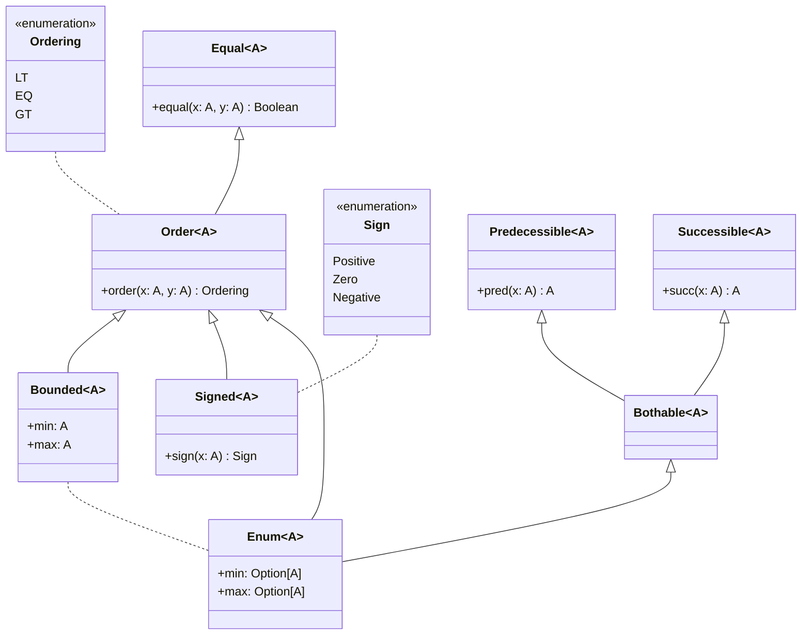

# Enum

**The `Enum` type class**, extending [`Order`](order.md) and [`Bothable`](bothable.md), is an abstraction
that represents types with a finite set of values having a defined order.
It combines the properties of enumerations (as in `Enum` from other languages)
and the ability to compare values (thanks to extending `Order`).
This allows working with such types as ordered sets,
where each value has a clearly defined position relative to others.

**Where is it used?**

- **Working with enumerations**:
    - For types representing a fixed set of values (e.g., days of the week, months, order statuses).
- **Comparison and sorting**:
    - Thanks to extending `Order`, values of type `Enum` can be compared and sorted.
- **Sequence generation**:
    - `Enum` allows easily generating sequences of values (e.g., all days of the week or all months of the year).
- **Conversion between values and their ordinal numbers**:
    - Useful in serialization/deserialization when values need to be stored as numbers.

## Formal definition

Members of the `Enum` type, extending [`Order`](order.md) and [`Bothable`](bothable.md),
represent sequentially ordered types — they can be enumerated.

The main advantage of the `Enum` type class is that we can use its types in list ranges.
They also have defined successors and predecessors,
which you can obtain using `succ` and `pred` functions.
There may also be minimum and maximum elements.

`Enum` must satisfy the following laws (besides `Order` and `Equal` laws):

- successor of predecessor of `x` is `x`: `succ(pred(x)) == x`
- predecessor of successor of `x` is `x`: `pred(succ(x)) == x`
- for any `x` not equal to `max`, its successor is greater than or equal to `x`: `x == max || succ(x) >= x`
- for any `x` not equal to `min`, its predecessor is less than or equal to `x`: `x == min || pred(x) <= x`

## Code definition in Scala

```dotty
trait Equal[A]:
  def equal(a1: A, a2: A): Boolean

enum Ordering:
  case LT
  case EQ
  case GT

trait Order[A] extends Equal[A]:
  def order(x: A, y: A): Ordering

trait Predecessible[A]:
  def pred(a: A): Option[A]

trait Successible[A]:
  def succ(a: A): Option[A]

trait Bothable[A] extends Predecessible[A], Successible[A]

trait Enum[A] extends Order[A], Bothable[A]:
  def min: Option[A]
  def max: Option[A]
```

### Day of week

An example of implementing `Enum` type class for a day of the week:

```dotty
object Enum:
  enum DayOfWeek(val i: Int):
    case Monday    extends DayOfWeek(1)
    case Tuesday   extends DayOfWeek(2)
    case Wednesday extends DayOfWeek(3)
    case Thursday  extends DayOfWeek(4)
    case Friday    extends DayOfWeek(5)
    case Saturday  extends DayOfWeek(6)
    case Sunday    extends DayOfWeek(7)

  given Enum[DayOfWeek] with
    override def min: Option[DayOfWeek] =
      Some(DayOfWeek.Monday)

    override def max: Option[DayOfWeek] =
      Some(DayOfWeek.Sunday)

    override def order(x: DayOfWeek, y: DayOfWeek): Ordering =
      if x.i < y.i then Ordering.LT
      else if x.i == y.i then Ordering.EQ
      else Ordering.GT

    override def prev(a: DayOfWeek): Option[DayOfWeek] =
      a match
        case DayOfWeek.Monday    => None
        case DayOfWeek.Tuesday   => Some(DayOfWeek.Monday)
        case DayOfWeek.Wednesday => Some(DayOfWeek.Tuesday)
        case DayOfWeek.Thursday  => Some(DayOfWeek.Wednesday)
        case DayOfWeek.Friday    => Some(DayOfWeek.Thursday)
        case DayOfWeek.Saturday  => Some(DayOfWeek.Friday)
        case DayOfWeek.Sunday    => Some(DayOfWeek.Saturday)

    override def next(a: DayOfWeek): Option[DayOfWeek] =
      a match
        case DayOfWeek.Monday    => Some(DayOfWeek.Tuesday)
        case DayOfWeek.Tuesday   => Some(DayOfWeek.Wednesday)
        case DayOfWeek.Wednesday => Some(DayOfWeek.Thursday)
        case DayOfWeek.Thursday  => Some(DayOfWeek.Friday)
        case DayOfWeek.Friday    => Some(DayOfWeek.Saturday)
        case DayOfWeek.Saturday  => Some(DayOfWeek.Sunday)
        case DayOfWeek.Sunday    => None

  end given
end Enum
```

## Diagram



## Implementation in libraries

### Implementation in ScalaZ

```dotty
import scalaz.*
import Scalaz.*
1 |-> 2        // [1,2]
1 |--> (2, 5)  // [1,3,5]
1.pred         // 0
1.predx        // Some(0)
1.succ         // 2
1.succx        // Some(2)
Enum[Int].min  // Some(-2147483648)
Enum[Int].max  // Some(2147483647)
```

---

**References:**

- [Repository with exercises][sample]
- [Learning Scalaz](http://eed3si9n.com/learning-scalaz/Enum.html)
- [Scalaz API](https://javadoc.io/doc/org.scalaz/scalaz-core_3/7.3.6/scalaz/Enum.html)

[sample]: https://gitverse.ru/scalabook/typeclasses
