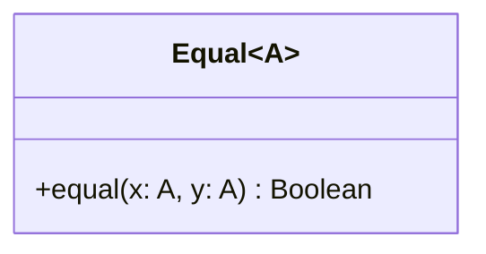

# Equal

`Equal` is a type class that defines a method for checking the equality of two objects.
Unlike Scala's built-in `==` method,
`Equal` provides a more type-safe and functional approach to comparison,
avoiding problems related to `null` and incompatible types.

**Where is it used?**

`Equal` is used in functional programming, where strict typing and avoiding side effects are important.
It is used in libraries such as Cats for working with types that require comparison,
for example, when implementing algorithms, testing, or working with collections.

**Usage examples:**

- **Comparing custom types**: If you have a custom data type,
  you can implement an `Equal` instance for it to compare objects of that type.
- **Testing**: In tests, `Equal` can be used to verify that a function's result matches an expected value.

**Key advantages:**

- **Type safety**: `Equal` does not allow comparing objects of different types.
- **Functional approach**: `Equal` integrates with other functional abstractions,
  such as [`Functor`](../monad/functor.md) or [`Monad`](../monad/monad.md).
- **Flexibility**: You can define custom comparison rules for various types.

## Formal definition

`Equal` is a type class that defines an `equal(a1: F, a2: F): Boolean` method,
returning `true` if two values are equal, or `false` otherwise.

### Laws for `Equal`:

For a correct implementation of `Equal`, the following [laws](https://ru.wikipedia.org/wiki/%D0%A2%D0%BE%D0%B6%D0%B4%D0%B5%D1%81%D1%82%D0%B2%D0%BE_%D0%BD%D0%B5%D1%80%D0%B0%D0%B7%D0%BB%D0%B8%D1%87%D0%B8%D0%BC%D1%8B%D1%85) must hold:

- **Reflexivity**: For any value `x` of type `A`, `equal(x, x)` must return `true`.
- **Indiscernibility of identicals** (_antisymmetry_): for any `x` and `y`, if `x == y`, then `x` and `y` are indistinguishable.
  Indiscernibility formalizes the intuitive notion of two objects having exactly the same properties.
  Two values `x, y: A` are indistinguishable if there is no function `f: A => Boolean` such that `f(x)` is `true` and `f(y)` is `false`.
- **Indistinguishability implies equality**: for any `x` and `y`, if `x` and `y` are indistinguishable, then `x == y`.

These laws entail symmetry and transitivity, which should be easier to check,
since they do not involve a universal quantification over all possible predicates in the language:

- **Symmetry**: For any values `x` and `y` of type `A`, if `equal(x, y)` returns `true`,
  then `equal(y, x)` must also return `true`.
- **Transitivity**: For any values `x`, `y`, and `z` of type `A`,
  if `equal(x, y)` and `equal(y, z)` return `true`, then `equal(x, z)` must also return `true`.

## Code definition in Scala

`Equal` is defined as follows:

```dotty
trait Equal[F]:
  self =>

  def equal(a1: F, a2: F): Boolean

  def notEqual(a1: F, a2: F): Boolean = !equal(a1, a2)

  def contramap[G](f: G => F): Equal[G] =
    (g1: G, g2: G) => self.equal(f(g1), f(g2))
```

- **Type parameter `F`**: `Equal` is parameterized by type `A` for which equality is defined.
- **`equal` method**: The `equal` method takes two values of type `A` and returns a `Boolean` indicating whether they are equal.
- **`notEqual` method**: The `notEqual` method takes two values of type `A` and returns a `Boolean` indicating whether they are distinct.
- **Contramap**: If there is a transformation `f: G => F`, then an `Equal[G]` can be derived from `Equal[F]`.

## Diagram



## Implementation in libraries

### Implementation in Cats

```dotty
import cats.*
import cats.implicits.*

1 === 1              // true
"Hello" =!= "World"  // true
123 === "123"        // Does not compile: Type Mismatch Error
1.some =!= none[Int] // true

final case class Cat(name: String, age: Int, color: String)

given Eq[Cat] =
  Eq.instance[Cat] { (cat1, cat2) =>
    (cat1.name  === cat2.name ) &&
      (cat1.age   === cat2.age  ) &&
      (cat1.color === cat2.color)
  }

val cat1 = Cat("Garfield",   38, "orange and black")
val cat2 = Cat("Heathcliff", 32, "orange and black")
cat1 === cat2         // false
```

### [Implementation in Spire](../../libs/spire.md)

Spire provides the `Eq[A]` type class for representing equality of types.
This allows reasoning about types for which no computationally useful notion of equality exists,
and avoids programming errors caused by universal equality.

`Eq[A]` provides two operators:

- `eqv` (`===`): equivalence — checking for equality.
- `neqv` (`=!=`): inequality — checking for lack of equality (by default `!(a === b)`).

Spire requires `eqv` to satisfy the laws of an equivalence relation, namely:

- `a === a` (_reflexivity_)
- if `a === b`, then `b === a` (_symmetry_)
- if `a === b`, then `a` is `b` (_antisymmetry_)
- if `a === b` and `b === c`, then `a === c` (_transitivity_)

The antisymmetry property may seem confusing.
The idea is that if `a === b`, then `a` and `b` must be interchangeable,
so for any expression `f(x)`, `f(a) === f(b)`.

```dotty
import spire.math.Rational
import spire.syntax.all.*

Rational(2, 4) === Rational(3, 6) // true
Rational(2, 6) =!= Rational(3, 6) // true
```

---

**References:**

- [Repository with exercises][sample]
- [Cats](https://typelevel.org/cats/typeclasses/eq.html)
- [Herding Cats](http://eed3si9n.com/herding-cats/Eq.html)
- [Learning Scalaz](http://eed3si9n.com/learning-scalaz/Equal.html)
- [Scalaz API](https://javadoc.io/doc/org.scalaz/scalaz-core_3/7.3.6/scalaz/Equal.html)
- [Spire home page](https://typelevel.org/spire/)

[sample]: https://gitverse.ru/scalabook/typeclasses
