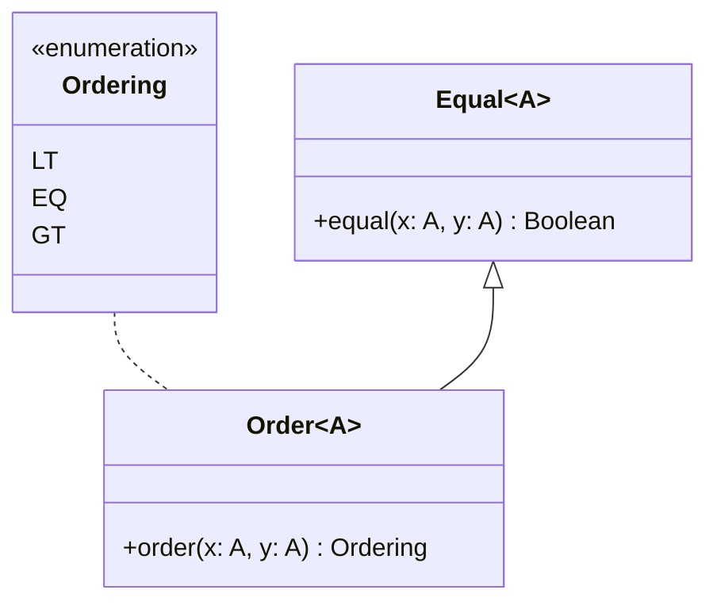

# Order

`Order` is a type class that defines methods for comparing two objects of the same type.
It allows determining which of two objects is "less than", "greater than", or "equal" to another.
`Order` includes comparison methods such as `order`,
which returns a value indicating "less than", "greater than", or "equal".

`Order` is used in various scenarios where ordering or comparing objects is needed.
Here are some examples:

- **Sorting collections**: `Order` can be used to sort lists, arrays, or other collections of objects.
- **Searching**: When implementing search algorithms such as binary search, it's important to be able to compare elements.
- **Comparing custom types**: If you have a custom data type,
  you can implement an `Order` instance for it to define how objects of that type should be compared.
- **Algorithms**: In algorithms such as merge sort or quicksort, `Order` allows determining the order of elements.

## Formal definition

`Order` extends [Equal](equal.md) and additionally defines methods for checking the ordering between values,
such as "less than", "greater than", or "equal".

`Order` must satisfy the following laws (besides `Equal` laws):

- **Reflexivity**: For any value `x` of type `A`, `order(x, x)` is "equal".
- **Antisymmetry**:
    - For any values `x` and `y` of type `A`, if `order(x, y)` is "less than" or "equal"
      and `order(y, x)` is "less than" or "equal", then `x` and `y` must be equal (`equal(x, y) == true`).
    - if `f1 < f2`, then `f2 > f1`,
    - if `f1 <= f2`, then `f2 >= f1`,
    - and so on.
- **Transitivity**:
  For any values `x`, `y`, and `z` of type `A`, if `x <= y` and `y <= z`, then `x <= z`.
  Similarly for `<`, `>=`, `>`, and `=`.
- **Totality**: either `a <= b` or `b <= a`.
- **Consistency of `Order` and `Equal`**: `equal(f1, f2)` is `true` if and only if
  `order(f1, f2)` is "equal".

## Code definition in Scala

The definition of `Order` looks like this:

```dotty
trait Equal[F]:
  def equal(a1: F, a2: F): Boolean

enum Ordering:
  case LT
  case EQ
  case GT

trait Order[F] extends Equal[F]:
  def order(x: F, y: F): Ordering

  def equal(x: F, y: F): Boolean = order(x, y) == Ordering.EQ
```

- **Type parameter `F`**: `Order` is parameterized by type `F` for which ordering is defined.
- **`order` method**: The `order` method takes two values of type `F` and returns the `Ordering` enumeration:
    - `LT` if `x < y`.
    - `EQ` if `x == y`.
    - `GT` if `x > y`.
- **Inheritance from `Equal`**: `Order` extends the `Equal` type class,
  allowing the use of methods for checking equality (`equal`).

### Additional methods

Using the `order` method, you can implement "less than", "less than or equal", "greater than", "greater than or equal",
finding maximum, minimum, sorting two elements, and a reversed `Order`.

```dotty
trait Order[F] extends Equal[F]:
  self =>

  ...

  def lessThan(x: F, y: F): Boolean = order(x, y) == Ordering.LT

  def lessThanOrEqual(x: F, y: F): Boolean = order(x, y) != Ordering.GT

  def greaterThan(x: F, y: F): Boolean = order(x, y) == Ordering.GT

  def greaterThanOrEqual(x: F, y: F): Boolean = order(x, y) != Ordering.LT

  def max(x: F, y: F): F = if greaterThanOrEqual(x, y) then x else y

  def min(x: F, y: F): F = if lessThan(x, y) then x else y

  def sort(x: F, y: F): (F, F) = if lessThanOrEqual(x, y) then (x, y) else (y, x)

  def reverseOrder: Order[F] = new Order[F]:
    def order(x: F, y: F): Ordering = self.order(y, x)

    override def reverseOrder: Order[F] = self
```

## Diagram



## Implementation in libraries

### Implementation in Cats

```dotty
import cats.*
import cats.implicits.*

1.0 compare 2.0
// val res0: Int = -1
1.0 max 2.0
// val res1: Double = 2.0
```

### [Implementation in Spire](../../libs/spire.md)

General comparison in Spire is supported by the `Order[A]` type class.
Unlike other ordering type classes (e.g., `scala.math.Ordering`),
this one specializes in avoiding boxing of `Order[A]`.
An `Eq[A]` can be implemented using a single `compare` method,
although `Order[A]` provides all of the following:

- `eqv` (`a === b`)
- `neqv` (`a =!= b`)
- `compare` (`a compare b`): less (`-1`), equal (`0`), or greater (`1`)
- `gt` (`a > b`): greater than
- `gteqv` (`a >= b`): greater than or equal
- `lt` (`a < b`): less than
- `lteqv` (`a <= b`): less than or equal
- `min` (`a min b`): least element
- `max` (`a max b`): greatest element

Instances of `Order[A]` must satisfy the following properties:

- if `a <= b` and `b <= a`, then `a === b` (_antisymmetry_)
- if `a <= b` and `b <= c`, then `a <= c` (_transitivity_)
- either `a <= b` or `b <= a` (_totality_)

Additionally, general field ordering must satisfy the following extra laws:

- if `a <= b`, then `(a + c) <= (b + c)` (_O1_)
- if `zero <= a` and `zero <= b`, then `zero <= (a * b)` (_O2_)

(This is a law required for ordered fields.)

In some cases, users may need to use (or define) a general ordering
that doesn't satisfy all these laws or may violate laws required by other structures.
An example is the lexicographic ordering of complex numbers, which violates _O2_.
In such cases, users must be aware of the risks and restrict usage to situations
where a specific law is not required.

```dotty
import spire.algebra.Order
import spire.math.Rational

Order.comparison(Rational(1, 2), Rational(1, 3)) // GreaterThan
Order.gt(Rational(1, 2), Rational(1, 3))         // true
Order.gteqv(Rational(1, 2), Rational(1, 3))      // true
Order.lt(Rational(1, 2), Rational(1, 3))         // false
Order.lteqv(Rational(1, 2), Rational(1, 3))      // false
Order.min(Rational(1, 2), Rational(1, 3))        // 1/3
Order.max(Rational(1, 2), Rational(1, 3))        // 1/2
```

#### PartialOrder

Partial ordering in Spire is supported by the `PartialOrder[A]` type class.
Its implementation differs from `scala.math.PartialOrdering` in two features:
`PartialOrder` is specialized to prevent boxing, and the `partialCompare` method returns a `Double`,
avoiding allocation of an `Option[Int]` instance.
`PartialOrder[A]` extends `Eq[A]` and can be implemented using a single `partialCompare` method described below.
`PartialOrder` provides:

- `partialCompare` (`a partialCompare b`): less (`-1.0`), equal (`0.0`), greater (`1.0`), or incomparable (`NaN`)
- `tryCompare` (`a tryCompare b`): less (`Some(-1)`), equal (`Some(0)`), greater (`Some(1)`), or incomparable (`None`)
- `pmin` (`a pmin b`): finding the lesser element if elements are comparable; returns `Option`
- `pmax` (`a pmax b`): finding the greater element if elements are comparable; returns `Option`
- `gt` (`a > b`), `gteqv` (`a >= b`), `lt` (`a < b`) and `lteqv` (`a <= b`): returns `false` if elements are incomparable
  or the comparison result
- `eqv` (`a === b`)
- `neqv` (`a =!= b`)

Partial ordering is defined by a binary relation `<=` that satisfies the following relations:

- `a <= a` (_reflexivity_)
- if `a <= b` and `b <= a`, then `a === b` (_antisymmetry_)
- if `a <= b` and `b <= c`, then `a <= c` (_transitivity_)

To compute both `<=` and `>=` values simultaneously,
the `partialCompare` method uses a `Double` value to encode the results of both comparisons.
The truth table is defined as follows:

| `a <= b` |`a >= b` | `partialCompare(a, b)` |      corresponds to       |
|:--------:|:-------:|:----------------------:|:-------------------------:|
|  `true`  | `true`  |          `0`           |       `a === b`           |
| `false`  | `false` |         `NaN`          |    `a` is incomparable    |
|  `true`  | `false` |          `-1`          |         `a < b`           |
| `false`  | `true`  |          `1`           |         `a > b`           |

The `tryCompare` method returns `Some(-1)`, `Some(0)`, `Some(1)`, and `None` instead of `-1.0`, `0.0`, `1.0`, `NaN` respectively,
allowing the use of `getOrElse` and higher-order methods at the cost of `Option[Int]` allocation.

Instances of `PartialOrder[A]` must satisfy the above properties.

---

**References:**

- [Repository with exercises][sample]
- [Cats API](https://www.javadoc.io/doc/org.typelevel/cats-docs_3/latest/cats/kernel/Order.html)
- [Herding Cats](http://eed3si9n.com/herding-cats/Order.html)
- [Learning Scalaz](http://eed3si9n.com/learning-scalaz/Order.html)
- [Scalaz API](https://javadoc.io/doc/org.scalaz/scalaz-core_3/7.3.6/scalaz/Order.html)
- [Spire home page](https://typelevel.org/spire/)

[sample]: https://gitverse.ru/scalabook/typeclasses
