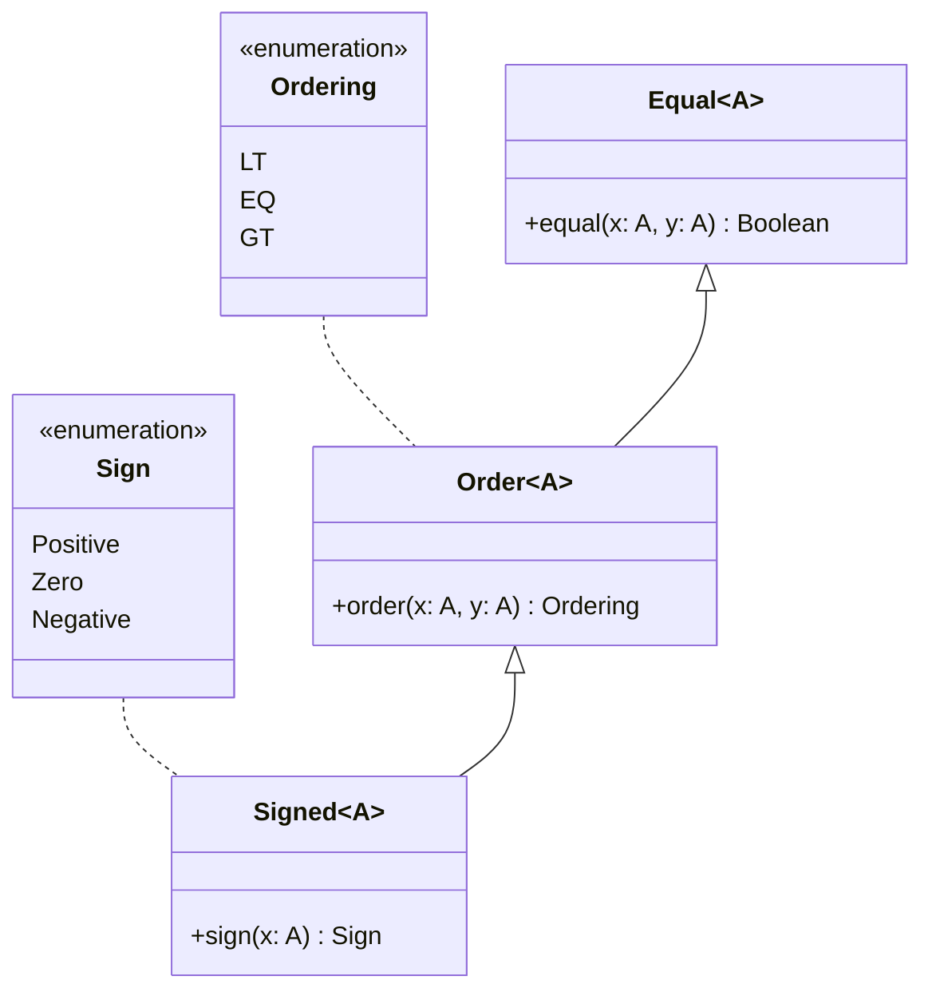

# Signed

`Signed` is a type class that defines methods for working with signed types.
It allows determining whether a value is positive, negative, or zero,
as well as performing operations such as taking the absolute value or changing the sign.

`Signed` is used in various scenarios where working with signed values is important. Here are some examples:

- **Numeric types**: `Signed` can be used to work with numeric types
  such as `Int`, `Long`, `Float`, and `Double` that support signs.
- **Mathematical operations**: In mathematical algorithms such as computing the modulus or negating a number,
  `Signed` provides convenient methods.
- **Custom types**: If you have a custom data type that supports a sign,
  you can implement a `Signed` instance for it.
- **Data analysis**: In data analysis tasks where the sign of values is important,
  `Signed` can be used for data classification.

## Formal definition

General shift-invariant ordering is established by the `Signed[A]` type class,
which extends [`Order`](order.md) — types having a sign (negative, zero, positive).
In general, type `A` contains a zero element `0`.

`Signed` must satisfy the following laws (besides `Order` and `Equal` laws):

- `sign(x) = Negative` if `x < 0`, `sign(x) = Positive` if `x > 0`, otherwise `sign(x) = Zero`.

If type `A` is equipped with negation elements `-x`, then:

- `abs(x) = -x` if `x < 0`, otherwise it is `x`,

## Code definition in Scala

```dotty
trait Equal[A]:
  def equal(a1: A, a2: A): Boolean

enum Ordering:
  case LT
  case EQ
  case GT

trait Order[A] extends Equal[A]:
  def order(x: A, y: A): Ordering

enum Sign:
  case Positive
  case Zero
  case Negative

trait Signed[A] extends Order[A]:
  def sign(x: A): Sign
  def abs(x: A): A
  def isSignPositive(x: A): Boolean = sign(x) == Sign.Positive
  def isSignZero(x: A): Boolean = sign(x) == Sign.Zero
  def isSignNegative(x: A): Boolean = sign(x) == Sign.Negative
  def isSignNonPositive(x: A): Boolean = sign(x) != Sign.Positive
  def isSignNonZero(x: A): Boolean = sign(x) != Sign.Zero
  def isSignNonNegative(x: A): Boolean = sign(x) != Sign.Negative
```

- **Type parameter `A`**: `Signed` is parameterized by type `A` for which sign handling is defined.
- **`sign` method**: The `sign` method takes a value of type `A` and returns the `Sign` enumeration:
    - `Negative` if `x` is negative.
    - `Zero` if `x` equals zero.
    - `Positive` if `x` is positive.
- **`abs` method**: The `abs` method takes a value of type `A` and returns its absolute value.

## Diagram



## Implementation in libraries

### Implementation in Cats

```dotty
import algebra.Order
import algebra.ring.{AdditiveCommutativeMonoid, Signed}
import algebra.ring.Signed.*

given Signed[Int] with
  def signum(a: Int): Int = a

  def abs(a: Int): Int = math.abs(a)

  def additiveCommutativeMonoid: AdditiveCommutativeMonoid[Int] =
    new AdditiveCommutativeMonoid[Int]:
      override def plus(x: Int, y: Int): Int = x + y

      override def zero: Int = 0

  def order: Order[Int] = Order.by(identity)

sign(10)               // Positive
sign(0)                // Zero
sign(-10)              // Negative
signum(10)             // 1
signum(0)              // 0
signum(-10)            // -1
abs(10)                // 10
abs(0)                 // 0
abs(-10)               // 10
isSignPositive(10)     // true
isSignZero(0)          // true
isSignNegative(-10)    // true
isSignNonPositive(10)  // false
isSignNonZero(0)       // false
isSignNonNegative(-10) // false
```

### [Implementation in Spire](../../libs/spire.md)

General shift-invariant ordering is established by the `Signed[A]` type class —
types having a sign (negative, zero, positive).
In general, type `A` is equipped with a commutative additive operation `+` and a zero element `0`
(see the definition of commutative rings below).
The following laws hold:

- if `a <= b`, then `a + c <= b + c` (linear order),
- `signum(x) = -1` if `x < 0`, `signum(x) = 1` if `x > 0`, otherwise `signum(x) = 0`.

If type `A` is equipped with negation elements `-x`, then:

- `abs(x) = -x` if `x < 0`, otherwise `x`,

The above laws imply:

- `abs(a + b) <= abs(a) + abs(b)`

```dotty
import spire.algebra.Signed.*
import spire.std.int.*

sign(10)               // Positive
sign(0)                // Zero
sign(-10)              // Negative
signum(10)             // 1
signum(0)              // 0
signum(-10)            // -1
abs(10)                // 10
abs(0)                 // 0
abs(-10)               // 10
isSignPositive(10)     // true
isSignZero(0)          // true
isSignNegative(-10)    // true
isSignNonPositive(10)  // false
isSignNonZero(0)       // false
isSignNonNegative(-10) // false
```

---

**References:**

- [Repository with exercises][sample]
- [Spire home page](https://typelevel.org/spire/)
- [Spire User's Guide](https://typelevel.org/spire/guide.html)

[sample]: https://gitverse.ru/scalabook/typeclasses
