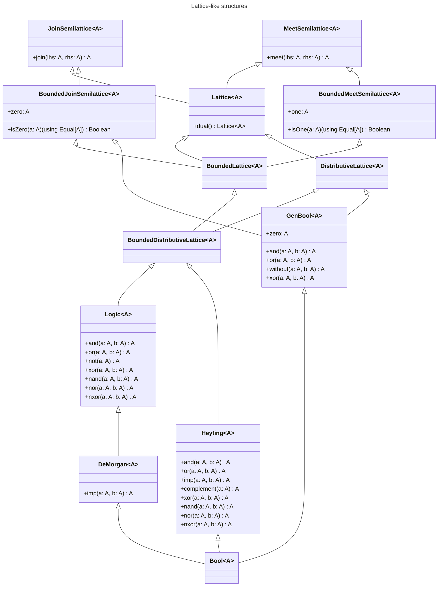

# Lattices

Lattice-like structures represent structures that may resemble rings but operate under different laws.

Instead of `plus` (addition) and `times` (multiplication) here we have:

- **`meet`** (meet/intersection) — analogous to logical **AND** or the **minimum** operation ("greatest lower bound").
- **`join`** (join/union) — analogous to logical **OR** or the **maximum** operation ("least upper bound").

**Properties of `meet` and `join`:**

- They are always associative, commutative, and idempotent (`a ∧ a = a`).
- Each one individually forms a **semilattice**.

**Additional elements:**

- **`zero`**: if present, then `join(a, zero) = a` (zero is the lower bound, joining with it does not change the element).
- **`one`**: if present, then `meet(a, one) = a` (one is the upper bound).
- **Absorption law**: if both are present, then `meet(a, join(a, b)) = join(a, meet(a, b)) = a`.
- **Distributivity**: `meet` is distributive over `join` and vice versa.
- **`imp` (implication)**: a special operation meaning "if... then...".

### Table of lattice-like structures

- [**JoinSemilattice**](lattice/join-semilattice.md): Join semilattice (knows only `join`).
- [**MeetSemilattice**](lattice/meet-semilattice.md): Meet semilattice (knows only `meet`).
- [**BoundedJoinSemilattice**](lattice/bounded-join-semilattice.md): Join semilattice with zero (lower bound).
- [**BoundedMeetSemilattice**](lattice/bounded-meet-semilattice.md): Meet semilattice with one (upper bound).
- [**Lattice**](lattice/lattice.md): Full lattice (has both meet and join).
- [**DistributiveLattice**](lattice/distributive-lattice.md): Distributive lattice.  
  *Example: sets with `∩` and `∪`.*
- [**BoundedLattice**](lattice/bounded-lattice.md): Bounded lattice (has both 0 and 1).
- [**BoundedDistributiveLattice**](lattice/bounded-distributive-lattice.md): Distributive lattice with bounds.
- [**Logic**](lattice/logic.md): **General logic**.
- [**DeMorgan**](lattice/de-morgan.md): **De Morgan algebra**.
- [**Heyting**](lattice/heyting.md): **Heyting algebra**. Lattice with implication.  
  *Example: logic without the law of excluded middle.*
- [**GenBool**](lattice/gen-bool.md): **Generalized Boolean algebra**.
- [**Bool**](lattice/bool.md): **Boolean algebra**. Classical logic with the law of excluded middle (`a || !a == true`).  
  *Example: `true/false`, bitmasks.*

## Hierarchy

---

**Links:**

- [Link to the exercises repository][sample]
- [Cats](https://typelevel.org/cats/)

[sample]: https://gitverse.ru/scalabook/typeclasses
