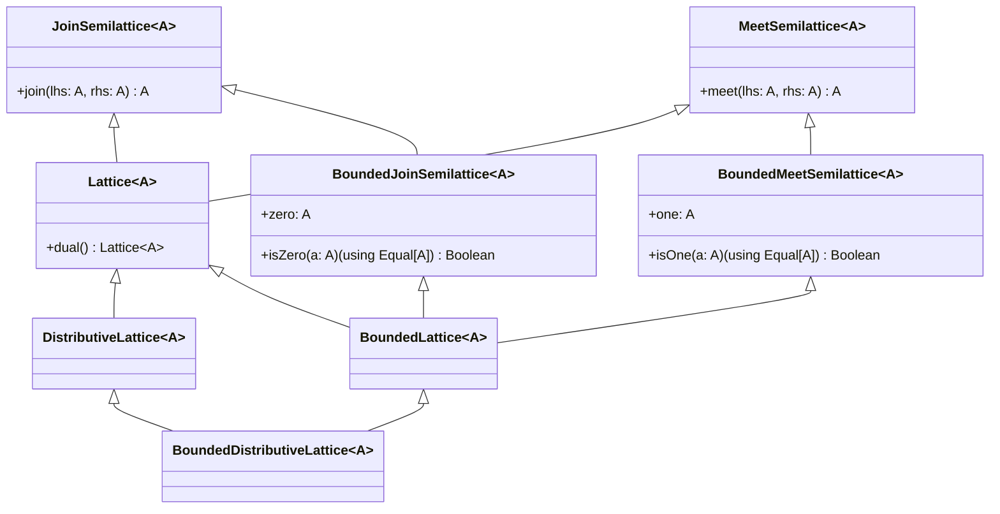

# Bounded Distributive Lattice

## Formal definition

A **bounded distributive lattice** is a structure
that combines the properties of a [bounded lattice](bounded-lattice.md) and a [distributive lattice](distributive-lattice.md).
It contains two distinguished elements (bottom and top) and operations that are distributive over each other.

### Axioms

1. **Lattice axioms**: idempotence, commutativity, associativity, absorption laws
2. **Boundedness axioms**:
    - Existence of `zero` (⊥): `join(zero, a) = a`
    - Existence of `one` (⊤): `meet(one, a) = a`
3. **Distributivity axioms**:
    - `join(a, meet(b, c)) = meet(join(a, b), join(a, c))`
    - `meet(a, join(b, c)) = join(meet(a, b), meet(a, c))`

### Complete set of axioms

| Law                       | Formula                            | Type               |
|---------------------------|------------------------------------|--------------------|
| Idempotence (join)        | `a ∨ a = a`                        | Lattice            |
| Idempotence (meet)        | `a ∧ a = a`                        | Lattice            |
| Commutativity (join)      | `a ∨ b = b ∨ a`                    | Lattice            |
| Commutativity (meet)      | `a ∧ b = b ∧ a`                    | Lattice            |
| Associativity (join)      | `(a ∨ b) ∨ c = a ∨ (b ∨ c)`        | Lattice            |
| Associativity (meet)      | `(a ∧ b) ∧ c = a ∧ (b ∧ c)`        | Lattice            |
| Absorption (1)            | `a ∨ (a ∧ b) = a`                  | Lattice            |
| Absorption (2)            | `a ∧ (a ∨ b) = a`                  | Lattice            |
| Neutrality of zero        | `⊥ ∨ a = a`                        | Boundedness        |
| Neutrality of one         | `⊤ ∧ a = a`                        | Boundedness        |
| Absorption of zero        | `a ∧ ⊥ = ⊥`                        | Boundedness        |
| Absorption of one         | `a ∨ ⊤ = ⊤`                        | Boundedness        |
| Distributivity (join)     | `a ∨ (b ∧ c) = (a ∨ b) ∧ (a ∨ c)`  | Distributivity     |
| Distributivity (meet)     | `a ∧ (b ∨ c) = (a ∧ b) ∨ (a ∧ c)`  | Distributivity     |

### Examples of bounded distributive lattices

| Set                              | join (∨)        | meet (∧)         | zero (⊥)         | one (⊤)              | Note               |
|----------------------------------|-----------------|------------------|------------------|----------------------|--------------------|
| Boolean values                   | `\|\|` (OR)     | `&&` (AND)       | `false`          | `true`               | Classic example    |
| Power set of a set               | `∪` (union)     | `∩` (intersection)| `∅` (empty)      | `U` (universe)       | Requires universe  |
| Integers bounded from a to b     | `max`           | `min`            | `a`              | `b`                  | Any linear order   |
| Divisors of N                    | `LCM`           | `GCD`            | `1`              | `N`                  | From factorization |
| Intervals from a to b            | union           | intersection     | empty interval   | full interval        | Interval arithmetic|
| Types in Scala                   | LUB             | GLB              | `Nothing`        | `Any`                | Subtype system     |

## Code

```dotty
trait BoundedDistributiveLattice[A] extends BoundedLattice[A],
      DistributiveLattice[A]:
  self =>

  /** Dual lattice (zero ↔ one, join ↔ meet) */
  override def dual: BoundedDistributiveLattice[A] =
    new BoundedDistributiveLattice[A]:
      def meet(a: A, b: A): A = self.join(a, b)
      def join(a: A, b: A): A = self.meet(a, b)
      def one: A = self.zero
      def zero: A = self.one
      override def dual: BoundedDistributiveLattice[A] = self   
```

## Exercises

### Exercise 5.1.1: Boolean values

> [Repository with exercises and instructions][sample]

Implement `BoundedDistributiveLattice` for the type `Boolean`:

```dotty
given BoundedDistributiveLattice[Boolean] with
  def join(a: Boolean, b: Boolean): Boolean = ???

  def meet(a: Boolean, b: Boolean): Boolean = ???

  def zero: Boolean = ???

  def one: Boolean = ???
```

@:note(🔍 Show solution)

This solution implements a bounded distributive lattice for Boolean values,
where `join` corresponds to logical OR (`||`), `meet` to logical AND (`&&`),
and the lower and upper bounds are `false` and `true` respectively,
which fully satisfies the distributive laws and makes this structure a classic two-valued Boolean algebra.

```dotty
given BoundedDistributiveLattice[Boolean] with
  // OR
  def join(a: Boolean, b: Boolean): Boolean = a || b

  // AND
  def meet(a: Boolean, b: Boolean): Boolean = a && b

  // false - neutral for OR
  def zero: Boolean = false

  // true - neutral for AND
  def one: Boolean = true
```

@:@

### Exercise 5.1.2: Integers with min/max (bounded)

Create a bounded distributive lattice for integers in a given range `[minBound, maxBound]`:

```dotty
def boundedIntLattice(
    minBound: Int,
    maxBound: Int
): BoundedDistributiveLattice[Int] =
  new BoundedDistributiveLattice[Int]:
    override def zero: Int = ???

    override def one: Int = ???

    override def join(lhs: Int, rhs: Int): Int = ???

    override def meet(lhs: Int, rhs: Int): Int = ???
```

@:note(🔍 Show solution)

This solution creates a bounded distributive lattice for integers in the range `[minBound, maxBound]`,
where `join` corresponds to `math.max` and `meet` to `math.min`,
making this a linearly ordered lattice. Here `zero = minBound` is the smallest element
and `one = maxBound` is the largest,
allowing it to model bounded numeric ranges in static analysis and optimization.

```dotty
def boundedIntLattice(
    minBound: Int,
    maxBound: Int
): BoundedDistributiveLattice[Int] =
  new BoundedDistributiveLattice[Int]:
    override def zero: Int = minBound

    override def one: Int = maxBound

    override def join(lhs: Int, rhs: Int): Int = math.max(lhs, rhs)

    override def meet(lhs: Int, rhs: Int): Int = math.min(lhs, rhs)
```

@:@

### Exercise 5.1.3: Optional values

Implement `BoundedDistributiveLattice` for the type `Option[A]`, using the base bounded lattice for `A`:

```dotty
def boundedOptionLattice[A: BoundedLattice as bounded]
    : BoundedDistributiveLattice[Option[A]] =
  new BoundedDistributiveLattice[Option[A]]:
    def join(a: Option[A], b: Option[A]): Option[A] =
      ???

    def meet(a: Option[A], b: Option[A]): Option[A] =
      ???

    def zero: Option[A] = ???

    def one: Option[A] = ???
```

@:note(🔍 Show solution)

This solution builds a bounded distributive lattice for `Option[A]` values
based on the base lattice for type `A`, where `join` merges two values,
preferring `Some` (and when both are `Some`, applying `join` to their contents),
while `meet` returns the shared value only when both arguments are `Some` (otherwise `None`).
Here `zero = None` represents absence of information (neutral element for join),
and `one = Some(bounded.one)` represents maximum possible information.

```dotty
def boundedOptionLattice[A: BoundedLattice as bounded]
    : BoundedDistributiveLattice[Option[A]] =
  new BoundedDistributiveLattice[Option[A]]:
    def join(a: Option[A], b: Option[A]): Option[A] =
      (a, b) match
        case (Some(x), Some(y)) => Some(bounded.join(x, y))
        case (Some(x), None)    => Some(x)
        case (None, Some(y))    => Some(y)
        case (None, None)       => None

    def meet(a: Option[A], b: Option[A]): Option[A] =
      (a, b) match
        case (Some(x), Some(y)) => Some(bounded.meet(x, y))
        case _                  => None

    def zero: Option[A] = None

    def one: Option[A] = Some(bounded.one)
```

@:@

### Exercise 5.1.4: Permission system

Implement `BoundedDistributiveLattice` for access levels `AccessLevel`:

```dotty
enum AccessLevel:
  case Guest, User, Moderator, Admin

given BoundedDistributiveLattice[AccessLevel] with
  import AccessLevel.*

  def join(a: AccessLevel, b: AccessLevel): AccessLevel =
    ???

  def meet(a: AccessLevel, b: AccessLevel): AccessLevel =
    ???

  def zero: AccessLevel = ???

  def one: AccessLevel = ???
```

@:note(🔍 Show solution)

This solution implements a bounded distributive lattice for access levels `AccessLevel`,
where `join` selects the highest level (maximum priority) and `meet` the lowest (minimum),
corresponding to policies for merging and intersecting access rights.
Here `zero = Guest` is the smallest element
and `one = Admin` is the largest, forming a hierarchy of authority from guest to administrator.

```dotty
given BoundedDistributiveLattice[AccessLevel] with
  import AccessLevel.*

  def join(a: AccessLevel, b: AccessLevel): AccessLevel =
    if a.ordinal >= b.ordinal then a else b // max = highest level

  def meet(a: AccessLevel, b: AccessLevel): AccessLevel =
    if a.ordinal <= b.ordinal then a else b // min = lowest level

  def zero: AccessLevel = Guest

  def one: AccessLevel = Admin
```

@:@

## Diagram



## Implementation in libraries

### Implementation in Cats

```dotty
import algebra.lattice.BoundedDistributiveLattice
import cats.*
import cats.implicits.*

// Implementation for Boolean
given BoundedDistributiveLattice[Boolean] with
  def join(a: Boolean, b: Boolean): Boolean = a || b
  def meet(a: Boolean, b: Boolean): Boolean = a && b
  def zero: Boolean                         = false
  def one: Boolean                          = true

// Implementation for Int (bounded range)
given BoundedDistributiveLattice[Int] with
  def join(a: Int, b: Int): Int = math.max(a, b)
  def meet(a: Int, b: Int): Int = math.min(a, b)
  def zero: Int                 = Int.MinValue
  def one: Int                  = Int.MaxValue

// Implementation for Set (power set)
def boundedSetLattice[A](universe: Set[A]): BoundedDistributiveLattice[Set[A]] =
  new BoundedDistributiveLattice[Set[A]]:
    def join(a: Set[A], b: Set[A]): Set[A] = a ++ b
    def meet(a: Set[A], b: Set[A]): Set[A] = a diff b
    def zero: Set[A]                       = Set.empty
    def one: Set[A]                        = universe

// Usage
val boolLattice = summon[BoundedDistributiveLattice[Boolean]]
println(boolLattice.join(true, false)) // true
println(boolLattice.meet(true, false)) // false
println(boolLattice.zero)              // false
println(boolLattice.one)               // true
```

## Summary

`BoundedDistributiveLattice` is a structure combining boundedness and distributivity. Key aspects:

1. **Completeness**: contains both bounds (zero, one) and distributive operations
2. **Normalization**: allows reducing expressions to normal forms (DNF, CNF)
3. **Foundation for Boolean algebras**: becomes a Boolean algebra when adding complement/negation
4. **Practical**: widely used in logical systems and data analysis

As a fundamental structure, `BoundedDistributiveLattice` serves as the basis for:

- **Logical systems**: classical and non-classical logic
- **Type systems**: bounded lattice types with LUB and GLB
- **Abstract interpretation**: complete lattices of program properties
- **Algebraic structures**: Boolean algebras, Heyting algebras

---

**Links:**

- [Link to the exercises repository][sample]
- [Cats](https://typelevel.org/cats/)

[sample]: https://gitverse.ru/scalabook/typeclasses
