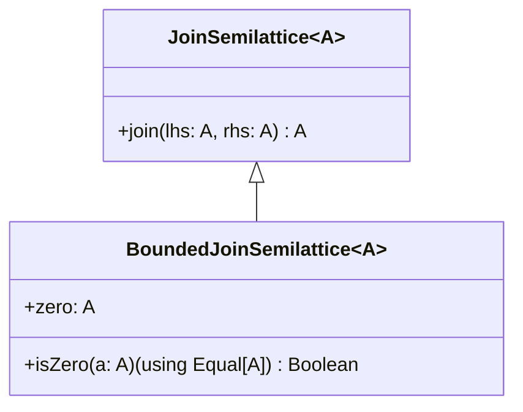

# Bounded Join Semilattice

## Formal definition

A **bounded join semilattice** (also known as a **upper semilattice with lower bound**) is a [`JoinSemilattice`](join-semilattice.md)
augmented with a special element `zero` (⊥) that is a **neutral element** with respect to the `join` operation.

### Axioms

In addition to the standard join semilattice axioms (idempotence, commutativity, associativity), the following is added:

1. **Existence of zero**: there exists an element `zero ∈ A` such that:

    ```
    join(zero, a) = a  for any a ∈ A
    ```

2. **Connection with partial order**: `zero` is the **smallest element**:
    ```
    zero ≤ a  for any a ∈ A
    ```

### Properties of the zero element

| Property               | Formula      | Meaning                                     |
|------------------------|--------------|---------------------------------------------|
| Neutrality for join    | `⊥ ∨ a = a`  | Zero does not affect the join operation     |
| Absorption for meet    | `a ∧ ⊥ = ⊥`  | Intersection with zero yields zero          |
| Smallest element       | `⊥ ≤ a`      | Zero is less than or equal to all elements  |
| Idempotence            | `⊥ ∨ ⊥ = ⊥`  | Joining zero with itself                    |

### Examples

| Set                     | join operation                   | zero (⊥)             | Partial order   | Description                                     |
|-------------------------|----------------------------------|----------------------|-----------------|-------------------------------------------------|
| Boolean values          | `\|\|` (OR)                      | `false`              | `false ≤ true`  | False is neutral for OR                         |
| Sets                    | `∪` (union)                      | `∅` (empty set)      | `⊆` (inclusion) | Empty set is neutral for union                  |
| Natural numbers (with 0)| `max`                            | `0`                  | `≤` (standard)  | 0 is the smallest number                        |
| Natural numbers (with 1)| `max`                            | `1`                  | `≤` (standard)  | 1 is the smallest in {1,2,3,...}                |
| Types in Scala          | LUB (Least Upper Bound)          | `Nothing`            | subtyping        | `Nothing` is a subtype of all types             |
| Intervals               | interval union                   | empty interval       | inclusion        | Empty interval is neutral for union             |

## Code

```dotty
trait BoundedJoinSemilattice[A] extends JoinSemilattice[A]:
  /** Neutral element with respect to the join operation. Also known as
    * the smallest element (bottom), zero, or ⊥.
    */
  def zero: A

  /** Checks whether the given element is zero (neutral). Uses the
    * provided Equal instance to compare with zero.
    */
  def isZero(a: A)(using ev: Equal[A]): Boolean = ev.equal(a, zero)
```

## Diagram



## Implementation in libraries

### Implementation in Cats

```dotty
import cats.*
import cats.implicits.*
import cats.kernel.BoundedSemilattice

// Implementation for Boolean (OR with zero = false)
given BoundedSemilattice[Boolean] with
  def combine(a: Boolean, b: Boolean): Boolean = a || b
  def empty: Boolean                           = false

// Implementation for Int (max with zero = Int.MinValue)
given BoundedSemilattice[Int] with
  def combine(a: Int, b: Int): Int = math.max(a, b)
  def empty: Int                   = Int.MinValue

// Usage
val boolLattice = summon[BoundedSemilattice[Boolean]]
println(boolLattice.combine(true, false)) // true
println(boolLattice.empty)                // false

val intLattice = summon[BoundedSemilattice[Int]]
println(intLattice.combine(5, 3)) // 5
println(intLattice.empty)         // -2147483648

val setLattice = summon[BoundedSemilattice[Set[String]]]
println(setLattice.combine(Set("a", "b"), Set("b", "c"))) 
// Set("a", "b", "c")
println(setLattice.empty)                                 
// Set()
```

## Summary

`BoundedJoinSemilattice` is a `JoinSemilattice` with an added **neutral element** `zero` (⊥),
which is the smallest element in the partial order. Key aspects:

1. **Neutrality**: `zero` does not affect the `join` operation: `join(zero, a) = a`
2. **Smallest element**: `zero ≤ a` for all `a ∈ A`
3. **Absorption**: in the presence of `meet`, `meet(a, zero) = zero`

Used in:

- **Data aggregation** (initial value for joining)
- **Type systems** (Nothing as bottom type)
- **Set theory** (empty set as neutral element for union)
- **Abstract interpretation** (bottom element as absence of information)

---

**Links:**

- [Link to the exercises repository][sample]
- [Cats](https://typelevel.org/cats/)

[sample]: https://gitverse.ru/scalabook/typeclasses
