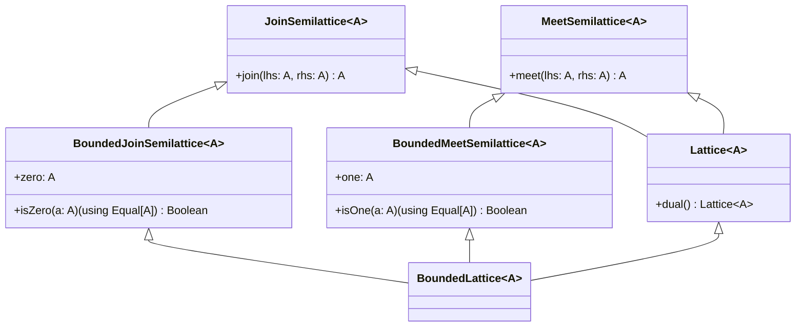

# Bounded Lattice

## Formal definition

A **bounded lattice** is a lattice that contains two distinguished elements:
**smallest** (bottom, ⊥) and **largest** (top, ⊤),
which are neutral elements for the `join` and `meet` operations respectively.

### Axioms

In addition to the standard lattice axioms (idempotence, commutativity, associativity, absorption laws), the following are added:

1. **Existence of zero (bottom)**: there exists an element `zero ∈ A` such that:

    ```
    join(zero, a) = a  for any a ∈ A
    ```

2. **Existence of one (top)**: there exists an element `one ∈ A` such that:

    ```
    meet(one, a) = a  for any a ∈ A
    ```

3. **Connection with partial order**:
    ```
    zero ≤ a ≤ one  for any a ∈ A
    ```

### Properties of a bounded lattice

| Property                      | Formula      | Meaning                                       |
|-------------------------------|--------------|-----------------------------------------------|
| Neutrality of zero for join   | `⊥ ∨ a = a`  | Zero does not affect the join operation       |
| Neutrality of one for meet    | `⊤ ∧ a = a`  | One does not affect the meet operation        |
| Absorption of zero for meet   | `a ∧ ⊥ = ⊥`  | Meet with zero yields zero                    |
| Absorption of one for join    | `a ∨ ⊤ = ⊤`  | Join with one yields one                      |
| Smallest element              | `⊥ ≤ a`      | Zero is less than or equal to all elements    |
| Largest element               | `a ≤ ⊤`      | All elements are less than or equal to one    |
| Idempotence of zero           | `⊥ ∨ ⊥ = ⊥`  | Joining zero with itself                      |
| Idempotence of one            | `⊤ ∧ ⊤ = ⊤`  | Meeting one with itself                       |

### Examples of bounded lattices

| Set                          | join (∨)            | meet (∧)           | zero (⊥)         | one (⊤)              | Partial order   |
|------------------------------|---------------------|--------------------|------------------|----------------------|-----------------|
| Boolean values               | `\|\|` (OR)         | `&&` (AND)         | `false`          | `true`               | `false ≤ true`  |
| Sets (power set)             | `∪` (union)         | `∩` (intersection) | `∅` (empty)      | `U` (universe)       | `⊆` (inclusion) |
| Integers from min to max     | `max`               | `min`              | `min`            | `max`                | `≤` (standard)  |
| Divisors of N                | `LCM`               | `GCD`              | `1`              | `N`                  | divisibility    |
| Types in Scala               | LUB                 | GLB                | `Nothing`        | `Any`                | subtyping       |
| Intervals from min to max    | union               | intersection       | empty interval   | full interval        | inclusion       |
| Probabilities from 0 to 1    | `max`               | `min`              | `0`              | `1`                  | `≤` (standard)  |

## Code

```dotty
trait BoundedLattice[A] extends Lattice[A], BoundedMeetSemilattice[A],
      BoundedJoinSemilattice[A]
```

## Diagram



## Implementation in libraries

### Implementation in Cats

```dotty
import algebra.lattice.BoundedLattice
import cats.*
import cats.implicits.*

// Implementation for Boolean
given BoundedLattice[Boolean] with
  def join(a: Boolean, b: Boolean): Boolean = a || b
  def meet(a: Boolean, b: Boolean): Boolean = a && b
  def zero: Boolean                         = false
  def one: Boolean                          = true

// Implementation for Int (bounded range)
given BoundedLattice[Int] with
  def join(a: Int, b: Int): Int = math.max(a, b)
  def meet(a: Int, b: Int): Int = math.min(a, b)
  def zero: Int                 = Int.MinValue
  def one: Int                  = Int.MaxValue

// Implementation for Set (power set)
// Requires a universe for one
def boundedSetLattice[A](universe: Set[A]): BoundedLattice[Set[A]] =
  new BoundedLattice[Set[A]]:
    def join(a: Set[A], b: Set[A]): Set[A] = a ++ b
    def meet(a: Set[A], b: Set[A]): Set[A] = a diff b
    def zero: Set[A]                       = Set.empty
    def one: Set[A]                        = universe

// Usage
val boolLattice = summon[BoundedLattice[Boolean]]
println(boolLattice.join(true, false)) // true
println(boolLattice.meet(true, false)) // false
println(boolLattice.zero)              // false
println(boolLattice.one)               // true

val intLattice = summon[BoundedLattice[Int]]
println(intLattice.join(5, 3)) // 5
println(intLattice.meet(5, 3)) // 3
println(intLattice.zero)       // -2147483648
println(intLattice.one)        // 2147483647

val setLattice = boundedSetLattice(Set(1, 2, 3, 4, 5))
println(setLattice.join(Set(1, 2), Set(2, 3))) // Set(1,2,3)
println(setLattice.meet(Set(1, 2), Set(2, 3))) // Set(2)
println(setLattice.zero)                       // Set()
println(setLattice.one)                        // Set(1,2,3,4,5)
```

## Summary

`BoundedLattice` is a lattice with two distinguished elements: `zero` (⊥) and `one` (⊤),
which are the bounds in the partial order. Key aspects:

1. **Double boundedness**: has both smallest and largest elements
2. **Neutrality**: `zero` is neutral for `join`, `one` is neutral for `meet`
3. **Absorption**: `zero` is absorbed by `meet`, `one` is absorbed by `join`
4. **Order**: `zero ≤ a ≤ one` for all `a ∈ A`

As the foundation for distributive lattices and Boolean algebras, `BoundedLattice` is widely used in:

- **Static program analysis**: bottom = absence of information, top = excessive information
- **Type systems**: Nothing as bottom, Any as top
- **Set theory**: empty set as bottom, universal set as top
- **Abstract interpretation**: representing program states
- **Functional programming**: composing structures with bounds

---

**Links:**

- [Link to the exercises repository][sample]
- [Cats](https://typelevel.org/cats/)

[sample]: https://gitverse.ru/scalabook/typeclasses
