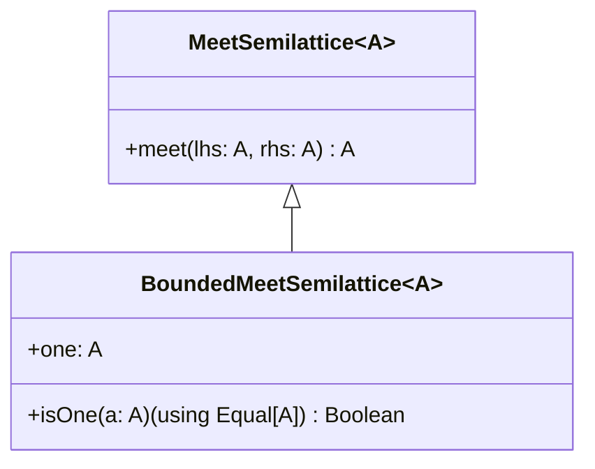

# Bounded Meet Semilattice

## Formal definition

A **bounded meet semilattice** (also known as a **lower semilattice with upper bound**) is a [`MeetSemilattice`](meet-semilattice.md)
augmented with a special element `one` (⊤) that is a **neutral element** with respect to the `meet` operation.

### Axioms

In addition to the standard meet semilattice axioms (idempotence, commutativity, associativity), the following is added:

1. **Existence of one**: there exists an element `one ∈ A` such that:
    ```
    meet(one, a) = a  for any a ∈ A
    ```

2. **Connection with partial order**: `one` is the **largest element**:
    ```
    a ≤ one  for any a ∈ A
    ```

### Properties of the one element

| Property               | Formula      | Meaning                                      |
|------------------------|--------------|----------------------------------------------|
| Neutrality for meet    | `⊤ ∧ a = a`  | One does not affect the meet operation       |
| Absorption for join    | `a ∨ ⊤ = ⊤`  | Join with one yields one                     |
| Largest element        | `a ≤ ⊤`      | All elements are less than or equal to one   |
| Idempotence            | `⊤ ∧ ⊤ = ⊤`  | Meeting one with itself                      |

### Examples

| Set                               | meet operation                | one (⊤)                 | Partial order   | Description                                          |
|-----------------------------------|-------------------------------|-------------------------|-----------------|------------------------------------------------------|
| Boolean values                    | `&&` (AND)                    | `true`                  | `false ≤ true`  | True is neutral for AND                              |
| Sets                              | `∩` (intersection)            | universal set U         | `⊆` (inclusion) | Universal set is neutral for intersection            |
| Bounded natural numbers           | `min`                         | maximal value           | `≤` (standard)  | Largest number in the range                          |
| Divisors of N                     | `GCD`                         | `N`                     | divisibility    | N itself is the largest divisor                      |
| Types in Scala                    | GLB (Greatest Lower Bound)    | `Any`                   | subtyping        | Any is a supertype of all types                      |
| Intervals                         | interval intersection         | universal interval      | inclusion        | Universal interval is neutral for intersection       |

## Code

```dotty
trait BoundedMeetSemilattice[A] extends MeetSemilattice[A]:
  /** Neutral element with respect to the meet operation. Also known as
    * the largest element (top), one, or ⊤.
    */
  def one: A

  /** Checks whether the given element is one (neutral). Uses the
    * provided Equal instance to compare with one.
    */
  def isOne(a: A)(using ev: Equal[A]): Boolean = ev.equal(a, one)
```

## Diagram



## Implementation in libraries

### Implementation in Cats

```dotty
import cats.*
import cats.kernel.BoundedSemilattice
import cats.implicits.*

// Implementation for Boolean (AND with one = true)
given BoundedSemilattice[Boolean] with
  def combine(a: Boolean, b: Boolean): Boolean = a && b
  def empty: Boolean                           = true // one for meet

// Implementation for Int (min with one = Int.MaxValue)
given BoundedSemilattice[Int] with
  def combine(a: Int, b: Int): Int = math.min(a, b)
  def empty: Int                   = Int.MaxValue

// Usage
val boolLattice = summon[BoundedSemilattice[Boolean]]
println(boolLattice.combine(true, false)) // false
println(boolLattice.empty)                // true

val intLattice = summon[BoundedSemilattice[Int]]
println(intLattice.combine(5, 3)) // 3
println(intLattice.empty)         // 2147483647
```

## Summary

`BoundedMeetSemilattice` is a `MeetSemilattice` with an added **neutral element** `one` (⊤),
which is the largest element in the partial order. Key aspects:

1. **Neutrality**: `one` does not affect the `meet` operation: `meet(one, a) = a`
2. **Largest element**: `a ≤ one` for all `a ∈ A`
3. **Absorption**: in the presence of `join`, `join(a, one) = one`
4. **Duality**: dual to `BoundedJoinSemilattice` (with zero)

Used in:

- **Data aggregation** (initial value for intersection)
- **Type systems** (Any as top type)
- **Set theory** (universal set as neutral element for intersection)
- **Abstract interpretation** (top element as excessive information)

---

**Links:**

- [Link to the exercises repository][sample]
- [Cats](https://typelevel.org/cats/)

[sample]: https://gitverse.ru/scalabook/typeclasses
