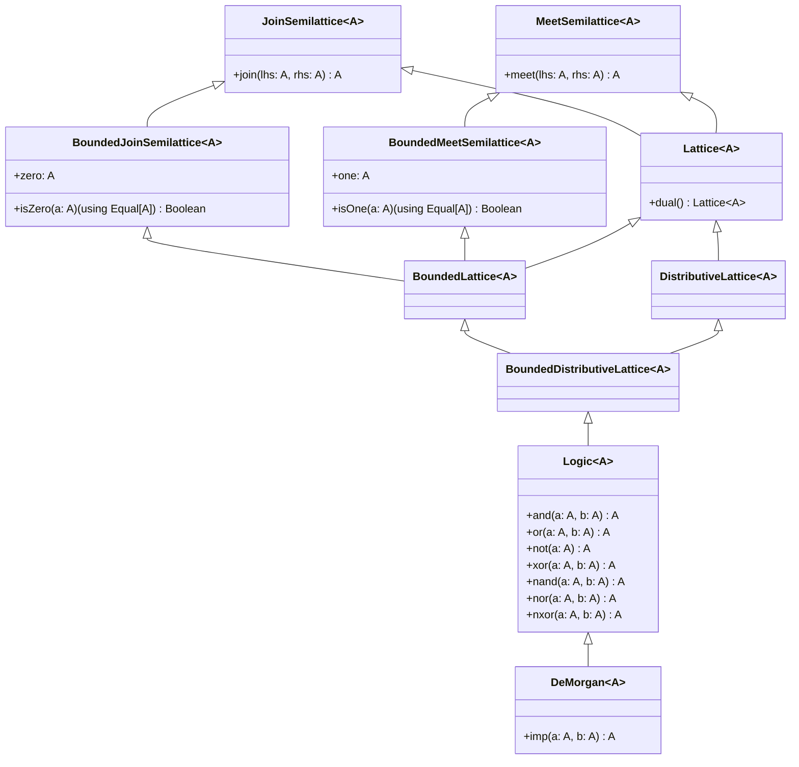

# De Morgan Algebra

## Formal definition

A **De Morgan algebra** is an algebraic structure
representing a [bounded distributive lattice with a unary negation operation](logic.md)
that satisfies the **De Morgan laws** and the **law of double negation**,
but does **not necessarily** satisfy the law of excluded middle and the law of non-contradiction.

### Axioms of De Morgan algebra

1. **Bounded distributive lattice axioms**:
    - All axioms of `BoundedDistributiveLattice` (idempotence, commutativity, associativity,
      absorption laws, distributivity, existence of zero and one)

2. **De Morgan laws** (full):
    - `¬(x ∨ y) = ¬x ∧ ¬y` (first De Morgan law)
    - `¬(x ∧ y) = ¬x ∨ ¬y` (second De Morgan law)

3. **Law of double negation**:
    - `¬¬a = a` (involution of negation)

4. **No guarantees**:
    - Law of excluded middle: `a ∨ ¬a = 1` — **not guaranteed**
    - Law of non-contradiction: `a ∧ ¬a = 0` — **not guaranteed**

### Comparison with other logical structures

| Property                      | Logic       | DeMorgan    | Heyting               | Bool |
|-------------------------------|-------------|-------------|-----------------------|------|
| Bounded distributive lattice  | ✅           | ✅           | ✅                     | ✅    |
| Negation (not)                | ✅           | ✅           | ✅ (pseudocomplement)  | ✅    |
| De Morgan laws                | ❌ (weak)    | ✅ (full)    | ✅                     | ✅    |
| Double negation               | ❌           | ✅           | ❌                     | ✅    |
| Law of excluded middle        | ❌           | ❌           | ❌                     | ✅    |
| Law of non-contradiction      | ❌           | ❌           | ✅                     | ✅    |
| Implication                   | ❌           | ✅           | ✅                     | ✅    |

### Examples of De Morgan algebras

| Example                         | Description              | Characteristics                           |
|---------------------------------|--------------------------|-------------------------------------------|
| Boolean values {true, false}    | Classical logic          | Also a Boolean algebra                    |
| Fuzzy logic interval 0 to 1     | `not(x) = 1-x`           | No law of excluded middle                 |
| Kleene's three-valued logic     | {true, false, unknown}   | `not(unknown) = unknown`                  |
| Sets with complement            | Power set with complement| Is a Boolean algebra                      |
| Interval logic                  | Intervals with negation  | `not([a,b]) = [1-b, 1-a]`                 |

## Code

```dotty
trait DeMorgan[A] extends Logic[A]:
  self =>

  /** Meet (intersection) operation implemented via logical AND */
  def meet(a: A, b: A): A = and(a, b)

  /** Join (union) operation implemented via logical OR */
  def join(a: A, b: A): A = or(a, b)

  /** Logical implication (a → b) is defined as ¬a ∨ b */
  def imp(a: A, b: A): A = or(not(a), b)
```

## Diagram



## Implementation in libraries

### Implementation in Cats

```dotty
import algebra.lattice.DeMorgan
import cats.*
import cats.implicits.*

// Implementation for Boolean (classical logic)
given DeMorgan[Boolean] with
  def and(a: Boolean, b: Boolean): Boolean = a && b
  def or(a: Boolean, b: Boolean): Boolean  = a || b
  def not(a: Boolean): Boolean             = !a
  def zero: Boolean                        = false
  def one: Boolean                         = true

// Usage
val boolDeMorgan = summon[DeMorgan[Boolean]]
println(boolDeMorgan.and(true, false)) // false
println(boolDeMorgan.or(true, false))  // true
println(boolDeMorgan.not(true))        // false
println(boolDeMorgan.imp(true, false)) // false
println(boolDeMorgan.xor(true, true))  // false
```

### Fuzzy logic implementation (example)

```dotty
// Fuzzy logic on interval [0, 1]
given FuzzyDeMorgan: DeMorgan[Double] with
  def and(a: Double, b: Double): Double = math.min(a, b)
  def or(a: Double, b: Double): Double  = math.max(a, b)
  def not(a: Double): Double            = 1.0 - a
  def zero: Double                      = 0.0
  def one: Double                       = 1.0

// Verify laws
val fuzzy = summon[DeMorgan[Double]]
println(fuzzy.and(0.3, 0.7)) // 0.3
println(fuzzy.or(0.3, 0.7))  // 0.7
println(fuzzy.not(0.3))      // 0.7
println(fuzzy.imp(0.3, 0.7)) // 0.7 (¬0.3 ∨ 0.7 = 0.7 ∨ 0.7 = 0.7)
```

### Three-valued logic implementation (example)

```dotty
enum KleeneLogic:
  case True, False, Unknown

// Kleene's three-valued logic as a De Morgan algebra
given KleeneDeMorgan: DeMorgan[KleeneLogic] with
  import KleeneLogic.*

  def and(a: KleeneLogic, b: KleeneLogic): KleeneLogic =
    (a, b) match
      case (False, _)   => False
      case (_, False)   => False
      case (Unknown, _) => Unknown
      case (_, Unknown) => Unknown
      case _            => True

  def or(a: KleeneLogic, b: KleeneLogic): KleeneLogic =
    (a, b) match
      case (True, _)    => True
      case (_, True)    => True
      case (Unknown, _) => Unknown
      case (_, Unknown) => Unknown
      case _            => False

  def not(a: KleeneLogic): KleeneLogic =
    a match
      case True    => False
      case False   => True
      case Unknown => Unknown

  def zero: KleeneLogic = False
  def one: KleeneLogic  = True
end KleeneDeMorgan

```

## Summary

`DeMorgan` is an algebraic structure extending `Logic` with full De Morgan laws and double negation. Key aspects:

1. **Involution negation**: `¬¬a = a` is guaranteed
2. **Full De Morgan laws**: both laws hold in full form
3. **Non-guaranteed laws**: law of excluded middle and law of non-contradiction may be violated
4. **Implication**: defined as `¬a ∨ b`

De Morgan algebras are especially useful for modeling:

- **Fuzzy logic** with continuous truth values
- **Many-valued logics** (3-valued, 4-valued logic)
- **Logics with uncertainty** (unknown, null)

As an intermediate link between `Logic` and `Bool`, `DeMorgan` provides a balance between expressiveness and
guarantees, allowing modeling of logical systems that need not obey the laws of classical logic.

---

**Links:**

- [Link to the exercises repository][sample]
- [Cats](https://typelevel.org/cats/)

[sample]: https://gitverse.ru/scalabook/typeclasses
