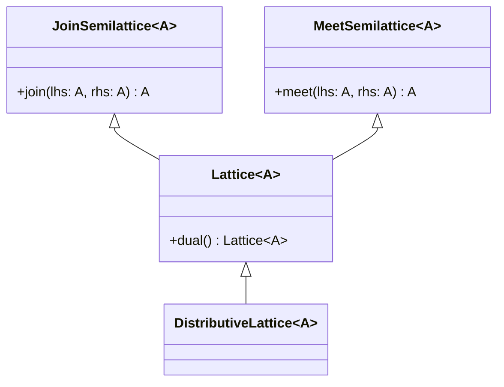

# Distributive Lattice

## Formal definition

A **distributive lattice** is a [lattice](lattice.md)
in which the `join` (∨) and `meet` (∧) operations are **distributive** over each other.
This means that each operation distributes through the other:

### Distributivity laws

1. **Distributivity of join over meet**:
    ```
    a ∨ (b ∧ c) = (a ∨ b) ∧ (a ∨ c)
    ```

2. **Distributivity of meet over join**:
    ```
    a ∧ (b ∨ c) = (a ∧ b) ∨ (a ∧ c)
    ```

In a distributive lattice it is sufficient to check **one** of these laws — the other follows automatically from the first (and vice versa),
provided the lattice already satisfies the absorption laws.

### Equivalent formulations

Distributivity can also be expressed through implication:

```
a ∨ (b ∧ c) ≤ (a ∨ b) ∧ (a ∨ c)  (always true for any lattice)
(a ∨ b) ∧ (a ∨ c) ≤ a ∨ (b ∧ c)  (additional distributivity condition)
```

### Characteristic properties

The following important properties hold in distributive lattices:

| Property           | Formula                                                                        | Description                              |
|--------------------|--------------------------------------------------------------------------------|------------------------------------------|
| Distributivity 1   | `a ∨ (b ∧ c) = (a ∨ b) ∧ (a ∨ c)`                                              | join is distributive over meet           |
| Distributivity 2   | `a ∧ (b ∨ c) = (a ∧ b) ∨ (a ∧ c)`                                              | meet is distributive over join           |
| Median law         | `(a ∨ b) ∧ (b ∨ c) ∧ (c ∨ a) = (a ∧ b) ∨ (b ∧ c) ∨ (c ∧ a)`                    | Characteristic property                  |
| Modularity         | `a ≤ c ⇒ a ∨ (b ∧ c) = (a ∨ b) ∧ c`                                            | Consequence of distributivity            |

### Examples of distributive lattices

| Lattice                     | Operations                 | Distributive? | Note                               |
|-----------------------------|----------------------------|---------------|------------------------------------|
| Boolean values              | OR/AND                     | ✅ Yes         | Classic example                    |
| Sets with ∪ and ∩           | union/intersection         | ✅ Yes         | Power set lattice                  |
| Integers with max/min       | max/min                    | ✅ Yes         | Any linear order is distributive   |
| Divisors with GCD/LCM       | GCD/LCM                    | ✅ Yes         | Follows from factorization         |
| All subsets of a set        | ∪/∩                        | ✅ Yes         | Power set                          |
| Real number intervals       | union/intersection         | ✅ Yes         | Interval arithmetic                |

## Code

```dotty
trait DistributiveLattice[A] extends Lattice[A]
```

## Diagram



## Implementation in libraries

### Implementation in Cats

```dotty
import algebra.lattice.Lattice
import cats.*
import cats.implicits.*

// Implementation for Boolean
given Lattice[Boolean] with
  def join(a: Boolean, b: Boolean): Boolean = a || b
  def meet(a: Boolean, b: Boolean): Boolean = a && b

// Implementation for Int (max/min)
given Lattice[Int] with
  def join(a: Int, b: Int): Int = math.max(a, b)
  def meet(a: Int, b: Int): Int = math.min(a, b)

// Implementation for Set (union/intersection)
given [A]: Lattice[Set[A]] with
  def join(a: Set[A], b: Set[A]): Set[A] = a ++ b
  def meet(a: Set[A], b: Set[A]): Set[A] = a diff b

// Usage
val boolLattice = summon[Lattice[Boolean]]
boolLattice.join(true, false) // true
boolLattice.meet(true, false) // false

val intLattice = summon[Lattice[Int]]
intLattice.join(5, 3) // 5
intLattice.meet(5, 3) // 3

val setLattice = summon[Lattice[Set[String]]]
setLattice.join(Set("a", "b"), Set("b", "c")) // Set("a", "b", "c")
setLattice.meet(Set("a", "b"), Set("b", "c")) // Set("b")
```

## Summary

`DistributiveLattice` is an important extension of lattice adding distributivity laws. Key aspects:

1. **Distributivity** allows transforming expressions by expanding parentheses
2. **Simplification** of complex logical expressions to normal forms (DNF, CNF)
3. **Query optimization** in databases and rule systems
4. **Modularity** automatically follows from distributivity

Used in:

- **Logic programming** (formula normalization)
- **Databases** (WHERE condition optimization)
- **Compilers** (type inference, expression simplification)
- **Rule systems** (merging and intersecting conditions)
- **Abstract interpretation** (simplifying abstract states)

---

**Links:**

- [Link to the exercises repository][sample]
- [Cats](https://typelevel.org/cats/)

[sample]: https://gitverse.ru/scalabook/typeclasses
