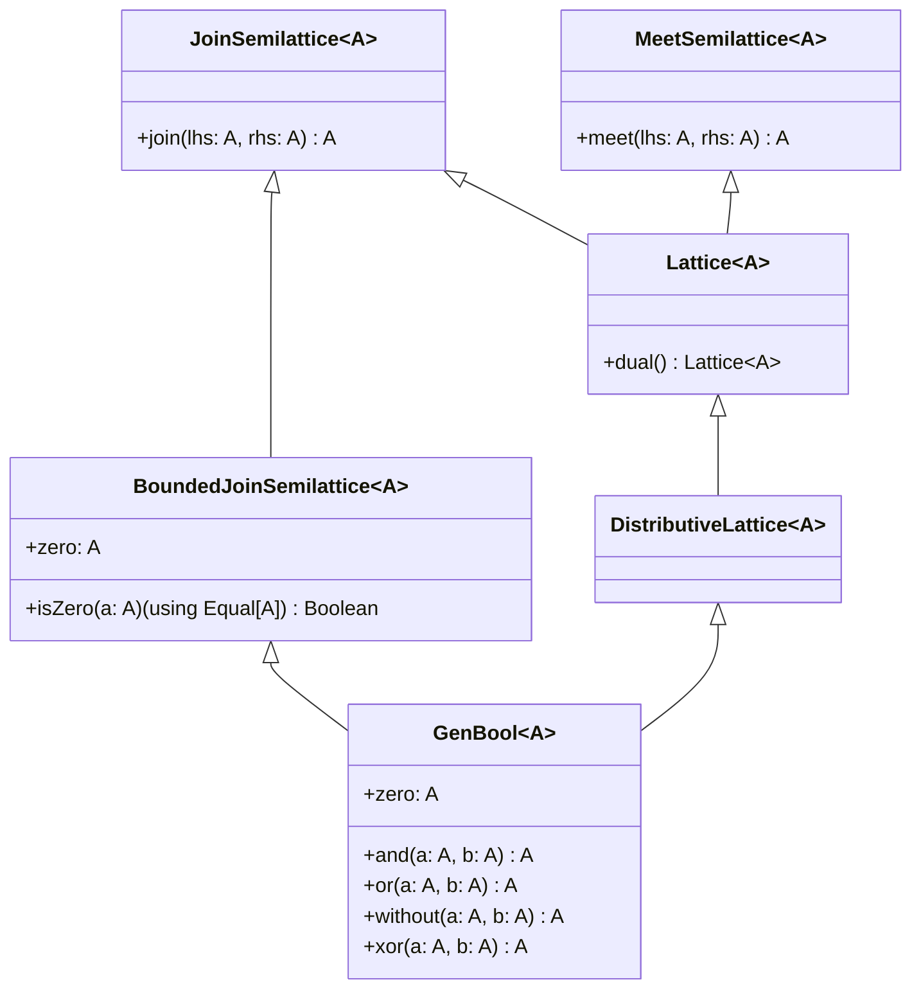

# Generalized Boolean Algebra

## Formal definition

A **generalized Boolean algebra** (also called _GenBool_) is a [distributive lattice](distributive-lattice.md) with a [lower bound (zero)](bounded-join-semilattice.md)
that has a **relative complement** operation (`without`, `\`),
but does not necessarily have an upper bound (top) or absolute complement.
This makes it suitable for modeling structures where a universal set is not defined.

### Axioms of generalized Boolean algebra

1. **Distributive lattice axioms**:
    - Idempotence, commutativity, associativity, absorption laws, distributivity

2. **Bounded join semilattice axioms**:
    - Existence of `zero` (⊥): `join(zero, a) = a`

3. **Relative complement** (`without`, `\`):
    - For any `a, b ∈ A` there exists an element `a \ b` (relative complement), which is the greatest element `x` such that:
        - `meet(b, x) = zero`
        - `join(b, x) = join(a, b)`

4. **No top element**:
    - In general, there is no guarantee of existence of an upper bound (one)

### Properties of relative complement

| Property            | Formula                          | Description                                                |
|---------------------|----------------------------------|------------------------------------------------------------|
| Non-contradiction   | `b ∧ (a \ b) = 0`                | Relative complement does not intersect with b              |
| Absorption          | `b ∨ (a \ b) = a ∨ b`            | Join of b and complement gives join of a and b             |
| Idempotence         | `a \ a = 0`                      | Set difference with itself is empty                        |
| Monotonicity        | if `a ≤ c`, then `a \ b ≤ c \ b` | Monotonicity with respect to the first argument            |
| Monotonicity        | if `b ≤ c`, then `a \ c ≤ a \ b` | Monotonicity with respect to the second argument           |

### Examples of generalized Boolean algebras

| Example                                                    | Operations                    | zero | Characteristics            |
|------------------------------------------------------------|-------------------------------|------|----------------------------|
| Sets (without universe)                                    | `∩`, `∪`, `\\`                | `∅`  | Classic example            |
| Finite sets                                                | `∩`, `∪`, `\\`                | `∅`  | Special case               |
| Open sets of a topological space                           | `∩`, `∪`, `\\` (relative)     | `∅`  | No guarantee of top        |
| Boolean algebras without top                               | `∩`, `∪`, `\\`                | `0`  | Generalization of Boolean  |
| Lattices with relative complement                          | depends on structure          | `0`  | Other structures           |

## Code

```dotty
trait GenBool[A] extends DistributiveLattice[A], BoundedJoinSemilattice[A]:
  self =>

  /** Logical AND (conjunction) */
  def and(a: A, b: A): A

  /** Meet (intersection) operation implemented via logical AND */
  override def meet(a: A, b: A): A = and(a, b)

  /** Logical OR (disjunction) */
  def or(a: A, b: A): A

  /** Join (union) operation implemented via logical OR */
  override def join(a: A, b: A): A = or(a, b)

  /** Relative complement operation, often denoted
    * as `a\b` (the set difference symbol, which is the
    * meaning of relative complement in the lattice of sets).
    *
    * Relative complement `a\b` is the greatest element x such that
    * meet(b, x) = zero and join(b, x) = join(a, b).
    *
    * In set terms: a\b = a ∩ b^c (elements of a not belonging to b)
    */
  def without(a: A, b: A): A

  /** Logical exclusive OR (XOR), also known as set-theoretic symmetric
    * difference. Defined as `a\b ∨ b\a`.
    *
    * In set terms: a XOR b = (a \ b) ∪ (b \ a)
    */
  def xor(a: A, b: A): A = or(without(a, b), without(b, a))
end GenBool
```

## Diagram



## Exercises

### Exercise 5.2.1: Generalized Boolean algebra for sets

> [Repository with exercises and instructions][sample]

Implement `GenBool` for the type `Set[A]`:

```dotty
given genBoolSet[A]: GenBool[Set[A]] with
  override def and(a: Set[A], b: Set[A]): Set[A] =
    ???

  override def zero: Set[A] =
    ???

  override def or(a: Set[A], b: Set[A]): Set[A] =
    ???

  override def without(a: Set[A], b: Set[A]): Set[A] =
    ???
```

@:note(🔍 Show solution)

This implementation provides a generalized Boolean algebra for sets,
where `and` corresponds to set intersection,
`or` to union, `zero` to the empty set,
and `without` to set difference, allowing set operations without requiring a universal set.

```dotty
given genBoolSet[A]: GenBool[Set[A]] with
  override def and(a: Set[A], b: Set[A]): Set[A] =
    a.intersect(b)

  override def zero: Set[A] =
    Set.empty

  override def or(a: Set[A], b: Set[A]): Set[A] =
    a ++ b

  override def without(a: Set[A], b: Set[A]): Set[A] =
    a.diff(b) 
```

@:@

## Implementation in libraries

### Implementation in Cats

```dotty
import algebra.lattice.GenBool
import cats.*
import cats.implicits.*

// Implementation for Set (generalized Boolean algebra)
given [A]: GenBool[Set[A]] with
  def and(a: Set[A], b: Set[A]): Set[A]     = a intersect b
  def or(a: Set[A], b: Set[A]): Set[A]      = a ++ b
  def zero: Set[A]                          = Set.empty
  def without(a: Set[A], b: Set[A]): Set[A] = a diff b

// Usage
val setBool = summon[GenBool[Set[Int]]]
val a       = Set(1, 2, 3)
val b       = Set(2, 3, 4)

println(setBool.and(a, b))     // Set(2, 3)
println(setBool.or(a, b))      // Set(1, 2, 3, 4)
println(setBool.zero)          // Set()
println(setBool.without(a, b)) // Set(1)
println(setBool.xor(a, b))     // Set(1, 4)
```

## Summary

`GenBool` is a generalization of Boolean algebra without an upper bound, using relative complement instead of absolute complement.
Key aspects:

1. **No top**: does not require a universal set
2. **Relative complement**: `without` instead of `complement`
3. **Zero element**: has a lower bound (`zero`)
4. **XOR via without**: symmetric difference via `without`

Used in:

- **Set theory**: sets without a universal set
- **Topology**: open sets of topological spaces
- **Permission systems**: relative access rights
- **Abstract interpretation**: program analysis without global state

---

**Links:**

- [Link to the exercises repository][sample]
- [Cats](https://typelevel.org/cats/)

[sample]: https://gitverse.ru/scalabook/typeclasses
