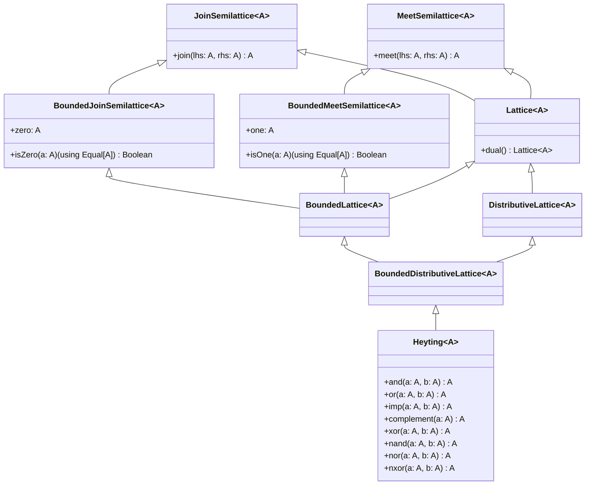

# Heyting Algebra

## Formal definition

A **Heyting algebra** is an algebraic structure
representing a [bounded distributive lattice](bounded-distributive-lattice.md)
with a binary **implication** operation (`imp`, →) that models intuitionistic logic.
Unlike [Boolean algebras](bool.md), Heyting algebras do **not guarantee** the law of excluded middle (`a ∨ ¬a = 1`),
but they do guarantee the law of non-contradiction (`a ∧ ¬a = 0`).

### Axioms of Heyting algebra

1. **Bounded distributive lattice axioms**:
    - All axioms of `BoundedDistributiveLattice` (idempotence, commutativity, associativity,
      absorption laws, distributivity, existence of zero and one)

2. **Implication axioms** (for any a, b, c ∈ A):
    - `a → a = 1` (reflexivity)
    - `a ∧ (a → b) = a ∧ b` (modus ponens)
    - `b ∧ (a → b) = b` (weakening)
    - `a → (b ∧ c) = (a → b) ∧ (a → c)` (distributivity of implication)

3. **Pseudocomplement**:
    - `¬a = a → 0` (complement defined via implication and `zero`)
    - `a ∧ ¬a = 0` (law of non-contradiction)

4. **No guarantee**:
    - Law of excluded middle: `a ∨ ¬a = 1` — **not guaranteed**

### Comparison with other logical structures

| Property                      | Logic       | DeMorgan         | Heyting               | Bool |
|-------------------------------|-------------|------------------|-----------------------|------|
| Bounded distributive lattice  | ✅           | ✅                | ✅                     | ✅    |
| De Morgan laws                | ❌ (weak)    | ✅ (full)         | ✅                     | ✅    |
| Double negation               | ❌           | ✅                | ❌                     | ✅    |
| Law of excluded middle        | ❌           | ❌                | ❌                     | ✅    |
| Law of non-contradiction      | ❌           | ❌                | ✅                     | ✅    |
| Implication                   | ❌           | ✅ (derived)      | ✅ (primitive)         | ✅    |
| Pseudocomplement              | ❌           | ❌                | ✅                     | ✅    |

### Examples of Heyting algebras

| Example                                                    | Description                        | Characteristics                      |
|------------------------------------------------------------|------------------------------------|--------------------------------------|
| Boolean values {true, false}                               | Classical logic                    | Also a Boolean algebra               |
| Open sets of a topological space                           | `imp(U,V) = interior(U^c ∪ V)`     | Classic example                      |
| Scala type system                                          | `imp(A,B) = A => B`                | Functional types as implication      |
| Subsets lattices with relative complement                  | Special case of Boolean algebra    | With universe present                |
| Intuitionistic propositional logic                         | Formulas with implication          | Modeled by Heyting algebras          |

## Code

```dotty
trait Heyting[A] extends BoundedDistributiveLattice[A]:
  self =>

  /** Logical AND (conjunction) */
  def and(a: A, b: A): A

  /** Meet (intersection) operation implemented via logical AND */
  def meet(a: A, b: A): A = and(a, b)

  /** Logical OR (disjunction) */
  def or(a: A, b: A): A

  /** Join (union) operation implemented via logical OR */
  def join(a: A, b: A): A = or(a, b)

  /** Logical implication (a → b) */
  def imp(a: A, b: A): A

  /** Pseudocomplement of an element (¬a), equivalent to (a → 0) */
  def complement(a: A): A

  /** Exclusive OR (XOR) — true when exactly one operand is true */
  def xor(a: A, b: A): A = or(and(a, complement(b)), and(complement(a), b))

  /** Sheffer stroke (NAND) — negation of conjunction */
  def nand(a: A, b: A): A = complement(and(a, b))

  /** Peirce arrow (NOR) — negation of disjunction */
  def nor(a: A, b: A): A = complement(or(a, b))

  /** Exclusive OR with negation (XNOR) — equivalence */
  def nxor(a: A, b: A): A = complement(xor(a, b))
end Heyting
```

## Diagram



## Implementation in libraries

### Implementation in Cats

```dotty
import algebra.lattice.Heyting
import cats.*
import cats.implicits.*

// Implementation for Boolean (classical logic)
given Heyting[Boolean] with
  def and(a: Boolean, b: Boolean): Boolean = a && b
  def or(a: Boolean, b: Boolean): Boolean  = a || b
  def imp(a: Boolean, b: Boolean): Boolean = !a || b
  def complement(a: Boolean): Boolean      = !a
  def zero: Boolean                        = false
  def one: Boolean                         = true

// Usage
val boolHeyting = summon[Heyting[Boolean]]
println(boolHeyting.and(true, false)) // false
println(boolHeyting.or(true, false))  // true
println(boolHeyting.imp(true, false)) // false
println(boolHeyting.complement(true)) // false
println(boolHeyting.xor(true, true))  // false
```

## Summary

`Heyting` is an algebraic structure modeling intuitionistic logic via implication and pseudocomplement.
Key aspects:

1. **Implication as primitive operation**: `imp` is fundamental, not derived
2. **Pseudocomplement**: defined via implication: `¬a = a → 0`
3. **Law of non-contradiction**: `a ∧ ¬a = 0` is guaranteed
4. **Law of excluded middle**: `a ∨ ¬a = 1` is **not guaranteed**
5. **Intuitionistic logic**: main model for constructive mathematics

Heyting algebras are especially important in:

- **Type theory**: functional types as implication
- **Topology**: open sets as propositions
- **Category theory**: subobjects and exponentials
- **Constructive mathematics**: proofs without the law of excluded middle

---

**Links:**

- [Link to the exercises repository][sample]
- [Cats](https://typelevel.org/cats/)

[sample]: https://gitverse.ru/scalabook/typeclasses
