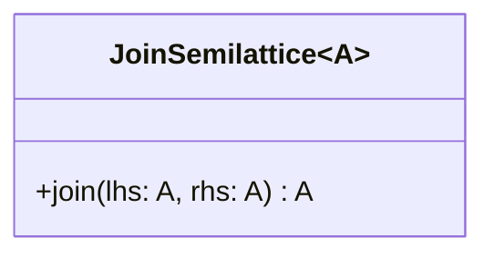

# Join Semilattice

## Formal definition

A **join semilattice** (also known as an **upper semilattice**) is an algebraic structure
representing a partially ordered set in which every pair of elements has a **least upper bound** (supremum).

In terms of abstract algebra, a join semilattice is a set `A` with a binary operation `join` (denoted as `∨`),
satisfying three axioms:

1. **Idempotence**: `a ∨ a = a` for any `a ∈ A`
2. **Commutativity**: `a ∨ b = b ∨ a` for any `a, b ∈ A`
3. **Associativity**: `(a ∨ b) ∨ c = a ∨ (b ∨ c)` for any `a, b, c ∈ A`

Connection with partial order: for any `a, b ∈ A`:

- `a ≤ b` if and only if `a ∨ b = b`

That is, `join` selects the "greater" of two elements with respect to the given order.

## Code

```dotty
trait JoinSemilattice[A]:
  /** Union (join) operation — returns the least upper bound
    * for two elements.
    */
  def join(lhs: A, rhs: A): A
```

## Examples

| Set              | join operation                | Partial order     | Description                |
|------------------|-------------------------------|-------------------|----------------------------|
| Boolean values   | `\|\|` (OR)                   | `false ≤ true`    | Logical OR                 |
| Sets             | `∪` (union)                   | `⊆` (inclusion)   | Set union                  |
| Natural numbers  | `max`                         | `≤` (standard)    | Maximum of two numbers     |
| Divisors of N    | `LCM`                         | divisibility      | Least common multiple      |
| Types in Scala   | LUB (Least Upper Bound)       | subtyping          | Least common supertype     |
| Strings          | lexicographic maximum         | alphabetical order| "later" string             |

`JoinSemilattice` is a fundamental structure underlying many abstractions in functional programming.
It allows:

- **Merging information** from different sources
- **Finding generalizations** for various values
- **Building hierarchies** based on partial order
- **Modeling operations** like maximum, union, OR

As the foundation for lattices and Boolean algebras, `JoinSemilattice` is widely used in type systems,
static analysis, databases, and many other areas.

## Diagram



## Implementation in libraries

### Implementation in Cats

```dotty
import algebra.lattice.JoinSemilattice
import cats.*
import cats.implicits.*

// Implementation for Boolean (OR)
given JoinSemilattice[Boolean] with
  def join(a: Boolean, b: Boolean): Boolean = a || b

// Implementation for Int (max)
given JoinSemilattice[Int] with
  def join(a: Int, b: Int): Int = math.max(a, b)

// Implementation for Set (union)
given [A]: JoinSemilattice[Set[A]] with
  def join(a: Set[A], b: Set[A]): Set[A] = a ++ b

// Usage
val boolLattice = summon[JoinSemilattice[Boolean]]
boolLattice.join(true, false) 
// true

val intLattice = summon[JoinSemilattice[Int]]
intLattice.join(5, 3)
// 5

val setLattice = summon[JoinSemilattice[Set[String]]]
setLattice.join(Set("a", "b"), Set("b", "c")) 
// Set("a", "b", "c")
```

---

**Links:**

- [Link to the exercises repository][sample]
- [Cats](https://typelevel.org/cats/)

[sample]: https://gitverse.ru/scalabook/typeclasses
