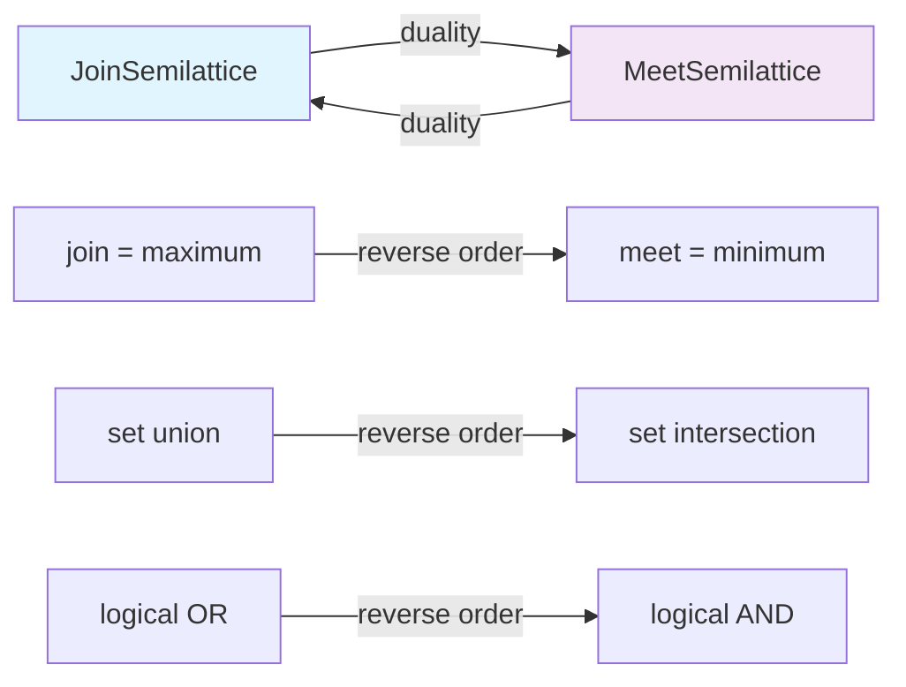
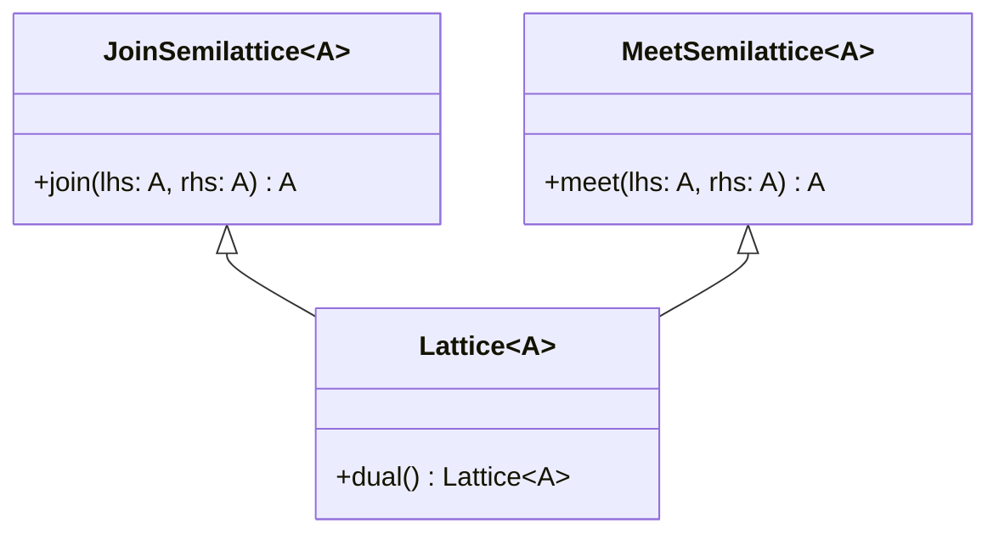

# Full Lattice

## Formal definition

A **lattice** is an algebraic structure representing a partially ordered set
in which every pair of elements has both a **least upper bound** (supremum, join, ∨)
and a **greatest lower bound** (infimum, meet, ∧).

In terms of abstract algebra, a lattice is a set `A` with two binary operations `join` (∨) and `meet` (∧),
satisfying the following axioms:

### 1. Semilattice axioms

Each operation separately satisfies the laws:

- **Idempotence**:
    - `a ∨ a = a`
    - `a ∧ a = a`
- **Commutativity**:
    - `a ∨ b = b ∨ a`
    - `a ∧ b = b ∧ a`
- **Associativity**:
    - `(a ∨ b) ∨ c = a ∨ (b ∨ c)`
    - `(a ∧ b) ∧ c = a ∧ (b ∧ c)`

### 2. Absorption laws

These are the key laws linking both operations:

- `a ∨ (a ∧ b) = a`
- `a ∧ (a ∨ b) = a`

### 3. Connection with partial order

For any `a, b ∈ A`:

- `a ≤ b` if and only if `a ∨ b = b`
- `a ≤ b` if and only if `a ∧ b = a`

## Code

```dotty
trait Lattice[A] extends JoinSemilattice[A], MeetSemilattice[A]:
  self =>

  /** This is a lattice in which meet and join are swapped
    *
    * This is useful for applying the duality principle:
    * any statement about lattices remains true when
    * join ↔ meet and ≤ ↔ ≥ are swapped
    */
  def dual: Lattice[A] = new Lattice[A]:
    def meet(a: A, b: A): A = self.join(a, b)
    def join(a: A, b: A): A = self.meet(a, b)
    override def dual: Lattice[A] = self
```

## Examples of lattices

| Set              | join operation (∨) | meet operation (∧) | Partial order     | Description                     |
|------------------|--------------------|--------------------|-------------------|---------------------------------|
| Boolean values   | `\|\|` (OR)        | `&&` (AND)         | `false ≤ true`    | Two-element Boolean lattice     |
| Sets             | `∪` (union)        | `∩` (intersection) | `⊆` (inclusion)   | Power set lattice               |
| Natural numbers  | `max`              | `min`              | `≤` (standard)    | Linearly ordered set            |
| Divisors of N    | `LCM`              | `GCD`              | divisibility      | Divisor lattice                 |
| Types in Scala   | LUB                | GLB                | subtyping          | Type lattice                    |
| Subspaces        | sum                | intersection       | inclusion         | Subspace lattice                |

### Duality of Join and Meet



### Summary

`Lattice` is a fundamental structure combining `JoinSemilattice` and `MeetSemilattice` via absorption laws.
It allows:

1. **Merging and intersecting information** from different sources
2. **Computing upper and lower bounds** in partially ordered sets
3. **Modeling hierarchies** with generalization and specialization operations
4. **Applying the duality principle** via the `dual` method

## Diagram



## Implementation in libraries

### Implementation in Cats

```dotty
import algebra.lattice.Lattice
import cats.*
import cats.implicits.*

// Implementation for Boolean
given Lattice[Boolean] with
  def join(a: Boolean, b: Boolean): Boolean = a || b
  def meet(a: Boolean, b: Boolean): Boolean = a && b

// Implementation for Int (max/min)
given Lattice[Int] with
  def join(a: Int, b: Int): Int = math.max(a, b)
  def meet(a: Int, b: Int): Int = math.min(a, b)

// Implementation for Set (union/intersection)
given [A]: Lattice[Set[A]] with
  def join(a: Set[A], b: Set[A]): Set[A] = a ++ b
  def meet(a: Set[A], b: Set[A]): Set[A] = a diff b

// Usage
val boolLattice = summon[Lattice[Boolean]]
boolLattice.join(true, false) // true
boolLattice.meet(true, false) // false

val intLattice = summon[Lattice[Int]]
intLattice.join(5, 3) // 5
intLattice.meet(5, 3) // 3

val setLattice = summon[Lattice[Set[String]]]
setLattice.join(Set("a", "b"), Set("b", "c")) // Set("a", "b", "c")
setLattice.meet(Set("a", "b"), Set("b", "c")) // Set("b")
```

---

**Links:**

- [Link to the exercises repository][sample]
- [Cats](https://typelevel.org/cats/)

[sample]: https://gitverse.ru/scalabook/typeclasses
