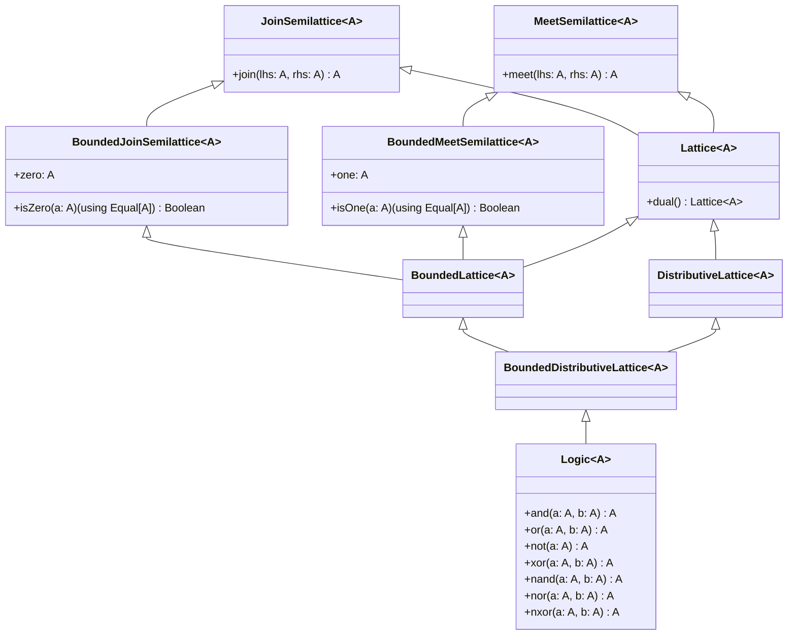

# General Logic

## Formal definition

**General logic** (or simply `Logic`) is an algebraic structure
extending a [bounded distributive lattice](bounded-distributive-lattice.md) with a negation operation,
which obeys the **weak De Morgan laws**.
This structure serves as an abstract foundation for various logical systems,
including classical, intuitionistic, and fuzzy logic.

### Logic Axioms

1. **Bounded distributive lattice axioms**:
    - All axioms of `BoundedDistributiveLattice` (idempotence, commutativity, associativity,
      absorption laws, distributivity, existence of `zero` and `one`)

2. **Negation operation** (`not`, `¬`):
    - `not: A → A` — unary operation

3. **Weak De Morgan laws**:
    - `¬(x ∨ y) = ¬x ∧ ¬y` (first De Morgan law)
    - `¬(x ∧ y) = ¬¬(¬x ∨ ¬y)` (second law in weakened form)

#### Weak vs. Full De Morgan Laws

| Law     | Weak form (Logic)            | Full form (DeMorgan/Bool)     |
|---------|------------------------------|-------------------------------|
| Law 1   | `¬(x∨y) = ¬x∧¬y`            | `¬(x∨y) = ¬x∧¬y`             |
| Law 2   | `¬(x∧y) = ¬¬(¬x∨¬y)`        | `¬(x∧y) = ¬x∨¬y`             |

> In the full form, the second De Morgan law does not require double negation, making it stronger.

### Connection with other logical structures

| Structure                | Negation                     | De Morgan Laws | Law of Excluded Middle | Double Negation |
|--------------------------|------------------------------|----------------|------------------------|-----------------|
| Logic                    | ✅ present                    | ❌ weak          | ❌                      | ❌               |
| [DeMorgan](de-morgan.md) | ✅ present                    | ✅ full          | ❌                      | ✅               |
| [Heyting](heyting.md)    | ✅ present (pseudocomplement) | ✅ full          | ❌                      | ❌               |
| [Bool](bool.md)          | ✅ present                    | ✅ full          | ✅                      | ✅               |

### Examples of logical systems

| Logic              | Element types           | Operations                     | Application                           |
|--------------------|-------------------------|--------------------------------|---------------------------------------|
| Classical          | Boolean                 | `!`, `&&`, `\|\|`              | Programming, circuit design           |
| Intuitionistic     | Types, open sets        | implication instead of not      | Type theory, constructive math        |
| Fuzzy              | interval 0 to 1         | `1-x`, `min`, `max`            | Control, expert systems               |
| Three-valued       | {true, false, unknown}  | Kleene operators               | Databases, logic with uncertainty     |

## Code

```dotty
trait Logic[A] extends BoundedDistributiveLattice[A]:
  self =>

  /** Logical AND (conjunction) — corresponds to meet (intersection) */
  def and(a: A, b: A): A

  /** Logical OR (disjunction) — corresponds to join (union) */
  def or(a: A, b: A): A

  /** Logical negation (involution) */
  def not(a: A): A

  /** Exclusive OR (XOR) — true when exactly one operand is true.
    * Defined as: (a ∧ ¬b) ∨ (¬a ∧ b)
    */
  def xor(a: A, b: A): A = or(and(a, not(b)), and(not(a), b))

  /** Sheffer stroke (NAND) — negation of conjunction: ¬(a ∧ b) */
  def nand(a: A, b: A): A = not(and(a, b))

  /** Peirce arrow (NOR) — negation of disjunction: ¬(a ∨ b) */
  def nor(a: A, b: A): A = not(or(a, b))

  /** Exclusive OR with negation (XNOR) — equivalence: ¬(a xor b) */
  def nxor(a: A, b: A): A = not(xor(a, b))
end Logic
```

## Diagram



## Implementation in libraries

### Implementation in Cats

```dotty
import algebra.lattice.Logic
import cats.*
import cats.implicits.*

// Implementation for Boolean (classical logic)
given Logic[Boolean] with
  def and(a: Boolean, b: Boolean): Boolean = a && b
  def or(a: Boolean, b: Boolean): Boolean  = a || b
  def not(a: Boolean): Boolean             = !a
  def zero: Boolean                        = false
  def one: Boolean                         = true

  override def join(lhs: Boolean, rhs: Boolean): Boolean = or(lhs, rhs)

  override def meet(lhs: Boolean, rhs: Boolean): Boolean = and(lhs, rhs)

// Usage
val boolLogic = summon[Logic[Boolean]]
println(boolLogic.and(true, false))  // false
println(boolLogic.or(true, false))   // true
println(boolLogic.not(true))         // false
println(boolLogic.xor(true, true))   // false
println(boolLogic.nand(true, true))  // false
println(boolLogic.nor(false, false)) // true
println(boolLogic.nxor(true, false)) // false
```

## Summary

`Logic` is a fundamental structure modeling general logic based on a bounded distributive lattice with negation. Key aspects:

1. **Generalization**: covers a broad spectrum of logical systems
2. **Minimality**: contains only the necessary axioms (weak De Morgan laws)
3. **Extensibility**: serves as the foundation for stronger logics (DeMorgan, Heyting, Bool)
4. **Practicality**: provides derived operations (xor, nand, nor, nxor)

As the peak of the lattice hierarchy, `Logic` prepares the ground for moving from purely lattice structures to logic-based structures, including:

- **Classical logic** (Bool)
- **Intuitionistic logic** (Heyting)
- **Fuzzy logic** (DeMorgan)

---

**Links:**

- [Link to the exercises repository][sample]
- [Cats](https://typelevel.org/cats/)

[sample]: https://gitverse.ru/scalabook/typeclasses
