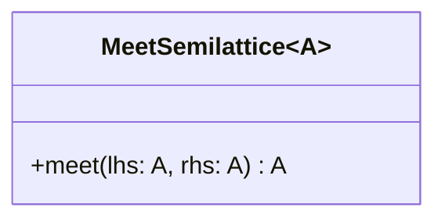

# Meet Semilattice

## Formal definition

A **meet semilattice** (also known as a **lower semilattice**) is an algebraic structure
representing a partially ordered set in which every pair of elements has a **greatest lower bound** (infimum).

In terms of abstract algebra, a meet semilattice is a set `A` with a binary operation `meet` (denoted as `∧`),
satisfying three axioms:

1. **Idempotence**: `a ∧ a = a` for any `a ∈ A`
2. **Commutativity**: `a ∧ b = b ∧ a` for any `a, b ∈ A`
3. **Associativity**: `(a ∧ b) ∧ c = a ∧ (b ∧ c)` for any `a, b, c ∈ A`

Connection with partial order: for any `a, b ∈ A`:

- `a ≤ b` if and only if `a ∧ b = a`

That is, `meet` selects the "lesser" of two elements with respect to the given order.

## Code

```dotty
trait MeetSemilattice[A]:
  /** Intersection (meet) operation — returns the greatest lower bound
    * for two elements.
    */
  def meet(lhs: A, rhs: A): A
```

## Examples

| Set              | meet operation              | Partial order     | Description                 |
|------------------|-----------------------------|-------------------|-----------------------------|
| Boolean values   | `&&` (AND)                  | `false ≤ true`    | Logical AND                 |
| Sets             | `∩` (intersection)          | `⊆` (inclusion)   | Set intersection            |
| Natural numbers  | `min`                       | `≤` (standard)    | Minimum of two numbers      |
| Divisors of N    | `GCD`                       | divisibility      | Greatest common divisor     |
| Types in Scala   | GLB (Greatest Lower Bound)  | subtyping          | Greatest common subtype     |
| Strings          | lexicographic minimum       | alphabetical order| "earlier" string            |

`MeetSemilattice` is a fundamental structure, dual to [`JoinSemilattice`](join-semilattice.md).
It allows:

- **Finding the common part** between two values
- **Intersecting information** from different sources
- **Finding the greatest common subtype** in type systems
- **Computing minimum** in various data structures

Together with `JoinSemilattice` it forms the basis for lattices ([Lattice](lattice.md)), which combine both operations
and are the foundation for building Boolean algebras and logical systems in functional programming.

## Diagram



## Implementation in libraries

### Implementation in Cats

```dotty
import algebra.lattice.MeetSemilattice
import cats.*
import cats.implicits.*

// Implementation for Boolean (AND)
given MeetSemilattice[Boolean] with
  def meet(a: Boolean, b: Boolean): Boolean = a && b

// Implementation for Int (min)
given MeetSemilattice[Int] with
  def meet(a: Int, b: Int): Int = math.min(a, b)

// Implementation for Set (intersection)
given [A]: MeetSemilattice[Set[A]] with
  def meet(a: Set[A], b: Set[A]): Set[A] = a diff b

// Usage
val boolLattice = summon[MeetSemilattice[Boolean]]
boolLattice.meet(true, false)
// false

val intLattice = summon[MeetSemilattice[Int]]
intLattice.meet(5, 3)
// 3

val setLattice = summon[MeetSemilattice[Set[String]]]
setLattice.meet(Set("a", "b"), Set("b", "c"))
// Set("b")
```

---

**Links:**

- [Link to the exercises repository][sample]
- [Cats](https://typelevel.org/cats/)

[sample]: https://gitverse.ru/scalabook/typeclasses
