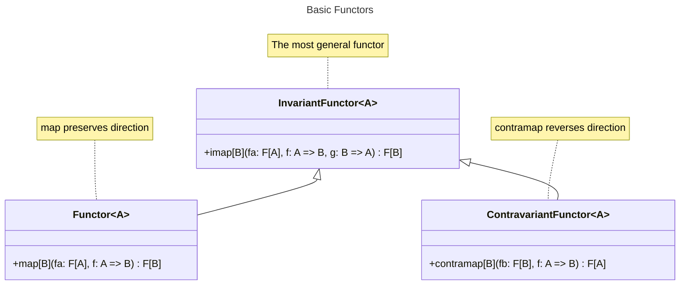
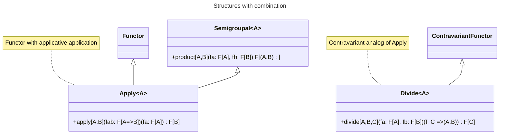
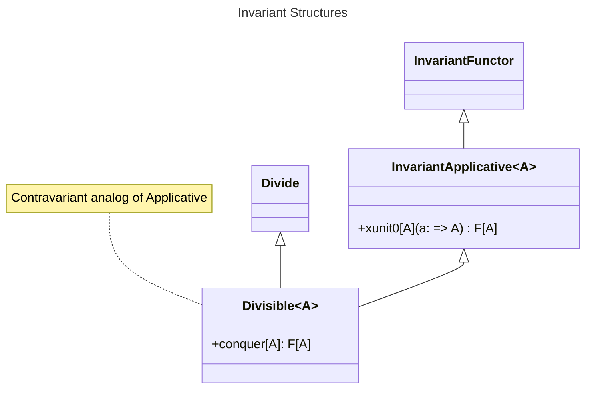
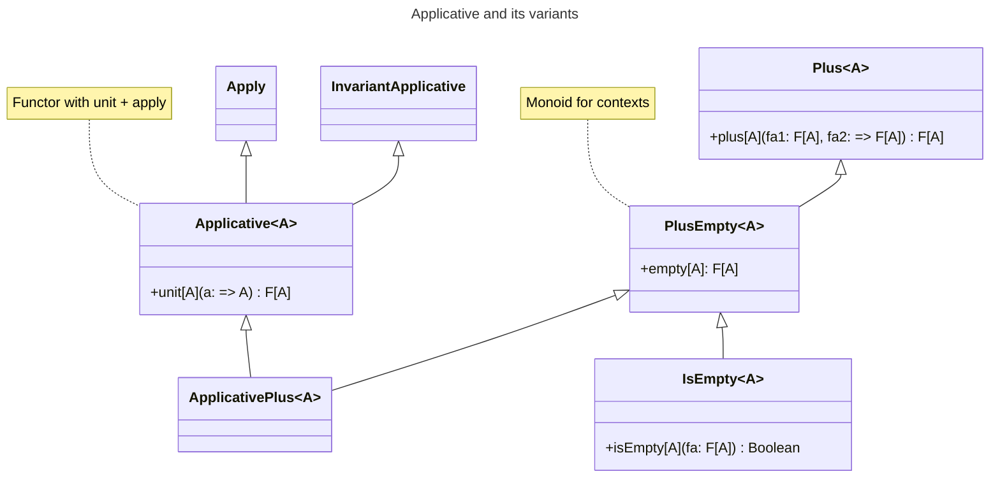
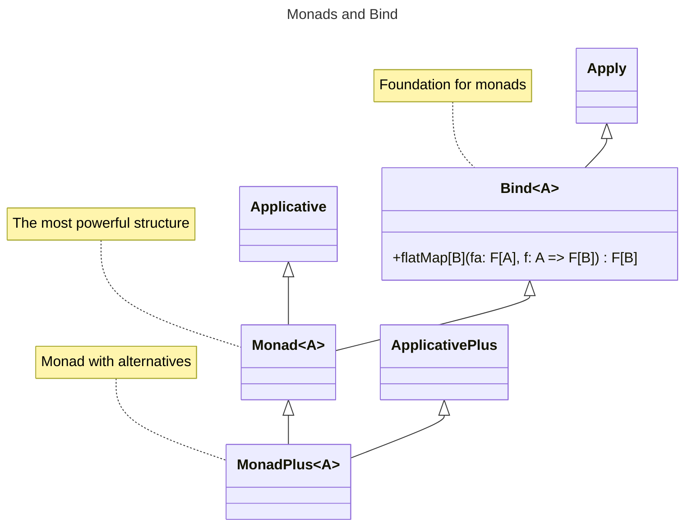
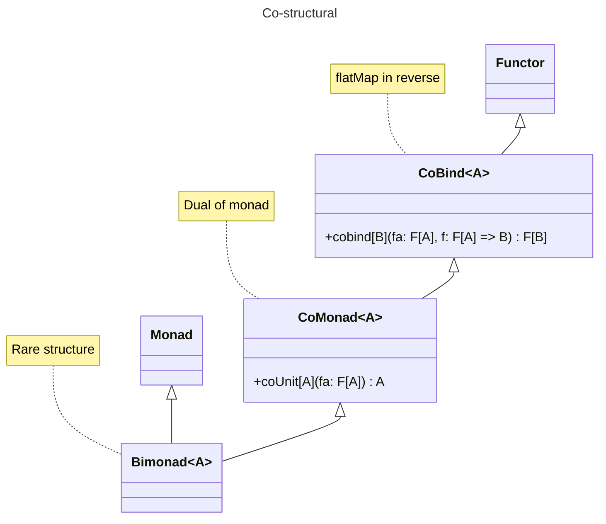
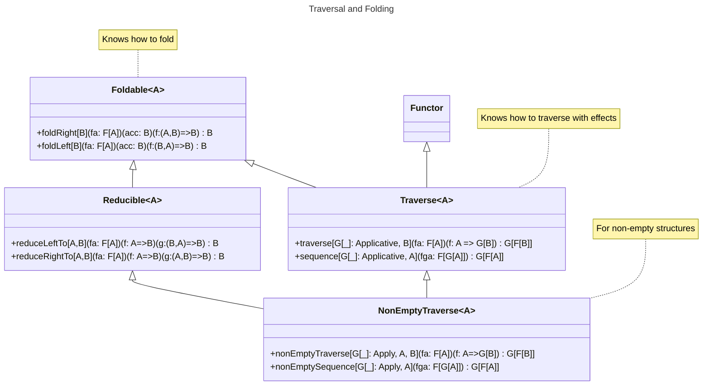
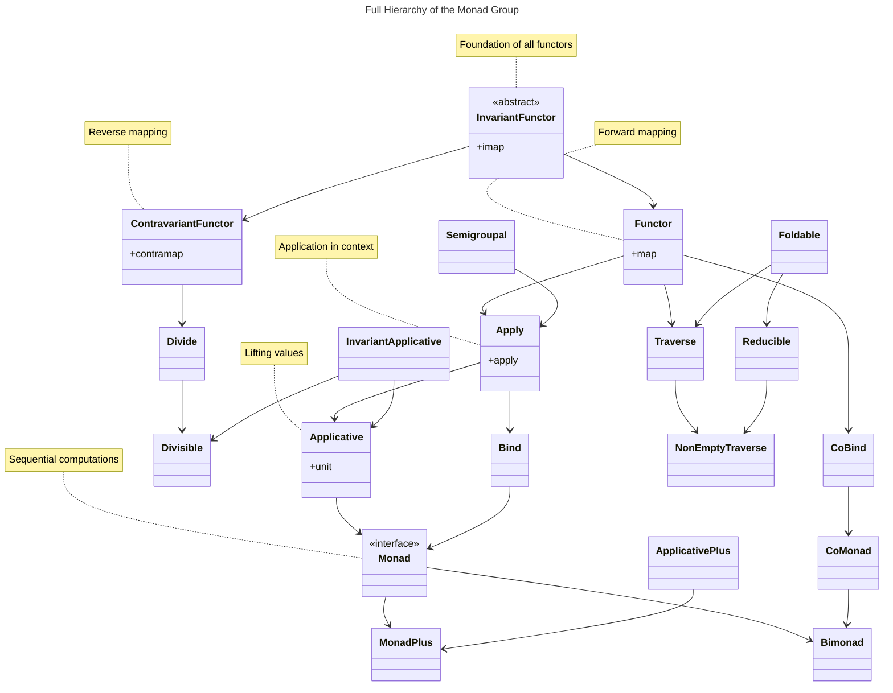

# Monad Group

## Introduction

**Monads** are one of the most important yet challenging concepts in functional programming and category theory. They represent an abstract structure that enables effective management of side effects such as error handling, I/O, state, or asynchronous computations while preserving purity and composability of functions. Monads provide a unified interface for working with such effects, making them an indispensable tool in developing reliable and predictable software.

The idea of monads originates in mathematics, where they are used to describe certain types of functors with additional structure. However, thanks to their versatility and expressiveness, monads have found widespread application in programming languages such as Scala, Haskell, and others.

## Usage

Here are the main areas where monads are used:

### Functional Programming

- **Managing side effects**: Monads allow isolating side effects (e.g., I/O, state changes, error handling) and working with them in a purely functional style.
- **Composing computations**: Monads provide a mechanism for sequentially executing operations, where each operation may depend on the result of the previous one.

### Error Handling

- Monads such as `Option` and `Either` are used for [safe error handling](../fp/handling-errors.md) without the need for explicit exception usage.
- Example: In Scala, `Option` allows expressing a computation that may return a value (`Some`) or nothing (`None`).

### Working with State

- The `State` monad allows modeling computations that [depend on mutable state](../fp/state.md) while preserving function purity.
- Example: Managing state in functional programs without using mutable variables.

### Asynchronous Computations

- Monads such as `IO` and `Promise` are used [for working with asynchronous operations](../fp/external-effects/common_io.md) such as file reading, network requests, or database interaction.
- Example: In Scala, the `IO` monad allows describing I/O in a purely functional style.

### Parsing

- Monads are used to create parser combinator libraries that allow building complex parsers from simple components.
- Example: Parser libraries such as Circe in Scala.

### Working with Collections

- Monads such as `List` allow [working with sequences](../data-structures/linear_list/lists.md) and combining them into complex computations.
- Example: Generating all possible combinations of elements from a list.

### Category Theory

- In mathematics, monads are used to describe certain types of functors with additional structure, aiding in the study of algebraic and categorical properties.

### Reactive Programming

- Monads can be used to manage data streams and reactive computations where values change over time.
- Example: Reactive programming libraries such as RxJS are inspired by monadic concepts.

### Testing and Modeling

- Monads such as `Writer` allow [collecting additional information (e.g., logs)](../fp/writer.md) during computations.
- Example: Logging in functional programs.

### Domain-Specific Languages (DSL)

- Monads are used to create embedded DSLs that allow describing complex domain tasks in a convenient and expressive form.
- Example: Languages for describing business rules or configurations.

### Examples of usage in real projects:

- In Haskell, monads are used almost ubiquitously, from I/O to complex data processing libraries.
- In Scala, monads are implemented through types such as `Option`, `Future`, and `Try`, which are actively used in industrial development.
- In JavaScript, libraries such as `folktale` or `fp-ts` provide monadic structures for functional programming.

---

Thus, monads are a powerful tool that helps structure code, manage complexity, and make programs more modular, predictable, and expressive.

## Example

In Scala, monads are actively used for working with various types of computations such as error handling, asynchronous operations, working with optional values, and more. Scala provides several built-in types that are monads, such as `Option`, `Either`, `Future`, `Try`, and `List`.

### The `Option` Monad

`Option` is used to work with values that may be absent (`None`) or present (`Some(value)`). This allows avoiding `null` and explicit checks.

```dotty
def divide(a: Int, b: Int): Option[Int] =
  if b == 0 then None else Some(a / b)

val result: Option[Int] =
  for
    r1 <- divide(10, 2)
    r2 <- divide(r1, 0)
  yield r2

result // None

val result2: Option[Int] =
  for
    r1 <- divide(10, 2)
    r2 <- divide(r1, 5)
  yield r1 + r2

result2 // Some(4)
```

### The `Either` Monad

`Either` is used to represent computations that can either succeed with a value (`Right`) or fail with an error (`Left`).

```dotty
def parseNumber(s: String): Either[String, Int] =
  try
    Right(s.toInt)
  catch
    case _: NumberFormatException => Left("Not a number")

val result: Either[String, Int] =
  for
    x <- parseNumber("10")
    y <- parseNumber("5")
  yield x + y

println(result) // Right(15)
```

### The `Future` Monad

`Future` is used for asynchronous computations that execute in a separate thread.

```dotty
import scala.concurrent.Future
import scala.concurrent.ExecutionContext.Implicits.global

def asyncComputation(x: Int): Future[Int] =
  Future {
    Thread.sleep(1000) // Simulating a long operation
    x * 2
  }

val result: Future[Int] =
  for
    a <- asyncComputation(10)
    b <- asyncComputation(20)
  yield a + b

result.foreach(println) // After a while it will print 60
```

### The `Try` Monad

`Try` is used to handle operations that can complete successfully (`Success`) or throw an exception (`Failure`).

```dotty
import scala.util.{Try, Success, Failure}

def safeDivide(a: Int, b: Int): Try[Int] =
  Try { a / b }

val result: Try[Int] =
  for
    x <- safeDivide(10, 2)
    y <- safeDivide(x, 0) // Division by zero
  yield y

println(result) // Failure(java.lang.ArithmeticException: / by zero)
```

### The `List` Monad

`List` is a monad that allows combining lists and performing operations on their elements.

```dotty
val numbers = List(1, 2, 3)
val letters = List('a', 'b', 'c')

val result: List[String] =
  for
    n <- numbers
    l <- letters
  yield s"$n$l"

println(result) // List(1a, 1b, 1c, 2a, 2b, 2c, 3a, 3b, 3c)
```

### The `Writer` Monad (from Cats library)

`Writer` is used to collect logs or additional information during computations.

```dotty
import cats.data.Writer
import cats.implicits.*

type Logged[A] = Writer[Vector[String], A]

def logNumber(x: Int): Logged[Int] = Writer(Vector(s"Number: $x"), x)

val result: Logged[Int] =
  for
    a <- logNumber(10)
    b <- logNumber(20)
  yield a + b

println(result.run) // (Vector(Number: 10, Number: 20), 30)
```

### The `IO` Monad (from Cats Effect library)

`IO` is used to describe side effects, such as I/O, in a purely functional style.

```dotty
import cats.effect.IO
import cats.effect.unsafe.implicits.global

val program: IO[Unit] =
  for
    _    <- IO(println("Enter your name:"))
    name <- IO(scala.io.StdIn.readLine())
    _    <- IO(println(s"Hello, $name!"))
  yield ()

program.unsafeRunSync() // Running the program
```

### The `State` Monad (from Cats library)

`State` is used to model computations that depend on changing state.

```dotty
import cats.data.State

type CounterState[A] = State[Int, A]

def increment: CounterState[Int] = State { count =>
  val newCount = count + 1
  (newCount, newCount)
}

val program: CounterState[Int] =
  for
    _      <- increment
    _      <- increment
    result <- increment
  yield result

val (finalState, value) = program.run(0).value
println(s"Final state: $finalState, Value: $value") 
// Final state: 3, Value: 3
```

## Monad Group Diagram

### 1. Basic Functor Structures (core)



### 2. Structures with Multiplication



### 3. Invariant Structures



### 4. Applicative Structures



### 5. Monad Structures (core)



### 6. Co-structural



### 7. Structures for Working with Collections



### Full Hierarchy (overall picture)

**Type Structures:**
- **Functors** - mapping values while preserving context
- **Applicatives** - applying functions within context
- **Monads** - binding computations with dependency on previous results
- **Comonads** - dual structures (working "in reverse")
- **Traversals** - working with collections and effects

**Key Relationships:**
- Arrow `-->` denotes inheritance (a subtype is an extension of its supertype)
- Inheritance always adds new functionality



**References:**

- [Link to exercise repository][sample]
- [Functors, Applicatives, And Monads in Pictures](https://habr.com/ru/articles/183150)
- [A Monads Approach for Beginners, in Scala - Rock the JVM](https://www.youtube.com/watch?v=d-dy1x33moA&amp;list=PLmtsMNDRU0Bzj7INIrLugi3a_WClwQuiS)
- [Functors and things using Scala - Tony Morris](https://blog.tmorris.net/posts/functors-and-things-using-scala/index.html)
- [Functors, Applicatives, And Monads In Pictures](https://www.adit.io/posts/2013-04-17-functors,_applicatives,_and_monads_in_pictures.html)
- [More on Monoids and Monads](https://apocalisp.wordpress.com/2010/07/21/more-on-monoids-and-monads/)

[sample]: https://gitverse.ru/scalabook/typeclasses
