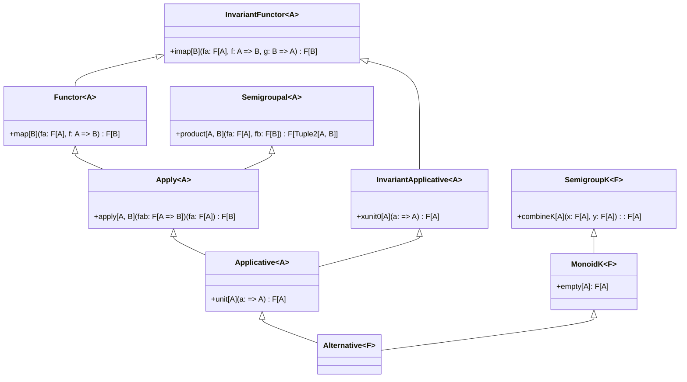

# Alternative

`Alternative` is an abstraction in functional programming
that combines the capabilities of [`Applicative` (applying functions within a context)](applicative.md)
and [`MonoidK` (combining contexts)](../monoid/monoid.md).
Simply put, `Alternative` allows not only performing computations in a context
(e.g., `Option`, `List`, `Future`),
but also choosing between multiple computations, combining them, or providing a "fallback" in case of failure.
This makes `Alternative` a powerful tool for writing flexible and robust error-resistant programs.

## Formal Definition

`Alternative` extends `Applicative` and `MonoidK`.
Let us briefly list all the operations to recall what this gives us.
The main idea is that `Alternative` allows working with values within a context `F[_]`,
combining them, applying functions, and providing an "empty" context.

```dotty
trait SemigroupK[F[_]]:
  /** Combines two contexts */
  def combineK[A](x: F[A], y: F[A]): F[A]
  
trait MonoidK[F[_]] extends SemigroupK[F]:
  /** Empty context (identity element for combineK) */
  def empty[A]: F[A]

trait Apply[F[_]] extends Functor[F], Semigroupal[F]:
  /** Applies a contextual function to a contextual value. */
  def apply[A, B](fab: F[A => B])(fa: F[A]): F[B]

trait Applicative[F[_]] extends Apply[F], InvariantApplicative[F]:
  /** Lifts a value into an applicative functor context. */
  def unit[A](a: => A): F[A]
  
trait NonEmptyAlternative[F[_]] extends Applicative[F] with SemigroupK[F]
  
trait Alternative[F[_]] extends NonEmptyAlternative[F] with MonoidK[F]
```

As can be seen from the definitions of the abstract methods of the type classes above:

- `unit` places a value into a context.
- `apply` allows performing computations inside a context by applying a function `F[A => B]` to a value `F[A]`.
- `combineK` allows combining two contexts `F[A]` for any type `A`.
- `empty` provides an identity (empty) element for the combining operation.

## Laws of `Alternative`

As with other type classes, `Alternative` instances must obey certain laws,
in addition to the `MonoidK` and `Applicative` laws.
These laws ensure consistency between `Applicative` and `MonoidK` operations,
which would otherwise behave independently.

1. **Right Absorption**: Applying a contextual function `F[A => B]` to `empty[A]` should yield `empty[B]`.
    - `ff.apply(F.empty[A]) = F.empty[B]`.
2. **Left Distributivity**: Mapping (`map`) over a combined element is equivalent to combining the mapped elements.
    - `(fa1 combineK fa2) map f = ((fa1 map f) combineK (fa2 map f))`, where `fa1: F[A]`, `fa2: F[A]`, and `f: A => B`.
3. **Right Distributivity**: Applying a combination of two functions is equivalent to combining their applications.
    - `(ff combineK fg) apply fa = (ff apply fa) combineK (fg apply fa)`, where `ff: F[A => B]`, `fg: F[A => B]`, and `fa: F[A]`.

## Exercises

### Exercise 2.20.1: Implement an Alternative instance for Vector

> [Repository with exercises and instructions][sample]

In this exercise, you will implement an instance of the `Alternative` type class for the standard Scala type `Vector`.

```dotty
given Alternative[Vector] with
  def unit[A](a: => A): Vector[A] =
    ???

  def apply[A, B](fab: Vector[A => B])(fa: Vector[A]): Vector[B] =
    ???

  def empty[A]: Vector[A] =
    ???

  def combineK[A](x: Vector[A], y: Vector[A]): Vector[A] =
    ???
```

**Examples:**

```dotty
// Create vectors using pure (via syntax)
val v1 = unit(1)        // Vector(1)
val v2 = unit(2)        // Vector(2)
val v3 = unit(3)        // Vector(3)

// Combine vectors using <+> (combineK)
val combined = v1 combineK v2 combineK v3 // Vector(1, 2, 3)

// Apply a vector of functions to a vector of values
val funcs = Vector((x: Int) => x + 10, (x: Int) => x * 2)
val values = Vector(1, 2, 3)
val result = funcs apply values
// Vector(11, 12, 13, 2, 4, 6) - all combinations
```

@:note(🔍 Show solution)

The solution uses standard vector operations.
In the `apply` method we compute the Cartesian product using `for` loops.
In the `combineK` method we concatenate the vectors.
The `unit` method simply creates a vector with one element, and `empty` returns an empty vector.
This implementation preserves all Alternative laws: right absorption (applying to `empty` yields `empty`),
left distributivity (mapping a combination equals the combination of mappings),
right distributivity (applying a combination of functions equals the combination of applications),
as well as the monoid laws for `combineK` (associativity and neutrality of `empty`).

```dotty
given Alternative[Vector] with
  def unit[A](a: => A): Vector[A] =
    Vector(a)

  def apply[A, B](fab: Vector[A => B])(fa: Vector[A]): Vector[B] =
    for
      f <- fab
      a <- fa
    yield f(a)

  def empty[A]: Vector[A] =
    Vector.empty

  def combineK[A](x: Vector[A], y: Vector[A]): Vector[A] =
    x ++ y
```

@:@

## Practical Application

### Parsing with Alternatives

Imagine we have a simple parsing library with an interface like this:

```dotty
trait Decoder[A]:
  def decode(in: String): Either[Throwable, A]
  
object Decoder:
  def from[A](f: String => Either[Throwable, A]): Decoder[A] =
    new Decoder[A]:
      def decode(in: String): Either[Throwable, A] = f(in)
```

We can implement an `Alternative` instance for this `Decoder` type.
This will allow us to combine several parsing strategies, trying them in order:

```dotty
given Alternative[Decoder] = new Alternative[Decoder]:
  /** A parser that always succeeds, returning the given value */
  def unit[A](a: => A): Decoder[A] =
    Decoder.from(Function.const(Right(a)))

  /** A parser that always fails */
  def empty[A]: Decoder[A] =
    Decoder.from(Function.const(Left(new Error("No dice."))))

  /** Tries to apply the left parser; if it fails, applies the right one
    */
  def combineK[A](l: Decoder[A], r: Decoder[A]): Decoder[A] =
    (in: String) => l.decode(in).orElse(r.decode(in))

  /** Applies a function inside one Decoder to a value inside another */
  def apply[A, B](ff: Decoder[A => B])(fa: Decoder[A]): Decoder[B] =
    (in: String) =>
      for
        a <- fa.decode(in)
        f <- ff.decode(in)
      yield f(a)
```

Thanks to `Alternative` methods, we can prioritize several strategies, compensating for inconsistencies in the input data.

```dotty
def parseInt(s: String): Either[Throwable, Int] =
  Try(s.toInt).toEither

def parseIntFirstChar(s: String): Either[Throwable, Int] =
  Try(2 * Character.digit(s.charAt(0), 10)).toEither

// Combine two parsers: first try to parse the whole string, then just the first character.
val decoder: Decoder[Int] =
  Alternative[Decoder].combineK(
    Decoder.from(parseInt),
    Decoder.from(parseIntFirstChar)
  )
```

This decoder successfully applies each strategy in order:

```dotty
decoder.decode("555")   
// Success: 555
decoder.decode("5a")    
// The first parser fails, the second successfully parses '5' and returns '10'
```

### Separating Results with `separate`

`Alternative` provides the ability to separate (partition) results if we also have `Bind` (`flatMap`).
This implements the `separate` method.

```dotty
trait MonoidK[F[_]] extends SemigroupK[F]:
  self =>

  def empty[A]: F[A]

  override def algebra[A]: Monoid[F[A]] =
    new Monoid[F[A]]:
      def empty: F[A] =
        self.empty

      def combine(x: F[A], y: F[A]): F[A] =
        self.combineK(x, y)
        
trait Alternative[F[_]] extends NonEmptyAlternative[F] with MonoidK[F]:
  def separate[G[_, _]: Bifoldable as G, A, B](fgab: F[G[A, B]])(using
      B: Bind[F]
  ): (F[A], F[B]) =
    val as =
      B.flatMap(fgab)(gab =>
        G.bifoldMap(gab)(unit)(_ => empty[A])(using algebra[A])
      )
    val bs =
      B.flatMap(fgab)(gab =>
        G.bifoldMap(gab)(_ => empty[B])(unit)(using algebra[B])
      )
    (as, bs)
```

The `separate` method in `Alternative` allows splitting the elements of a container `F[_]`
that has type `G[A, B]` (e.g., `Either[A, B]` or `(A, B)`) into two separate collections:
one for values of type `A` and another for values of type `B`.
It uses `Bind` (the extension of `flatMap`) to iterate over all elements
and `Bifoldable` to extract values from a [bifoldable `G`](../bifunctor/bifoldable.md).
For each element, `bifoldMap` is applied: when collecting `A` values — left values are preserved (`unit`),
and right values are ignored (`empty`), and vice versa when collecting `B` values.
The result is a tuple `(F[A], F[B])` where all values are split by side of the bifoldable.

An excellent example of `Bifoldable` is `Either`, as well as `Tuple2`.

Imagine we make several independent calls that may fail, for different input values of type `Int` (e.g., resource IDs).
Each call returns `Either[(Int, String), (Int, Long)]`,
where `Left` contains an error code and `Right` holds the successful result.

```dotty
// A function that simulates a resource request
def requestResource(a: Int): Either[(Int, String), (Int, Long)] =
  if a % 4 == 0 then Left((a, "Bad request"))
  else if a % 3 == 0 then Left((a, "Server error"))
  else Right((a, 200L))
```

We can use `separate` to split the failures and successes, grouped with the input values.
This allows us to log errors and continue working with successful results.

```dotty
// Apply the function to all inputs and separate the results
val partitionedResults =
  separate(apply(unit(requestResource))(Vector(5, 6, 7, 99, 1200, 8, 22)))

// partitionedResults: (Vector[(Int, String)], Vector[(Int, Long)]) — left part contains errors, right part contains successes
// (
//   Vector((6,Server error), (99,Server error), (1200,Bad request), (8,Bad request)),
//   Vector((5,200), (7,200), (22,200))
// )
```

Alternatively (and not unintentionally), we can use the `Bifoldable` instance for `Tuple2`
to separate the results of two computations that depend on the same input value.

```dotty
// A function that returns a tuple (region, list of districts)
val double: Int => Int                                  = _ * 2
val addFive: Int => Int                                 = _ + 5
def getRegionAndDistrict(pkey: Int): (Int, Vector[Int]) =
  (5 * pkey, apply(combineK(unit(double), unit(addFive)))(unit(pkey)))

val regionsWithDistricts =
  apply(unit(getRegionAndDistrict))(Vector(5, 6, 7, 97, 1200, 8, 25))
// regionsWithDistricts: Vector[(Int, Vector[Int])] = Vector(
//   (25, Vector(10, 10)),
//   (30, Vector(12, 11)),
//   (35, Vector(14, 12)),
//   (485, Vector(194, 102)),
//   (6000, Vector(2400, 1205)),
//   (40, Vector(16, 13)),
//   (125, Vector(50, 30))
// )
  
// Extract all first elements (regions)
val regionIds = separate(regionsWithDistricts)._1
// Vector(25, 30, 35, 485, 6000, 40, 125)

// Extract all second elements (districts) and combine them
val districtIds = separate(regionsWithDistricts)._2.flatten
// Vector(10, 10, 12, 11, 14, 12, 194, 102, 2400, 1205, 16, 13, 50, 30)
```

## Scheme

The inheritance of `Alternative` can be visually represented with the following diagram:



## Implementation in Libraries

### Implementation in Cats

In Cats, `Alternative` is available via `import cats.*, cats.data.*, cats.syntax.all.*`.
Here is a small example of using it with `Option` and `List`:

```dotty
import cats.*
import cats.implicits.*

// Option as Alternative
val someResult = (Option(10) <+> Option(20)).map(_ * 2)
// Some(20), since the first Some is non-empty
val noneResult = (Option.empty[Int] <+> Option(5)).map(_ + 1)
// Some(6)

// List as Alternative
val listResult = (List(1, 2) <+> List(3, 4)).map(_ + 10)
// List(11, 12, 13, 14)
val emptyListResult = (List.empty[Int] <+> List(5, 6)).map(_ * 2)
// List(10, 12)
```

---

**References:**

- [Link to the repository with exercises][sample]
- [Cats](https://typelevel.org/cats/typeclasses/alternative.html)

[sample]: https://gitverse.ru/scalabook/typeclasses
