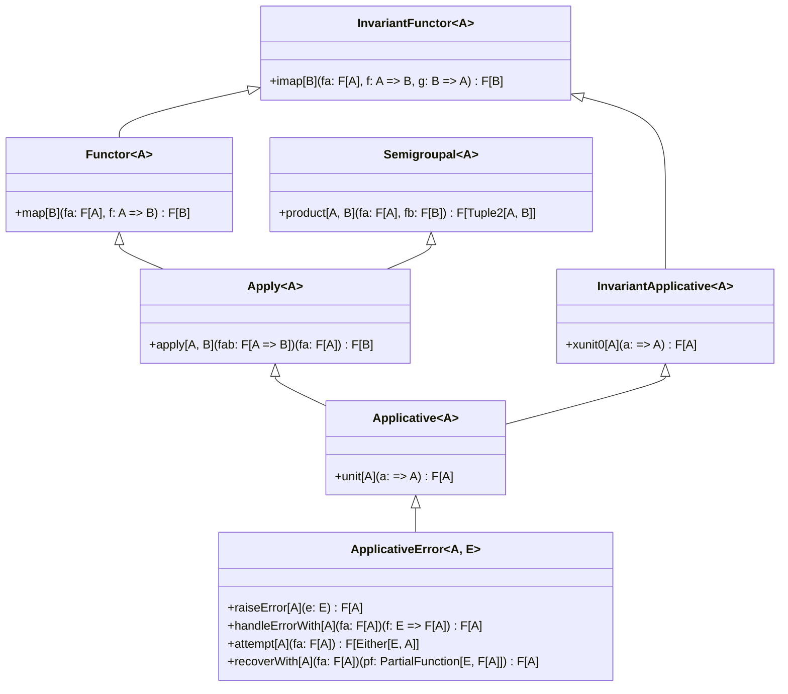

# ApplicativeError

`ApplicativeError` is a type class that extends [`Applicative`](applicative.md),
adding the ability to work with errors within the effect context `F[_]`.
If `Applicative` allows lifting values and combining computations, then `ApplicativeError` also allows:

1. **Creating computations that immediately complete with an error** (via `raiseError`)
2. **Handling errors** and recovering from them (via `handleErrorWith`, `recoverWith`)
3. **Transforming errors into values** (via `attempt`), allowing them to be worked with as data

`ApplicativeError` is a bridge between pure applicative computations and computations that may fail.
It is a fundamental abstraction for working with effects
that support error handling: `IO`, `Task`, `Either`, `Try`, and others.

**Type Parameters**

- **`F[_]`** — the context type (e.g., `IO`, `Either[E, *]`, `Try`, `Future`)
- **`E`** — the error type (e.g., `Throwable`, `String`, a custom error type)

## Formal Definition

`ApplicativeError` adds two main operations to `Applicative`:

```dotty
trait ApplicativeError[F[_], E] extends Applicative[F]:
  def raiseError[A](e: E): F[A]
  def handleErrorWith[A](fa: F[A])(f: E => F[A]): F[A]
```

#### Derived Operations

From these two primitives, useful combinators can be derived:

- **`attempt`** — transforms an error into a `Either[E, A]` value, allowing it to be worked with as ordinary data
- **`recoverWith`** — handles an error via a partial function (handles only certain errors)

## Laws of ApplicativeError

The laws of `ApplicativeError` formally define error semantics.
They ensure predictable behavior for any implementation.

### Group 1: Laws of `attempt`

#### Law 1: Successful Computation

```dotty
unit(a).attempt == unit(Right(a))
```

If you take a successful computation and apply `attempt`, the result will contain `Right(a)`.
`attempt` should not modify successful values.

**Practical example:**

```dotty
val io: IO[Int] = IO.pure(42)
io.attempt // IO(Right(42))
```

#### Law 2: Raised Error

```dotty
raiseError(e).attempt == unit(Left(e))
```

If you create an error via `raiseError` and apply `attempt`, the error is converted to `Left(e)` at the value level.
The original error is "caught" and becomes an ordinary value.

**Practical example:**

```dotty
val ioError: IO[Int] = IO.raiseError(new Exception("boom"))
ioError.attempt // IO(Left(boom))
```

### Group 2: Laws of `handleErrorWith`

#### Law 3a: Successful Computation Is Not Handled

```dotty
unit(a).handleErrorWith(h) == unit(a)
```

If a computation succeeds, the error handler `h` is **never called**, and the result remains unchanged.

**Example:**

```dotty
val success: IO[Int] = IO.pure(42)
success.handleErrorWith(_ => IO.pure(0)) // IO.pure(42) — handler not called
```

#### Law 3b: Error Is Passed to the Handler

```dotty
raiseError(e).handleErrorWith(h) == h(e)
```

If a computation fails, the handler `h` is applied to that error. The result is `h(e)`.

**Example:**

```dotty
val error: IO[Int] = IO.raiseError(new Exception("boom"))
error.handleErrorWith(e => IO.pure(0)) // IO.pure(0)
```

### Group 3: Interaction with `flatMap` (the most important law)

#### Law 4: Error Propagation through flatMap

```dotty
raiseError(e).flatMap(f) == raiseError(e)
```

This is the **short-circuit** law.
If a computation fails with an error, the function `f` in `flatMap` is **never executed**.
The error is simply propagated forward.

**Why is this important?**

1. **Safety** — the function `f` may rely on valid input data that is absent in case of an error.
2. **Performance** — `f` is not computed for nothing.
3. **Consistency** — this behavior is expected for all error-supporting monads (`Either`, `Try`, `IO`).

**Example:**

```dotty
val error: IO[Int] = IO.raiseError(new Exception("boom"))
error.flatMap(x => IO.pure(x * 2)) 
// IO.raiseError("boom") — the function was never executed
```

### recoverWith Laws (derived)

Although `recoverWith` is expressed through `handleErrorWith`, similar behavior is expected from it:

```dotty
unit(a).recoverWith(pf) == unit(a)                    
// success is not handled
raiseError(e).recoverWith(pf) == pf.applyOrElse(e, raiseError)  
// error is handled, if it matches
```

## Schema



## Implementation in Libraries

### Cats

In Cats, `ApplicativeError` is defined in the `cats` package. Here is an example of using it:

```dotty
import cats.ApplicativeError
import cats.effect.IO
import cats.implicits.*

val ae = ApplicativeError[IO, Throwable]

// raiseError
val error = ae.raiseError[Int](new IllegalArgumentException("boom"))

// handleErrorWith
val recovered = ae.handleErrorWith(error) {
  case ex: IllegalArgumentException => IO.pure(42)
  case other                        => IO.raiseError(other)
}
// IO(42)

// attempt
val attempted = ae.attempt(error)
// IO(Left("boom"))
```

---

**References:**

- [Link to the repository with exercises][sample]
- [Cats](https://typelevel.org/cats/typeclasses/applicativemonaderror.html)

[sample]: https://gitverse.ru/scalabook/typeclasses
