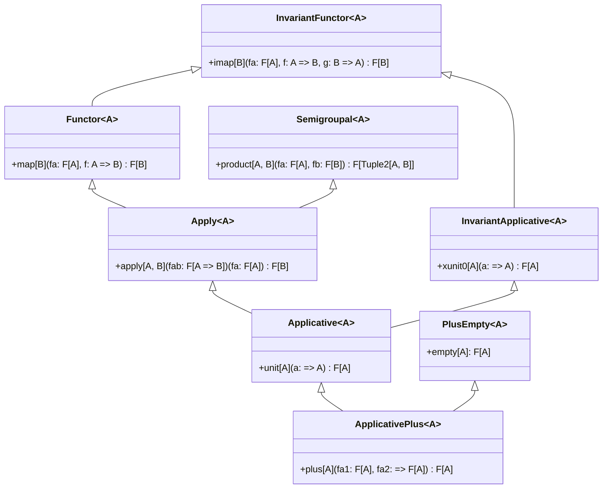

# ApplicativePlus

`ApplicativePlus` is a concept from functional programming
that combines the capabilities of **applicative functors** — `Applicative`](applicative.md)
and **monadic combinators** — `PlusEmpty`](plus-empty.md).
It adds the ability to combine values within a context
and also to work with an "empty" value (an identity element).

**Main characteristics of `ApplicativePlus`:**

- **Applicative computations**:
  Like [applicative functors](applicative.md), `ApplicativePlus` allows applying a function that is in a context
  to a value that is also in a context. For example, you can apply a function `f: A => B` "wrapped" in a context
  to a value `x: A` "wrapped" in the same context.
- **Combining values**:
  Like [`Plus`](plus.md), `ApplicativePlus` allows combining two values in one context using an operation
  similar to "addition" (`plus`, `combine`, or `<+>`).
- **Empty value**:
  Like [`PlusEmpty`](plus-empty.md), `ApplicativePlus` introduces the concept of an "empty" value,
  which is an identity element for the combining operation.

**Examples of `ApplicativePlus`**

- **Lists (`List`)**.
  Imagine you have two lists: `[1, 2, 3]` and `[4, 5, 6]`.
  `ApplicativePlus` allows combining them into a single list: `[1, 2, 3, 4, 5, 6]`.
  You can also apply functions to list elements while preserving context.
  For example, you can apply the function `x => x * 2` to the list `[1, 2, 3]` to get `[2, 4, 6]`.
  The empty value here is an empty list `[]`.
- **Parsers**.
  Imagine you have two parsers: one parses numbers, the other parses strings.
  `ApplicativePlus` allows combining the results of these parsers.
  For example, if the first parser fails to parse the input, the second parser will try.
  You can also apply functions to parsing results.
  The empty value here is a parser that always returns an error.
- **Validators**.
  Imagine you have two validators: one checks that a string is non-empty, the other checks that a string contains only letters.
  `ApplicativePlus` allows combining validation results. For example, if the first validator returns an error,
  the second validator will still be executed, and all errors will be collected together.
  You can also apply functions to validation results.
  The empty value here is a validator that always returns success.
- **Asynchronous computations (`Future`)**.
  Imagine you have two asynchronous computations: one returns a number, the other returns a string.
  `ApplicativePlus` allows executing both computations and combining their results.
  For example, if the first computation fails, the second will still be executed.
  You can also apply functions to computation results.
  The empty value here is a `Future` that always completes with an error.

## Formal Definition

`ApplicativePlus` is a monoidal applicative functor,
[`Applicative`](applicative.md) combined with [`PlusEmpty`](plus-empty.md).

`ApplicativePlus` must satisfy the laws of its parents.

## Code

```dotty
trait ApplicativePlus[F[_]] extends Applicative[F], PlusEmpty[F]
```

### Example with List

```dotty
given ApplicativePlus[List] with
  def unit[A](a: => A): List[A] = List(a)

  def apply[A, B](fab: List[A => B])(fa: List[A]): List[B] =
    fab.flatMap { aToB => fa.map(aToB) }

  def plus[A](fa1: List[A], fa2: => List[A]): List[A] = fa1 ++ fa2

  def empty[A]: List[A] = List.empty[A]
```

## Schema


