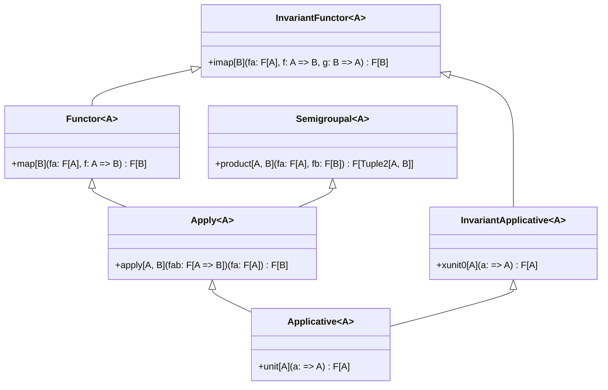

# Applicative

**Applicative** is a concept from functional programming that extends the capabilities of a [functor](functor.md)
and adds the ability to [apply a function](apply.md) that is itself inside a context to a value
that is also inside a context.
This allows working with effects (e.g., computations that may fail,
or asynchronous computations) in a more convenient and composable manner.

**Main ideas of Applicative:**

- A **functor** allows applying a function to a value inside a context (e.g., `Option`, `List`, `Future`).
- **Applicative** adds the ability to apply a function that is itself inside a context to a value
  that is also inside a context.

`Applicative` is useful when you have a function that takes multiple arguments,
and each of these arguments is inside a context (e.g., `Option`, `Either`, `Future`).
Instead of manually extracting values from the context and applying the function,
`Applicative` allows doing this more elegantly.

**Advantages of Applicative:**

- **Composability**: `Applicative` allows combining computations that are inside a context
  without the need to manually extract values.
- **Clean code**: Code becomes more declarative and easier to read.
- **Effect support**: `Applicative` works with various effects such as `Option`, `Either`, `Future`, `IO`, and others.

## Examples

Here are several examples of using **Applicative**:

### Example 1: Form Validation

Imagine you have a form with several fields (e.g., name, email, password).
Each field needs to be validated for correctness (e.g., email must contain "@", password must be at least 8 characters).
If all fields are correct, you want to create a user object.
If there are errors, you want to collect them all, not stop at the first one.

- **Context**: `Validated` (from the Cats library), which allows accumulating errors.
- **Application**: You validate each field and combine the results using `Applicative`.
  If all fields are correct, a user object is created. If there are errors, a list of all errors is returned.

### Example 2: Parallel HTTP Requests

You have several independent HTTP requests that need to be executed in parallel
(e.g., to get data about a user, their orders, and payment history).
After all requests are executed, you want to combine the results into a single object.

- **Context**: `Future` (asynchronous computations).
- **Application**: You run all requests in parallel and combine their results using `Applicative`.
  If all requests are successful, you combine the data.
  If at least one request fails, the entire process fails.

### Example 3: Working with Configuration

You have an application configuration consisting of several parameters
(e.g., database URL, server port, debug mode). Each parameter may or may not be set.
You want to read all parameters and create a configuration object only if all parameters are present.

- **Context**: `Option` (a value may be set or absent).
- **Application**: You read each parameter and combine them using `Applicative`.
  If all parameters are set, a configuration object is created. If at least one parameter is absent, the result is `None`.

### Example 4: Combining Lists

You have two lists: one contains first names, the other contains last names. You want to create all possible combinations of first names and last names.

- **Context**: `List` (a collection of values).
- **Application**: You combine two lists using `Applicative`, creating all possible pairs of first and last names.

### Example 5: Working with Trees

You have two trees, and you want to combine them into one, applying a function to corresponding nodes.

- **Context**: A custom data type `Tree` representing a tree.
- **Application**: You combine two trees using `Applicative`, creating a new tree
  where each node is the result of applying the function to corresponding nodes of the original trees.

### Example 6: Aggregating Data from Multiple Sources

You have multiple data sources (e.g., a database, a cache, an external API).
You want to get data from all sources and combine them into a single object.

- **Context**: `IO` (from Cats Effect), representing a side-effecting lazy computation.
- **Application**: You get data from each source and combine them using `Applicative`.
  If all sources return data, you combine it.
  If any source returns an error, the entire process fails.

## Formal Definition

`Applicative` extends [`Apply`](apply.md) (and [`InvariantApplicative`](invariant-applicative.md))
and allows working with multiple "boxes."
`Applicative`, in addition to `Apply` operations, implements the `unit` operation (also known as `point`, `pure`),
which wraps an arbitrary type `A` value into `Applicative`.

## Code

```dotty
trait Applicative[F[_]] extends Apply[F], InvariantApplicative[F]:
  def unit[A](a: => A): F[A]
  
  override def xunit0[A](a: => A): F[A] = unit(a)

  def apply[A, B](fab: F[A => B])(fa: F[A]): F[B]

  override def product[A, B](fa: F[A], fb: F[B]): F[(A, B)] =
    fa.map2(fb)((a, b) => (a, b))
  
  extension [A](fa: F[A])
    def map[B](f: A => B): F[B] =
      ??? // Exercise

    def map2[B, C](fb: F[B])(f: (A, B) => C): F[C] =
      ??? // Exercise
```

### Applicative Combinators

`Applicative` defines some combinators:

```dotty
def sequence[A](fas: List[F[A]]): F[List[A]] =
  traverse(fas)(identity)

def traverse[A,B](as: List[A])(f: A => F[B]): F[List[B]] =
  as.foldRight(unit(List[B]()))((a, acc) => f(a).map2(acc)(_ :: _))

def replicateM[A](n: Int, fa: F[A]): F[List[A]] =
  sequence(List.fill(n)(fa))

def product[A, B](fa: F[A], fb: F[B]): F[(A,B)] =
  fa.map2(fb)((a, b) => (a, b))
```

### Laws

The following laws must hold for `Applicative` (in addition to parent type class laws):

> The following signatures are assumed below: `a: A, f: A => B, fa: F[A], fb: F[B], fc: F[C], fab: F[A => B], fbc: F[B => C]`

- Identity: `apply[A, A](unit(identity))(fa) == fa` (`unit` of the identity function is identity for `apply`)
- `unit(a).map(f) == unit(f(a))`
- `fa.map(f) == apply(unit(f))(fa)`
- Homomorphism: `apply(unit(f))(unit(a)) == unit(f(a))`
  (In other words, applying an idiomatic function to `unit` is the same as applying a regular function to `unit`.
  More precisely, `unit` is a homomorphism from `A` to `F[A]` with respect to function application.)
- Interchange: `apply(fab)(unit(a)) == apply(unit((f: A => B) => f(a)))(fab)`
  (This law essentially says that `unit` is not allowed to affect any implementation of an applicative functor.
  If one of the arguments to be applied is `unit`, then the other can appear in any position.
  In other words, it should not matter when we perform `unit`.)
- Left identity: `unit(()).map2(fa)((_, a) => a) == fa`
- Right identity: `fa.map2(unit(()))((a, _) => a) == fa`
- Associativity: `fa.product(fb).product(fc) == fa.product(fb.product(fc)).map(assoc)`, where
  `def assoc[A, B, C](p: (A, (B, C))): ((A, B), C) = p match { case (a, (b, c)) => ((a, b), c) }`
- Naturality: `fa.map2(fb)((a, b) => (f(a), g(b))) == fa.map(f).product(fb.map(g))`
- Composition:
  `apply(fbc)(apply(fab)(fa)) == apply(apply(apply(unit((g: B => C) => (f: A => B) => g compose f))(fbc))(fab))(fa)`
  (Apply `fab` to `fa`, then apply `fbc` to the result — is the same as
  applying the composition to `fbc`, then `fab`, and then applying the composed function to `fa`.)

## Exercises

### Exercise 2.5.1: Implement `map` and `map2` via `unit` and `apply`.

> [Repository with exercises and instructions][sample]

An applicative functor provides two basic operations: `unit` (lifting a value into the context)
and `apply` (applying a function in context to a value in context). Using only these primitives,
express covariant `map` and binary `map2`.

Implement the `map` and `map2` methods in the `Applicative` trait using only `unit` and `apply`.

```dotty
trait Applicative[F[_]] extends Apply[F], InvariantApplicative[F]:
  /** Lifts a value into the applicative functor context. */
  def unit[A](a: => A): F[A]

  /** Applies a function in context to a value in context. */
  def apply[A, B](fab: F[A => B])(fa: F[A]): F[B]

  extension [A](fa: F[A])
    /** Exercise 2.5.1: Implement `map` via `unit` and `apply`.
      */
    def map[B](f: A => B): F[B] =
      ???

    /** Exercise 2.5.1: Implement `map2` via `unit` and `apply`.
      */
    def map2[B, C](fb: F[B])(f: (A, B) => C): F[C] =
      ???
```

**Examples:**

```dotty
// For Option
val opt = Some(5)
val optMapped = opt.map(_ * 3)             // Some(15)
val optMapped2 = opt.map2(Some(10))(_ + _) // Some(15)

// For List
val list = List(1, 2, 3)
val listMapped = list.map(_ * 2)         // List(2, 4, 6)
val listMapped2 = list.map2(List(10, 20))(_ + _) // List(11, 21, 12, 22)
```

@:note(🔍 Show solution)

For the implementation of `map`, we lift the function `f` into the context using `unit`, obtaining `F[A => B]`,
and then apply it to `fa` using `apply`.
For the implementation of `map2`, we use currying:
first we lift the curried version of the binary function `f.curried: A => B => C` into the context via `unit`,
then we apply `apply` twice: first to `fa` (obtaining `F[B => C]`), and then to `fb` (obtaining `F[C]`).

```dotty
trait Applicative[F[_]] extends Apply[F], InvariantApplicative[F]:
  def unit[A](a: => A): F[A]

  def apply[A, B](fab: F[A => B])(fa: F[A]): F[B]

  extension [A](fa: F[A])
    def map[B](f: A => B): F[B] =
      apply(unit(f))(fa)

    def map2[B, C](fb: F[B])(f: (A, B) => C): F[C] =
      apply(apply(unit(f.curried))(fa))(fb)
```

@:@

### Exercise 2.5.2: Implement Applicative for type Option

Implement the `Applicative` instance for `Option`:

- `unit` should lift a value into the `Option` context
- `apply` should apply a function inside `Option` to a value inside `Option`.

```dotty
given optionApplicative: Applicative[Option] with
  def unit[A](a: => A): Option[A] = ???
  
  def apply[A, B](fab: Option[A => B])(fa: Option[A]): Option[B] = ???
```

**Examples:**

```dotty
import Applicative.given

// unit — lifting a value
unit(42)                  // Some(42)
unit("Hello")             // Some("Hello")
unit(true)                // Some(true)

// apply — applying a function in context
val optFunc = Some((x: Int) => x * 2)
apply(optFunc)(Some(21))  // Some(42)
apply(optFunc)(None)      // None

val noneFunc: Option[Int => Int] = None
apply(noneFunc)(Some(21)) // None
apply(noneFunc)(None)     // None
```

@:note(🔍 Show solution)

In the `unit` implementation, we simply wrap the passed value in `Some(a)`.
For `apply`, pattern matching is used: when both arguments are `Some(aToB)` and `Some(a)`,
we extract the function and value, apply the function to the value, and return `Some(f(a))`.
In all other cases (when at least one argument is `None`), we return `None`.
This corresponds to the semantics of an "optional" computation,
where the result exists only when all of its components exist.

```dotty
given optionApplicative: Applicative[Option] with
  def unit[A](a: => A): Option[A] = Some(a)

  def apply[A, B](fab: Option[A => B])(fa: Option[A]): Option[B] =
    (fab, fa) match
      case (Some(aToB), Some(a)) => Some(aToB(a))
      case _                     => None
```

@:@

### Exercise 2.5.3: Implement Applicative for type List

`List[A]` represents a non-deterministic computation that can return zero, one, or multiple values.
Implement the `Applicative` instance for `List`, using "Cartesian product" semantics:

- `unit` should create a single-element list containing the passed value
- `apply` should apply each function from list `fab` to each value from list `fa`,
  collecting all results into a single list (Cartesian product)

```dotty
given listApplicative: Applicative[List] with
  def unit[A](a: => A): List[A] = ???
  
  def apply[A, B](fab: List[A => B])(fa: List[A]): List[B] = ???
```

**Examples:**

```dotty
import Applicative.given

// unit — creating a single-element list
unit(42)                  // List(42)
unit("Hello")             // List("Hello")
unit(true)                // List(true)

// apply — Cartesian product
val funcs = List((x: Int) => x + 1, (x: Int) => x * 2, (x: Int) => x - 3)
val nums = List(1, 2, 3)

apply(funcs)(nums)
// Result: List(2, 3, 4,  2, 4, 6,  -2, -1, 0)
// Step by step:
// (_+1): 1+1=2, 2+1=3, 3+1=4
// (_*2): 1*2=2, 2*2=4, 3*2=6
// (_-3): 1-3=-2, 2-3=-1, 3-3=0

// Empty lists
apply(List.empty[Int => Int])(List(1, 2, 3))  // Nil
apply(List((x: Int) => x + 1))(List.empty)    // Nil
```

@:note(🔍 Show solution)

In the `unit` implementation, we simply wrap the passed value in a single-element list `List(a)`.
For `apply`, the algorithm is:
first we iterate over each function `aToB` from list `fab`,
and then for each function we apply `map` to all values of `fa`, transforming them with that function.
The result will be a list containing the results of applying each function to each value.
This is the Cartesian product, where the number of result elements equals `fab.length * fa.length`.

```dotty
given listApplicative: Applicative[List] with
  def unit[A](a: => A): List[A] = List(a)

  def apply[A, B](fab: List[A => B])(fa: List[A]): List[B] =
    fab match
      case f :: tail =>
        fa.map(f) ++ apply(tail)(fa)
      case Nil => Nil
```

@:@

### Exercise 2.5.4: Implement Applicative for type Either

`Either[E, A]` represents a computation that may fail with error type `E` (the `Left` branch)
or succeed with a result of type `A` (the `Right` branch).
Implement the `Applicative` instance for `Either[E, A]` with fixed error type `E`, following "short-circuit" semantics:

- `unit` should lift a value into the `Either` context
- `apply` should apply a function from `Right` to a value from `Right`, returning `Right(f(a))`.
  If either operand is `Left`, the result should be the first encountered `Left` (error short-circuits the computation)

```dotty
given eitherApplicative[E]: Applicative[[x] =>> Either[E, x]] with
  def unit[A](a: => A): Either[E, A] = ???
  
  def apply[A, B](fab: Either[E, A => B])(fa: Either[E, A]): Either[E, B] = ???
```

**Examples:**

```dotty
import Applicative.given

// unit — lifting a value
unit(42): Either[String, Int]         // Right(42)
unit("Hello"): Either[String, String] // Right("Hello")
unit(true): Either[String, Boolean]   // Right(true)

// apply — applying a function in context
val rightFunc: Either[String, Int => Int] = Right((x: Int) => x * 2)
val rightValue: Either[String, Int] = Right(21)
apply(rightFunc)(rightValue)       // Right(42)

val leftFunc: Either[String, Int => Int] = Left("function error")
val rightValue2: Either[String, Int] = Right(21)
apply(leftFunc)(rightValue2)       // Left("function error")

val rightFunc2: Either[String, Int => Int] = Right((x: Int) => x * 2)
val leftValue: Either[String, Int] = Left("value error")
apply(rightFunc2)(leftValue)       // Left("value error")

val leftFunc2: Either[String, Int => Int] = Left("error1")
val leftValue2: Either[String, Int] = Left("error2")
apply(leftFunc2)(leftValue2)       // Left("error1") (first error)
```

@:note(🔍 Show solution)

In the `unit` implementation, we simply wrap the passed value in `Right(a)`.
For `apply`, pattern matching is used on the pair `(fab, fa)`.
When both arguments are `Right(fx)` and `Right(a)`, we extract the function and value,
apply the function to the value, and return `Right(fx(a))`.
If the first argument is `Left(l)`, we return it, ignoring the second argument.
If the first argument is `Right` but the second is `Left(l)`, we return `Left(l)`.
This implementation corresponds to "short-circuit" semantics: the first encountered error is immediately returned,
and successful computation continues only when all components are `Right`.

```dotty
given eitherApplicative[E]: Applicative[[x] =>> Either[E, x]] with
  def unit[A](a: => A): Either[E, A] = Right(a)

  def apply[A, B](fab: Either[E, A => B])(fa: Either[E, A]): Either[E, B] =
    (fab, fa) match
      case (Right(fx), Right(a)) => Right(fx(a))
      case (Left(l), _)          => Left(l)
      case (_, Left(l))          => Left(l)
```

@:@

### Exercise 2.5.5: Implement Applicative for type Writer

`Writer[W, A]` represents a computation that accumulates a log of type `W` (usually a monoid) and returns a value of type `A`.
Implement the `Applicative` instance for `Writer[W, A]` with fixed log type `W`, following accumulation semantics:

- `unit` should create a `Writer` with an empty log and the passed value
- `apply` should sequentially execute two computations: first `fab` (obtaining a function and intermediate log),
  then `fa` (obtaining a value and final log), then combine the logs and apply the function to the value

```dotty
given writerApplicative[W](using monoid: Monoid[W]): Applicative[[x] =>> Writer[W, x]] with
  def unit[A](a: => A): Writer[W, A] = ???
    
  def apply[A, B](fab: Writer[W, A => B])(fa: Writer[W, A]): Writer[W, B] = ???
```

**Examples:**

```dotty
import Applicative.given
import Monoid.given  // for String, List and other monoids

// Log type String (monoid with concatenation)
val w1: Writer[String, Int] = unit(42)
w1.run()  // ("", 42)

val addOne: Writer[String, Int => Int] = Writer(() => ("Adding 1 ", (x: Int) => x + 1))
val value: Writer[String, Int] = Writer(() => ("Value 5 ", 5))

val result = apply(addOne)(value)
result.run()  // ("Adding 1 Value 5 ", 6)

// Log type List[String] (monoid with list concatenation)
val log1: Writer[List[String], Int] = Writer(() => (List("Step 1"), 10))
val log2: Writer[List[String], Int => Int] = Writer(() => (List("Step 2: multiply"), (x: Int) => x * 2))

val combined = apply(log2)(log1)
combined.run()  // (List("Step 1", "Step 2: multiply"), 20)
```

@:note(🔍 Show solution)

In the `unit` implementation, a `Writer` is created that, when executed, returns a pair of an empty log (`monoid.empty`)
and the passed value `a`.
In the `apply` implementation, we first call `fab.run()` to obtain log `w0` and function `aToB`.
Then we call `fa.run()` to obtain log `w1` and value `a`.
After that, we combine the logs using `monoid.combine(w0, w1)` and apply function `aToB` to value `a`.
The result is wrapped in a new `Writer` with lazy evaluation (`() =>`).
Importantly, the execution order of `fab` first, then `fa` determines the log accumulation order: first logs from `fab`, then from `fa`.

```dotty
given writerApplicative[W](using monoid: Monoid[W]): Applicative[[x] =>> Writer[W, x]] with
  def unit[A](a: => A): Writer[W, A] =
    Writer[W, A](() => (monoid.empty, a))

  def apply[A, B](fab: Writer[W, A => B])(fa: Writer[W, A]): Writer[W, B] =
    Writer { () =>
      val (w0, aToB) = fab.run()
      val (w1, a) = fa.run()
      (monoid.combine(w0, w1), aToB(a))
    }
```

@:@

### Exercise 2.5.6: Implement Applicative for type State

`State[S, A]` represents a pure functional computation that depends on and can modify state.
This is a function from an initial state `S` to a pair `(new state, value of type A)`.
Implement the `Applicative` instance for `State[S, A]` with fixed state type `S`,
following sequential execution semantics:

- `unit` should create a `State` that does not modify the passed state and returns value `a`
- `apply` should sequentially execute two computations: first `fab` (obtaining a function and intermediate state),
  then `fa` on the updated state (obtaining a value and final state),
  then apply the function to the value and return the final state

**Important**: State must be passed through the computation chain strictly sequentially, like in a pipeline.

```dotty
given stateApplicative[S]: Applicative[[X] =>> State[S, X]] with
  def unit[A](a: => A): State[S, A] = ???
  
  def apply[A, B](fab: State[S, A => B])(
      fa: State[S, A]
  ): State[S, B] = ???
```

**Examples:**

```dotty
import Applicative.given

// unit — computation that does not change state
val st: State[Int, String] = unit("hello")
st.run(5)  // (5, "hello")

// Basic state operations
val increment: State[Int, Int] = State(s => (s + 1, s))
val decrement: State[Int, Int] = State(s => (s - 1, s))
val getState: State[Int, Int] = State(s => (s, s))
val setState: Int => State[Int, Unit] = (n: Int) => State(_ => (n, ()))

// apply — sequential application
val addOneFunc: State[Int, Int => Int] = unit((x: Int) => x + 1)
val result1 = apply(addOneFunc)(getState).run(10)
// (10, 11) — state unchanged (10), value = 10 + 1 = 11

// More complex chain
val transform: State[Int, Int => Int] = unit((x: Int) => x * 2)
val result2 = apply(transform)(increment).run(5)
// increment(5) -> (6, 5)
// transform applied to value 5: 5 * 2 = 10
// Result: (6, 10)
```

@:note(🔍 Show solution)

In the `unit` implementation, a `State` is created that takes state `s` and returns `(s, a)` —
state remains unchanged, the passed value `a` is returned.
In the `apply` implementation, we create a new `State` that sequentially executes two computations:
first we call `fab.run(s)`, obtaining intermediate state `s0` and function `aToB`.
Then we call `fa.run(s0)` on the updated state, obtaining final state `s1` and value `a`.
After that, we apply function `aToB` to value `a` and return the pair `(s1, aToB(a))`.
Importantly, state is passed strictly sequentially: the result of the first computation becomes the input to the second.
This allows composing stateful computations while preserving purity and predictability.

```dotty
given stateApplicative[S]: Applicative[[X] =>> State[S, X]] with
    def unit[A](a: => A): State[S, A] =
      State[S, A](s => (s, a))

    def apply[A, B](fab: State[S, A => B])(
        fa: State[S, A]
    ): State[S, B] =
      State { s =>
        val (s0, aToB) = fab.run(s)
        val (s1, a)    = fa.run(s0)
        (s1, aToB(a))
      }
```

@:@

### Exercise 2.5.7: Composition of two applicative functors

A crucial property of applicative functors: they are closed under composition.
If `F` and `G` are applicative functors, then `F[G[A]]` is also an applicative functor.
This allows combining effects of nested contexts.

Unlike [monads](monad.md), applicative functors can always be composed, and the result will be an applicative functor.
This means that two sequentially dependent applicative effects can be combined into one without losing the applicative structure.
This is called composition over `Applicative`.

Implement the `Applicative` instance for composition `F[G[A]]`.

```dotty
given compositeApplicative[F[_]: Applicative, G[_]: Applicative]
    : Applicative[[X] =>> F[G[X]]] with
  def unit[A](a: => A): F[G[A]] = ???
  
  def apply[A, B](fab: F[G[A => B]])(fa: F[G[A]]): F[G[B]] = ???
```

**Examples:**

```dotty
import Applicative.given

// Example: composition of Option and List
type OptionList[A] = List[Option[A]]

// unit — creating a nested value
unit(42): OptionList[Int]  // List(Some(42))

// apply — combining all possible combinations
val funcs: OptionList[Int => String] = List(Some((x: Int) => x.toString), None, Some((x: Int) => s"num:$x"))
val values: OptionList[Int] = List(Some(1), Some(2), None)

val result = apply(funcs)(values)
// Result: 
// List(
//   Some("1"), Some("2"), None,        // from Some(_.toString)
//   None, None, None,                  // from None
//   Some("num:1"), Some("num:2"), None // from Some("num:"+_)
// )
```

@:note(🔍 Show solution)

The composition implementation uses the applicative operations of the outer functor `F` and inner functor `G`.
In `unit`, we first lift the value `a` into context `G` using `Applicative[G].unit(a)`,
then lift the result into context `F` using `Applicative[F].unit(...)`.

In `apply`, we obtain `fab: F[G[A => B]]` and `fa: F[G[A]]`.
Using `Applicative[F].map`, we transform the inner `G[A => B]` into a function `G[A] => G[B]` via `Applicative[G].apply`.
This yields `F[G[A] => G[B]]`.
Then we apply this to `fa` using `Applicative[F].apply`, obtaining `F[G[B]]`.
Thus, the outer layer `F` manages composition, while the inner `G` is responsible for applying functions to values.

```dotty
given compositeApplicative[F[_]: Applicative, G[_]: Applicative]
    : Applicative[[X] =>> F[G[X]]] with
  override def unit[A](a: => A): F[G[A]] = 
    Applicative[F].unit(Applicative[G].unit(a))

  override def apply[A, B](fab: F[G[A => B]])(fa: F[G[A]]): F[G[B]] =
    val applicativeF = Applicative[F]
    val applicativeG = Applicative[G]
    val tmp: F[G[A] => G[B]] = 
      applicativeF.map(fab)(ga2b => applicativeG.apply(ga2b))
    applicativeF.apply(tmp)(fa)
```

@:@

### Exercise 2.5.8: Composition of two applicative functors as a tuple (product)

An important property of applicative functors: they are closed under product (pairwise product).
If `F` and `G` are applicative functors, then the pair `(F[A], G[A])` is also an applicative functor.
This allows performing two independent applicative effects simultaneously and combining their results into a single product.

Unlike composition (nesting), product is a **parallel composition** of effects:
both computations are performed independently, and their results are collected into a tuple.
This is especially useful when you need to combine two different contexts,
e.g., validation (`Either`) and logging (`Writer`),
or optionality (`Option`) and non-determinism (`List`).

Implement the `Applicative` instance for product `(F[A], G[A])`.

```dotty
given tupleApplicative[F[_]: Applicative, G[_]: Applicative]
    : Applicative[[X] =>> (F[X], G[X])] with
  type FG[A] = (F[A], G[A])

  def unit[A](a: => A): FG[A] = ???
  
  def apply[A, B](fab: FG[A => B])(fa: FG[A]): FG[B] = ???
```

**Examples:**

```dotty
import Applicative.given

// Example 1: Product of Option and List
type OptionList[A] = (Option[A], List[A])

// unit — creating a pair from two unit contexts
unit(42): OptionList[Int]  // (Some(42), List(42))
unit("hello"): OptionList[String]  // (Some("hello"), List("hello"))

// apply — component-wise application
val fab: (Option[Int => String], List[Int => String]) = 
  (Some((x: Int) => x.toString), List((x: Int) => x + 1, (x: Int) => x * 2))
val fa: (Option[Int], List[Int]) = (Some(5), List(1, 2, 3))

val result = apply(fab)(fa)
// Result: (Some("5"), List(2, 3, 4, 2, 4, 6))
// Option part: Some(5.toString) = Some("5")
// List part: Cartesian product: (1+1=2, 2+1=3, 3+1=4, 1*2=2, 2*2=4, 3*2=6)
```

@:note(🔍 Show solution)

The product of two applicative functors is implemented component-wise.
In the `unit` method, we create a pair from calling `unit` for each functor: `(Applicative[F].unit(a), Applicative[G].unit(a))`.

In the `apply` method, we receive a pair of functions `fab = (ff: F[A => B], fg: G[A => B])` and a pair of values `fa = (faF: F[A], faG: G[A])`.
The result will be a pair where the first component is the result of applying `ff` to `faF` using `Applicative[F].apply`,
and the second component is the result of applying `fg` to `faG` using `Applicative[G].apply`.
Thus, both computations are performed independently, and their results are combined into a tuple.
This demonstrates that applicative functors are closed under product, enabling parallel combination of independent effects.

```dotty
given tupleApplicative[F[_]: Applicative, G[_]: Applicative]
    : Applicative[[X] =>> (F[X], G[X])] with
  type FG[A] = (F[A], G[A])

  def unit[A](a: => A): FG[A] =
    (Applicative[F].unit(a), Applicative[G].unit(a))

  def apply[A, B](fab: FG[A => B])(fa: FG[A]): FG[B] =
    (
     Applicative[F].apply(fab._1)(fa._1), 
     Applicative[G].apply(fab._2)(fa._2)
    )
```

@:@

Product (`(F[X], G[X])`) and composition (`F[G[A]]`) allow combining idiomatic (applicative) computations in two different ways;
They are usually called parallel and sequential composition respectively.
The fact that applicatives can be composed and remain applicative is very useful.

### Exercise 2.5.9: Equivalence of Applicative definitions — implementing `map` and `apply` via `map2`

An applicative functor can be defined in different but equivalent ways.
`Applicative` is usually defined via `unit` and `apply`,
but there is an alternative definition via `unit` and `map2`.
Show the equivalence of these approaches by implementing `map` and `apply` via `unit` and `map2`.

This exercise assumes that `map2` is already implemented, and you should express `map` and `apply` via it.

```dotty
trait Applicative[F[_]] extends Apply[F], InvariantApplicative[F]:
  /** Lifts a value into the applicative functor context. */
  def unit[A](a: => A): F[A]

  /** Binary mapping — combines two values
    * in context using a binary function.
    */
  extension [A](fa: F[A])
    def map2[B, C](fb: F[B])(f: (A, B) => C): F[C]

  /** Exercise 2.5.9: Implement `map` via `unit` and `map2`. */
  extension [A](fa: F[A])
    def mapViaUnitAndMap2[B](f: A => B): F[B] =
      ???

  /** Exercise 2.5.9: Implement `map` via `unit` and `map2`. */
  def applyViaUnitAndMap2[A, B](fab: F[A => B])(fa: F[A]): F[B] =
    ???
```

**Examples:**

```dotty
import Applicative.given

// For Option
val opt = Some(5)
val optMapped = opt.mapViaUnitAndMap2(_ * 3)  // Some(15)
val optFunc = Some((x: Int) => x * 2)
val optApplied = applyViaUnitAndMap2(optFunc)(opt)  // Some(10)
```

@:note(🔍 Show solution)

To implement `mapViaUnitAndMap2`, we use `map2` with `unit(())` as the second argument.
The binary function `(a, _) => f(a)` ignores the second argument (the unit) and applies `f` to the first argument.
Thus, `fa.map2(unit(()))((a, _) => f(a))` effectively applies `f` to the value inside `fa`,
ignoring the empty `unit(())` context.
This works because `map2` combines two contexts,
and `unit(())` represents an "empty" effect that does not affect the result.

To implement `applyViaUnitAndMap2`, we use `fab.map2(fa)((f, a) => f(a))`.
Here `fab` contains a function in context, `fa` contains a value in context,
and the binary function `(f, a) => f(a)` simply applies the function to the argument.
`map2` takes care of properly combining the effects of both contexts,
applying function `f` to value `a` within the respective contexts.
This demonstrates that `apply` can be expressed via `map2`,
which confirms the equivalence of the two alternative definitions of an applicative functor.

```dotty
extension [A](fa: F[A])
  def mapViaUnitAndMap2[B](f: A => B): F[B] =
    fa.map2(unit(()))((a, _) => f(a))

def applyViaUnitAndMap2[A, B](fab: F[A => B])(fa: F[A]): F[B] =
  fab.map2(fa)((f, a) => f(a))
```

@:@

## Schema



## Implementation in Libraries

### Implementation in Cats

```dotty
import cats.*, cats.data.*, cats.syntax.all.*

Applicative[List].pure(1)    // List(1)
Applicative[Option].pure(1)  // Some(1)
```

### Implementation in Scalaz

```dotty
import scalaz.*
import Scalaz.*

// ... All parent operations

1.point[List]  // List(1)
1.η[List]      // List(1)
```

---

**References:**

- [Link to the repository with exercises][sample]
- [Classic abstractions used in FP](https://habr.com/ru/articles/896660/)
- [Algebird](https://twitter.github.io/algebird/typeclasses/applicative.html)
- [Applicative Programming with Effects](https://www.staff.city.ac.uk/~ross/papers/Applicative.html)
- [Cats](https://typelevel.org/cats/typeclasses/applicative.html)
- [Functional Programming in Scala, Second Edition](https://www.manning.com/books/functional-programming-in-scala-second-edition?query=Functional%20Programming%20in%20Scala,%20Second%20Edition)
- [Functional Programming in Scala, Second Edition, Wiki](https://github.com/fpinscala/fpinscala/wiki/Chapter-12:-Applicative-and-traversable-functors)
- [Herding Cats](http://eed3si9n.com/herding-cats/Applicative.html)
- [Learn Functional Programming course/tutorial on Scala](https://github.com/dehun/learn-fp)
- [Learning Scalaz](http://eed3si9n.com/learning-scalaz/Applicative.html)
- [Scala with Cats](https://scalawithcats.com/dist/scala-with-cats.html#apply-and-applicative)
- [Scalaz API](https://javadoc.io/doc/org.scalaz/scalaz-core_3/7.3.6/scalaz/Applicative.html)
- [SKB – Scala Applicative](https://leobenkel.com/2021/01/skb-scala-applicative/)
- [Tour of Scala](https://tourofscala.com/scala/applicative)

[sample]: https://gitverse.ru/scalabook/typeclasses
