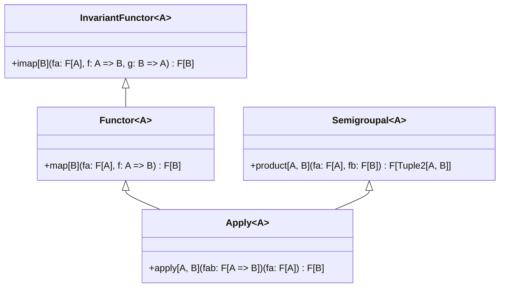

# Apply

**Apply** is an abstraction in functional programming that extends the capabilities of [`Semigroupal`](semigroupal.md),
adding the ability to apply a function, which is itself in a context, to a value that is also in a context.
`Apply` is a less strict version of [`Applicative`](applicative.md),
as it does not require the `pure` operation (which lifts a value into a context).

**The main idea of Apply**

`Apply` is a type that implements two main operations:

- `product` (or `tuple2`, `tuple3`, etc.) — combines two contextual values into a pair within the same context.
- `ap` (or `apply`) — applies a contextual function to a contextual value.

`Apply` is useful when you need to:

- Apply functions that are in a context to values that are also in a context.
- Combine multiple values in a context (e.g., results of several asynchronous computations or multiple optional values).
- Work with effects (e.g., asynchrony, optionality, errors) in a composable style,
  without needing to use the stricter `Applicative` abstraction.

**Examples of Apply**

- `Option` as `Apply`. `Option` is a container that can hold a value (`Some`) or be empty (`None`).
  `Apply` allows applying a function to multiple optional values.
- `List` as `Apply`. `List` is a container holding multiple values.
  `Apply` allows applying a function to all possible combinations of elements from several lists.
- `Future` as `Apply`. `Future` is a container representing an asynchronous computation.
  `Apply` allows combining multiple asynchronous computations.

## Formal Definition

`Apply` implements the `apply` operation
(also known as `join`, `sequence`, `joinWith`, `ap`, `applicate` — the names are interchangeable),
which combines `F[A]` and `F[A => B]` into `F[B]`.
`Apply` extends [`Functor`](functor.md) and [`Semigroupal`](semigroupal.md).

A function is sometimes thought of as a kind of enhanced `map`.
While `map` takes a function and a functor and applies the function inside a functor value,
`apply` takes a functor containing a function and another functor,
extracts the function from the first functor, and then maps it over the second.

`Apply` must satisfy the following laws:

- **Composition**: `apply(fbc)(apply(fab)(fa)) == apply(apply(fbc.map((bc: B => C) => (ab: A => B) => bc compose ab))(fab))(fa)`

## Code

```dotty
trait Apply[F[_]] extends Functor[F], Semigroupal[F]:
  def apply[A, B](fab: F[A => B])(fa: F[A]): F[B]

  def apply2[A, B, C](fa: => F[A], fb: => F[B])(f: (A, B) => C): F[C] =
    apply(fa.map(f.curried))(fb)

  override def product[A, B](fa: F[A], fb: F[B]): F[(A, B)] =
    apply2(fa, fb)((_, _))

  def lift2[A, B, C](f: (A, B) => C): (F[A], F[B]) => F[C] =
    apply2(_, _)(f)
```

Using `apply` and `map`, the following operations can be implemented:

- `apply2`, which takes two `Apply` values and a transforming function from their types to a third type `C`, returning an `Apply` of `C`.
- `tuple2`, which takes two `Apply` values and returns an `Apply` of their tuple types.
- `lift2`, which "lifts" a function `(A, B) => C` to a transforming function over `Apply`: `(F[A], F[B]) => F[C]`

Obviously, these operations can be further extended to longer tuples: `apply3`, `apply4`, etc.

### Laws

- The `Apply` law states that composing functions inside an applicative functor must be consistent
  with applying functions individually. Formally:
  `apply(fbc)(apply(fab)(fa)) == apply(apply(fbc.map((bc: B => C) => (ab: A => B) => bc compose ab))(fab))(fa)`

## Exercises

### Exercise 2.4.1: Implement Apply for the Option type.

> [Repository with exercises and instructions][sample]

Implement an `Apply` instance for the `Option` type. The semantics should be as follows:
- If both values are `Some`, the function is applied to the value, and the result is `Some`.
- If either value is `None`, the result is `None`.

`map` must also be implemented.

```dotty
given Apply[Option] with
  def apply[A, B](fab: Option[A => B])(fa: Option[A]): Option[B] = ???

  extension [A](as: Option[A])
    def map[B](f: A => B): Option[B] = ???
```

**Examples:**

```dotty
import Apply.given

// product from Semigroupal (should work automatically)
val product1 = product(someNum, someStr)   // Some((42, "Hello"))
val product2 = product(someNum, none)      // None

// apply (ap) — applying a function from context
val optFunc: Option[Int => String] = Some(_.toString)
val applied1 = apply(optFunc)(someNum)    // Some("42")
val applied2 = apply(optFunc)(none)       // None

val optNoneFunc: Option[Int => String] = None
val applied3 = apply(optNoneFunc)(someNum) // None

// map
val mapped1 = someNum.map(_ * 2)          // Some(84)
val mapped2 = none.map(_ * 2)             // None
```

@:note(🔍 Show solution)

The solution uses pattern matching to handle two cases.
In the `apply` method we pattern match on the pair `(fab, fa)`:
if both values are `Some` — we extract the function `aToB` and the value `a`,
apply the function to the value and return `Some(aToB(a))`.
In all other cases (when either value is `None`) we return `None`.

In the `map` method we also use pattern matching:
if the value is `Some(a)`, we apply the function `f` and return `Some(f(a))`;
if the value is `None`, we return `None`.

Note that `Apply` inherits from `Semigroupal`,
so the `product` method is already implemented via `apply` and `map` (or must be provided separately),
but in this instance we rely on the default implementations in the `Apply` trait.

```dotty
given Apply[Option] with
  def apply[A, B](fab: Option[A => B])(fa: Option[A]): Option[B] =
    (fab, fa) match
      case (Some(aToB), Some(a)) => Some(aToB(a))
      case _                     => None

  extension [A](as: Option[A])
    def map[B](f: A => B): Option[B] =
      as match
        case Some(a) => Some(f(a))
        case None    => None
```

@:@

### Exercise 2.4.2: Implement Apply for the List type.

Implement an `Apply` instance for the `List` type:
this implementation should create the Cartesian product of all functions on all values.
`map` must also be implemented, which applies a function to each element of the list.

```dotty
given Apply[List] with
  def apply[A, B](fab: List[A => B])(fa: List[A]): List[B] = ???

  extension [A](as: List[A])
    def map[B](f: A => B): List[B] = ???
```

**Examples:**

```dotty
import Apply.given

val numbers = List(1, 2, 3, 4, 5)
val strings = List("a", "b", "c")
val booleans = List(true, false)
val empty = List.empty[Int]

// product from Semigroupal (should work automatically)
val product1 = product(numbers, strings)   
// List((1,"a"), (2,"b"), (3,"c"))

val product2 = product(numbers, booleans)  
// List((1,true), (2,false))

val product3 = product(numbers, empty)     
// Nil

val funcs1: List[Int => String] = List(_.toString, x => s"num:$x")
val applied2 = apply(funcs1)(List(10, 20))  
// List("10", "num:10", "20", "num:20")
```

@:note(🔍 Show solution)

This is an implementation of `Apply[List]`, where the `apply` operation (known as `ap`) combines a list of functions with a list of values,
applying each function from `fab` to all elements of `fa` and concatenating the results.

The `map` method is implemented standardly by recursively traversing the list and applying function `f` to each element, preserving structure.
This implementation matches the behavior of a Cartesian product, where the result contains `|fab| * |fa|` elements —
unlike a "zip-like" implementation, where the result is limited by the shorter length.

```dotty
given Apply[List] with
  def apply[A, B](fab: List[A => B])(fa: List[A]): List[B] =
    fab match
      case Nil    => Nil
      case h :: t =>
        fa.map(h) ++ apply(t)(fa)

  extension [A](as: List[A])
    def map[B](f: A => B): List[B] =
      as match
        case h :: t => f(h) :: t.map(f)
        case Nil    => Nil
```

@:@

## Scheme



## Implementation in Libraries

### Implementation in Cats

```dotty
import cats.*, cats.data.*, cats.syntax.all.*

Apply[Option].ap({{(_: Int) + 3}.some })(10.some)               // Some(13)
Apply[Option].ap({{(_: String) + "hahah"}.some })(none[String]) // None
Apply[Option].ap({ none[String => String] })("woot".some)       // None
```

### Implementation in ScalaZ

```dotty
import scalaz.*
import Scalaz.*

// Operations inherited from functor
...

val intToString: Int => String = _.toString
val double: Int => Int = _ * 2
val addTwo: Int => Int = _ + 2
Apply[Option].ap(1.some)(some(intToString))           // Some(1)
Apply[Option].ap(none)(some(double))                  // None
Apply[List].ap(List(1,2,3))(List(double, addTwo))     // List(2, 4, 6, 3, 4, 5)

val add2 = ((_:Int) + (_:Int))
Apply[Option].apply2(some(1), some(2))(add2)          // Some(3)

Apply[List].tuple2(List(1,2,3), List("a", "b"))       // List((1,a), (1,b), (2,a), (2,b), (3,a), (3,b))

Apply[List].lift2 {(_: Int) * (_: Int)} (List(1, 2), List(3, 4)) // List(3, 4, 6, 8)

1.some <*> {(_: Int) + 2}.some                                   // Some(3)
1.some <*> { 2.some <*> {(_: Int) + (_: Int)}.curried.some }     // Some(3)
1.some <* 2.some                                                 // Some(1)
1.some *> 2.some                                                 // Some(2)
(3.some |@| 5.some) {_ + _}                                      // Some(8)
```

---

**References:**

- [Link to the repository with exercises][sample]
- [Cats](https://typelevel.org/cats/typeclasses/applicative.html)
- [Herding Cats](http://eed3si9n.com/herding-cats/Apply.html)
- [Learning Scalaz](http://eed3si9n.com/learning-scalaz/Applicative.html)
- [Scala with Cats](https://scalawithcats.com/dist/scala-with-cats.html#apply-and-applicative)
- [Scalaz API](https://javadoc.io/doc/org.scalaz/scalaz-core_3/7.3.6/scalaz/Apply.html)

[sample]: https://gitverse.ru/scalabook/typeclasses