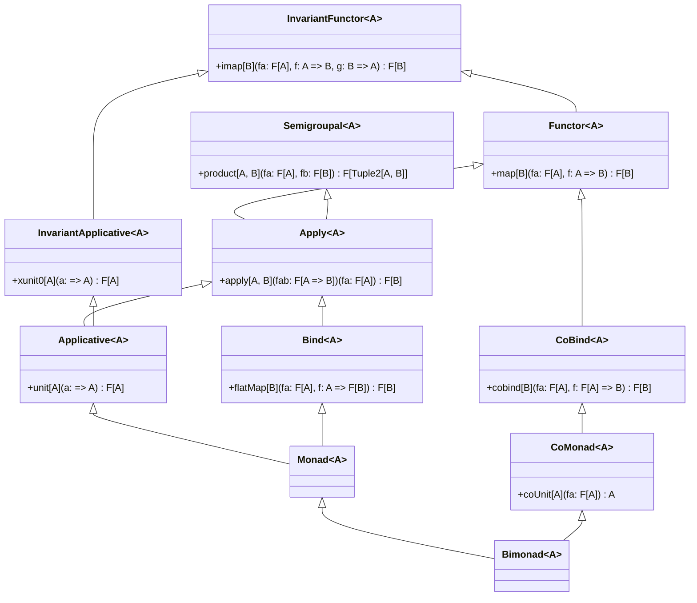

# Bi-Monad

**A Bi-Monad** (or **Bimonad**) is a type class in functional programming
that combines the properties of a **[monad](monad.md)** and a **[comonad](co-monads.md)**.
This means that a `Bi-Monad` simultaneously supports operations for working with context (like a monad)
and for extracting values from context (like a comonad).

**Use cases**

- **Working with bidirectional data structures**:
    - For example, working with data streams that can be both sources (extracting data)
      and sinks (sequential computations).
- **Data processing in context**:
    - For example, working with tables or matrices, where both value extraction
      and sequential transformations are required.
- **Data analysis**:
    - For example, analyzing time series, where both current values and their context must be considered.

> `Bimonad` is different from other **Bi**-prefixed type classes,
> such as [Bifunctor](../bifunctor/bifunctor.md), [Bifoldable](../bifunctor/bifoldable.md),
> or [Bitraverse](../bifunctor/bitraverse.md), where the prefix describes `F[_, _]`.
> `Bimonad` is `F[_]`, and the **Bi** prefix here has a different meaning: it is both a monad and a comonad.
> A bimonad has its own additional laws,
> so what is both monadic and comonadic is not necessarily a valid bimonad.

## Formal Definition

For a type `F[_]`, the `Bi-Monad` type class provides the following methods:

- **Monad methods**:
    - `pure: A => F[A]` — creates a context from a value (also known as `point`, `unit`).
    - `flatMap: (F[A], A => F[B]) => F[B]` — sequentially computes values in context
      (also known as `bind`).
- **Comonad methods**:
    - `extract: F[A] => A` — extracts a value from context (also known as `coUnit`, `coPoint`, `coPure`).
    - `coflatMap: (F[A], F[A] => B) => F[B]` — transforms a context considering its entire structure
      (also known as `cobind`).

### Laws

A `Bi-Monad` must satisfy the laws for both a monad and a comonad:

- **[Monad laws](monad.md)**:
    - **Associativity law**: `fa.flatMap(f).flatMap(g) == fa.flatMap { a => f(a).flatMap(g) }`.
      This law states that when we have a chain of monadic function applications with `flatMap`,
      it should not matter how they are nested.
    - **Left identity law**: `unit(a).flatMap(afb) == afb(a)`.
      This law states that if we take a value (`A`),
      put it into the default context using `unit` and then pass it to a function via `flatMap` (`A => F[B]`) —
      this is the same as simply taking the value and applying the function to it.
    - **Right identity law**: `fa.flatMap(unit _) == fa`.
      This law states that if we have a monadic value (`F[A]`) and use `flatMap`
      to pass it to `unit` (`A => F[A]`), the result will be the original monadic value.
- **[Comonad laws](co-monads.md)**:
    - **Associativity law**:
      `fa.coflatMap(f).coflatMap(g) == fa.coflatMap(x => g(x.coflatMap(f)))`.
      This means that sequentially applying `coflatMap` must be associative.
    - **Left identity law**: `fa.coflatMap(f).extract == f(fa)`.
      Here, `extract` is a method that extracts a value from context (usually provided by `Comonad`).
      This law guarantees that `coflatMap` interacts correctly with `extract`.
    - **Right identity law**: `fa.coflatMap(_.extract) == fa`.
      This law guarantees that if function `f` simply extracts a value from context,
      `coflatMap` returns the original context.

## Code

```dotty
trait Bimonad[F[_]] extends Monad[F], CoMonad[F]
```

## Exercises

### Exercise 2.18.1: Implement Bimonad for NonEmptyList

> [Repository with exercises and instructions][sample]

`NonEmptyList` (non-empty list) is a classic example of a bimonad.
Why `NonEmptyList` and not a regular `List`?
Because:

- A comonad needs a `coUnit` operation — extracting a value from context
- A regular list has no guaranteed first element (it can be empty)
- `NonEmptyList` always has at least one element, so `coUnit` can always return `head`

**`NonEmptyList[A]` structure**:

- `head: A` — the first element (always present)
- `tail: List[A]` — the tail of the list (can be empty)

**Operations to implement**:

1. **`unit` (from the monad)** — lifts a value into context
2. **`coUnit` (from the comonad)** — extracts a value from context
3. **`flatMap` (from the monad)** — sequential transformation
4. **`cobind` (from the comonad)** — context extension
5. **`map` (inherited)** — transforming all elements
    - Implemented via `flatMap` and `unit` (or via `cobind` and `coUnit`)

Implement a `Bimonad` instance for `NonEmptyList`.

```dotty
import ru.scalabook.typeclasses.Bimonad

case class NonEmptyList[A](head: A, tail: List[A]):
  def toList: List[A] = head :: tail
  def ++(than: NonEmptyList[A]): NonEmptyList[A] =
    NonEmptyList(head = head, tail = tail ++ than.toList)

// TODO: Implement the given Bimonad instance for NonEmptyList
given Bimonad[NonEmptyList] with
  override def unit[A](a: => A): NonEmptyList[A] = ???
  override def coUnit[A](fa: NonEmptyList[A]): A = ???

  extension [A](fa: NonEmptyList[A])
    override def flatMap[B](f: A => NonEmptyList[B]): NonEmptyList[B] = ???
    override def cobind[B](f: NonEmptyList[A] => B): NonEmptyList[B] = ???
```

**Examples:**

```dotty
import Bimonad.given

val nel = NonEmptyList(1, List(2, 3, 4))

// unit — creating a single-element list
unit(42)  // NonEmptyList(42, Nil)

// flatMap — sequential transformation
val doubled = nel.flatMap(x => NonEmptyList(x, List(x * 2)))
// NonEmptyList(1, List(2, 2, 4, 3, 6, 4, 8))
// Step by step:
// 1 → [1,2]
// 2 → [2,4]
// 3 → [3,6]
// 4 → [4,8]
// Result: [1,2,2,4,3,6,4,8]

// coUnit — extracting the head
coUnit(nel)  // 1

// cobind — sum of each suffix
val sums = nel.cobind(_.toList.sum)
// NonEmptyList(10, List(9, 7, 4))
// Suffixes and their sums:
// [1,2,3,4] → 10
// [2,3,4]   → 9
// [3,4]     → 7
// [4]       → 4
```

@:note(🔍 Show solution)

**`unit`** creates a single-element list: `NonEmptyList(a, Nil)`.

**`coUnit`** extracts the head: `fa.head`.

**`flatMap`** uses recursion: for a single-element list, we apply `f` to the head;
for a multi-element list, we apply `f` to the head
and recursively process the tail, then concatenate the results via `++`.
Importantly, the result is always non-empty, since `f(head)` returns a `NonEmptyList[B]`.

**`cobind`** uses tail recursion to iterate over all non-empty suffixes:

1. The `loop` function takes the current suffix `nel` and the accumulator `acc`
2. On each step it applies `f` to the current `nel` and adds the result to the accumulator
3. If the tail is empty — it reverses the accumulator and creates a `NonEmptyList` from the first element and the rest
4. If the tail is non-empty — it recursively calls `loop` with the new suffix `NonEmptyList(h, t)`

```dotty
given Bimonad[NonEmptyList] with
  override def unit[A](a: => A): NonEmptyList[A] = NonEmptyList(a, Nil)

  override def coUnit[A](fa: NonEmptyList[A]): A = fa.head

  extension [A](fa: NonEmptyList[A])
    override def flatMap[B](f: A => NonEmptyList[B]): NonEmptyList[B] =
      fa match
        case NonEmptyList(head, Nil)       => f(head)
        case NonEmptyList(head, h :: tail) =>
          f(head) ++ NonEmptyList(h, tail).flatMap(f)

    override def cobind[B](f: NonEmptyList[A] => B): NonEmptyList[B] =
      @annotation.tailrec
      def loop(nel: NonEmptyList[A], acc: List[B]): NonEmptyList[B] =
        val newAcc = f(nel) :: acc
        nel.tail match
          case Nil =>
            val newList = newAcc.reverse
            // Calling head is safe because we know newAcc is non-empty
            NonEmptyList(newList.head, newList.tail)
          case h :: t =>
            loop(NonEmptyList(h, t), newAcc)

      loop(fa, Nil)
  end extension
end given
```

@:@

## Schema



## Implementation in Libraries

### Implementation in Cats

```dotty
import cats.*
import cats.data.*
import cats.syntax.all.*

def make[T[_]: Bimonad](config: T[String]): String = 
  config
    .flatMap(c => Bimonad[T].pure(c + " with option A"))
    .flatMap(c => Bimonad[T].pure(c + " with option B"))
    .flatMap(c => Bimonad[T].pure(c + " with option C"))
    .extract

make(NonEmptyList.one("config"))
// res0: String = "config with option A with option B with option C"
```

---

**References:**

- [Link to the repository with exercises][sample]
- [Cats](https://typelevel.org/cats/typeclasses/bimonad.html)

[sample]: https://gitverse.ru/scalabook/typeclasses
