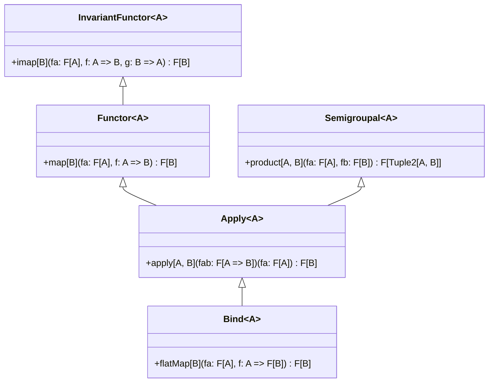

# Bind (FlatMap)

In functional programming, particularly in Scala, `bind` (or `flatMap`) is an operation
used for working with monadic data types.
[Monads](monad.md) are an abstraction that allows sequentially executing computations
while preserving context (e.g., error handling, asynchrony, state, etc.).

**What is `bind` (`flatMap`)?**

`bind` (more commonly called `flatMap` in Scala) is a method that takes a value
"wrapped" in a monad (e.g., `Option`, `List`, `Future`, etc.),
and a function that returns a new value, also "wrapped" in a monad.
The result of `flatMap` is an "unwrapped" value, obtained after applying the function.

**Why is `bind` (`flatMap`) needed?**

- **Sequential execution of computations**:
  `flatMap` allows chaining computations that return monadic values.
  For example, if there are several operations, each of which may return `Option`,
  you can use `flatMap` to execute them sequentially without worrying about checking for `None`.
- **Working with context**:
  Monads allow working with context (e.g., error handling, asynchrony, state).
  `flatMap` helps preserve this context between computations.
- **Composing operations**:
  `flatMap` allows combining multiple operations into a single chain, making code more readable and expressive.
- **Avoiding "nested callback hell"**:
  Without `flatMap`, working with monads would require manually checking the context
  (e.g., `None` for `Option` or `Failure` for `Future`), which would lead to nested conditions and complex code.

`bind` (`flatMap`) is a powerful tool in functional programming
that allows working with monadic data types while preserving context and simplifying operation composition.
In Scala, it is widely used for working with `Option`, `List`, `Future`, `Either`, and other monads.

Here are several examples of using `bind` (or `flatMap`) in various contexts:

- **Working with `Option` (optional absence of value)**.
  Imagine a function that looks up a user by their ID, and another function that looks up that user's orders.
  If the user is not found, there is no need to look up orders. With `bind`, these two operations can be chained:
  first look up the user, and then, if they exist, look up their orders.
  If the user is not found, the process simply stops and returns "nothing" (`None`).
- **Working with `State` (state management)**.
  Imagine a program that works with some state (e.g., a counter).
  Several operations each modify the state and return a result.
  With `bind`, these operations can be chained so that state is passed between them automatically,
  without the need to manage it explicitly.
- **Working with `IO` (side effects)**.
  Imagine a program that reads data from a file and then writes it to another file.
  With `bind`, these two operations can be chained so that the second operation (writing) is performed
  only after the first one (reading) completes successfully. If reading fails, writing will never start.
- **Working with `Try` (exception handling)**.
  Imagine a function that may throw an exception,
  and another function that works with the result of the first function.
  With `bind`, these two functions can be chained so that the second function is executed only if
  the first one completes successfully. If the first function throws an exception, the second will never start.

## Formal Definition

`Bind` is an [`Apply`](apply.md) functor
in which a function can introduce new values and a new context of the functor
embedded within the "lifting" context. This operation is called `flatMap[B](f: A => F[B]): F[B]` (or its synonym `bind`).

The following laws must hold for `Bind`:

- **`apply` and `flatMap` correspondence**:
    - `apply(fab)(fa) == fab.flatMap(a2b => fa.map(a2b))`
- **Associativity on `flatMap`** (as with semigroups, monadic effects change only when their order changes,
  not when the order of their combination changes):
    - `fa.flatMap(f).flatMap(g) == fa.flatMap { a => f(a).flatMap(g) }`

The `flatMap` function allows us to define the `join[A](ffa: F[F[A]]): F[A]` operation, which "flattens" functor layers.
`join` is a synonym for `flatten`.


## Code

```dotty
trait Bind[F[_]] extends Apply[F]:
  extension [A](fa: F[A])
    def flatMap[B](f: A => F[B]): F[B]

    def bind[B](f: A => F[B]): F[B] = flatMap(f)

  extension [A](ffa: F[F[A]])
    def flatten: F[A] = ffa.flatMap(identity)

    def join: F[A] = flatten

  override def apply[A, B](fab: F[A => B])(fa: F[A]): F[B] =
    flatMap(fab)(x => fa.map(x))

  override def apply2[A, B, C](fa: => F[A], fb: => F[B])(f: (A, B) => C): F[C] =
    flatMap(fa)(a => fb.map(b => f(a, b)))
```

### Laws

- `apply` and `flatMap` correspondence: `apply(fab)(fa) == fab.flatMap(a2b => fa.map(a2b))`
- Associativity on `flatMap`: `fa.flatMap(f).flatMap(g) == fa.flatMap { a => f(a).flatMap(g) }`

## Exercises

### Exercise 2.6.1: Implement Bind for the Option type.

> [Repository with exercises and instructions][sample]

Implement a `Bind` instance for the `Option` type:

```dotty
given optionBind: Bind[Option] with
  extension [A](fa: Option[A])
    override def flatMap[B](f: A => Option[B]): Option[B] = ???

  extension [A](fa: Option[A])
    override def map[B](f: A => B): Option[B] = ???
```

**Examples:**

```dotty
import Bind.given

// flatMap
Some(42).flatMap(x => Some(x * 2))  // Some(84)
Some(42).flatMap(_ => None)         // None
None.flatMap((x: Int) => Some(x))   // None

// map via flatMap (automatic)
Some(5).map(_ * 3)                  // Some(15)
None.map(_ * 3)                     // None
```

@:note(🔍 Show solution)

The `flatMap` implementation uses pattern matching on the value `fa`.
If `fa` is `Some(a)`, we extract the value `a` and apply the function `f`, returning `f(a)`.
If `fa` is `None`, we return `None` without calling `f`.
This matches the "short-circuit" semantics:
if the computation has already failed (with absence of a value), subsequent steps are not executed.
The `map` implementation also uses pattern matching: for `Some(a)` we return `Some(f(a))`, for `None` we return `None`.

```dotty
given optionBind: Bind[Option] with
  extension [A](fa: Option[A])
    override def flatMap[B](f: A => Option[B]): Option[B] =
      fa match
        case Some(a) => f(a)
        case None    => None

  extension [A](fa: Option[A])
    override def map[B](f: A => B): Option[B] =
      fa match
        case Some(a) => Some(f(a))
        case None    => None
```

@:@

### Exercise 2.6.2: Implement Bind for the List type.

`Bind` for `List` allows executing computations sequentially, where each function
returns a list, and all application results are combined into a single flat list.
This is a fundamental operation for working with nondeterministic computations.

Implement a `Bind` instance for the `List` type:

```dotty
given listBind: Bind[List] with
  extension [A](fa: List[A])
    override def flatMap[B](f: A => List[B]): List[B] = ???

  extension [A](fa: List[A])
    override def map[B](f: A => B): List[B] = ???
```

**Examples:**

```dotty
import Bind.given

// flatMap — creating a Cartesian product
List(1, 2, 3).flatMap(x => List(x, x * 2))
// Result: List(1, 2, 2, 4, 3, 6)
// Explanation: for 1 -> [1,2], for 2 -> [2,4], for 3 -> [3,6], then concatenation

List(1, 2, 3).flatMap(x => List.empty)
// Result: Nil

// map
List(1, 2, 3).map(_ * 2)  // List(2, 4, 6)
```

@:note(🔍 Show solution)

The `flatMap` implementation uses recursive pattern matching.
The base case is an empty list `Nil`, for which we return `Nil`.
The recursive case is a non-empty list with head `h` and tail `t`.
First, we apply the function `f` to the head, obtaining a list `f(h)`.
Then we recursively apply `flatMap` to the tail `t`, obtaining the result `flatMap(t)`.
After that, we combine these two lists using the concatenation operator `++`.
Importantly, the order of application is preserved: the head is processed first, then the tail,
and the results are combined in the correct order.
In the `map` implementation we recursively traverse the list:
for a non-empty list we apply function `f` to the head and recursively process the tail; for an empty list we return `Nil`.

```dotty
given listBind: Bind[List] with
  extension [A](fa: List[A])
    override def flatMap[B](f: A => List[B]): List[B] =
      fa match
        case h :: t =>
          f(h) ++ this.flatMap(t)(f)
        case Nil => Nil

  extension [A](fa: List[A])
    override def map[B](f: A => B): List[B] =
      fa match
        case h :: t =>
          f(h) :: this.map(t)(f)
        case Nil => Nil
```

@:@

## Schema



## Implementation in Libraries

### Implementation in ScalaZ

```dotty
import scalaz.*
import Scalaz.*

3.some flatMap { x => (x + 1).some }  // Some(4)
3.some >>= { x => (x + 1).some }      // Some(4)
3.some >> 4.some                      // Some(4)
List(List(1, 2), List(3, 4)).join     // List(1, 2, 3, 4)
```

---

**References:**

- [Link to the repository with exercises][sample]
- [Cats](https://typelevel.org/cats/typeclasses/monad.html)
- [Herding Cats](http://eed3si9n.com/herding-cats/FlatMap.html)
- [Learning Scalaz](http://eed3si9n.com/learning-scalaz/Monad.html)
- [Scalaz API](https://javadoc.io/doc/org.scalaz/scalaz-core_3/7.3.6/scalaz/Bind.html)

[sample]: https://gitverse.ru/scalabook/typeclasses
