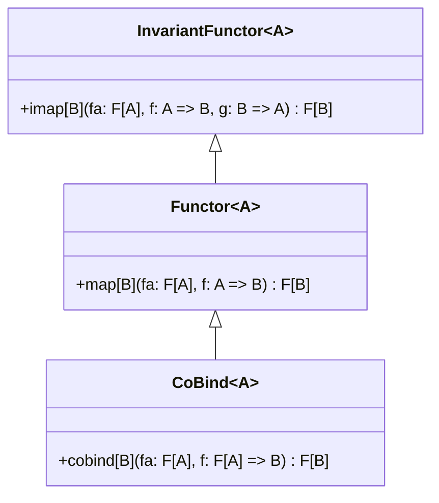

# CoBind

**`CoBind`** (or **`Cobind`**) is a type class that extends the capabilities of a [**functor**](functor.md)
and provides the `coflatMap` operation.
This type class is used for working with contexts that support "extension" or "unfolding" of values
while preserving the structure of the context.

`CoBind` implements the opposite of [`Bind`](bind.md) operations.

`CoBind` is defined for a type `F[_]` and provides the method: `coflatMap: (F[A], F[A] => B) => F[B]`

- It takes:
    - A value of type `F[A]`.
    - A function that transforms `F[A]` into `B`.
- Returns a value of type `F[B]`.

`CoBind` allows "unfolding" a value within a context by applying a function to the entire context, rather than to an individual value.
This is useful in situations where working with the "neighborhoods" of values
or with contexts that preserve structure is required.

**Use cases**

- **Infinite streams**:
    - You have an infinite stream of numbers (`LazyList[Int]`).
    - With `coflatMap`, you can create a new stream where each value is
      the result of applying a function to the entire stream (e.g., a moving average).
- **Data tables**:
    - You have a data table (`Table[A]`) where each cell depends on neighboring cells.
    - With `coflatMap`, you can create a new table where each cell is
      the result of applying a function to the entire table (e.g., a summary by rows and columns).
- **Time series**:
    - You have a time series (`TimeSeries[A]`) where each value depends on previous and subsequent values.
    - With `coflatMap`, you can create a new time series where each value is
      the result of applying a function to the entire series (e.g., filtering or smoothing).

## Formal Definition

**`CoBind`** (or **`Cobind`**) is a type class in functional programming
that is formally defined as follows:

For a type `F[_]`, the `CoBind` type class provides the method: `coflatMap: (F[A], F[A] => B) => F[B]`

- **Input**:
    - A value of type `F[A]` (a context containing a value of type `A`).
    - A function `F[A] => B` that takes the entire context `F[A]` and returns a value of type `B`.
- **Output**:
    - A new value of type `F[B]`, where each element of the context is transformed via the function.

### Laws

`CoBind` must satisfy certain laws that ensure its correct behavior:

- **Associativity law**:
  `fa.coflatMap(f).coflatMap(g) == fa.coflatMap(x => g(x.coflatMap(f)))`
  This means that sequentially applying `coflatMap` must be associative.

## Code

```dotty
trait CoBind[F[_]] extends Functor[F]:
  extension [A](fa: F[A])
    /** Also known as `extend` and `coFlatMap` */
    def cobind[B](f: F[A] => B): F[B]

    final def extend[B](f: F[A] => B): F[B] = fa.cobind(f)

    final def coFlatMap[B](f: F[A] => B): F[B] = fa.cobind(f)

    /** Also known as `duplicate` */
    final def cojoin: F[F[A]] = fa.cobind(fa => fa)
```

## Exercises

### Exercise 2.16.1: Implement CoBind (Comonad) for NonEmptyList

> [Repository with exercises and instructions][sample]

`NonEmptyList` (non-empty list) is a classic example of a comonad.
Each non-empty list can be represented as:

- `head`: the first element (always present)
- `tail`: the tail of the list (can be empty)

`CoBind` operations:

- `map`: transforms each element of the list while preserving its structure
- `cobind`: applies function `f` to each non-empty suffix (tail) of the list, creating a new non-empty list from the results

Implement a `CoBind` instance for `NonEmptyList`.

```dotty
import ru.scalabook.typeclasses.CoBind

case class NonEmptyList[A](head: A, tail: List[A]):
  def toList: List[A] = head :: tail
  def ++(than: NonEmptyList[A]): NonEmptyList[A] =
    NonEmptyList(head = head, tail = tail ++ than.toList)

given CoBind[NonEmptyList] with
  extension [A](fa: NonEmptyList[A])
    override def map[B](f: A => B): NonEmptyList[B] = ???
    override def cobind[B](f: NonEmptyList[A] => B): NonEmptyList[B] = ???
```

**Examples:**

```dotty
import CoBind.given

val nel = NonEmptyList(1, List(2, 3, 4))

// map — transform all elements
nel.map(_ * 2)  
// NonEmptyList(2, List(4, 6, 8))

nel.map(_.toString)  
// NonEmptyList("1", List("2", "3", "4"))

// cobind — sum of each suffix
val sumSuffixes = nel.cobind(_.toList.sum)
// NonEmptyList(10, List(9, 7, 4))
// Explanation: 
// - suffix [1,2,3,4] → 1+2+3+4=10
// - suffix [2,3,4] → 2+3+4=9
// - suffix [3,4] → 3+4=7
// - suffix [4] → 4

// cobind — product of each suffix
val productSuffixes = nel.cobind(_.toList.product)
// NonEmptyList(24, List(24, 12, 4))
// 1*2*3*4=24, 2*3*4=24, 3*4=12, 4=4

// cobind with conversion to string
val describe = nel.cobind(nel => s"[${nel.toList.mkString(",")}]")
// NonEmptyList("[1,2,3,4]", List("[2,3,4]", "[3,4]", "[4]"))
```

@:note(🔍 Show solution)

The `map` implementation uses a recursive traversal of the list: for an empty tail we apply the function only to the head;
for a non-empty tail we apply the function to the head and recursively to the tail,
then construct a new list via `NonEmptyList(f(head), tail.map(f).toList)`.

`cobind` uses tail recursion with the accumulator `acc: List[B]`. At each step:

- Apply `f` to the current `nel` and add the result to the accumulator.
- If the tail is empty, return a list of the accumulated results in reverse order,
  because each current result was prepended to the list;
  the `newList.head` call is safe, since we know for sure that at least `f(nel)` is there.
- If the tail is not empty, recursively call `loop` with a new `NonEmptyList(h, t)`.

```dotty
given CoBind[NonEmptyList] with
  extension [A](fa: NonEmptyList[A])
    override def map[B](f: A => B): NonEmptyList[B] =
      fa match
        case NonEmptyList(head, Nil)       => NonEmptyList(f(head), Nil)
        case NonEmptyList(head, h :: tail) =>
          NonEmptyList(f(head), NonEmptyList(h, tail).map(f).toList)

    override def cobind[B](f: NonEmptyList[A] => B): NonEmptyList[B] =
      @annotation.tailrec
      def loop(nel: NonEmptyList[A], acc: List[B]): NonEmptyList[B] =
        val newAcc = f(nel) :: acc
        nel.tail match
          case Nil =>
            val newList = newAcc.reverse
            NonEmptyList(newList.head, newList.tail)
          case h :: t =>
            loop(NonEmptyList(h, t), newAcc)

      loop(fa, Nil)
  end extension
```

@:@

## Diagram



## Implementation in libraries

### Implementation in Cats

```dotty
import cats.*
import cats.data.*
import cats.syntax.all.*
import cats.instances.list.*

List(1, 2, 3, 4, 5).coflatMap(identity)
// res2: List[List[Int]] = List(
//   List(1, 2, 3, 4, 5),
//   List(2, 3, 4, 5),
//   List(3, 4, 5),
//   List(4, 5),
//   List(5)
// )
```

---

**Links:**

- [Link to the repository with exercises][sample]
- [Cats](https://typelevel.org/cats/typeclasses/comonad.html)
- [Scalaz API](https://javadoc.io/doc/org.scalaz/scalaz-core_3/7.3.6/scalaz/Cobind.html)

[sample]: https://gitverse.ru/scalabook/typeclasses