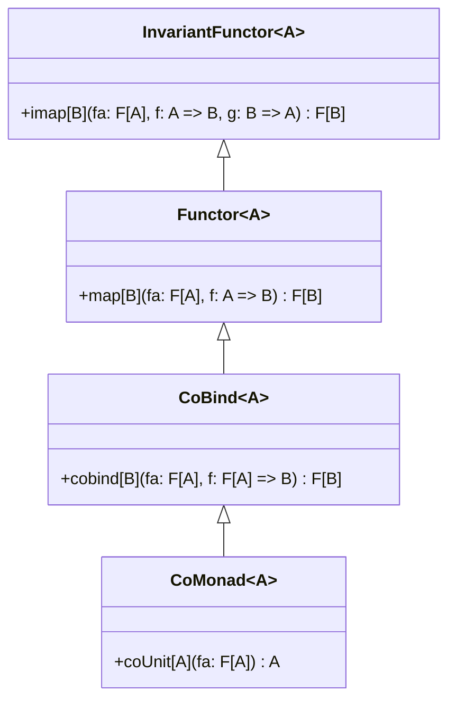

# CoMonad

**`CoMonad`** (or **`Comonad`**) is a type class in functional programming
that extends [`CoBind`](co-bind.md),
representing the dual concept to **[`Monad`](monad.md)**.
If monads allow sequentially computing values within a context,
then comonads allow extracting values from context and working with "extended" contexts.

For a type `F[_]`, the `CoMonad` type class provides two main methods:

- **`extract`** (also known as `coUnit`, `coPoint`, `coPure`):
    - Extracts a value of type `A` from context `F[A]`.
    - Signature: `extract: F[A] => A`.
- **`coflatMap`** (also known as `cobind`):
    - Takes a context `F[A]` and a function `F[A] => B`, then returns a new context `F[B]`.
    - Signature: `coflatMap: (F[A], F[A] => B) => F[B]`.

**Use cases**

- **Working with infinite data structures**:
    - For example, working with infinite streams or infinite lists,
      where values need to be extracted and "neighborhoods" of values need to be worked with.
- **Data processing in context**:
    - For example, working with two-dimensional data structures such as tables or matrices,
      where values need to be extracted and functions applied to the entire structure.

## Formal Definition

**`CoMonad`** (or **`Comonad`**) is a type class in functional programming
that is defined as follows:

For a type `F[_]`, the `CoMonad` type class provides two main methods:

- **`extract`**:
    - Extracts a value of type `A` from context `F[A]`.
    - Signature: `extract: F[A] => A`.
- **`coflatMap`**:
    - Takes a context `F[A]` and a function `F[A] => B`, then returns a new context `F[B]`.
    - Signature: `coflatMap: (F[A], F[A] => B) => F[B]`.

### Laws

`CoMonad` must satisfy certain laws that ensure its correct behavior:

- **Associativity law**:
  `fa.coflatMap(f).coflatMap(g) == fa.coflatMap(x => g(x.coflatMap(f)))`.
  This means that sequentially applying `coflatMap` must be associative.
- **Left identity law**: `fa.coflatMap(f).extract == f(fa)`.
  Here, `extract` is a method that extracts a value from context (usually provided by `Comonad`).
  This law guarantees that `coflatMap` interacts correctly with `extract`.
- **Right identity law**: `fa.coflatMap(_.extract) == fa`.
  This law guarantees that if function `f` simply extracts a value from context,
  `coflatMap` returns the original context.

### Relationship to other type classes

- **`CoMonad`** and **`CoBind`** extend **`Functor`**, since `cobind` and `coUnit`
  can be used to implement `map`: `map(fa)(f) = cobind(fa)(x => f(x.coUnit))`

## Code

```dotty
trait CoMonad[F[_]] extends CoBind[F]:
  def coUnit[A](fa: F[A]): A

  final def coPoint[A](p: F[A]): A = coUnit(p)

  final def coPure[A](p: F[A]): A = coUnit(p)

  extension [A](fa: F[A])
    override def map[B](f: A => B): F[B] =
      fa.cobind(x => f(coUnit(x)))
```

## Exercises

### Exercise 2.17.1: Implement CoMonad (Comonad) for NonEmptyList

> [Repository with exercises and instructions][sample]

Implement a `CoMonad` instance for `NonEmptyList`:

- Implement `coUnit` — extracting the head
- Implement `cobind` — applying a function to all non-empty suffixes

```dotty
import ru.scalabook.typeclasses.CoMonad

case class NonEmptyList[A](head: A, tail: List[A]):
  def toList: List[A] = head :: tail
  def ++(than: NonEmptyList[A]): NonEmptyList[A] =
    NonEmptyList(head = head, tail = tail ++ than.toList)

// TODO: Implement the given CoMonad instance for NonEmptyList
given CoMonad[NonEmptyList] with
  override def coUnit[A](fa: NonEmptyList[A]): A = ???

  extension [A](fa: NonEmptyList[A])
    override def cobind[B](f: NonEmptyList[A] => B): NonEmptyList[B] = ???
```

**Examples:**

```dotty
import CoMonad.given

val nel = NonEmptyList(1, List(2, 3, 4))

// coUnit — extracting the head (first element)
coUnit(nel)  // 1

// cobind — sum of each suffix
val sums = nel.cobind(_.toList.sum)
// NonEmptyList(10, List(9, 7, 4))
// Explanation: 
// - suffix [1,2,3,4] → 1+2+3+4 = 10
// - suffix [2,3,4] → 2+3+4 = 9
// - suffix [3,4] → 3+4 = 7
// - suffix [4] → 4
```

@:note(🔍 Show solution)

The `coUnit` implementation is trivial — it simply returns `fa.head` (the head of the non-empty list).

In `cobind` tail recursion is used with an accumulator `acc: List[B]`.
On each step:

- We apply `f` to the current `nel`, adding the result to the accumulator.
- If the tail is empty — we return a list of accumulated results in reverse order,
  since each current result was added to the front of the list;
  calling `newList.head` is safe since we know there is at least `f(nel)`.
- If the tail is non-empty — we recursively call `loop` with the new `NonEmptyList(h, t)`.

```dotty
given CoMonad[NonEmptyList] with
  override def coUnit[A](fa: NonEmptyList[A]): A = fa.head

  extension [A](fa: NonEmptyList[A])
    override def cobind[B](f: NonEmptyList[A] => B): NonEmptyList[B] =
      @annotation.tailrec
      def loop(nel: NonEmptyList[A], acc: List[B]): NonEmptyList[B] =
        val newAcc = f(nel) :: acc
        nel.tail match
          case Nil =>
            val newList = newAcc.reverse
            // Calling head is safe because we know newAcc is non-empty
            NonEmptyList(newList.head, newList.tail)
          case h :: t =>
            loop(NonEmptyList(h, t), newAcc)

      loop(fa, Nil)
  end extension   
```

@:@

## Schema



## Implementation in Libraries

### Implementation in Cats

```dotty
import cats.*
import cats.data.*
import cats.syntax.all.*
import cats.instances.list.*

NonEmptyList.of(1, 2, 3).extract
// res0: Int = 1

NonEmptyList.of(1, 2, 3, 4, 5).coflatMap(identity)
// res1: NonEmptyList[NonEmptyList[Int]] = NonEmptyList(
//   head = NonEmptyList(head = 1, tail = List(2, 3, 4, 5)),
//   tail = List(
//     NonEmptyList(head = 2, tail = List(3, 4, 5)),
//     NonEmptyList(head = 3, tail = List(4, 5)),
//     NonEmptyList(head = 4, tail = List(5)),
//     NonEmptyList(head = 5, tail = List())
//   )
// )
```

---

**References:**

- [Link to the repository with exercises][sample]
- [Cats](https://typelevel.org/cats/typeclasses/comonad.html)
- [Life Is A Comonad](https://eli-jordan.github.io/2018/02/16/life-is-a-comonad/)
- [Scalaz API](https://javadoc.io/static/org.scalaz/scalaz-core_3/7.3.6/scalaz/Comonad.html)

[sample]: https://gitverse.ru/scalabook/typeclasses
