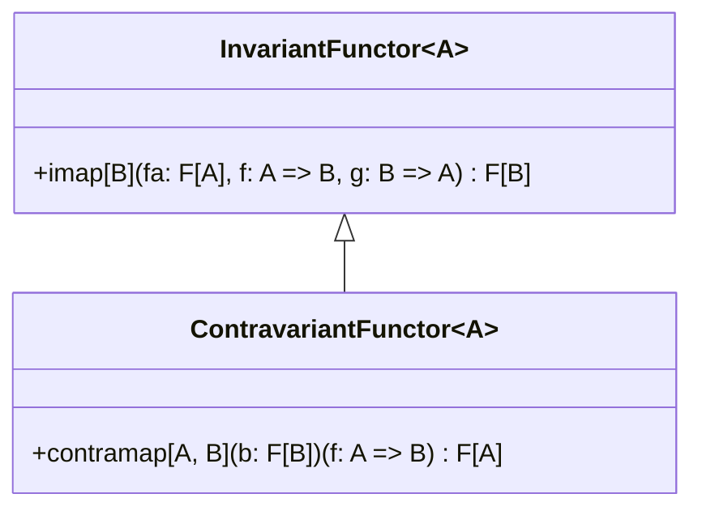

# Contravariant Functor

**A contravariant functor** is a type class
generalizing the operation of "preparing" or "transforming" data in the opposite direction
compared to an [ordinary (covariant) functor](functor.md).
A contravariant functor is defined via the `Contravariant` type class, which provides the `contramap` operation.

For a type `F[_]`, a contravariant functor provides the method: `contramap: (F[A], B => A) => F[B]`

- It takes:
    - A value of type `F[A]`.
    - A function that transforms `B` into `A`.
- Returns a value of type `F[B]`.

A contravariant functor "prepares" data for processing.
If you have a functor `F[A]` that works with type `A`, and a function `B => A`,
then via `contramap` you can adapt this functor to work with type `B`.

**Use cases**

- **Serialization and encoding**:
    - If you have an encoder for type `A` (`F[A]`), and you want to adapt it to work with type `B`,
      you can use `contramap` by providing a function `B => A`.
- **Data validation**:
    - If you have a validator for type `A` (`F[A]`), and you want to validate type `B`,
      you can use `contramap` by providing a function `B => A`.
- **Predicates and filters**:
    - If you have a predicate for type `A` (`F[A]`), and you want to apply it to type `B`,
      you can use `contramap` by providing a function `B => A`.

Contravariant functors are useful in situations where adaptation of existing handlers
(e.g., encoders, validators, predicates) is required to work with other types.
They are often used in functional programming libraries such as **Cats** or **Scalaz**.

## Formal Definition

A contravariant functor (`F`) is similar to a [functor](functor.md),
but with the opposite operation `cmap`:

- `cmap(b: F[B])(f: A => B): F[A]`.

A contravariant functor creates new type class instances by adding a function to the beginning of the transformation chain,
unlike a functor, which adds it to the end.

Laws of a contravariant functor:

- **Identity**: If an identity method `id` is defined such that: `id(a) == a`,
  then `cmap(fa)(id) == fa`.
- **Composition**: If two methods `f: A => B` and `g: B => C` are defined,
  then `cmap(cmap(fc)(g))(f) == cmap(fc)(g(f(_)))`.

## Code

```dotty
trait ContravariantFunctor[F[_]] extends InvariantFunctor[F]:
  self =>

  def cmap[A, B](b: F[B])(f: A => B): F[A]

  def contramap[A, B](b: F[B])(f: A => B): F[A] = cmap(b)(f)

  extension [A](fa: F[A]) override def imap[B](f: A => B, g: B => A): F[B] = cmap(fa)(g)

  /** Composition of two contravariant functors is covariant */
  def compose[G[_]: ContravariantFunctor as cfu]: Functor[[X] =>> F[G[X]]] =
    new Functor[[X] =>> F[G[X]]]:
      extension [A](as: F[G[A]])
        def map[B](f: A => B): F[G[B]] =
          cmap(as)(gb => cfu.cmap(gb)(f))

  /** Composition of a contravariant and a covariant functor is contravariant */
  def icompose[G[_]: Functor as fu]: ContravariantFunctor[[X] =>> F[G[X]]] =
    new ContravariantFunctor[[X] =>> F[G[X]]]:
      def cmap[A, B](fa: F[G[B]])(f: A => B): F[G[A]] =
        self.cmap(fa)(fu.lift(f))

  /** Product of two contravariant functors is contravariant */
  def product[G[_]: ContravariantFunctor as cfu]
      : ContravariantFunctor[[X] =>> (F[X], G[X])] =
    new ContravariantFunctor[[X] =>> (F[X], G[X])]:
      def cmap[A, B](fa: (F[B], G[B]))(f: A => B): (F[A], G[A]) =
        (self.contramap(fa._1)(f), cfu.contramap(fa._2)(f))
```

### Compositions

#### Composition of two contravariant functors

```dotty
def compose[G[_]: ContravariantFunctor]: Functor[[X] =>> F[G[X]]]
```

**Why this works:**

- The outer functor `F` is contravariant (transforms input types backwards)
- The inner functor `G` is also contravariant

**Result**: The composition of two contravariant functors yields a **covariant** functor!
This may seem surprising, but here is the logic:

1. We need to transform `F[G[A]]` to `F[G[B]]` using a function `A => B`
2. Since `F` is contravariant, to get `F[G[B]]` from `F[G[A]]`, we need a function from `G[B]` to `G[A]`
3. Since `G` is contravariant, we can get `G[A]` from `G[B]` using function `A => B`

In code:
```dotty
extension [A](as: F[G[A]])
  def map[B](f: A => B): F[G[B]] =
    cmap(as)(gb => cfu.cmap(gb)(f))
```

**Step by step**:

1. `as` has type `F[G[A]]`
2. We need to get `F[G[B]]`
3. We use `cmap` on `as`: `cmap(as)(fun)`
4. Function `fun` must transform `G[B]` into `G[A]`
5. We use inner `cfu.cmap(gb)(f)` where:
    - `gb` is `G[B]`
    - `f: A => B`
    - Since `G` is contravariant, `cmap` gives us `G[A]` from `G[B]`!

Key observation:

- A contravariant functor reverses arrows: `A => B` becomes `F[B] => F[A]`
- Two reversals return to the original direction!

#### Composition of a contravariant and a covariant functor = contravariant

```dotty
def icompose[G[_]: Functor]: ContravariantFunctor[[X] =>> F[G[X]]]
```

**Why this works:**

- Outer `F` is contravariant
- Inner `G` is covariant (ordinary functor)

**Result**: Composition of a contravariant and a covariant functor yields a **contravariant** functor.

```dotty
def cmap[A, B](fa: F[G[B]])(f: A => B): F[G[A]] =
  self.cmap(fa)(fu.lift(f))
```

**Step by step**:

1. `fa` has type `F[G[B]]`
2. We need to get `F[G[A]]`
3. We use `self.cmap(fa)(fun)`
4. Function `fun` must transform `G[A]` into `G[B]`
5. We use `fu.lift(f)`, which lifts `f: A => B` into `G[A] => G[B]` (since `G` is a functor)

#### Product of two contravariant functors

```dotty
def product[G[_]: ContravariantFunctor]: ContravariantFunctor[[X] =>> (F[X], G[X])]
```

**Why this works**: The product of two contravariant functors remains contravariant.

```dotty
def cmap[A, B](fa: (F[B], G[B]))(f: A => B): (F[A], G[A]) =
  (self.contramap(fa._1)(f), cfu.contramap(fa._2)(f))
```

**Step by step**:

1. Input: pair `(F[B], G[B])` and function `f: A => B`
2. Need to get: pair `(F[A], G[A])`
3. For the first component use `self.contramap(fa._1)(f)`
4. For the second use `cfu.contramap(fa._2)(f)`
5. Return the pair of results

### Important patterns

| Composition | First type | Second type | Result |
|-------------|------------|-------------|--------|
| `compose`   | `F` (contra) | `G` (contra) | **Covariant** |
| `icompose`  | `F` (contra) | `G` (covariant) | **Contravariant** |
| `product`   | `F` (contra) | `G` (contra) | **Contravariant** |

### Laws

- Identity: `cmap(fa)(id) == fa`.
- Composition: `cmap(cmap(fc)(g))(f) == cmap(fc)(g(f(_)))`.

## Exercises

### Exercise 2.11.1: Implement a contravariant functor for function type.

> [Repository with exercises and instructions][sample]

A contravariant functor for type `Function1` (a function from `X` to `R`) allows transforming the input type of the function.

Implement the `ContravariantFunctor` instance for type `Function1[X, R]` with fixed return type `R`.

```dotty
given functionContravariantFunctor[R]: ContravariantFunctor[[X] =>> Function1[X, R]] with
  def cmap[A, B](function: B => R)(f: A => B): A => R = ???
```

**Examples:**

```dotty
val boolToString: Boolean => String = (b: Boolean) => if b then "true" else "false"
val intToBool: Int => Boolean = (x: Int) => x > 0

val positiveToString = 
  summon[ContravariantFunctor[[X] =>> X => String]]
    .cmap(boolToString)(intToBool)

positiveToString(5)   // "true"
positiveToString(-3)  // "false"
```

@:note(🔍 Show solution)

The implementation is trivial: to get a function `A => R`, we apply function `f: A => B` to argument `a`, getting `B`,
then apply the original function `function: B => R` to the result. This is standard function composition.
This is a key property of `Function1` — it is contravariant in its input type.

```dotty
given functionContravariantFunctor[R]: ContravariantFunctor[[X] =>> Function1[X, R]] with
  def cmap[A, B](function: B => R)(f: A => B): A => R =
    a => function(f(a))
```

A special case of the previous example is a predicate — a function returning `Boolean`:

```dotty
opaque type Predicate = [X] =>> X => Boolean

given predicateContravariantFunctor: ContravariantFunctor[Predicate] with
  def cmap[A, B](predicate: Predicate[B])(f: A => B): Predicate[A] =
    a => predicate(f(a))
```

Or value rendering (Show):

```dotty
opaque type ShowX = [X] =>> X => String
object ShowX:
  def apply[X](f: X => String): ShowX[X] = f

given showContravariantFunctor: ContravariantFunctor[ShowX] with
  def cmap[A, B](show: ShowX[B])(f: A => B): ShowX[A] =
    a => show(f(a))
```

@:@

## Schema



## Implementation in Libraries

### Implementation in Cats

```dotty
import cats.syntax.contravariant.*
import cats.Show

val showString = Show[String]
showString
  .contramap[Symbol](sym => s"'${sym.name}")
  .show(Symbol("dave"))
// val res0: String = 'dave
```

---

**References:**

- [Link to the repository with exercises][sample]
- Category Theory for Programmers - Bartosz Milewski:
    - [Theory of Categories for Programmers](https://henrychern.wordpress.com/2022/09/15/%d1%82%d0%b5%d0%be%d1%80%d0%b8%d1%8f-%d0%ba%d0%b0%d1%82%d0%b5%d0%b3%d0%be%d1%80%d0%b8%d0%b9-%d0%b4%d0%bb%d1%8f-%d0%bf%d1%80%d0%be%d0%b3%d1%80%d0%b0%d0%bc%d0%bc%d0%b8%d1%81%d1%82%d0%be%d0%b2/)
    - [Category Theory for Programmers, Functoriality](https://bartoszmilewski.com/2015/02/03/functoriality/)
- [Cats](https://typelevel.org/cats/typeclasses/contravariant.html)
- [Learn Functional Programming course/tutorial on Scala](https://github.com/dehun/learn-fp) 
- [Scala with Cats](https://scalawithcats.com/dist/scala-with-cats.html#contravariant)
- [Scalaz API](https://javadoc.io/static/org.scalaz/scalaz-core_3/7.3.6/scalaz/Contravariant.html)

[sample]: https://gitverse.ru/scalabook/typeclasses
