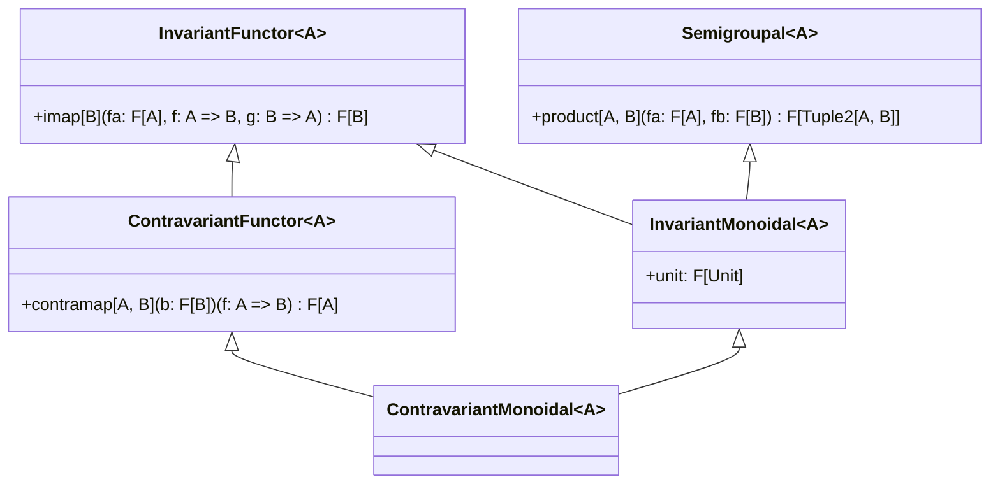

# Contravariant Monoidal

The `ContravariantMonoidal` type class is designed for [contravariant functors](contravariant-functor.md)
that can define `product` (product) and `unit` (unit) functions inherited from [InvariantMonoidal](invariant-monoidal.md).
This can be viewed as the contravariant analogue of [`Applicative`](applicative.md) —
instead of combining values using `map2` and `unit`,
we combine them in the opposite direction using `contramap2` and `point`.

## Code

```dotty
trait InvariantMonoidal[F[_]] extends InvariantSemigroupal[F]:
  def point[A](a: A): F[A] = unit.imap(_ => a, _ => ())

  def unit: F[Unit]

trait ContravariantMonoidal[F[_]] extends InvariantMonoidal[F]
    with ContravariantFunctor[F]:
  def contramap2[A, B, C](fb: F[B], fc: F[C])(f: A => (B, C)): F[A] =
    contramap(product(fb, fc))(f)
```

### Key Idea

If you have two contexts `F[B]` and `F[C]` for types `B` and `C`,
and a way to simultaneously obtain values `B` and `C` from a value of type `A`,
then `ContravariantMonoidal` allows you to obtain a context `F[A]` for type `A`.

Simply put:

- **Applicative** allows creating `F[A]` from `A` (method `def unit[A](a: => A): F[A]`)
  and combining `F[A]` and `F[B]` into `F[C]` using function `f: (A, B) => C`
  (extension method `extension [A](fa: F[A]) def map2[B, C](fb: F[B])(f: (A, B) => C): F[C]`)
  This is from [Exercise 2.5.9](applicative.md).
- **ContravariantMonoidal** also allows creating `F[A]` from `A` (method `point`)
  and "mapping backwards" `F[B]` and `F[C]` into `F[A]` (method `contramap2`) via function `A => (B, C)`

## Examples of Instances

Classic examples of `ContravariantMonoidal`:

- [`Equal`](../equal/equal.md) — equality comparison.
- Predicates (`A => Boolean`).

### Equality comparison as `ContravariantMonoidal`

```dotty
given ContravariantMonoidal[Equal] with
  def unit: Equal[Unit] =
    (a1: Unit, a2: Unit) => true

  def cmap[A, B](b: Equal[B])(f: A => B): Equal[A] =
    (a1: A, a2: A) => b.equal(f(a1), f(a2))

  def product[A, B](fa: Equal[A], fb: Equal[B]): Equal[(A, B)] =
    (ab1: (A, B), ab2: (A, B)) =>
      fa.equal(ab1._1, ab2._1) && fb.equal(ab1._2, ab2._2)
```

The `ContravariantMonoidal` instance for `Equal` allows combining equality comparisons for composite types.
The `unit` method defines that any two `Unit` values are always equal, serving as an identity element for combining.
The `product` method combines two `Equal` instances — for types `A` and `B` — into one instance for the pair `(A, B)`,
checking component-wise equality using logical AND.
The `contramap` (`cmap`) method allows adapting an equality comparison:
if we have `Equal[B]` and a transformation function `A => B`,
we can obtain `Equal[A]` by comparing values of `A` through their transformation to `B`.

This approach is especially useful when working with domain models:
you can define basic `Equal` instances for primitive types (strings, numbers)
and then combine them for complex case classes, using `contramap` to access fields.
For example, `Equal[(String, Int)]` can be built from `Equal[String]` and `Equal[Int]` via `product`.
Thanks to contravariance, `ContravariantMonoidal[Equal]` allows creating equality comparisons for any types
for which there exists a way to decompose them into components with already-defined comparisons,
making code more modular and reusable.

### Predicates as `ContravariantMonoidal`

Consider a practical example with the `Predicate` type, which represents a function
that checks a certain condition.

We can implement `ContravariantMonoidal` for `Predicate`, based on the `Boolean` monoid with the `&&` (logical AND) operation:

```dotty
given ContravariantMonoidal[[X] =>> X => Boolean] with
  def unit: Unit => Boolean = _ => true

  def cmap[A, B](b: B => Boolean)(f: A => B): A => Boolean =
    a => b(f(a))

  def product[A, B](fa: A => Boolean, fb: B => Boolean): ((A, B)) => Boolean =
    (a, b) => fa(a) && fb(b)
```

**What is happening here?**

1. **`unit`** — a predicate for `Unit` that always returns `true`.
   This is an identity element for combining: `predicate && true == predicate`.
2. **`product`** — combines two predicates into one that checks both conditions on the corresponding components of a pair.
3. **`contramap`** — allows transforming the input type of a predicate.
   If we have `Predicate[A]` and a function `B => A`, we can obtain `Predicate[B]`.

We could also use `false` and `||` (logical OR):

```dotty
given ContravariantMonoidal[[X] =>> X => Boolean] with
  def unit: Unit => Boolean = _ => false

  def cmap[A, B](b: B => Boolean)(f: A => B): A => Boolean =
    a => b(f(a))

  def product[A, B](fa: A => Boolean, fb: B => Boolean): ((A, B)) => Boolean =
    (a, b) => fa(a) || fb(b)
```

### Using `contramap` to transform predicates

With `contramap` we can adapt predicates to new types:

```dotty
case class Money(value: Long)

// Predicate for Long: checks evenness
def isEven: Long => Boolean = _ % 2 == 0

// Transform the predicate for Long into a predicate for Money
def isEvenMoney: Money => Boolean =
  ContravariantMonoidal[[X] =>> X => Boolean]
    .contramap[Money, Long](isEven)(_.value)

// Check
isEvenMoney(Money(55)) // false (55 — odd)
isEvenMoney(Money(56)) // true (56 — even)
```

## Relationship with other type classes

### Comparison of `Applicative` and `ContravariantMonoidal`

| Characteristic              | `Applicative[F]`                               | `ContravariantMonoidal[F]`                     |
|:----------------------------|:-----------------------------------------------|:-----------------------------------------------|
| **Direction**               | Covariant                                      | Contravariant                                  |
| **Base class**              | `Apply` + `Functor`                            | `Semigroupal` + `ContravariantFunctor`         |
| **Identity element**        | `pure[A](a: A): F[A]`                          | `unit: F[Unit]`                                |
| **Combination**             | `product[A, B](fa: F[A], fb: F[B]): F[(A, B)]` | `product[A, B](fa: F[A], fb: F[B]): F[(A, B)]` |
| **Mapping**                 | `map(fa)(f: A => B): F[B]`                     | `contramap(fa)(f: B => A): F[B]`               |
| **Combination with mapping**| `map2(fa, fb)(f: (A, B) => C)`                 | `contramap2(fa, fb)(f: C => (A, B))`           |

## Diagram



---

**References:**

- [Repository with exercises][sample]
- [Cats](https://typelevel.org/cats/typeclasses/contravariantmonoidal.html)

[sample]: https://gitverse.ru/scalabook/typeclasses
