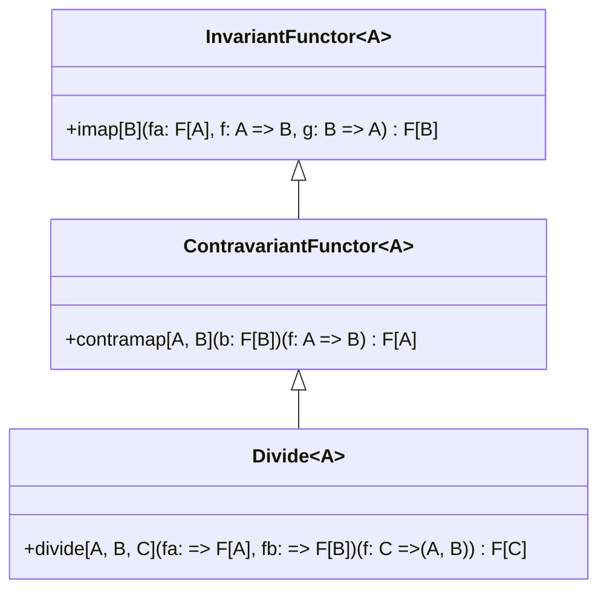

# Divide

**`Divide`** is a type class that represents the conceptual opposite
of [`Semigroup`](../monoid/semigroup.md) or [`Applicative`](applicative.md).
While `Semigroup` allows combining values (e.g., addition or concatenation),
`Divide` allows "dividing" or "decomposing" values.

`Divide` is defined as a type class that for a type `F[_]` provides the `divide` operation.
This operation takes:

- Two values of type `F[A]` and `F[B]`.
- A function that extracts a pair `(A, B)` from a value of type `C`.
- Returns a value of type `F[C]`.

Formally: `divide: (F[A], F[B], C => (A, B)) => F[C]`

`Divide` can be viewed as an operation that allows "assembling" a value of type `F[C]`
from two components `F[A]` and `F[B]`, using a function that "divides" `C` into `A` and `B`.

**Use cases**

- **Data validation**:
  If you have validators for fields `A` and `B`, then with `Divide` you can create
  a validator for a composite type `C` that contains both fields.
- **Parsing**:
  If you have parsers for types `A` and `B`, then `Divide` allows
  creating a parser for type `C`, which consists of `A` and `B`.
- **Contextual computations**:
  In functional programs where data decomposition is required,
  `Divide` can be used for working with contexts (e.g., `F[_]` can be `Option`, `Either`, `List`, etc.).

## Formal Definition

`Divide` is the contravariant analogue of [`Apply`](apply.md).
It extends a [contravariant functor](contravariant-functor.md) and additionally implements
the `divide` operation:

`def divide[A, B, C](fa: => F[A], fb: => F[B])(f: C => (A, B)): F[C]`

Laws of `Divide`:

- **Identity**: If an identity method `id` is defined such that: `id(a) == a`,
  then `cmap(fa)(id) == fa`.
- **Composition**: If two methods `f: A => B` and `g: B => C` are defined,
  then `cmap(cmap(fc)(g))(f) == cmap(fc)(g(f(_)))`.
- **Composition**: `divide(divide(fa1, fa2)(delta), fa3)(delta) == divide(fa1, divide(fa2, fa3)(delta))(delta)`,
  where `delta: A => (A, A) = a => (a, a)`.

## Code

```dotty
trait Divide[F[_]] extends ContravariantFunctor[F]:
  def divide[A, B, C](fa: => F[A], fb: => F[B])(f: C => (A, B)): F[C]

  def tuple2[A, B](fa: => F[A], fb: => F[B]): F[(A, B)] = divide(fa, fb)(identity)
```

### Laws

- **Identity**: `cmap(fa)(id) == fa`.
- **Composition**: `cmap(cmap(fc)(g))(f) == cmap(fc)(g(f(_)))`.
- **Composition**:
  ```dotty
  divide(divide(fa1, fa2)(delta), fa3)(delta) ==
  divide(fa1, divide(fa2, fa3)(delta))(delta)
  ```
  where `delta: A => (A, A) = a => (a, a)`

## Exercises

### Exercise 2.14.1: Implement Divide for a function.

> [Repository with exercises and instructions][sample]

Implement a `Divide` instance for the type `Function1[X, R]`, assuming that type `R` forms a monoid.

```dotty
import ru.scalabook.typeclasses.Divide
import ru.scalabook.typeclasses.Monoid

given functionDivide[R: Monoid]: Divide[[X] =>> Function1[X, R]] with
  override def cmap[A, B](function: B => R)(f: A => B): A => R = ???
  override def divide[A, B, C](fa: => A => R, fb: => B => R)(f: C => (A, B)): C => R = ???
```

**Examples:**

```dotty
given Monoid[Boolean] with
  val empty: Boolean = true
  def combine(a: Boolean, b: Boolean): Boolean = a && b

val isEven: Int => Boolean = (x: Int) => x % 2 == 0
val isPositive: Int => Boolean = (x: Int) => x > 0
val splitPair: Int => (Int, Int) = (x: Int) => (x, x)

val isEvenAndPositive: Int => Boolean =
  summon[Divide[[X] =>> X => Boolean]]
    .divide(isEven, isPositive)(splitPair)

isEvenAndPositive(4)  // true && true = true
isEvenAndPositive(3)  // false && true = false
isEvenAndPositive(-2) // true && false = false
```

@:note(🔍 Show solution)

The `cmap` implementation is ordinary function composition:
to obtain `A => R`, we apply `f: A => B` to the input value,
and then pass the result to the original function `function: B => R`.

The `divide` implementation uses the splitting function `f: C => (A, B)` to obtain a pair `(a, b)` from the input value `c`.
Then it applies `fa` to `a` and `fb` to `b`, obtaining two values of type `R`,
which are combined using the monoid operation for `R`.
Note that the parameters `fa` and `fb` are passed by name (`=>`) to support lazy evaluation,
which is important for some types of contexts, but does not matter for functions.
Type `R` must be a monoid for a combining operation on the results to exist.

```dotty
given functionDivide[R: Monoid]: Divide[[X] =>> Function1[X, R]] with
  override def cmap[A, B](function: B => R)(f: A => B): A => R =
    a => function(f(a))

  override def divide[A, B, C](fa: => A => R, fb: => B => R)(f: C => (A, B)): C => R =
    c =>
      val (a, b) = f(c)
      summon[Monoid[R]].combine(fa(a), fb(b))
```

@:@

## Diagram



---

**References:**

- [Repository with exercises][sample]
- [Scalaz API](https://javadoc.io/static/org.scalaz/scalaz-core_3/7.3.6/scalaz/Divide.html)

[sample]: https://gitverse.ru/scalabook/typeclasses
