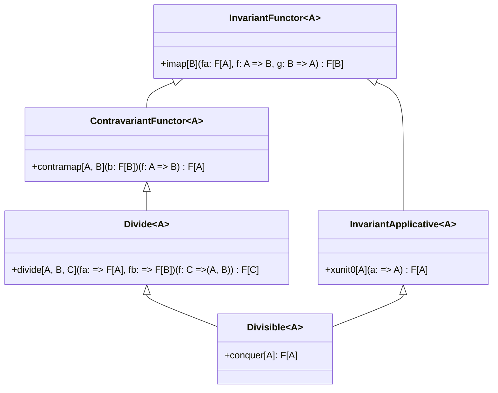

# Divisible

**`Divisible`** is a type class that extends **`Divide`**
and adds support for an "identity" element (an analogue of a monoid for [contravariant functors](contravariant-functor.md)).
It allows not only [splitting data](divide.md) but also combining them with an identity element.

`Divisible` is defined for a type `F[_]` and provides two operations:

- **`divide`**:
    - Divides a value of type `C` into two components `A` and `B` via function `C => (A, B)`.
    - Combines two values of type `F[A]` and `F[B]` into a value of type `F[C]`.
- **`conquer`**:
    - Returns an "identity" element of type `F[A]` that can be used as a basis for combining.

`Divisible` allows not only splitting data but also combining them with an identity element.
This is useful in situations where data needs to be assembled from several parts,
and also handle cases where data is absent or does not need processing.

**Use cases**

- **Data validation**:
    - If you have validators for multiple fields, `Divisible` allows creating a validator for a composite type,
      and also handling cases where some fields are absent.
- **Parsing**:
    - If you have parsers for several parts of data, `Divisible` allows creating a parser for a composite type,
      and also handling cases where some parts of the data are absent.
- **Contextual computations**:
    - In functional programs where data decomposition is required, `Divisible` can be used for working
      with contexts (e.g., `F[_]` can be `Option`, `Either`, `List`, etc.).

`Divisible` is useful in situations requiring data decomposition and working with contexts,
as well as supporting an identity element. It is often used in functional programming libraries
such as **Cats** or **Scalaz** for implementing complex operations on types.

## Formal Definition

`Divisible` is the contravariant analogue of [`Applicative`](applicative.md).
It extends [`Divide`](divide.md) and [`InvariantApplicative`](invariant-applicative.md).

## Code

```dotty
trait Divisible[F[_]] extends Divide[F], InvariantApplicative[F]:
  def conquer[A]: F[A]

  override def xunit0[A](a: => A): F[A] = conquer

  override def cmap[A, B](fb: F[B])(f: A => B): F[A] =
    divide(conquer[Unit], fb)(c => ((), f(c)))
```

### Laws

- **Identity**: `cmap(fa)(id) == fa`.
- **Composition**: `cmap(cmap(fc)(g))(f) == cmap(fc)(g(f(_)))`.
- **Composition**:
  ```dotty
  divide(divide(fa1, fa2)(delta), fa3)(delta) ==
  divide(fa1, divide(fa2, fa3)(delta))(delta)
  ```
  where `delta: A => (A, A) = a => (a, a)`
- **Right identity**: `divide(fa, conquer)(delta) == fa`.
- **Left identity**: `divide(conquer, fa)(delta) == fa`.

## Exercises

### Exercise 2.15.1: Implement Divisible for a function.

> [Repository with exercises and instructions][sample]

Implement a `Divisible` instance for the type `Function1[X, R]`, assuming that type `R` forms a monoid.

```dotty
given functionDivisible[R: Monoid]: Divisible[[X] =>> Function1[X, R]] with
  override def divide[A, B, C](fa: => A => R, fb: => B => R)(f: C => (A, B)): C => R = ???
  override def conquer[A]: A => R = ???
```

**Examples:**

```dotty
case class Data(value: Int)

val isPositive: Data => Boolean = (d: Data) => d.value > 0
val isEven: Data => Boolean = (d: Data) => d.value % 2 == 0
val splitData: Data => (Data, Data) = (d: Data) => (d, d)

given Monoid[Boolean] with
  val empty: Boolean = true
  def combine(a: Boolean, b: Boolean): Boolean = a && b

val isValid: Data => Boolean =
  summon[Divisible[[X] =>> X => Boolean]]
    .divide(isPositive, isEven)(splitData)

isValid(Data(2))   // true && true = true
isValid(Data(-2))  // false && true = false
isValid(Data(3))   // true && false = false
```

@:note(🔍 Show solution)

The `divide` implementation is the same as in Exercise 2.14.1:
we use the splitting function `f` to obtain a pair `(a, b)` from the input value `c`,
then apply `fa` to `a` and `fb` to `b`, after which we combine the results using the monoid operation for `R`.
The `conquer` implementation creates a function that for any input value of type `A`
returns the empty element of the monoid `Monoid[R].empty`.
This satisfies the laws of `Divisible`, where `conquer` is the identity element for `divide`.
Note that the parameters `fa` and `fb` are passed by name (`=>`) to support lazy evaluation,
and `conquer` ignores its input, since the result does not depend on it.

```dotty
given functionDivisible[R: Monoid]: Divisible[[X] =>> Function1[X, R]] with
  override def divide[A, B, C](fa: => A => R, fb: => B => R)(f: C => (A, B)): C => R =
    c => {
      val (a, b) = f(c)
      summon[Monoid[R]].combine(fa(a), fb(b))
    }

  override def conquer[A]: A => R = _ => summon[Monoid[R]].empty
```

@:@

## Diagram



---

**References:**

- [Repository with exercises][sample]
- [Scalaz API](https://javadoc.io/static/org.scalaz/scalaz-core_3/7.3.6/scalaz/Divisible.html)

[sample]: https://gitverse.ru/scalabook/typeclasses
