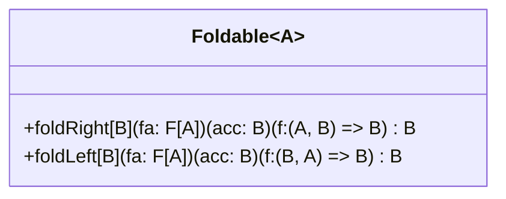

# Foldable

`Foldable` is a concept from functional programming
that describes data structures supporting the "fold" operation (`fold`).
Fold allows converting a collection of elements into a single value,
sequentially applying a function to each element and accumulating the result.

**Main characteristics of `Foldable`:**

- **Fold operation**:
  `Foldable` provides methods for traversing the elements of a data structure and combining them into a single value.
  For example, you can sum all numbers in a list or concatenate all strings into one.
- **Flexibility**:
  Folds can be performed in different directions (left to right or right to left) with different initial values.
- **Universality**:
  `Foldable` works with various collection types, such as lists, sets, trees, and others.

**Where is `Foldable` used?**

`Foldable` is used in functional programming for:

- **Data aggregation** (e.g., summation, multiplication, concatenation).
- **Transforming collections** (e.g., filtering, searching).
- **Working with nested data structures** (e.g., trees, graphs).

**Examples of `Foldable`**

- **Summing list elements**.
  With `Foldable`, you can sum all numbers in a list and get their total.
- **String concatenation**.
  With `Foldable`, you can concatenate all strings into one.
- **Finding minimum or maximum value**.
  With `Foldable`, you can find the minimum or maximum value in a list.
- **Counting elements**.
  With `Foldable`, you can count the number of elements in a list.
- **Filtering elements**.
  With `Foldable`, you can filter all even numbers and return their sum.
- **Working with trees**.
  With `Foldable`, you can traverse all nodes of a tree where each node contains a number and compute the sum of all numbers.
- **Transforming a collection into another structure**.
  Imagine you have a list of "key-value" pairs.
  With `Foldable`, you can convert this list into an associative map (dictionary).

**Folding**

_Fold_ can be used to implement `reduce`.
The difference between `fold` and `reduce` is that
in `reduce` the initial element is an identity element that does not change the value,
such as an empty string `""` for string concatenation or `0` for the `+` operation on type `Int`.
You can implement a version of `reduce` where the initial element is
simply the first element that will be combined in the _fold_,
if there is access to a function like `head`.

## Formal Definition

`Foldable` is a data type for which a `fold` operation
(or its variants, such as `foldLeft`, `foldRight`) is defined, satisfying the following properties:

- **`fold` operation**:
  For a type `F[A]` (where `F` is a container and `A` is the element type), the `fold` operation has the signature:
  `def fold[B](fa: F[A], z: B)(f: (B, A) => B): B`
- **`foldLeft` operation**:
  Similar to `fold`, but guarantees traversal order from left to right:
  `def foldLeft[B](fa: F[A], z: B)(f: (B, A) => B): B`
- **`foldRight` operation**:
  Similar to `fold`, but guarantees traversal order from right to left:
  `def foldRight[B](fa: F[A], z: B)(f: (A, B) => B): B`
- **Additional operations**:
  Based on `fold`, other useful operations can be defined, such as:
    - `toList` — converting a collection to a list.
    - `isEmpty` — checking if a collection is empty.
    - `size` — counting the number of elements.
    - `sum`, `product`, `minimum`, `maximum` — aggregating elements.

### Laws of `Foldable`

For a data type to be considered `Foldable`, it must satisfy certain laws.
Here are the main ones:

- **Associativity law for `foldLeft`**:
  `foldLeft(fa, z)(f) == foldLeft(fa, z)((acc, x) => f(acc, x))`
  This law ensures that the order of applying function `f` does not affect the result.
- **Associativity law for `foldRight`**:
  `foldRight(fa, z)(f) == foldRight(fa, z)((x, acc) => f(x, acc))`
  Similarly, this law ensures correctness of the right-to-left traversal order.
- **Consistency law between `foldLeft` and `foldRight`**:
  For some data structures (e.g., lists), the results of `foldLeft` and `foldRight` should be consistent
  if the operation `f` is associative and commutative:
  `foldLeft(fa, z)(f) == foldRight(fa, z)(f)`

### Interchangeability of Operations

Right-to-left aggregation operations (`foldRight`), left-to-right operations (`foldLeft`), using a monoid (`foldMap`),
`foldMap` fold of `Foldable` (`combineAll`), and conversion to a linked list (`toList`) can be expressed in terms of each other.
Therefore, it is sufficient to implement only `foldRight` or `foldMap`, but for better performance it is sometimes
necessary to implement several operations directly.

The relationship between operations must satisfy the following laws:

- `foldLeft` corresponds to `foldMap`: `fa.foldMap(Vector(_)) == fa.foldLeft(Vector.empty[A])(_ :+ _)`
- `foldRight` corresponds to `foldMap`: `fa.foldMap(Vector(_)) == fa.foldRight(Vector.empty[A])(_ +: _)`

## Code

```dotty
trait Monoid[A]:
  def combine(a1: A, a2: A): A
  def empty: A

object Monoid:
  def dual[A](m: Monoid[A]): Monoid[A] = new:
    def combine(x: A, y: A): A = m.combine(y, x)
    val empty: A = m.empty

  def endoMonoid[A]: Monoid[A => A] = new:
    def combine(a1: A => A, a2: A => A): A => A = a1 andThen a2
    val empty: A => A = identity

trait Foldable[F[_]]:
  import Monoid.{endoMonoid, dual}

  extension [A](as: F[A])
    def foldRight[B](acc: B)(f: (A, B) => B): B =
      ??? // Exercise 2.9.1: Implement `foldRight` via `foldMap`.

    def foldLeft[B](acc: B)(f: (B, A) => B): B =
      ??? // Exercise 2.9.2: Implement `foldLeft` via `foldMap`.

    def foldMap[B](f: A => B)(using mb: Monoid[B]): B =
      ??? // Exercise 2.9.3: Implement `foldMap` via `foldRight`.

    def combineAll(using ma: Monoid[A]): A =
      ??? // Exercise 2.9.4: Implement `combineAll` via `foldLeft`.
    
    def toList: List[A] =
      ??? // Exercise 2.9.5: Implement `toList` via `foldRight`.
```

## Exercises

### Exercise 2.9.1: Implement `foldRight` via `foldMap`.

> [Repository with exercises and instructions][sample]

`foldRight` is a right fold of a data structure.
It applies a binary operation `f` to elements from right to left, starting from an initial value `init`.

Implement `foldRight` via `foldMap`, using the fact that functions `B => B`
form a [monoid (endo](../monoid/monoid.md)[morphisms)](../monoid/monoid.md),
and `f.curried` is a function that transforms each element `A` into `B => B`.

Hint: `endoMonoid[B]` gives a monoid for functions `B => B` with the composition operation `andThen`,
and `foldMap` combines these functions.

```dotty
trait Foldable[F[_]]:
  extension [A](fa: F[A])
    def foldRight[B](init: B)(f: (A, B) => B): B =
      ???
```

**Examples:**

```dotty
val list = List(1, 2, 3, 4)

// Sum of elements
Foldable[List].foldRight(list)(0)(_ + _)     
// 10

// Difference (right-associative)
Foldable[List].foldRight(list)(0)(_ - _)     
// (1 - (2 - (3 - (4 - 0)))) = -2

// String concatenation
Foldable[List].foldRight(List("a", "b", "c"))("")(_ + _) 
// "abc"
```

@:note(🔍 Show solution)

The function `f.curried` has type `A => (B => B)`, meaning it transforms each element `A` into an endomorphism `B => B`.
These endomorphisms form a monoid `endoMonoid[B]` with the composition operation `combine = (g, h) => g.andThen(h)`.
`foldMap` combines all endomorphisms into one, which is then applied to `init`.
Importantly, the order of composition in `foldRight` — from the last element to the first — corresponds to the right fold.

```dotty
trait Foldable[F[_]]:
  extension [A](fa: F[A])
    def foldRight[B](init: B)(f: (A, B) => B): B =
      fa.foldMap(f.curried)(using endoMonoid[B])(init)  
```

@:@

### Exercise 2.9.2: Implement `foldLeft` via `foldMap`.

`foldLeft` is a left fold of a data structure.
It applies a binary operation `f` to elements from left to right, starting from an initial value `acc`.

Implement `foldLeft` via `foldMap`, using the dual monoid of endomorphisms.
Hint: use `Monoid.dual(endoMonoid[B])` to reverse the order of composition.

```dotty
trait Foldable[F[_]]:
  extension [A](fa: F[A])
    def foldLeft[B](acc: B)(f: (B, A) => B): B =
      ???
```

**Examples:**

```dotty
val list = List(1, 2, 3, 4)

// Sum of elements
Foldable[List].foldLeft(list)(0)(_ + _)     // 10

// Difference (left-associative)
Foldable[List].foldLeft(list)(0)(_ - _)     // (((0 - 1) - 2) - 3) - 4 = -10

// String concatenation
Foldable[List].foldLeft(List("a", "b", "c"))("")(_ + _) // "abc"
```

@:note(🔍 Show solution)

The function `a => b => f(b, a)` transforms each element `A` into an endomorphism `B => B`.
In the regular monoid `endoMonoid[B]`, composition goes left to right, which corresponds to a right fold.
To get a left fold, we need to use `Monoid.dual`, which reverses the order of composition.
As a result, sequential application of endomorphisms will occur in the order of traversing elements left to right.

```dotty
trait Foldable[F[_]]:
  extension [A](fa: F[A])
    def foldLeft[B](acc: B)(f: (B, A) => B): B =
      fa.foldMap(a => b => f(b, a))(using Monoid.dual(endoMonoid[B]))(acc)  
```

@:@

### Exercise 2.9.3: Implement `foldMap` via `foldRight`.

`foldMap` maps each element of the structure to a monoid `B` using function `f`,
then combines all results using the monoid operation.

Implement `foldMap` via `foldRight`.

```dotty
trait Foldable[F[_]]:
  extension [A](fa: F[A])
    def foldMap[B](f: A => B)(using mb: Monoid[B]): B =
      ???
```

**Examples:**

```dotty
val list = List(1, 2, 3, 4)

// Sum of elements
Foldable[List].foldMap(list)(identity)        // 10

// Conversion to strings with concatenation
Foldable[List].foldMap(list)(_.toString)      // "1234"

// With respect to the Option monoid
Foldable[List].foldMap(List(Some(1), None, Some(3)))(identity) // None
```

@:note(🔍 Show solution)

`foldRight` is applied to the data structure, starting from the empty element of the monoid `mb.empty`.
For each element `a` we compute `f(a)`, then combine it with the current accumulator using `mb.combine`.
The right-to-left order of combination corresponds to `foldRight`, which is consistent with the definition of `foldMap` via right fold.

```dotty
trait Foldable[F[_]]:
  extension [A](fa: F[A])
    def foldMap[B](f: A => B)(using mb: Monoid[B]): B =
      fa.foldRight(mb.empty)((a, b) => mb.combine(f(a), b))  
```

@:@

### Exercise 2.9.4: Implement `combineAll` via `foldLeft`.

`combineAll` combines all elements of the structure, using the monoid operation for type `A`.
This is useful when the elements themselves form a monoid.

Implement `combineAll` via `foldLeft`.

```dotty
trait Foldable[F[_]]:
  extension [A](fa: F[A])
    def combineAll(using ma: Monoid[A]): A =
      ???
```

**Examples:**

```dotty
val list = List(1, 2, 3, 4)
val opt = Some(5)
val none = Option.empty[Int]

Foldable[List].combineAll(list)   // 10
Foldable[Option].combineAll(opt)  // 5
Foldable[Option].combineAll(none) // 0
```

@:note(🔍 Show solution)

`foldLeft` is applied to the data structure, starting from the empty element of the monoid `ma.empty`.
For each element `a`, `ma.combine(acc, a)` is called, which sequentially combines all elements from left to right.
The result is a combination of all elements of the structure according to monoid laws.

```dotty
trait Foldable[F[_]]:
  extension [A](fa: F[A])
    def combineAll(using ma: Monoid[A]): A =
      fa.foldLeft(ma.empty)(ma.combine)
```

@:@

### Exercise 2.9.5: Implement `toList` via `foldRight`.

`toList` transforms a data structure into a list, preserving the order of elements.

Implement `toList` via `foldRight`.

```dotty
trait Foldable[F[_]]:
  extension [A](fa: F[A])
    def toList: List[A] =
      ???
```

**Examples:**

```dotty
Foldable[Option].toList(Some(5))        // List(5)
Foldable[Option].toList(None)           // Nil
Foldable[List].toList(Set(1, 2, 3))     // List(1, 2, 3)
Foldable[[X] =>> (X, X)].toList((1, 2)) // List(1, 2)
```

@:note(🔍 Show solution)

`foldRight` is applied to the data structure, starting from an empty list `List.empty[A]`.
For each element `a`, the operation `a :: acc` is performed, which prepends the element to the list.
Since `foldRight` processes elements from right to left,
the order of elements in the resulting list will correspond to the original traversal order.

```dotty
trait Foldable[F[_]]:
  extension [A](fa: F[A])
    def toList: List[A] =
      fa.foldRight(List.empty[A])(_ :: _)
```

@:@

### Exercise 2.9.6: Implement Foldable for type Option.

Implement the `Foldable` instance for `Option`.

```dotty
given Foldable[Option] with
  extension [A](as: Option[A])
    override def foldRight[B](acc: B)(f: (A, B) => B): B = ???
    override def foldLeft[B](acc: B)(f: (B, A) => B): B = ???
    override def foldMap[B](f: A => B)(using mb: Monoid[B]): B = ???
```

**Examples:**

```dotty
Foldable[Option].foldRight(Some(5))(0)(_ + _)   // 5
Foldable[Option].foldRight(None)(0)(_ + _)      // 0

Foldable[Option].foldLeft(Some(5))(0)(_ + _)    // 5
Foldable[Option].foldLeft(None)(0)(_ + _)       // 0

Foldable[Option].foldMap(Some(5))(_.toString)   // "5"
Foldable[Option].foldMap(None)(_.toString)      // ""
```

@:note(🔍 Show solution)

For `None`, all folds return the initial accumulator value (or the empty element of the monoid), since there are no elements.

For `Some(a)`:

- `foldRight` applies `f(a, acc)`
- `foldLeft` applies `f(acc, a)`
- `foldMap` returns `f(a)`

These implementations correspond to the behavior of `Option` as a container that can hold zero or one element.

```dotty
given Foldable[Option] with
  extension [A](as: Option[A])
    override def foldRight[B](acc: B)(f: (A, B) => B): B =
      as match
        case None    => acc
        case Some(a) => f(a, acc)
    override def foldLeft[B](acc: B)(f: (B, A) => B): B =
      as match
        case None    => acc
        case Some(a) => f(acc, a)
    override def foldMap[B](f: A => B)(using mb: Monoid[B]): B =
      as match
        case None    => mb.empty
        case Some(a) => f(a)
```

@:@

### Exercise 2.9.7: Implement Foldable for type List.

Implement the `Foldable` instance for `List`.

```dotty
given Foldable[List] with
  extension [A](as: List[A])
    override def foldRight[B](acc: B)(f: (A, B) => B) = ???
    override def foldLeft[B](acc: B)(f: (B, A) => B) = ???
    override def toList: List[A] = ???
```

**Examples:**

```dotty
Foldable[List].foldRight(List(1, 2, 3, 4))(0)(_ + _)  // 10
Foldable[List].foldRight(List(1, 2, 3, 4))(0)(_ - _)  // -2

Foldable[List].foldLeft(List(1, 2, 3, 4))(0)(_ + _)   // 10
Foldable[List].foldLeft(List(1, 2, 3, 4))(0)(_ - _)   // -10

Foldable[List].foldMap(List(1, 2, 3, 4))(_.toString)  // "1234"
Foldable[List].combineAll(List(1, 2, 3, 4))           // 10
Foldable[List].toList(List(1, 2, 3, 4))               // List(1, 2, 3, 4)
```

@:note(🔍 Show solution)

This implementation of `Foldable[List]` uses recursive definitions for traversing the list:
`foldRight` recursively traverses to the end of the list and folds elements from right to left,
applying function `f` to head `h` and the fold result of tail `t` (starting with `acc` for an empty list);
`foldLeft` also recursively traverses the list, but accumulates the result from left to right,
updating the accumulator at each step as `f(acc, h)`, then continuing with the tail;
`toList` simply returns the list itself, since it is already the required representation.

```dotty
given Foldable[List] with
  extension [A](as: List[A])
    override def foldRight[B](acc: B)(f: (A, B) => B) =
      as match
        case Nil    => acc
        case h :: t =>
          f(h, this.foldRight(t)(acc)(f))

    override def foldLeft[B](acc: B)(f: (B, A) => B) =
      as match
        case Nil => acc 
        case h :: t =>
          this.foldLeft(t)(f(acc, h))(f)
        
    override def toList: List[A] = 
      as
```

@:@

### Exercise 2.9.8: Implement Foldable for tuples.

Tuples of fixed length can be viewed as containers with a known number of elements.
Implement `Foldable` instances for pairs `(X, X)` and triples `(X, X, X)`.

The right fold should process elements from right to left: first the last element, then the second-to-last, and so on.

```dotty
given tuple2Foldable: Foldable[[X] =>> (X, X)] with
  extension [A](fa: (A, A))
    override def foldRight[B](init: B)(f: (A, B) => B): B = ???

given tuple3Foldable: Foldable[[X] =>> (X, X, X)] with
  extension [A](fa: (A, A, A))
    override def foldRight[B](init: B)(f: (A, B) => B): B = ???
```

**Examples:**

```dotty
val pair = (1, 2)
val triple = (1, 2, 3)

// Pairs
Foldable[[X] =>> (X, X)].foldRight(pair)(0)(_ + _)   // 1 + 2 = 3
Foldable[[X] =>> (X, X)].foldRight(pair)(0)(_ - _)   // 1 - 2 = -1

// Triples
Foldable[[X] =>> (X, X, X)].foldRight(triple)(0)(_ + _) // 1 + 2 + 3 = 6
Foldable[[X] =>> (X, X, X)].foldRight(triple)(0)(_ - _) // 1 - (2 - (3 - 0)) = 1 - (2 - 3) = 2
```

@:note(🔍 Show solution)

For the pair `(a0, a1)`, the right fold first applies `f` to the right element `a1` and the initial value `init`,
obtaining an intermediate result, then applies `f` to the left element `a0` and this intermediate result.
For the triple `(a0, a1, a2)`, the process is similar: first `a2` is processed, then `a1`, then `a0`.
This order ensures proper right-associativity.

```dotty
given tuple2Foldable: Foldable[[X] =>> (X, X)] with
  extension [A](fa: (A, A))
    override def foldRight[B](init: B)(f: (A, B) => B): B =
      val (a0, a1) = fa
      val b        = f(a1, init)
      f(a0, b)

given tuple3Foldable: Foldable[[X] =>> (X, X, X)] with
  extension [A](fa: (A, A, A))
    override def foldRight[B](init: B)(f: (A, B) => B): B =
      val (a0, a1, a2) = fa
      val b0           = f(a2, init)
      val b1           = f(a1, b0)
      f(a0, b1)
```

@:@

### Exercise 2.9.9: Implement Foldable for type Either.

`Either[E, A]` can hold either a value in the right branch (`Right`) or an error in the left (`Left`).
When folding, we ignore the left branch since it does not contain values of type `A`.

Implement the `Foldable` instance for `Either[E, A]` with fixed error type `E`.

```dotty
given eitherFoldable[E]: Foldable[[x] =>> Either[E, x]] with
  extension [A](fa: Either[E, A])
    override def foldRight[B](init: B)(f: (A, B) => B): B = ???
```

**Examples:**

```dotty
val right: Either[String, Int] = Right(5)
val left: Either[String, Int] = Left("error")

Foldable[[x] =>> Either[String, x]].foldRight(right)(0)(_ + _)  // 5
Foldable[[x] =>> Either[String, x]].foldRight(left)(0)(_ + _)   // 0

Foldable[[x] =>> Either[String, x]].foldMap(right)(_.toString)  // "5"
Foldable[[x] =>> Either[String, x]].foldMap(left)(_.toString)   // ""
```

@:note(🔍 Show solution)

For `Either[E, A]`, folding makes sense only for the right branch `Right(a)`, which contains a value of type `A`.
The left branch `Left(e)` does not contain values and simply returns the initial accumulator value when folded.
This is consistent with the behavior of `Option`: `Right` is analogous to `Some`, and `Left` is analogous to `None`.
This implementation allows using `Either` in contexts requiring structure traversal while ignoring the error branch.

```dotty
given eitherFoldable[E]: Foldable[[x] =>> Either[E, x]] with
  extension [A](fa: Either[E, A])
    override def foldRight[B](init: B)(f: (A, B) => B): B =
      fa match
        case Right(a) => f(a, init)
        case Left(_)  => init
```

@:@

### Exercise 2.9.10: Implement a generalized fold via optional accumulator.

`foldOpt` is a generalized form of folding that represents the accumulator state as `Option[(B, A)]`.
This allows expressing both left and right folds through a unified mechanism.
Function `f` transforms the current state into a new accumulator value:
`None` means the initial state (accumulator does not yet contain values),
while `Some((b, a))` represents an intermediate state,
where `b` is the current accumulator and `a` is the last processed element.

Implement the `foldOpt` method using tail recursion for efficient traversal.

```dotty
trait Foldable[F[_]]:
  extension [A](fa: F[A])
    def foldOpt[B](f: Option[(B, A)] => B): B =
      ???
```

**Examples:**

```dotty
val right: Either[String, Int] = Right(5)
val left: Either[String, Int] = Left("error")
val list = List(1, 2, 3, 4)

// Sum of elements
right.foldOpt[Int] {
  case None          => 0
  case Some((acc, a)) => acc + a
} // 5

left.foldOpt[Int] {
  case None          => 0
  case Some((acc, a)) => acc + a
} // 0

// Left fold (accumulator on the left)
list.foldOpt[Int] {
  case None          => 0
  case Some((acc, a)) => acc - a
} // (((0 - 1) - 2) - 3) - 4 = -10
```

@:note(🔍 Show solution)

The implementation uses a helper tail-recursive function `loop`,
which traverses the list of elements (obtained via `fa.toList`). Initial state: `loop(fa.toList, f(None))`.
At each step, for head `h` and current accumulator `acc`, `f(Some((acc, h)))` is called,
and the result is passed to the next recursive call with the list tail.
When the list is empty, the current accumulator `acc` is returned.

```dotty
trait Foldable[F[_]]:
  extension [A](fa: F[A])
    def foldOpt[B](f: Option[(B, A)] => B): B =
      @annotation.tailrec
      def loop(rest: List[A], acc: B): B =
        rest match
          case Nil    => acc
          case h :: t => loop(t, f(Some((acc, h))))

       loop(fa.toList, f(None))
```

@:@

### Exercise 2.9.11: Implement `foldOpt` via standard fold `foldLeft`.

Show the equivalence of `foldOpt` and `foldLeft`.
Using the already-defined `foldLeft` method, express `foldOpt` as a fold.

```dotty
trait Foldable[F[_]]:
  extension [A](fa: F[A])
    def foldOptViaFold[B](f: Option[(B, A)] => B): B =
      ???
```

**Examples:**

```dotty
val list = List(1, 2, 3, 4)

// Equivalence with foldLeft
list.foldLeft(0)(_ + _) == list.foldOptViaFold[Int] {
  case None          => 0
  case Some((acc, a)) => acc + a
} // true (both give 10)
```

@:note(🔍 Show solution)

`foldLeft` applies a binary operation to the accumulator and each element from left to right.
In `foldOptViaFold`, the initial accumulator is `f(None)`,
and at each step we apply the update function `(b, a) => f(Some((b, a)))`.
This exactly matches the definition of `foldOpt`, but expressed through the existing `foldLeft` method.
This implementation is shorter and uses already-defined `Foldable` capabilities.

```dotty
trait Foldable[F[_]]:
  extension [A](fa: F[A])
    def foldOptViaFold[B](f: Option[(B, A)] => B): B =
      foldLeft[B](f(None))((b, a) => f(Some((b, a))))
```

@:@

### Exercise 2.9.12: Implement standard fold via `foldOpt`.

Show the reverse equivalence: any standard fold can be expressed via `foldOpt`.
This demonstrates that `foldOpt` is a more general primitive than `foldLeft` or `foldRight`.

```dotty
trait Foldable[F[_]]:
  extension [A](fa: F[A])
    def foldViaFoldOpt[B](init: B)(f: (B, A) => B): B =
      ???
```

**Examples:**

```dotty
val right: Either[String, Int] = Right(5)
val left: Either[String, Int] = Left("error")
val list = List(1, 2, 3, 4)

// Left fold via foldViaFoldOpt
right.foldViaFoldOpt(0)(_ + _)   // 5
left.foldViaFoldOpt(0)(_ + _)    // 0
list.foldViaFoldOpt(0)(_ + _)    // 10
list.foldViaFoldOpt(0)(_ - _)    // -10

// Equivalence with foldLeft
list.foldLeft(0)(_ + _) == list.foldViaFoldOpt(0)(_ + _) // true
```

@:note(🔍 Show solution)

We create a function `g: Option[(B, A)] => B` that transforms optional state into an accumulator value:
for `Some((b, a))` it returns `f(b, a)`, and for `None` it returns the initial value `init`.
Then we simply call `foldOpt(g)`. This shows that `foldOpt` is a more general primitive:
any standard fold can be expressed through it
by simply transforming the binary operation into a function over optional state.

```dotty
trait Foldable[F[_]]:
  extension [A](fa: F[A])
    def foldViaFoldOpt[B](init: B)(f: (B, A) => B): B =
      val g: Option[(B, A)] => B =
        case Some((b, a)) => f(b, a)
        case None         => init
      foldOpt[B](g)
```

@:@

## Schema



## Implementation in Libraries

### Implementation in Cats

```dotty
import cats.Foldable
import cats.instances.list.*
import cats.instances.option.*
import cats.instances.int.*
import cats.instances.string.*

val ints = List(1, 2, 3)                           // List(1, 2, 3)
Foldable[List].foldLeft(ints, 0)(_ + _)            // 6

val maybeInt = Option(123)                         // Some(123)
Foldable[Option].foldLeft(maybeInt, 10)(_ * _)     // 1230

Foldable[Option].nonEmpty(Option(42))              // true
Foldable[List].find(List(1, 2, 3))(_ % 2 == 0)     // Some(2)
Foldable[List].combineAll(List(1, 2, 3))           // 6
Foldable[List].foldMap(List(1, 2, 3))(_.toString)  // 123
```

### Implementation in ScalaZ

```dotty
import scalaz.*
import Scalaz.*

List(1, 2, 3).foldRight (0) {_ - _}                        // 2
List(1, 2, 3).foldLeft (0) {_ - _}                         // -6

val trues: LazyList[Boolean] = LazyList.continually(true)
def lazyOr(x: Boolean)(y: => Boolean) = x || y
Foldable[LazyList].foldr(trues, false)(lazyOr)             // true

val digits = List(0,1,2,3,4,5,6,7,8,9)
Foldable[List].fold(digits)                                // 45
```

### Lazy `foldRight` Implementation in Cats

In Cats, the `foldRight` method from the `Foldable` type class has a signature that may seem unusual for those
used to the standard Scala collection. Instead of the expected strict version:

```dotty
def foldRight[A, B](fa: F[A], z: B)(f: (A, B) => B): B
```

Cats offers a **lazy** version:

```dotty
def foldRight[A, B](fa: F[A], lb: Eval[B])(f: (A, Eval[B]) => Eval[B]): Eval[B]
```

This change has deep implications for performance and correctness when working with infinite data structures.
Let's figure out why this matters and how to use this feature correctly.

#### The Problem: Strict Right Fold

In the standard Scala library, the `foldRight` method (available on `List`, `Vector`, and other collections) is **strict**.
This means that:

1. It starts computation from the **last** element of the collection.
2. For this, it must first **traverse all elements** to reach the end.
3. Then it applies the function to elements in reverse order.

This implementation requires the entire collection to be available in memory and does not work with **infinite** collections.

##### Example of the problem: infinite list

Consider an example with an infinite list of boolean values:

```dotty
val allFalse = LazyList.continually(false)
// Infinite stream: false, false, false, ...
```

Suppose we want to "fold" this stream into a single boolean value using logical AND (`&&`).
We intuitively know the result should be `false`, because the first element is already `false`:

```
false && false && false && ... = false
```

To determine the result, we only need to check the first element!
We do not need to traverse the entire infinite sequence.

However, the standard `foldRight` from Scala collections **does not know this**:

```dotty
// CAUTION! This code will cause an OutOfMemoryError!
allFalse.foldRight(true)(_ && _)
```

What happens:

1. `foldRight` will start traversing from the end of the collection.
2. But an infinite stream has no end!
3. The collection will infinitely accumulate elements in memory until it exhausts available memory.
4. Result — an **unrecoverable `OutOfMemoryError`** (the program cannot be recovered).

#### Solution: Lazy `foldRight` using `Eval`

##### How `Eval` works

Cats provides type `Eval[B]`, which represents a lazy computation of a value of type `B`.
This allows deferring execution until the result is actually needed.

Signature of `Foldable.foldRight` in Cats:

```dotty
def foldRight[A, B](fa: F[A], lb: Eval[B])(f: (A, Eval[B]) => Eval[B]): Eval[B]
```

Key differences from the strict version:

1. **Initial value** `lb: Eval[B]` — lazy.
2. **Function `f`** returns `Eval[B]`, not `B`.
3. **Result** — `Eval[B]`, which can be computed later.

##### How this prevents problems with infinite structures

Thanks to laziness, `foldRight` can **skip computing** the right argument if the result can be determined earlier.

Consider the same example with an infinite stream, but now using Cats:

```dotty
import cats.Foldable
import cats.Eval

val allFalse = LazyList.continually(false)

// Lazy fold using Cats
val result =
  Foldable[LazyList].foldRight(allFalse, Eval.True) { (a, b) =>
    if a then b else Eval.False
  }.value
// Result: false
```

What happens here:

1. `Eval.True` is a lazy computation that returns `true`.
2. Function `(a, b) => if a then b else Eval.False`:
    - If `a == true`, we **return `b`** (continue computation).
    - If `a == false`, we **immediately return `Eval.False`** (terminate computation without touching `b`!).
3. Since the first element in the stream is `false`, computation terminates immediately after processing the first element.
4. The rest of the infinite stream is never computed, which prevents memory overflow.

#### Convenient syntax: `foldr`

It may happen that calling `Foldable[LazyList].foldRight(...)` may conflict with `foldRight`
defined on the `LazyList` collection itself (or another collection).
To avoid confusion and explicitly indicate that you are using the lazy version from Cats, there is a **pseudonym** `foldr`:

```dotty
// Use pseudonym foldr to access the lazy implementation
val result = allFalse.foldr(Eval.True) { (a, b) =>
  if a then b else Eval.False
}.value

// Result: false
```

`foldr` is a syntactic extension that explicitly calls the `foldRight` method from `Foldable`. This makes code more readable and explicit.

#### Comparison of approaches

| Characteristic                        | Standard `foldRight`          | Cats `foldRight` / `foldr`                    |
|:--------------------------------------|:---------------------------------|:----------------------------------------------|
| **Signature**                         | `(A, B) => B`                    | `(A, Eval[B]) => Eval[B]`                     |
| **Initial value**                | Strict (`B`)                    | Lazy (`Eval[B]`)                           |
| **Result**                         | Immediate (`B`)                | Lazy (`Eval[B]`)                           |
| **Working with infinite collections** | ❌ Leads to `OutOfMemoryError`  | ✅ Can terminate early when possible  |
| **Laziness of right argument**       | No                              | Yes (can skip computation)                       |
| **Library conflicts**           | No                              | Yes (resolved via `foldr` pseudonym)         |

---

**References:**

- [Link to the repository with exercises][sample]
- [Classic abstractions used in FP](https://habr.com/ru/articles/896660/)
- [Cats](https://typelevel.org/cats/typeclasses/foldable.html)
- [Folds for Imperative Programmers](https://blog.tmorris.net/posts/folds-for-imperative-programmers/index.html)
- [Functional Programming in Scala, Second Edition, Chapter 10](https://www.manning.com/books/functional-programming-in-scala-second-edition?query=Functional%20Programming%20in%20Scala,%20Second%20Edition)
- [Herding Cats](http://eed3si9n.com/herding-cats/using-monoids-to-fold.html)
- [Learn Functional Programming course/tutorial on Scala](https://github.com/dehun/learn-fp)
- [Learning Scalaz](http://eed3si9n.com/learning-scalaz/Foldable.html)
- [Scala with Cats](https://scalawithcats.com/dist/scala-with-cats.html#sec:foldable)
- [Scalaz API](https://javadoc.io/doc/org.scalaz/scalaz-core_3/7.3.6/scalaz/Foldable.html)
- [SKB – Scala Foldable](https://leobenkel.com/2021/01/skb-scala-foldable/)
- [Tour of Scala](https://tourofscala.com/scala/foldable)

[sample]: https://gitverse.ru/scalabook/typeclasses
