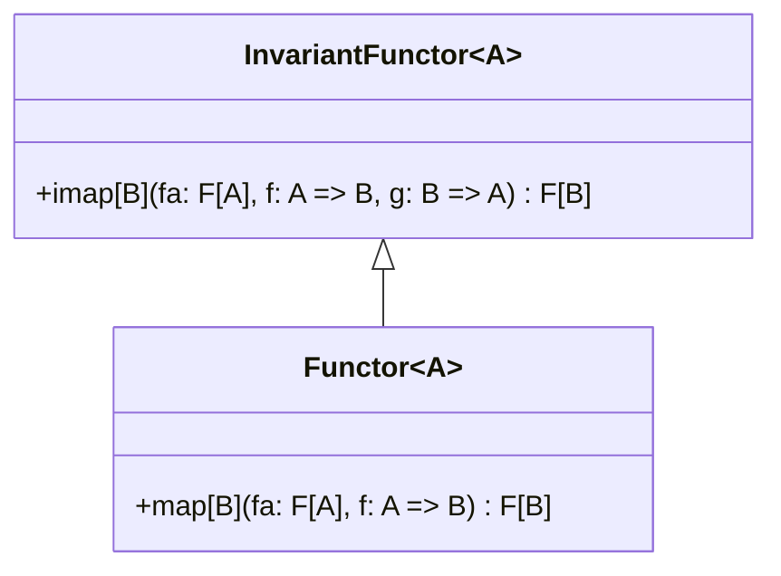

# Functor

**A functor** is a concept from category theory that is widely used in functional programming.
In the context of programming, a functor is an abstraction that allows applying a function to values
"wrapped" in some context without extracting those values from the context.

**The main idea of a functor**

A functor is a type that implements the `map` operation. This operation takes:

- A container (or context) with a value of type `A`.
- A function `A => B`.
- Returns a new container with the result of applying the function to the value, without changing the context itself.

**Why are functors useful?**

Functors are useful because they allow working with data
located within a context (e.g., in `Option`, `List`, `Future`, etc.)
without the need to extract them from that context.
This makes code safer, more composable, and more expressive.

**Examples of functors**

- `Option` as a functor. `Option` is a container that can hold a value (`Some`) or be empty (`None`).
  A functor allows applying a function to the value inside `Option`, if it exists.
- `List` as a functor. `List` is a container holding multiple values. A functor allows applying a function to each element of the list.
- `Future` as a functor. `Future` is a container representing an asynchronous computation.
  A functor allows applying a function to the result of a `Future` when it becomes available.

## Formal Definition

A functor is a transformation from category `A` to category `B`.
Such transformations are often depicted as an arrow: `A -> B` (or via the `map` method).
A functor preserves structure: what was related in the source category will be related in the target category.

A functor (F) extends an [invariant functor](invariant-functor.md)
and must follow these laws
(besides the invariant functor laws):

- **Identity**: If an identity method `identity` is defined such that: `identity(a) == a`,
  then `map(fa)(identity) == fa`. In other words: if we map the `identity` function over a functor,
  the resulting functor must be the same as the original functor.
- **Composition**: If two methods `f` and `g` are defined, then `fa.map(f).map(g) == fa.map(g(f(_)))`.
  In other words: composing two functions and then mapping the resulting function over a functor
  should be the same as first mapping one function over the functor, then mapping the other.

> Note that throughout this section and onwards, the discussion concerns only pure functions `identity`, `f`, and `g`.

## Code

```dotty
trait Functor[F[_]] extends InvariantFunctor[F]:
  extension [A](fa: F[A])
    def map[B](f: A => B): F[B]

    override def imap[B](f: A => B, g: B => A): F[B] = fa.map(f)

  def lift[A, B](f: A => B): F[A] => F[B] = _.map(f)

  def mapply[A, B](a: A)(f: F[A => B]): F[B] = map(f)((ff: A => B) => ff(a))

  def fproduct[A, B](fa: F[A])(f: A => B): F[(A, B)] = map(fa)(a => (a, f(a)))
```

As can be seen from the example above, a functor allows defining additional operations:

- "lifts" a function `A => B` up to a transforming function `F[A] => F[B]`
- applies a functor of a function transforming from `A` to `B` (`F[A => B]`) to an element of type `A` and obtains a functor of `B`
- given a functor of `A` and a transforming function from `A` to `B`, produces a functor of the tuple `(A, B)`

### Laws

- The identity law states that applying an identity transformation to a functor value
  does not change that value. Formally: `fu.map(fa)(identity) == fa`
- The composition law states that sequentially applying two mappings is equivalent to one mapping
  that is the composition of those two mappings. Formally:
  `fu.map(fu.map(fa)(f))(g) == fu.map(fa)(f andThen g)`

## Exercises

### Exercise 2.2.1: Functor for the Identity Type Id

> [Repository with exercises and instructions][sample]

Implement a `Functor` instance for the `Id` type (identity type), which simply wraps a value of the same type.
`Id[A]` is a wrapper type that behaves exactly like type `A` itself, but allows implementing
type class instances for it as for an ordinary single-parameter type.

```dotty
type Id[A] = A
object Id:
  def apply[A](a: A): Id[A] = a

given idFunctor: Functor[Id] with
  extension [A](as: Id[A]) 
    def map[B](f: A => B): Id[B] = ???
```

**Examples:**

```dotty
// Id can hold a value of any type
val intId: Id[Int] = Id(42)
val stringId: Id[String] = Id("Hello")

// Functions for transformation
val toString: Int => String = _.toString
val addOne: Int => Int = _ + 1
val length: String => Int = _.length

// Using map with Id
intId.map(toString)        // Id("42")
intId.map(addOne)          // Id(43)
stringId.map(length)       // Id(5)
```

@:note(🔍 Show solution)

The identity type `Id[A]` is the simplest container that holds exactly one value of type `A`.
The `map` method must apply function `f` to this value and return a new `Id[B]`.
Since `Id[B]` is just `B`, it is sufficient to call `f` on the original value `as` (of type `A`)
and wrap the result in `Id.apply`.

```dotty
given idFunctor: Functor[Id] with
  extension [A](as: Id[A]) 
    def map[B](f: A => B): Id[B] = Id(f(as))
```

@:@

### Exercise 2.2.2: Functor for type Option

Implement the `Functor` instance for type `Option`, which allows applying a function to a value inside `Some`,
leaving `None` unchanged.

```dotty
given optionFunctor: Functor[Option] with
  extension [A](optA: Option[A])
    def map[B](f: A => B): Option[B] = ???
```

**Examples:**

```dotty
// Option with and without a value
val someNumber: Option[Int] = Some(42)
val noneNumber: Option[Int] = None
val someString: Option[String] = Some("Hello")

// Functions for transformation
val toString: Int => String = _.toString
val addOne: Int => Int = _ + 1
val length: String => Int = _.length
val toBoolean: Int => Boolean = _ > 0

// Using map with Option with a value
someNumber.map(toString)        // Some("42")
someNumber.map(addOne)          // Some(43)
someNumber.map(toBoolean)       // Some(true)
someString.map(length)          // Some(5)

// Using map with None
noneNumber.map(toString)        // None
noneNumber.map(addOne)          // None
noneNumber.map(toBoolean)       // None

// Chain of transformations
val result = Some(5)
  .map(_ * 2)      // Some(10)
  .map(_ + 3)      // Some(13)
  .map(_.toString) // Some("13")
  .map(_ + "!")    // Some("13!")
// Some("13!")
```

@:note(🔍 Show solution)

The solution is to pattern match on the value `Option[A]`. If `optA` is `Some(a)`,
we extract value `a`, apply function `f` to it, and return `Some(f(a))`.
If `optA` is `None`, we return `None`.

```dotty
given optionFunctor: Functor[Option] with
  extension [A](optA: Option[A])
    def map[B](f: A => B): Option[B] =
      optA match
        case Some(a) => Some(f(a))
        case None    => None
```

@:@

### Exercise 2.2.3: Functor for type List

Implement the `Functor` instance for type `List`, which allows applying a function to each element of the list,
preserving its structure and element order. `List[A]` represents an ordered sequence
of elements of type `A`, which can be empty (`Nil`) or consist of a head (`head`) and a tail (`tail`).

```dotty
given listFunctor: Functor[List] with
  extension [A](as: List[A])
    def map[B](f: A => B): List[B] = ???
```

**Examples:**

```dotty
val result = List(1, 2, 3)
  .map(_ * 2)       // List(2, 4, 6)
  .map(_ + 1)       // List(3, 5, 7)
  .map(_.toString)  // List("3", "5", "7")
  .map(_ + "!")     // List("3!", "5!", "7!")
```

@:note(🔍 Show solution)

The solution uses recursive pattern matching on the list structure. The base case is an empty list `Nil`,
which maps to `Nil` (an empty list). The recursive case is a non-empty list of form `head :: tail`,
where we need to apply function `f` to the head (`f(h)`) and recursively apply `map` to the tail (`t.map(f)`),
then construct a new list using the `::` operator.

```dotty
given listFunctor: Functor[List] with
  extension [A](as: List[A])
    def map[B](f: A => B): List[B] = as match
      case Nil    => Nil
      case h :: t => f(h) :: t.map(f)
```

@:@

### Exercise 2.2.4: Functor for type Either with fixed left type

Implement the `Functor` instance for type `Either[E, A]` with fixed left type `E`.
`Either[E, A]` represents a value that can be either an error of type `E` (`Left`),
or a successful result of type `A` (`Right`). The functor should transform only the right side
(`Right`), leaving the left side (`Left`) unchanged.

```dotty
given eitherFunctor[E]: Functor[[x] =>> Either[E, x]] with
  extension [A](fa: Either[E, A])
    def map[B](f: A => B): Either[E, B] = ???
```

**Examples:**

```dotty
// Transformation chain for the success path
val result = Right(5)
  .map(_ * 2)       // Right(10)
  .map(_ + 3)       // Right(13)
  .map(_.toString)  // Right("13")
  .map(_ + "!")     // Right("13!")

// Transformation chain stops at the first error
val failedResult = Left("Initialization error")
  .map(_ * 2)       // Left("Initialization error")
  .map(_ + 3)       // Left("Initialization error")
  .map(_.toString)  // Left("Initialization error")
```

@:note(🔍 Show solution)

The solution uses pattern matching on the value `Either[E, A]`. If `fa` is `Right(a)`,
we extract the successful value `a`, apply function `f` to it, and return `Right(f(a))`.
If `fa` is `Left(e)`, we return `Left(e)` without applying the function, preserving error information.

```dotty
given eitherFunctor[E]: Functor[[x] =>> Either[E, x]] with
  extension [A](fa: Either[E, A])
    def map[B](f: A => B): Either[E, B] =
      fa match
        case Right(a) => Right(f(a))
        case Left(e)  => Left(e)
```

@:@

### Exercise 2.2.5: Functor for type Writer with fixed log type

Implement the `Functor` instance for type `Writer[W, A]` with fixed log type `W`.
`Writer[W, A]` represents a computation that produces a value of type `A`
and an additional log (or side output) of type `W`.
In this implementation, `Writer` is represented as a lazy computation via `() => (W, A)`.

```dotty
case class Writer[W, A](run: () => (W, A))

given writerFunctor[W]: Functor[[x] =>> Writer[W, x]] with
  extension [A](fa: Writer[W, A])
    def map[B](f: A => B): Writer[W, B] = ???
```

**Examples:**

```dotty
// Transformation chain with log preservation
val result = Writer(() => ("Computation: ", 10))
  .map(_ * 2)         // Writer(() => ("Computation: ", 20))
  .map(_ + 5)         // Writer(() => ("Computation: ", 25))
  .map(_.toString)    // Writer(() => ("Computation: ", "25"))
  .map("Number: " + _) // Writer(() => ("Computation: ", "Number: 25"))
```

@:note(🔍 Show solution)

The solution requires executing the lazy computation of the original `Writer`. In the `map` method, we call `fa.run()`,
to obtain the pair `(w, a)` — the log and the value. Then we apply function `f` to value `a`,
obtaining a new value `f(a)`. After that, we return a new instance `Writer[W, B]`,
which, when executed (via the lambda `() =>`), returns the pair `(w, f(a))`.
It is important to preserve log `w` unchanged and preserve laziness — the new `Writer`
should also be lazy and only execute when `run()` is called. This allows
composing transformations without prematurely executing side effects or computations.

```dotty
given writerFunctor[W]: Functor[[x] =>> Writer[W, x]] with
  extension [A](fa: Writer[W, A])
    def map[B](f: A => B): Writer[W, B] =
      val (w, a) = fa.run()
      Writer[W, B](() => (w, f(a)))
```

@:@

### Exercise 2.2.6: Functor for type State with fixed state type

Implement the `Functor` instance for type `State[S, A]` with fixed state type `S`.
`State[S, A]` represents a function that takes an initial state of type `S`,
computes a new state and a value of type `A`. This is a pure functional abstraction for
working with state without using variables.

```dotty
case class State[S, +A](run: S => (S, A))

given stateFunctor[S]: Functor[[x] =>> State[S, x]] with
  extension [A](fa: State[S, A])
    def map[B](f: A => B): State[S, B] = ???
```

**Examples:**

```dotty
val counter = State[Int, Int](s => (s + 1, s))

val (finalCounter, values) = counter
  .map(_ * 2)      // State(s => (s+1, s*2))
  .map(_ + 3)      // State(s => (s+1, s*2+3))
  .map(_.toString) // State(s => (s+1, (s*2+3).toString))
  .run(10)
// finalCounter = 11, values = "23"
```

@:note(🔍 Show solution)

The solution consists of creating a new state `State[S, B]` based on the original.
In the `map` method, we return a new instance of `State` that takes an initial state `s`.
Inside this state, we call `fa.run(s)` to obtain pair `(s1, a)` — the new state
and the computed value. Then we apply function `f` to value `a`, obtaining `f(a)`,
and return pair `(s1, f(a))`. It is important that function `f` is applied only to the value,
without affecting the state, which is fully determined by the original computation `fa`.
Such an implementation allows creating chains of value transformations while preserving
the purity and composability of stateful computations.

```dotty
given stateFunctor[S]: Functor[[x] =>> State[S, x]] with
  extension [A](fa: State[S, A])
    def map[B](f: A => B): State[S, B] =
      State[S, B] { s =>
        val (s1, a) = fa.run(s)
        (s1, f(a))
      }
```

@:@

### Exercise 2.2.7: Functor for type IO (Input/Output)

Implement the `Functor` instance for type `IO[R]`, which represents a lazy computation
that returns a value of type `R` and potentially contains side effects (I/O, file reading,
database queries, etc.). `IO[R]` is a description of an effectful computation that will be executed
only when the `run()` method is called.

```dotty
final case class IO[R](run: () => R)

given ioFunctor: Functor[IO] with
  extension [A](as: IO[A]) 
    def map[B](f: A => B): IO[B] = ???
```

**Examples:**

```dotty
val resultIO = IO(() => 10)
  .map(_ * 2)         // IO(() => 20)
  .map(_ + 3)         // IO(() => 23)
  .map(_.toString)    // IO(() => "23")
  .map(_ + "!")       // IO(() => "23!")
  .map(_.toUpperCase) // IO(() => "23!")
```

@:note(🔍 Show solution)

The solution consists of creating a new `IO[B]` that lazily wraps the application of the function
to the result of the original computation. In the `map` method, we return a new instance of `IO`,
that takes function `() => B`. Inside this function, we first call `as.run()`,
to execute the original effectful computation and obtain value `a`. Then we apply
function `f` to this value, obtaining `f(a)`, and return it as the result of the new `IO`.
It is important to preserve laziness: the new computation must not execute before calling `run()`.
This allows composing effectful operations, deferring their execution until the moment
when the result is actually needed, while preserving purity and referential transparency
of functional programs.

```dotty
given ioFunctor: Functor[IO] with
  extension [A](as: IO[A]) 
    def map[B](f: A => B): IO[B] = 
      IO { () => f(as.run()) }
```

@:@

### Exercise 2.2.8: Functor for binary tree (BinaryTree)

Implement the `Functor` instance for type `BinaryTree[A]`, which represents a binary tree,
where each node (`Branch`) contains a value of type `A` and two subtrees (left and right),
and a leaf (`Leaf`) denotes the absence of a value. The functor should traverse the entire tree,
applying the function to each value in the nodes, preserving the tree structure.

```dotty
enum BinaryTree[+A]:
  case Leaf
  case Branch(value: A, left: BinaryTree[A], right: BinaryTree[A])

given Functor[BinaryTree] with
  extension [A](as: BinaryTree[A])
    def map[B](f: A => B): BinaryTree[B] = ???
```

**Examples:**

```dotty
val resultTree = BinaryTree.Branch(10,
  BinaryTree.Branch(5, BinaryTree.Leaf, BinaryTree.Leaf),
  BinaryTree.Branch(15, BinaryTree.Leaf, BinaryTree.Leaf)
)
  .map(_ * 2)         // Branch(20, Branch(10, Leaf, Leaf), Branch(30, Leaf, Leaf))
  .map(_ + 3)         // Branch(23, Branch(13, Leaf, Leaf), Branch(33, Leaf, Leaf))
  .map(_.toString)    // Branch("23", Branch("13", Leaf, Leaf), Branch("33", Leaf, Leaf))
  .map("number: " + _) // Branch("number: 23", Branch("number: 13", Leaf, Leaf), Branch("number: 33", Leaf, Leaf))
```

@:note(🔍 Show solution)

The solution uses recursive pattern matching on the binary tree structure.
The base case is a `Leaf`, which maps to `Leaf` (empty tree without values).
The recursive case is a node `Branch(value, left, right)`, where we need to apply function `f`
to the node value `a`, obtaining `f(a)`, and recursively apply `map` to the left and right subtrees
via `left.map(f)` and `right.map(f)`. Then these components are used to construct a new node
`Branch(f(a), left.map(f), right.map(f))`.

```dotty
given Functor[BinaryTree] with
  extension [A](as: BinaryTree[A])
    def map[B](f: A => B): BinaryTree[B] = as match
      case Leaf                   => Leaf
      case Branch(a, left, right) => Branch(f(a), left.map(f), right.map(f))
```

@:@

## Functor Composition

Functor composition is a functor for which `map` is the composition of the respective `map`s.
Functor composition is a category in which objects are categories and morphisms are functors.

Consider an example:

```dotty
final case class Nested[F[_], G[_], A](value: F[G[A]])

given nf[F[_]: Functor, G[_]: Functor]: Functor[[X] =>> Nested[F, G, X]] with
  extension [A](fga: Nested[F, G, A])
    override def map[B](f: A => B): Nested[F, G, B] =
      Nested[F, G, B](fga.value.map(_.map(f)))

Nested(Some(List(1, 2))).map(_ + 10)
// Nested(Some(value = List(11, 12)))
```

Functor composition satisfies functorial laws:

- preserves identity morphisms: `map(fa)(identity) == fa`
    - `fga.map(ga => ga.map(identity)) == fga.map(ga => ga) == fga.map(identity) == fga`
- preserves composition: `fa.map(f).map(g) == fa.map(g(f(_)))`
    - ```dotty
      fga.map(ga => ga.map(f)).map(ga => ga.map(g)) == 
      fga.map(ga => ga.map(f).map(g)) == 
      fga.map(ga => ga.map(g(f(_))))
      ```
```

## Schema



## Implementation in Libraries

### Implementation in Cats

```dotty
import cats.*
import cats.data.Nested
import cats.syntax.all.*

val list1 = List(1, 2, 3)
val list2 = Functor[List].map(list1)(_ * 2) 
// List(2, 4, 6)

val func       = (x: Int) => x + 1
val liftedFunc = Functor[Option].lift(func)
liftedFunc(Option(1))
// Some(2)

val listOption                        = List(Some(1), None, Some(2))
val nested: Nested[List, Option, Int] = Nested(listOption)
// nested: Nested[List, Option, Int] = Nested(
//   value = List(Some(value = 1), None, Some(value = 2))
// )

nested.map(_ + 1)
// res2: Nested[List, Option, Int] = Nested(
//   value = List(Some(value = 2), None, Some(value = 3))
// )
```

---

**References:**

- [Link to the repository with exercises][sample]
- [Category Hask](https://habr.com/ru/articles/133277/)
- [Classic abstractions used in FP](https://habr.com/ru/articles/896660/)
- [Algebird](https://twitter.github.io/algebird/typeclasses/functor.html)
- Category Theory for Programmers - Bartosz Milewski:
    - [Theory of Categories for Programmers](https://henrychern.wordpress.com/2022/09/15/%d1%82%d0%b5%d0%be%d1%80%d0%b8%d1%8f-%d0%ba%d0%b0%d1%82%d0%b5%d0%b3%d0%be%d1%80%d0%b8%d0%b9-%d0%b4%d0%bb%d1%8f-%d0%bf%d1%80%d0%be%d0%b3%d1%80%d0%b0%d0%bc%d0%bc%d0%b8%d1%81%d1%82%d0%be%d0%b2/)
    - [Category Theory for Programmers, Functors](https://bartoszmilewski.com/2015/01/20/functors/)
- [Cats](https://typelevel.org/cats/typeclasses/functor.html)
- [Functional Programming in Scala, Second Edition, Chapter 11](https://www.manning.com/books/functional-programming-in-scala-second-edition?query=Functional%20Programming%20in%20Scala,%20Second%20Edition)
- [Functors in Functional Programming](https://www.baeldung.com/scala/functors-functional-programming)
- [Herding Cats](http://eed3si9n.com/herding-cats/Functor.html)
- [Just what the funk is a Functor anyway?](https://blog.tmorris.net/posts/just-what-the-funk-is-a-functor-anyway/index.html)
- [Learn Functional Programming course/tutorial on Scala](https://github.com/dehun/learn-fp)
- [Learning Scalaz](http://eed3si9n.com/learning-scalaz/Functor.html)
- [Liskov Substitution Principle is Contravariance](https://apocalisp.wordpress.com/2010/10/06/liskov-substitution-principle-is-contravariance/)
- [Scala with Cats](https://scalawithcats.com/dist/scala-with-cats.html#definition-of-a-functor)
- [Scalaz API](https://javadoc.io/doc/org.scalaz/scalaz-core_3/7.3.6/scalaz/Functor.html)
- [SKB – Scala Functor](https://leobenkel.com/2021/01/skb-scala-functor/)
- [Tour of Scala](https://tourofscala.com/scala/functor)
- [What the Functor? Functors in Scala - Rock the JVM](https://www.youtube.com/watch?v=aSnY2JBzjUw&amp;list=PLmtsMNDRU0Bzj7INIrLugi3a_WClwQuiS)

[sample]: https://gitverse.ru/scalabook/typeclasses
