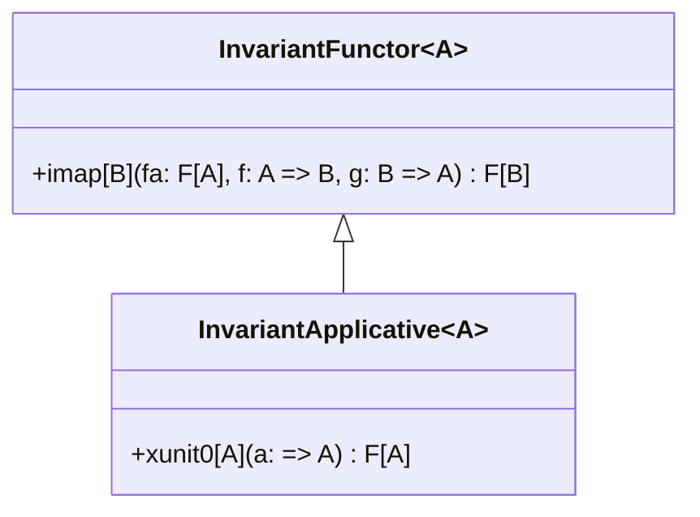

# Invariant Applicative

`InvariantApplicative` (an invariant applicative functor) is a functional abstraction
that generalizes the concept of a container supporting bidirectional transformations
(invariant mappings) and "wrapping" values into a context via unit operations
`xunit0`, `xunit1`, etc.

Unlike an ordinary [Applicative](applicative.md), which requires covariance
(the ability to transform values in one direction),
an invariant applicative functor allows working with types
where transformations may be reversible or require bidirectional mapping.

## Code

```dotty
trait InvariantFunctor[F[_]]:
  extension [A](fa: F[A])
    def imap[B](f: A => B, g: B => A): F[B]

trait InvariantApplicative[F[_]] extends InvariantFunctor[F]:
  def xunit0[A](a: => A): F[A]

  extension [A](fa: => F[A])
    def xunit1[B](f: A => B, g: B => A): F[B] =
      fa.imap(f, g)
```

1. **Basic operations**:
    - `imap` (invariant mapping) — transforms `F[A]` to `F[B]` using a pair of inverse functions
    - `xunit0` — places a value into the minimal context `F` (analogous to `pure` in a regular `Applicative`)

2. **Derived operations**:
    - `xunit1` — a combination of `xunit0` and `imap` for creating a value in a context with transformation

### Laws

1. Identity law for `imap`: `fa.imap(identity, identity) == fa`
2. Composition law for `imap`:
    `fa.imap(f1, g1).imap(f2, g2) == fa.imap(f1 andThen f2, g2 andThen g1)`
3. Unit law for `xunit0`: `xunit0(a).imap(f, g) == xunit0(f(a))`

## When to Use

An Invariant Applicative is useful in the following cases:

1. **Working with bidirectional transformations** (serialization/deserialization)
2. **Types with reversible operations** (isomorphisms, encoding/decoding)
3. **Composing container types** while preserving the ability to reverse transformations
4. **Building DSLs** for bidirectional data transformations

## Schema



---

**References:**

- [Link to exercise repository][sample]
- [Scalaz API](https://javadoc.io/doc/org.scalaz/scalaz-core_3/7.3.6/scalaz/InvariantApplicative.html)

[sample]: https://gitverse.ru/scalabook/typeclasses
