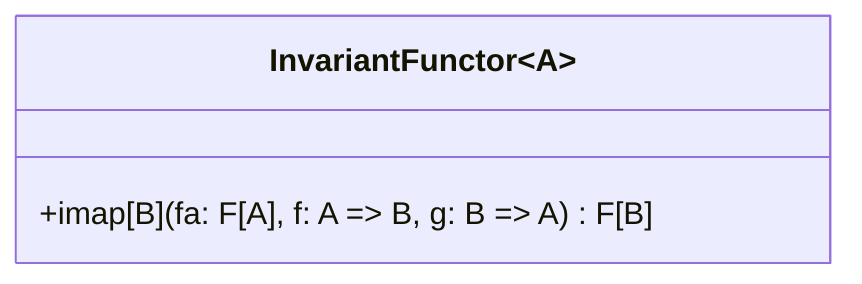

# Invariant Functor

**An invariant functor** is a concept from category theory and functional programming
that generalizes the idea of a functor with additional constraints.
Unlike a [covariant functor](functor.md), which preserves the direction of morphisms (functions),
or a [contravariant functor](contravariant-functor.md), which reverses them,
an invariant functor does not assume preservation or reversal of direction.
Instead, it allows working with types that can be transformed in both directions,
without explicit structure preservation.

**Why is an invariant functor needed?**

Invariant functors are useful in situations where a data type can be transformed
both in one direction and the other, but does not preserve the structure of the original type.
They are often used for working with types that are neither covariant nor contravariant,
but still require some form of functional mapping.

**Examples of invariant functors**

- **A data type representing a codec (encoder/decoder)**:
  Suppose we have a data type that can both encode a value into a string and decode a string back into a value.
  Such a data type can be an invariant functor.
- **A data type representing an isomorphism**:
  An isomorphism is a pair of functions that can transform values between two types in both directions.
- **A data type representing a parser and printer**:
  Some parser and printer libraries use invariant functors to transform between types.

## Formal Definition

An invariant functor supports the `imap` operation (or `xmap`),
which transforms `F[A]` to `F[B]` using two functions: `A => B` and `B => A`.

If a [functor](functor.md)
creates new type class instances by adding a function to the end of the transformation chain,
and a [contravariant functor](contravariant-functor.md)
creates them by adding a function to the beginning of the chain,
then an invariant functor creates new type class instances using a pair of bidirectional transformations.

An invariant functor must satisfy two laws:

- **Identity**: If a method `identity` is defined such that: `identity(a) == a`,
  then `imap(ma)(identity, identity) == ma`.
- **Composition**: `imap(imap(ma, f1, g1), f2, g2) == imap(ma, f2 compose f1, g1 compose g2)`

> Also known as an exponential functor.

## Code

```dotty
trait InvariantFunctor[F[_]]:
  extension [A](fa: F[A])
    def imap[B](f: A => B, g: B => A): F[B]
```

### Laws

- The identity law states that applying an identity transformation to an invariant functor value
  does not change that value. Formally: `inf.imap(fa)(identity, identity) == fa`
- The composition law states that sequentially applying two invariant mappings is equivalent to one mapping
  that is the composition of those two mappings. Formally:
  `inf.imap(inf.imap(fa)(f, fReverse))(g, gReverse) == inf.imap(fa)(g compose f, fReverse compose gReverse)`

## Exercises

### Exercise 2.1.1: Invariant-mapping for an isomorphism

> [Repository with exercises and instructions][sample]

Implement an `InvariantFunctor` instance for the type `Iso[A, C]` (`case class Iso[A, B](to: A => B, from: B => A)`)
with the right type fixed as `C`.
This will allow invariantly transforming the left side of the isomorphism using a pair of functions `f: A => B` and `g: B => A`.

```dotty
given invarFunctor[C]: InvariantFunctor[[x] =>> Iso[x, C]] with
  extension [A](iso: Iso[A, C])
    def imap[B](f: A => B, g: B => A): Iso[B, C] =
      ???
```

@:note(🔍 Show solution)

The solution lies in correctly implementing the `to` and `from` methods for the resulting `Iso[B, C]`.
The `to` method transforms a value of type `B` to `C`: first, using function `g` to transform `B` to `A`,
then using the original `iso.to` to obtain `C`. The `from` method transforms `C` back to `B`:
first, the original `iso.from` transforms `C` to `A`, then function `f` transforms `A` to `B`.
Thus, we preserve the properties of the isomorphism by applying transformation functions on both sides.

```dotty
given invarFunctor[C]: InvariantFunctor[[x] =>> Iso[x, C]] with
  extension [A](iso: Iso[A, C])
    def imap[B](f: A => B, g: B => A): Iso[B, C] =
      Iso(
        to = (b: B) => iso.to(g(b)),
        from = (c: C) => f(iso.from(c))
      )
```

@:@

### Exercise 2.1.2: Invariant-mapping for Codec.

Implement the `InvariantFunctor` instance for type `Codec`
(`case class Codec[A](encode: A => String, decode: String => Either[String, A])`),
which allows transforming an encoder/decoder for one type into an encoder/decoder for another type:

```dotty
given InvariantFunctor[Codec] with
  extension [A](codec: Codec[A])
    def imap[B](f: A => B, g: B => A): Codec[B] =
      ???
```

@:note(🔍 Show solution)

The solution consists of correctly implementing the `encode` and `decode` methods for the resulting `Codec[B]`.
When encoding a value of type `B`, we first transform it to `A` using function `g`,
then use the original `encode` of the original `codec`. When decoding a string we first
decode it to `A`, then transform the result to `B` using function `f`,
applying it to the value inside `Either` via `map`.

```dotty
given InvariantFunctor[Codec] with
  extension [A](codec: Codec[A])
    def imap[B](f: A => B, g: B => A): Codec[B] =
      Codec(
        encode = (b: B) => codec.encode(g(b)),
        decode = (s: String) => codec.decode(s).map(f)
      )
```

@:@

## Invariant Instance for `Semigroup`

Suppose we have a `Semigroup[Long]`,
which represents a standard UNIX timestamp (milliseconds since the epoch).
We want to create a `Semigroup[Date]`, **reusing** the already-existing `Semigroup[Long]`.
It seems like a simple task, but it actually demonstrates a fundamental limitation of [functors](functor.md)
and the need for an **invariant functor**.

### Part 1: `Semigroup` is not a covariant functor

A [covariant functor](functor.md) (`Functor`) allows applying a function `A => B` to a value in context `F[A]`, yielding `F[B]`.
If [`Semigroup`](../monoid/semigroup.md) had a `Functor` instance,
we could use `map` to transform `Semigroup[Long]` into `Semigroup[Date]` using function `longToDate: Long => Date`:

```dotty
import java.util.Date

// Function for transforming Long to Date
def longToDate: Long => Date = new Date(_)
```

Imagine we try to get `Semigroup[Date]` based on `Semigroup[Long]` via `map`. We have:

1. **`Semigroup[Long]`** — knows how to combine two `Long`s (add them).
2. **`longToDate: Long => Date`** — knows how to transform `Long` into `Date`.
3. **Two values of type `Date`** — which we want to combine.

The problem is that `Semigroup[Date]` must be able to combine two `Date` values.
But we only have a way to convert `Long` to `Date`, not the other way around.
How can we combine two `Date` values if our `combine` operation works on `Long`?

Thus, `map` with `longToDate` does not give us `Semigroup[Date]`.
`Functor` allows only transforming the result (output), not the input.

> **`Semigroup` is not a covariant functor**,
> because to combine `Date` values we need the ability
> to convert `Date` back to `Long` before applying the operation.

### Part 2: `Semigroup` is not a contravariant functor

A [contravariant functor](contravariant-functor.md) (`Contravariant`) works in the opposite direction:
it allows applying a function `B => A` to context `F[A]`, yielding `F[B]`.
If `Semigroup` had a `Contravariant` instance,
we could use `contramap` to transform `Semigroup[Long]` into `Semigroup[Date]`
using function `dateToLong: Date => Long`:

```dotty
import java.util.Date

// Function for transforming Date to Long
def dateToLong: Date => Long = _.getTime
```

Now we have a way to transform `Date` into `Long` before combining. Let's see what happens:

```
Step 1: We have two values: d1: Date, d2: Date
Step 2: Transform them to Long: l1 = dateToLong(d1), l2 = dateToLong(d2)
Step 3: Combine Longs: l = combineLong(l1, l2)
Step 4: We obtain a result of type Long: l
Step 5: We need to get Date, but we have no way to convert Long back to Date!
       (we only have dateToLong, not longToDate)
Step 6: Cannot get Date from the result
```

`Contravariant` allows only transforming inputs (before applying), not outputs.
We can get `Long`, but cannot convert it to `Date`.

> **`Semigroup` is not a contravariant functor**, because after combining we get `Long`,
> but we need `Date`, and we have no function to convert back.

### Part 3: `Semigroup` forms an invariant functor

From the previous discussion, we need **both** capabilities:

- **`map`** (from covariant `Functor`) — to transform the result (output).
- **`contramap`** (from contravariant `Contravariant`) — to transform the input.

Let's apply `imap` to our task. We have `Semigroup[Long]`, and we want to obtain `Semigroup[Date]`. We need two functions:

1. **`longToDate: Long => Date`** — to transform the result (covariant part).
2. **`dateToLong: Date => Long`** — to transform inputs (contravariant part).

How `imap` works for `Semigroup`:

```
Input: two values of type Date: d1, d2

1. Apply g (dateToLong) to inputs:
   l1 = dateToLong(d1)
   l2 = dateToLong(d2)

2. Use Semigroup[Long].combine:
   l = combineLong(l1, l2)

3. Apply f (longToDate) to result:
   result = longToDate(l)

Output: value of type Date
```

Thus, we first convert the input `Date` values to `Long` (contravariant part),
then combine them using the existing operation for `Long`,
and finally convert the result back to `Date` (covariant part).

#### Implementation

```dotty
import java.util.Date
import cats.*
import cats.syntax.all.*

// Transformation functions
def longToDate: Long => Date = new Date(_)
def dateToLong: Date => Long = _.getTime

// Create Semigroup[Date] from Semigroup[Long] using imap
given Semigroup[Date] =
  Semigroup[Long].imap(longToDate)(dateToLong)
```

Now we have a full-fledged `Semigroup[Date]` that we can use:

```dotty
val today: Date = longToDate(1449088684104L) // approximately December 2, 2015
val timeLeft: Date = longToDate(1900918893L) // some additional time

// Combine two values using Semigroup[Date]
val combined = today |+| timeLeft
// Result: a Date representing the sum of two timestamps
```

**What is happening here?**

```
1. dateToLong(today) → 1449088684104L
2. dateToLong(timeLeft) → 1900918893L
3. Semigroup[Long].combine(1449088684104L, 1900918893L) → 1450989602997L
4. longToDate(1450989602997L) → a Date representing the new timestamp
```

### Bijection

**In practice, `imap` for `Semigroup` is used to create new `Semigroup` instances based on existing ones,
when there is a bijection (one-to-one correspondence) between types.**
For example, if you have `Semigroup[Long]` and you want to obtain `Semigroup[Date]`,
knowing that `UUID` can be converted to a string and back.

### Exercise 2.1.3: Implement Invariant Functor for Monoid

Fill in the blanks (`???`) in the `map` method implementation so that it correctly transforms a monoid from type `A` to type `B`.

```dotty
given InvariantFunctor[Monoid] with
  extension [A](fa: Monoid[A])
    def imap[B](f: A => B, g: B => A): Monoid[B] =
      ???
```

@:note(🔍 Show solution)

The neutral element `empty` for type `B` is obtained by transforming the neutral element of the original monoid
from type `A` to type `B` using function `f`.

The `combine` operation for type `B` works as follows:
first, both input values are transformed from `B` to `A` using function `g`,
then the original `combine` operation is applied for type `A`,
and finally the result is transformed back to `B` using function `f`.
Thus, we preserve the semantics of the original monoid, adapting it to the new type.

```dotty
given InvariantFunctor[Monoid] with
  extension [A](fa: Monoid[A])
    def imap[B](f: A => B, g: B => A): Monoid[B] =
      new Monoid[B]:
        val empty: B = f(fa.empty)

        def combine(x: B, y: B): B = f(fa.combine(g(x), g(y)))
```

@:@

## Schema



---

**References:**

- [Link to the repository with exercises][sample]
- [Cats](https://typelevel.org/cats/typeclasses/invariant.html)
- [Scala with Cats](https://scalawithcats.com/dist/scala-with-cats.html#sec:functors:invariant)
- [Scalaz API](https://javadoc.io/static/org.scalaz/scalaz-core_3/7.3.6/scalaz/InvariantFunctor.html)

[sample]: https://gitverse.ru/scalabook/typeclasses
