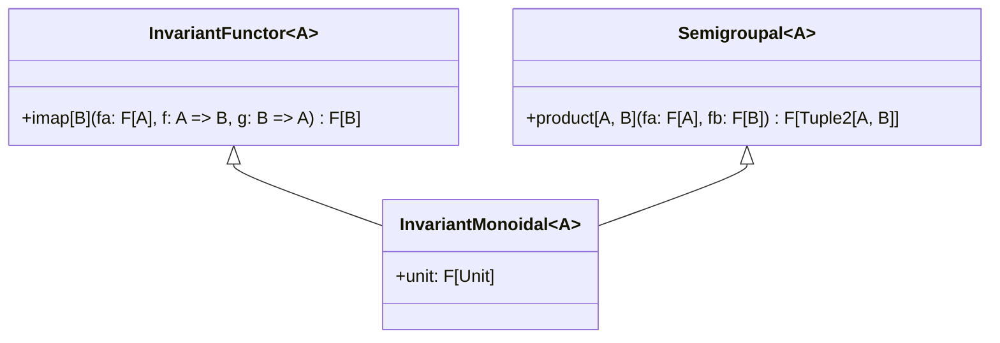

# Invariant Monoidal

## Invariant Monoid

`InvariantMonoidal` is a type class that combines the capabilities of [`InvariantFunctor`](invariant-functor.md) 
(an invariant functor) and [`Semigroupal`](semigroupal.md) (a semigroup combinator), adding a `unit` method. 
In isolation, this type class can be defined as follows:

```dotty
trait InvariantSemigroupal[F[_]] extends Semigroupal[F] with InvariantFunctor[F]

trait InvariantMonoidal[F[_]] extends InvariantSemigroupal[F]:
  def unit: F[Unit]
  
  /** `point` lifts any value into a Monoidal Functor. */
  def point[A](a: A): F[A] = unit.imap(_ => a, _ => ())
```

`InvariantMonoidal` allows working with types that:

1. **Can be transformed** via `imap` (invariant mapping).
2. **Can be combined** via `product` (combining two values into a pair).
3. **Have a neutral element** `unit` (unit value).

Practical use of `InvariantMonoidal` arises in the context of **codecs** — interfaces that 
simultaneously capture serialization and deserialization for some format. 
Another well-known example is [`Semigroup`](../monoid/semigroup.md).

## `Semigroup` as `InvariantMonoidal`

### `Semigroup` is an invariant functor

As explained in the [`InvariantFunctor` guide](invariant-functor.md), `Semigroup` forms an invariant functor. 
Indeed, given a `Semigroup[A]` and two functions `A => B` and `B => A`, we can construct a `Semigroup[B]` as follows:

1. Transform two values of type `B` into type `A` using `g: B => A`.
2. Combine them using `Semigroup[A].combine`.
3. Transform the result back into type `B` using `f: A => B`.

### Implementing `unit` and `product` for `Semigroup`

To define `InvariantMonoidal[Semigroup]`, we need implementations of `unit` and `product`.

**`unit: Semigroup[Unit]`** — a trivial monoid for the `Unit` type:

```dotty
def unit: Semigroup[Unit] = (_, _) => ()
```

The `combine` operation for `Unit` always returns `()`, since that is the only value of this type.

**`product: Semigroup[(A, B)]`** — combines two semigroups for types `A` and `B` into one semigroup for the pair `(A, B)`:

```dotty
def product[A, B](fa: Semigroup[A], fb: Semigroup[B]): Semigroup[(A, B)] =
  case ((xa, xb), (ya, yb)) => fa.combine(xa, ya) -> fb.combine(xb, yb)
```

Logic:

1. Destructure two pairs into components: `(xa, xb)` and `(ya, yb)`.
2. Combine the first components using `fa.combine(xa, ya)`.
3. Combine the second components using `fb.combine(xb, yb)`.
4. Assemble the results into a new pair.

### Practical example: creating a `Semigroup` for a case class

Given an `InvariantMonoidal` instance for `Semigroup`, 
we can combine existing `Semigroup` instances to create a new one using `Semigroupal` syntax:

```dotty
import cats.syntax.all.*

// Define a case class
case class Foo(a: String, c: List[Double])

// Create a Semigroup for Foo by combining Semigroup[String] and Semigroup[List[Double]]
given Semigroup[Foo] =
  (summon[Semigroup[String]], summon[Semigroup[List[Double]]])
    .imapN(Foo.apply)(foo => (foo.a, foo.c))
```

**What is happening here?**

1. `(summon[Semigroup[String]], summon[Semigroup[List[Double]]])` — creates a tuple of two semigroups.
2. `.imapN(Foo.apply)(foo => (foo.a, foo.c))` — uses `InvariantMonoidal` to:
    - Transform a pair of values `(String, List[Double])` into `Foo` using the constructor `Foo.apply`.
    - Transform `Foo` back into a pair via `foo => (foo.a, foo.c)`.

**Verification:**

```dotty
Foo("Hello", List(0.0)) |+| Foo("World", Nil) |+| Foo("!", List(1.1, 2.2))
// Result: Foo("HelloWorld!", List(0.0, 1.1, 2.2))
```

Strings are concatenated and lists are combined — exactly as their respective semigroups work.

## `CsvCodec` as `InvariantMonoidal`

### Defining `CsvCodec`

We define `CsvCodec` — a type class for serializing and deserializing CSV strings:

```dotty
type CSV = List[String]

trait CsvCodec[A]:
  def read(s: CSV): (Option[A], CSV)
  def write(a: A): CSV
```

- **`read`** — consumes columns from a CSV string, returning an optional value and the remaining CSV (unread columns).
- **`write`** — creates a CSV representation for a given value.

### Law for `CsvCodec`

Grouping serialization and deserialization in a single type class allows defining a law that guarantees consistency of operations:

```dotty
forAll { (c: CsvCodec[A], a: A) => c.read(c.write(a)) == ((Some(a), List()))
```

This law states that if we serialize a value `a` and then deserialize the resulting CSV, 
we should obtain the original value `a`.

### Implementing `InvariantMonoidal` for `CsvCodec`

Now let's see how to define an `InvariantMonoidal` instance for `CsvCodec`.

#### `unit` — a trivial codec for `Unit`

We lift the unit value into a codec in a trivial way: we consume nothing from CSV and always return `()`, 
and upon writing we return an empty CSV:

```dotty
def unit: CsvCodec[Unit] = new CsvCodec[Unit]:
  def read(s: CSV): (Option[Unit], CSV) = (Some(()), s)
  def write(u: Unit): CSV               = List.empty
```

#### `product` — combining two codecs

We combine two codecs for types `A` and `B` into one codec for the pair `(A, B)`:

```dotty
def product[A, B](fa: CsvCodec[A], fb: CsvCodec[B]): CsvCodec[(A, B)] =
  new CsvCodec[(A, B)]:
    def read(s: CSV): (Option[(A, B)], CSV) =
      // First read A
      val (maybeA, s1) = fa.read(s)
      // Then read B from the remainder
      val (maybeB, s2) = fb.read(s1)
      // If both reads succeed — combine into a pair
      val maybePair =
        for
          a <- maybeA
          b <- maybeB
        yield a -> b

      (maybePair, s2)

    def write(a: (A, B)): CSV =
      fa.write(a._1) ++ fb.write(a._2)
```

Logic:

- **Reading:** sequentially read `A`, then `B`. If both succeed — return `Some((a, b))`, otherwise `None`.
- **Writing:** write `A`, then `B` and concatenate the results.

#### `imap` — invariant transformation

Transform `CsvCodec[A]` into `CsvCodec[B]` using two functions:

```dotty
extension [A](fa: CsvCodec[A])
  def imap[B](f: A => B, g: B => A): CsvCodec[B] =
    new CsvCodec[B]:
      def read(s: CSV): (Option[B], CSV) =
        val (a1, s1) = fa.read(s)
        (a1.map(f), s1) // Transform the result after deserialization

      def write(a: B): CSV =
        fa.write(g(a)) // Transform the input data before serialization
```

#### Putting it all together

```dotty
given InvariantMonoidal[CsvCodec] with
  def unit: CsvCodec[Unit] = ...

  def product[A, B](fa: CsvCodec[A], fb: CsvCodec[B]): CsvCodec[(A, B)] =
    ...

  extension [A](fa: CsvCodec[A])
    def imap[B](f: A => B, g: B => A): CsvCodec[B] =
      ...
```

### Practical example: using `CsvCodec`

Define several basic codecs:

**Codec for `String`:**

```dotty
val stringCodec: CsvCodec[String] =
  new CsvCodec[String]:
    def read(s: CSV): (Option[String], CSV) = (s.headOption, s.drop(1))

    def write(a: String): CSV = List(a)
```

**Codec for numbers in different numeral systems:**

```dotty
def numericSystemCodec(base: Int): CsvCodec[Int] =
  new CsvCodec[Int]:
    def read(s: CSV): (Option[Int], CSV) =
      (
        s.headOption.flatMap: head =>
          scala.util.Try(Integer.parseInt(head, base)).toOption,
        s.drop(1)
      )

    def write(a: Int): CSV =
      List(Integer.toString(a, base))
```

**Combining codecs for case classes:**

```dotty
case class BinDec(binary: Int, decimal: Int)

val binDecCodec: CsvCodec[BinDec] = (
  (numericSystemCodec(2), numericSystemCodec(10))
    .imapN(BinDec.apply)(bindec => (bindec.binary, bindec.decimal))
)

case class Foo(name: String, bd1: BinDec, bd2: BinDec)

val fooCodec: CsvCodec[Foo] = (
  (stringCodec, binDecCodec, binDecCodec)
    .imapN(Foo.apply)(foo => (foo.name, foo.bd1, foo.bd2))
)
```

**Verifying the law:**

```dotty
val foo = Foo("foo", BinDec(10, 10), BinDec(20, 20))

val fooCsv = fooCodec.write(foo)
// Result: List("foo", "1010", "10", "10100", "20")

fooCodec.read(fooCsv)
// Result: (Some(Foo("foo", BinDec(10, 10), BinDec(20, 20))), List())

fooCodec.read(fooCodec.write(foo)) == ((Some(foo), List()))
// true
```

## `InvariantMonoidal` as a generalization of `InvariantFunctor`

To better understand the motivation for creating `InvariantMonoidal`, let us show how we can naturally arrive at its definition 
by generalizing the concept of an invariant functor. 
This reasoning is analogous to what is presented in the paper 
[Free Applicative Functors by Paolo Capriotti](http://www.paolocapriotti.com/assets/applicative.pdf), 
where it is shown how [`Applicative`](applicative.md) is a generalization of [`Functor`](functor.md).

### The Problem: `InvariantFunctor` Works Only with Unary Functions

Given an instance `InvariantFunctor[F]` for some context `F[_]`, 
the `imap` method allows lifting two _unary_ pure functions `A => B` and `B => A` into _contextualized_ functions `F[A] => F[B]`.

But what about functions of other arities?

### Generalization: `MultiInvariant`

A value `a` of type `A` can be regarded as a pair of nullary functions:

- One takes no input and returns `a`.
- The other takes `a` and returns nothing.

We want to lift them into a contextualized `F[A]`.

Similarly, given two functions `(A, B) => C` and `C => (A, B)`, we want to contextualize them as functions of type `(F[A], F[B]) => F[C]`.

An `InvariantFunctor` instance by itself does not provide any of these lifts. 
Therefore it is natural to define a type class for generalizing `InvariantFunctor` to functions of arbitrary arity:

```dotty
trait MultiInvariant[F[_]]:
  def imap0[A](a: A): F[A]
  def imap1[A, B](f: A => B)(g: B => A)(fa: F[A]): F[B]
  def imap2[A, B, C](f: ((A, B)) => C)(g: C => (A, B))(fa: F[A], fb: F[B]): F[C]
```

### Defining `imapN` via `imap2`

Higher arities `imapN` can be defined through `imap2`. For example, for `N = 3`:

```dotty
trait MultiInvariantImap3[F[_]] extends MultiInvariant[F]:
  def imap3[A, B, C, D](
      f: ((A, B, C)) => D,
      g: D => (A, B, C),
      fa: F[A],
      fb: F[B],
      fc: F[C]
  ): F[D] = (
    imap2[A, (B, C), D](f compose { case (a, (b, c)) => (a, b, c) })(g andThen {
      case (a, b, c) => (a, (b, c))
    })(fa, imap2[B, C, (B, C)](identity)(identity)(fb, fc))
  )
```

### Equivalence of `MultiInvariant` and `InvariantMonoidal`

We can observe that `MultiInvariant` is nothing other than an alternative formulation of `InvariantMonoidal`. 

Indeed:

```dotty
trait MultiInvariant[F[_]]:
  def imap0[A](a: A): F[A]
  def imap1[A, B](f: A => B)(g: B => A)(fa: F[A]): F[B]
  def imap2[A, B, C](f: ((A, B)) => C)(g: C => (A, B))(fa: F[A], fb: F[B]): F[C]
  
trait InvariantMonoidal[F[_]] extends InvariantSemigroupal[F]:
  def unit: F[Unit]  
  
  extension [A](fa: F[A])
    def imap[B](f: A => B, g: B => A): F[B]

  def product[A, B](fa: F[A], fb: F[B]): F[(A, B)]
```  
  
- `imap1` and `imap` differ only in argument order.
- `imap2` can be easily defined via `imap` and `product`:

```dotty
trait Imap2FromImapProduct[F[_]] extends InvariantMonoidal[F]:
  def imap2[A, B, C](f: ((A, B)) => C)(g: C => (A, B))(
      fa: F[A],
      fb: F[B]
  ): F[C] =
    product(fa, fb).imap(f, g)
```

In summary:

```dotty
trait MultiInvariantViaInvariantMonoidal[F[_]] extends InvariantMonoidal[F]:
  def imap0[A](a: A): F[A] =
    unit.imap(_ => a, _ => ())

  def imap1[A, B](f: A => B)(g: B => A)(fa: F[A]): F[B] =
    fa.imap(f, g)

  def imap2[A, B, C](f: ((A, B)) => C)(g: C => (A, B))(
      fa: F[A],
      fb: F[B]
  ): F[C] =
    product(fa, fb).imap(f, g)
```

### Conclusion

`InvariantMonoidal` naturally arises as a generalization of `InvariantFunctor` to functions of arbitrary arity. 
This allows working with:

- **Nullary functions** (constants) via `unit`.
- **Unary functions** via `imap`.
- **Binary functions** via `product` + `imap`.
- **Functions of arbitrary arity** via combination of `product` and `imap` (`imapN` syntax).

## Diagram



---

**References:**

- [Link to the exercises repository][sample]
- [Cats](https://typelevel.org/cats/typeclasses/invariantmonoidal.html)

[sample]: https://gitverse.ru/scalabook/typeclasses
