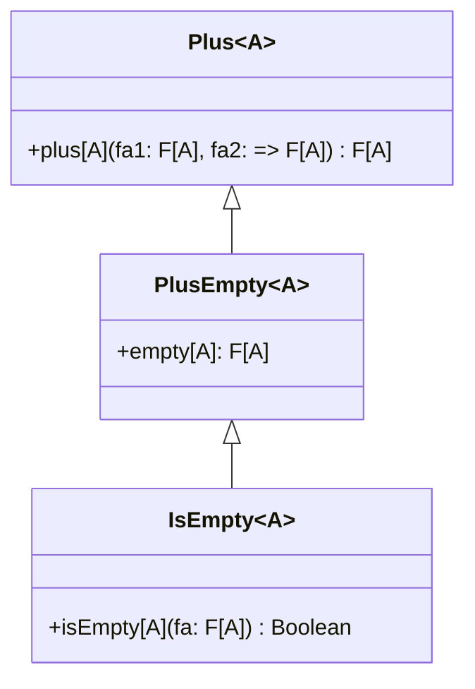

# IsEmpty

`IsEmpty` is a concept from functional programming that extends [`PlusEmpty`](plus-empty.md),
adding an emptiness-checking operation.
It allows determining whether a value within a certain context is "empty"
(e.g., absence of a value, an empty list, a failed computation, etc.).

**Main characteristics of `IsEmpty`:**

- **Checking for "empty"**:
  The `isEmpty` operation returns `true` if a value is "empty" and `false` otherwise.
- **Relationship to the "empty" value**:
  An "empty" value (`empty[A]`) must always be recognized by the `isEmpty` operation as "empty".
- **Relationship to the combining operation**:
  The result of combining two values via `plus` (or `<+>`) is "empty" only if
  both original values were "empty".

**Examples of `IsEmpty`**

- **Lists (`List`)**.
  Imagine you have a list of numbers. The `isEmpty` operation allows checking whether the list is empty.
  For example, for the list `[1, 2, 3]` the result is `false`, and for an empty list `[]` it is `true`.
- **Parsers**.
  Imagine you have a parser that parses input data. The `isEmpty` operation allows checking whether
  the parser returned an error (which can be considered an "empty" result).
- **Validators**.
  Imagine you have a validator that checks data correctness.
  The `isEmpty` operation allows checking whether the validator returned an error (which can be considered an "empty" result).

## Formal Definition

`IsEmpty` is a type class that allows checking whether a type with an empty representation is truly empty.
Extends [`PlusEmpty`](plus-empty.md).

The laws of `isEmpty` (besides the parent laws) describe how the emptiness-checking operation should behave:

- **An "empty" value must always be recognized as "empty"**:
  `isEmpty(empty[A]) = true`.
  In other words, if you check whether the value `empty[A]` is "empty", the result should be `true`.
- **The result of combining two values is "empty" only when both values are "empty"**:
  `isEmpty(fa1) && isEmpty(fa2) == isEmpty(plus(fa1, fa2))`.
  `isEmpty` over a composition of two functors is `true` if and only if `isEmpty` of each functor is `true`:
  In other words, if you combine two values using `plus`,
  the result will be "empty" only when both values were "empty".

## Code

```dotty
trait IsEmpty[F[_]] extends PlusEmpty[F]:
  def isEmpty[A](fa: F[A]): Boolean
```

### Laws

- **An "empty" value must always be recognized as "empty"**: `isEmpty(empty[A]) = true`.
- **The result of combining two values is "empty" only when both values are "empty"**:
  `isEmpty(fa1) && isEmpty(fa2) == isEmpty(plus(fa1, fa2))`.

### Example with List

```dotty
given IsEmpty[List] with
  override def isEmpty[A](fa: List[A]): Boolean = fa.isEmpty
  override def plus[A](fa1: List[A], fa2: => List[A]): List[A] = fa1 ++ fa2
  override def empty[A]: List[A] = List.empty[A]
```

## Schema



## Library Implementations

### Implementation in ScalaZ

```dotty
import scalaz.*
import Scalaz.*

// ... All parent operations

summon[IsEmpty[List]].isEmpty(List.empty[Int]) // true
```

---

**References:**
