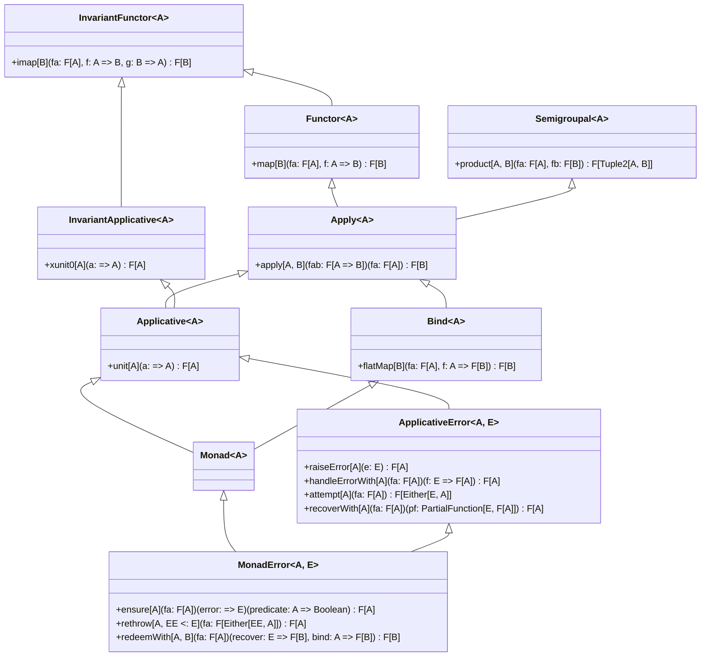

# MonadError

`MonadError` is a type class that combines the capabilities of [`Monad`](monad.md) and [`ApplicativeError`](applicative-error.md),
adding monadic operations to an error context.
If `ApplicativeError` allows creating and handling errors,
then `MonadError` adds the ability to sequentially chain computations (`flatMap`) with error awareness.

`MonadError` is the foundation for effect systems that support error handling: `IO`, `Task`, `ZIO`, `EitherT`, and others.
It is one of the most practical abstractions in functional programming.

**Type Parameters**

- **`F[_]`** — the context type (e.g., `IO`, `Either[E, *]`, `Try`, `Future`)
- **`E`** — the error type (e.g., `Throwable`, `String`, a custom type)

## Formal Definition

`MonadError` combines `Monad` and `ApplicativeError` without adding new primitives, but provides powerful derived combinators:

```dotty
trait MonadError[F[_], E] extends ApplicativeError[F, E] with Monad[F]:
  def ensure[A](fa: F[A])(error: => E)(predicate: A => Boolean): F[A]

  def rethrow[A, EE <: E](fa: F[Either[EE, A]]): F[A]

  def redeemWith[A, B](fa: F[A])(recover: E => F[B], bind: A => F[B]): F[B]
```

## Derived Combinators

### `ensure` — conditional check with error

```dotty
def ensure[A](fa: F[A])(error: => E)(predicate: A => Boolean): F[A] =
  flatMap(fa)(a => if predicate(a) then unit(a) else raiseError(error))
```

Checks the successful result of computation `fa` against a predicate.
If the predicate holds, the result remains unchanged. If not, the computation is replaced with the error `error`.

**Use-case:** Validating data after a database or API request.

### `rethrow` — lifting the error level

```dotty
def rethrow[A, EE <: E](fa: F[Either[EE, A]]): F[A] =
  flatMap(fa)(_.fold(raiseError, unit))
```

Converts `F[Either[EE, A]]` to `F[A]`.
If the inside is `Right(a)`, it returns `unit(a)`. If inside is `Left(e)`, it returns `raiseError(e)`.

**Use-case:** When you have an effect that returns an `Either` (e.g., a parsing result),
and you want to convert parsing errors into effect errors.

### `redeemWith` — universal handling of success and error

```dotty
def redeemWith[A, B](fa: F[A])(recover: E => F[B], bind: A => F[B]): F[B] =
  flatMap(attempt(fa))(_.fold(recover, bind))
```

Allows handling both a successful result and an error, transforming them into a new computation `F[B]`.
Unlike `handleErrorWith`, here you can also transform the successful value.

**Use-case:** Error transformation, logging, fallback values, complex handling of both execution paths.

## MonadError Laws

`MonadError` inherits the laws of [`Monad`](monad.md) and [`ApplicativeError`](applicative-error.md) and adds laws for its own combinators.

### Laws of `ensure`

```dotty
ensure(unit(a))(error)(predicate) == if predicate(a) then unit(a) else raiseError(error)
```

**In plain words:** `ensure` on a clean value either leaves it unchanged or replaces it with an error.

### Laws of `rethrow`

```dotty
rethrow(unit(Right(a))) == unit(a)
rethrow(unit(Left(e))) == raiseError(e)
rethrow(raiseError(e)) == raiseError(e)
```

**In plain words:** `rethrow` correctly converts `Right` to success, `Left` to error, and passes through outer-level errors.

### Laws of `redeemWith`

```dotty
redeemWith(unit(a))(recover, bind) == bind(a)
redeemWith(raiseError(e))(recover, bind) == recover(e)
```

**In plain words:** For success, `bind` is applied; for error, `recover` is applied.

## Schema



## Implementation in Libraries

### Cats

```dotty
import cats.MonadError
import cats.effect.IO
import cats.implicits.*

val me = MonadError[IO, Throwable]

val success = me.pure(42)
val failure = me.raiseError[Int](new IllegalArgumentException("boom"))

val ensured =
  me.ensure(success)(new IllegalArgumentException("Must be positive"))(_ > 0)
val rethrown = me.rethrow[Int, IllegalArgumentException](IO(Right(42)))
val redeemed = me.redeemWith(success)(
  recover = e => me.pure(0),
  bind = a => me.pure(a * 2)
)
```

---

**References:**

- [Link to the repository with exercises][sample]
- [Cats](https://typelevel.org/cats/typeclasses/applicativemonaderror.html)

[sample]: https://gitverse.ru/scalabook/typeclasses
