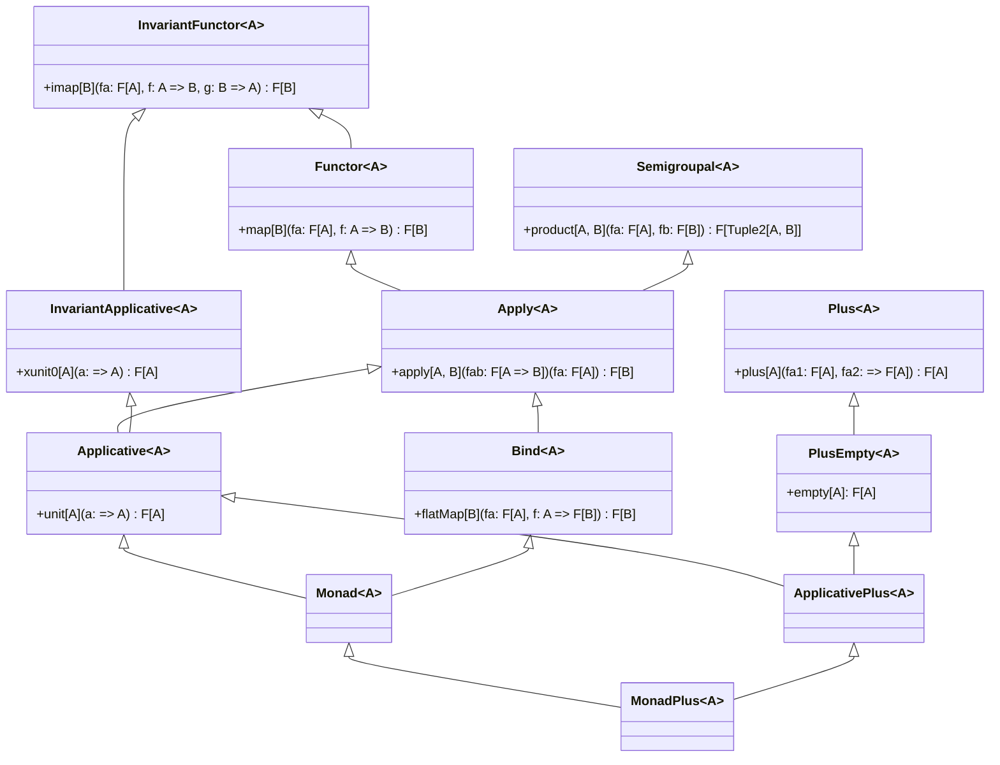

# MonadPlus

`MonadPlus` is an extension of the concept of a [monad](monad.md) in functional programming
that adds two key operations:

- **`empty`** — an identity element (or "empty" value) for the combining operation.
- **`plus`** (`combine` or `<+>`) — an operation that allows combining two values within one context.

`MonadPlus` combines the capabilities of [monads](monad.md) (sequential computations with a context)
and [monoids](../monoid/monoid.md) (a combining operation with an identity element).
This makes it a powerful tool for working with computations that may "fail through" or return multiple results.

**Main characteristics of `MonadPlus`:**

- **Monad computations**:
  Like an ordinary monad, `MonadPlus` allows sequentially executing computations,
  preserving the context (e.g., error handling, asynchrony, state).
- **Combining values**:
  The `plus` operation (`combine` or `<+>`) allows combining two values within one context.
  For example, two lists can be combined into one, or two `Option` values can be combined by selecting the first existing value.
- **Empty value**:
  `empty` represents an identity element for the combining operation.
  For example, for lists this is an empty list `[]`, for `Option` it is `None`.

`MonadPlus` is used in functional programming for:

- **Handling possible absence of values** (e.g., `Option`, `Either`).
- **Combining collections of values** (e.g., lists, sets).
- **Aggregating computation results** (e.g., in parsers or validators).
- **Working with identity elements** in various contexts.

**Examples of `MonadPlus`**

- **Lists (`List`)**.
  Imagine you have two lists: `[1, 2, 3]` and `[4, 5, 6]`.
  `MonadPlus` allows combining them into one list: `[1, 2, 3, 4, 5, 6]`.
  You can also work with an empty list `[]`, which is an identity element.
  For example, combining any list with an empty list leaves the list unchanged.
- **`Option` (optional absence of value)**.
  Imagine you have two values of type `Option`: `Some(42)` and `None`.
  `MonadPlus` allows selecting the first existing value. For example, `Some(42) <+> None` will return `Some(42)`.
  The empty value here is `None`, which does not change the result when combining.
- **Parsers**.
  Imagine you have two parsers: one parses numbers, the other parses strings.
  `MonadPlus` allows combining the results of these parsers.
  For example, if the first parser fails to parse the input, the second parser will try.
  The empty value here is a parser that always returns an error.
- **Validators**.
  Imagine you have two validators: one checks that a string is non-empty, the other checks that a string contains only letters.
  `MonadPlus` allows combining validation results.
  For example, if the first validator returns an error, the second validator will still be executed, and all errors will be collected together.
  The empty value here is a validator that always returns a successful result.

## Formal Definition

The `MonadPlus` type class is designed for [monads](monad.md)
that can also act as [monoids](../monoid/monoid.md).

`MonadPlus` must satisfy the laws of monads and monoids, as well as:

- **Neutral element preservation under `map`**: `empty[A].map(_ => fa) == empty[A]`.
  This law states that applying a function to an "empty" value (`empty[A]`) via `map` does not change it.
  No matter which function you apply to `empty[A]`, the result will always remain `empty[A]`.
- **Neutral element preservation under `flatMap`**: `empty[A].flatMap(_ => fa) == empty[A]`.
  This law states that applying a function to an "empty" value (`empty[A]`) via `flatMap` also does not change it.
  No matter what function you pass to `flatMap`, the result will always remain `empty[A]`.
- **Neutral element closure law**: `fa.flatMap(_ => empty[A]) == empty[A]`.
  This law states that if `empty[A]` is encountered in a chain of computations, the entire computation tree "collapses" into `empty[A]`.
  In other words, if you call `flatMap` on a value `fa` and pass a function that returns `empty[A]`,
  then the result of the entire expression will be `empty[A]`.

These `MonadPlus` laws describe how an "empty" value (`empty[A]`) should behave within the context of monadic computations.
They guarantee that:

- `empty[A]` remains unchanged when functions are applied via `map`.
- `empty[A]` remains unchanged when functions are applied via `flatMap`.
- If `empty[A]` is encountered in a chain of computations, the entire computation tree "collapses" into `empty[A]`.

## Code

```dotty
trait MonadPlus[F[_]] extends Monad[F], ApplicativePlus[F]:
  def filter[A](fa: F[A])(f: A => Boolean): F[A] =
    fa.flatMap(a => if f(a) then unit(a) else empty[A])

  def unite[T[_], A](value: F[T[A]])(using T: Foldable[T]): F[A] =
    value.flatMap(ta => T.foldMap(ta)(a => unit(a))(using monoid[A]))
```

`MonadPlus` allows defining a `filter` operation that filters monad elements by a predicate.

It also defines the `unite` operation, allowing "collapsing" `F[T[A]]` given a [Foldable](foldable.md).
For example, a list `List(Some(785727510), Some(0), Some(1), None, None, Some(1))` "collapses" to
`List(785727510, 0, 1, 1)`.

### Laws

- Neutral element preservation under `map`: `empty[A].map(_ => fa) == empty[A]`.
- Neutral element preservation under `flatMap`: `empty[A].flatMap(_ => fa) == empty[A]`.
- Neutral element closure law: `fa.flatMap(_ => empty[A]) == empty[A]`.

## Exercises

### Exercise 2.8.1: Implement MonadPlus for the List type

> [Repository with exercises and instructions][sample]

Implement a `MonadPlus` instance for the `List` type:

```dotty
given MonadPlus[List] with
  override def unit[A](a: => A): List[A] = ???

  extension [A](fa: List[A])
    override def flatMap[B](f: A => List[B]): List[B] = ???

  override def plus[A](fa1: List[A], fa2: => List[A]): List[A] = ???

  override def empty[A]: List[A] = ???
```

**Examples:**

```dotty
import MonadPlus.given

// Basic operations
empty[Int]                   // List()
plus(List(1, 2), List(3, 4)) // List(1, 2, 3, 4)

// plus with empty
plus(empty[Int], List(1, 2)) // List(1, 2)
plus(List(1, 2), empty[Int]) // List(1, 2)
```

@:note(🔍 Show solution)

For `List`, the implementation of `MonadPlus` is natural and intuitive. `unit` creates a single-element list `List(a)`.
`flatMap` recursively applies the function to each element and concatenates the results (as in previous exercises).
`plus` is simply concatenation of lists via the `++` operator.
`empty` is an empty list `List.empty[A]`.
These operations satisfy all `MonadPlus` laws: concatenation is associative, an empty list is an identity element,
and `empty.flatMap(f)` yields `empty` (since there are no elements in an empty list to which `f` can be applied).
This implementation makes `List` a monad with support for alternatives and backtracking,
which is useful for parsing, solution search, and nondeterministic algorithms.

```dotty
given MonadPlus[List] with
  override def unit[A](a: => A): List[A] =
    List(a)

  extension [A](fa: List[A])
    override def flatMap[B](f: A => List[B]): List[B] =
      fa match
        case h :: t => f(h) ++ this.flatMap(t)(f)
        case Nil    => Nil

  override def plus[A](fa1: List[A], fa2: => List[A]): List[A] = fa1 ++ fa2

  override def empty[A]: List[A] = List.empty[A]    
```

@:@

## Schema



## Implementation in Libraries

### Implementation in ScalaZ

```dotty
import scalaz.*
import Scalaz.*

// ... All parent operations

List(1, 2, 3) filter {_ > 2}                     // List(3)
(1 |-> 50) filter { x => x.shows contains '7' }  // [7,17,27,37,47]
```

---

**References:**

- [Link to the repository with exercises][sample]
- [Learning Scalaz](http://eed3si9n.com/learning-scalaz/MonadPlus.html)
- [Scalaz API](https://javadoc.io/doc/org.scalaz/scalaz-core_3/7.3.6/scalaz/MonadPlus.html)

[sample]: https://gitverse.ru/scalabook/typeclasses
